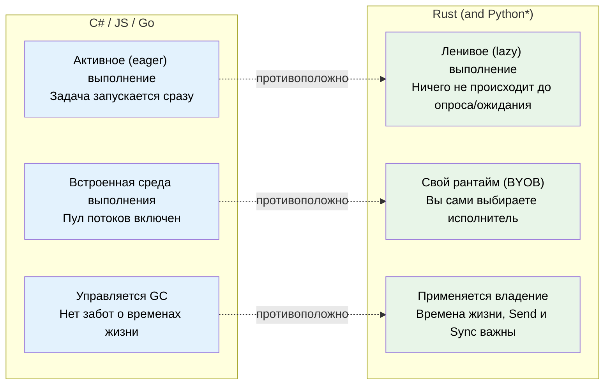
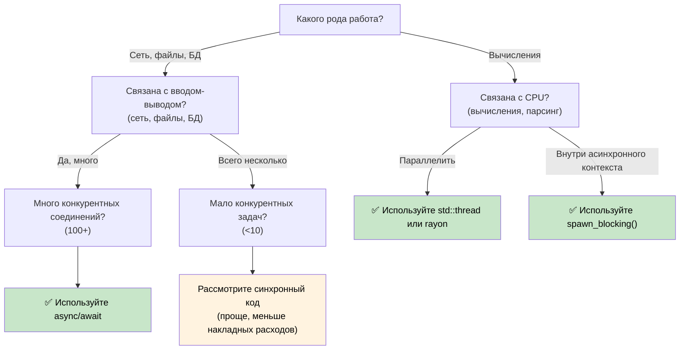

# 1. Почему асинхронность в Rust устроена иначе 🟢

> **Чему вы научитесь:**
> - Почему в Rust нет встроенной асинхронной среды выполнения (и что это означает для вас)
> - Три ключевых свойства: ленивое выполнение, отсутствие встроенного рантайма, абстракции с нулевой стоимостью
> - Когда асинхронность — это подходящий инструмент (а когда она может быть медленнее)
> - Сравнение модели Rust с C#, Go, Python и JavaScript

## Фундаментальное отличие

Большинство языков программирования с поддержкой `async/await` скрывают внутренние механизмы под капотом. В C# есть пул потоков CLR. В JavaScript — цикл событий (event loop). В Go — горутины и планировщик, встроенный в среду выполнения. В Python — библиотека `asyncio`.

**В Rust нет ничего из этого.**

Здесь нет встроенной среды выполнения, пула потоков и цикла событий. Ключевое слово `async` — это компиляционная стратегия с нулевой стоимостью: оно преобразует вашу функцию в конечный автомат, реализующий трейт `Future`. Кто-то другой (исполнитель или *executor*) должен продвигать этот конечный автомат вперед.

### Три ключевых свойства асинхронного Rust



> \* Сопрограммы (coroutines) в Python ленивы так же, как и фьючеры в Rust — они не выполняются, пока их не ожидают (await) или не запланируют. Однако Python по-прежнему использует сборщик мусора (GC), поэтому там нет проблем с владением и временами жизни.

### Отсутствие встроенного рантайма

```rust
// Это компилируется, но ничего НЕ ДЕЛАЕТ:
async fn fetch_data() -> String {
    "hello".to_string()
}

fn main() {
    let future = fetch_data(); // Создает Future, но не выполняет его
    // future — это просто структура, лежащая в стеке
    // Нет вывода, нет побочных эффектов, ничего не происходит
    drop(future); // Молча удаляется — работа так и не была начата
}
```

Сравните с C#, где `Task` запускается активно:
```csharp
// C# — это немедленно начинает выполняться:
async Task<string> FetchData() => "hello";

var task = FetchData(); // Уже запущено!
var result = await task; // Просто ждет завершения
```

### Ленивые Futures по сравнению с активными Tasks

Это самый важный сдвиг в мышлении:

| | C# / JavaScript | Python | Go | Rust |
|---|---|---|---|---|
| **Создание** | `Task` начинает выполняться немедленно | Корутина **ленива** — возвращает объект, не запускается до await или планирования | Горутина запускается немедленно | `Future` ничего не делает до опроса (poll) |
| **Сброс (Drop)** | Отделенная задача продолжает выполняться | Корутина без await собирается мусором (с предупреждением) | Горутина выполняется до возврата | Сброс (drop) `Future` отменяет его выполнение |
| **Среда выполнения** | Встроена в язык / VM | Event loop из `asyncio` (нужно запускать явно) | Встроена в бинарник (планировщик M:N) | Вы выбираете сами (tokio, smol и т.д.) |
| **Планирование** | Автоматическое (пул потоков) | Event loop + `await` или `create_task()` | Автоматическое (GMP-планировщик) | Явное (`spawn`, `block_on`) |
| **Отмена** | `CancellationToken` (кооперативная) | `Task.cancel()` (кооперативная, бросает `CancelledError`) | `context.Context` (кооперативная) | Сброс (drop) future (немедленная) |

```rust
// Чтобы действительно ЗАПУСТИТЬ future, вам нужен исполнитель:
#[tokio::main]
async fn main() {
    let result = fetch_data().await; // ТЕПЕРЬ оно выполняется
    println!("{result}");
}
```

### Когда стоит использовать асинхронность (а когда нет)



**Золотое правило**: Асинхронность создана для конкурентности по вводу-выводу (выполнение множества операций во время ожидания), а не для параллелизма CPU (ускорение одного процесса за счет ядер процессора). Если у вас 10 000 сетевых подключений, асинхронность покажет себя с лучшей стороны. Если вы производите сложные математические вычисления, используйте `rayon` или системные потоки.

### Когда асинхронность может быть *медленнее*

Асинхронность не дается бесплатно. При небольшом количестве параллельных задач синхронный код может работать быстрее асинхронного:

| Накладной расход | Почему |
|------|-----|
| **Накладные расходы на конечный автомат** | Каждый `.await` добавляет вариант перечисления; глубоко вложенные фьючеры порождают большие сложные конечные автоматы. |
| **Динамическая диспетчеризация** | `Box<dyn Future>` добавляет уровень косвенности (indirection) и делает инлайнинг невозможным. |
| **Переключение контекста** | Кооперативное планирование все еще имеет свою цену — исполнитель должен управлять очередью задач, wakers и регистрациями ввода-вывода. |
| **Время компиляции** | Асинхронный код генерирует более сложные типы, замедляя компиляцию. |
| **Удобство отладки** | Трассировки стека сквозь конечные автоматы читать сложнее (см. Главу 12). |

**Рекомендации по профилированию**: Если у вас выполняется менее ~10 параллельных операций ввода-вывода, проведите профилирование перед тем, как окончательно выбрать асинхронность. Обычный запуск `std::thread::spawn` на каждое соединение отлично масштабируется до сотен потоков в современном Linux.

### Упражнение: В каких случаях стоит использовать асинхронность?

<details>
<summary>🏋️ Упражнение (нажмите для раскрытия)</summary>

Для каждого сценария решите, подходит ли асинхронность, и объясните почему:

1. Веб-сервер, обрабатывающий 10 000 конкурентных WebSocket-соединений.
2. CLI-утилита, сжимающая один большой файл.
3. Сервис, который делает запросы к 5 разным базам данных и объединяет результаты.
4. Игровой движок, выполняющий симуляцию физики на частоте 60 FPS.

<details>
<summary>🔑 Решение</summary>

1. **Асинхронность** — высокая нагрузка по вводу-выводу с огромным уровнем конкурентности. Каждое соединение большую часть времени проводит в ожидании данных. Потокам ОС потребовалось бы 10 тысяч стеков.
2. **Синхронность / многопоточность** — задача привязана к процессору, выполняется одна задача. Асинхронность добавит накладных расходов без какой-либо выгоды. Используйте `rayon` для параллельного сжатия.
3. **Асинхронность** — пять конкурентных ожиданий ввода-вывода. `tokio::join!` выполнит все пять запросов одновременно.
4. **Синхронность / многопоточность** — вычисления привязаны к процессору, критична задержка. Кооперативное планирование асинхронности может привести к дрожанию кадров (jitter).

</details>
</details>

> **Основные выводы — Чем отличается асинхронность**
> - Фьючеры (futures) в Rust **ленивы** — они ничего не делают до опроса исполнителем.
> - В языке **нет встроенной среды выполнения** — вы выбираете (или пишете) свою собственную.
> - Асинхронность — это **компиляционная стратегия с нулевой стоимостью**, которая генерирует конечные автоматы.
> - Асинхронность раскрывается в задачах **конкурентного ввода-вывода (I/O)**; для вычислений используйте потоки ОС или Rayon.

> **См. также:** [Глава 2 — Трейт Future](ch02-the-future-trait.md) для изучения трейта, который делает всё это возможным, и [Глава 7 — Исполнители и среды выполнения](ch07-executors-and-runtimes.md) для выбора среды выполнения.

***
