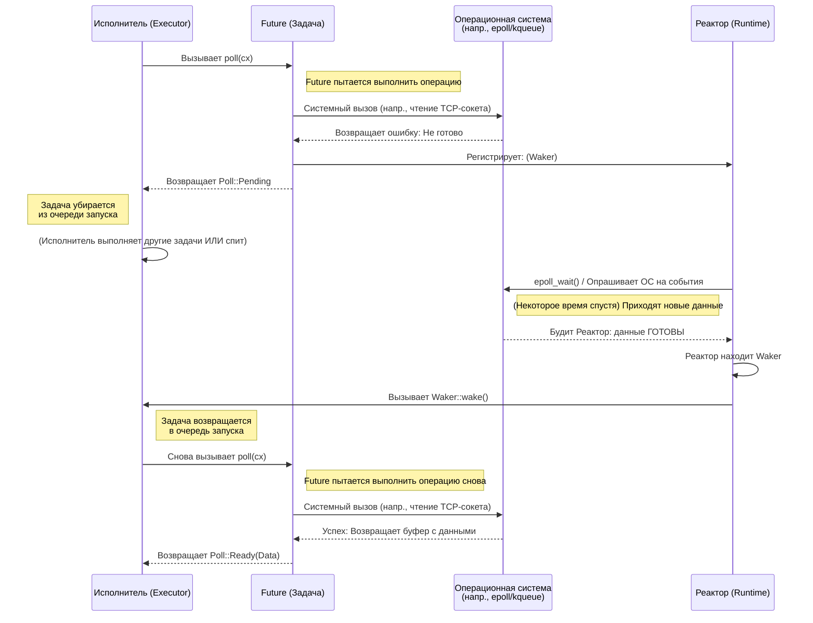

# 2. Трейт Future 🟡

> **Чему вы научитесь:**
> - Устройству трейта `Future`: `Output`, `poll()`, `Context`, `Waker`
> - Как будильник (`Waker`) сообщает исполнителю: «опроси меня снова»
> - Контракту: если не вызвать `wake()`, программа молча зависнет
> - Созданию реального фьючера вручную (`Delay`)

## Анатомия Future

Все асинхронные сущности в Rust в конечном итоге реализуют этот трейт:

```rust
pub trait Future {
    type Output;

    fn poll(self: Pin<&mut Self>, cx: &mut Context<'_>) -> Poll<Self::Output>;
}

pub enum Poll<T> {
    Ready(T),   // Выполнение завершено, возвращено значение T
    Pending,    // Будущее еще не готово — опросите меня позже
}
```

Вот и всё. `Future` (будущее) — это всё, что может быть опрошено (poll) с вопросом: «Ну что, готово?». В ответ возвращается либо «Да, вот результат», либо «Еще нет, я разбужу тебя, когда буду готов».

### Output, poll(), Context, Waker



Давайте подробно разберем каждую часть:

```rust
use std::future::Future;
use std::pin::Pin;
use std::task::{Context, Poll};

// Будущее, возвращающее 42 немедленно
struct Ready42;

impl Future for Ready42 {
    type Output = i32; // То, что будущее в конечном итоге вернет

    fn poll(self: Pin<&mut Self>, _cx: &mut Context<'_>) -> Poll<i32> {
        Poll::Ready(42) // Всегда готово — никакого ожидания
    }
}
```

**Компоненты**:
- **`Output`** — тип значения, получаемого при завершении выполнения.
- **`poll()`** — метод, вызываемый исполнителем для проверки прогресса; возвращает `Ready(value)` или `Pending`.
- **`Pin<&mut Self>`** — гарантирует, что будущее не переместится в памяти (причины этого мы разберем в Главе 4).
- **`Context`** — содержит в себе `Waker`, чтобы будущее могло сигнализировать исполнителю, когда будет готово продолжить работу.

### Контракт Waker

Инструмент `Waker` — это механизм обратного вызова (callback). Когда `Future` возвращает `Pending`, он *обязан* сделать так, чтобы `waker.wake()` был вызван позже — в противном случае исполнитель никогда больше его не опросит, и программа просто зависнет.

```rust
use std::task::{Context, Poll, Waker};
use std::pin::Pin;
use std::future::Future;
use std::sync::{Arc, Mutex};
use std::thread;
use std::time::Duration;

/// Будущее, завершающееся после задержки (упрощенная реализация)
struct Delay {
    completed: Arc<Mutex<bool>>,
    waker_stored: Arc<Mutex<Option<Waker>>>,
    duration: Duration,
    started: bool,
}

impl Delay {
    fn new(duration: Duration) -> Self {
        Delay {
            completed: Arc::new(Mutex::new(false)),
            waker_stored: Arc::new(Mutex::new(None)),
            duration,
            started: false,
        }
    }
}

impl Future for Delay {
    type Output = ();

    fn poll(mut self: Pin<&mut Self>, cx: &mut Context<'_>) -> Poll<()> {
        // Проверяем, завершено ли выполнение, до сохранения waker
        if *self.completed.lock().unwrap() {
            return Poll::Ready(());
        }

        // Сохраняем waker — исполнитель может передавать новый waker при каждом опросе
        *self.waker_stored.lock().unwrap() = Some(cx.waker().clone());

        // Запускаем фоновый таймер при первом опросе
        if !self.started {
            self.started = true;
            let completed = Arc::clone(&self.completed);
            let waker = Arc::clone(&self.waker_stored);
            let duration = self.duration;

            thread::spawn(move || {
                thread::sleep(duration);
                *completed.lock().unwrap() = true;

                // ВАЖНО: будим исполнитель, чтобы он снова опросил нас
                if let Some(w) = waker.lock().unwrap().take() {
                    w.wake(); // "Эй, исполнитель, я готов — опроси меня снова!"
                }
            });
        }

        // Повторно проверяем завершение после сохранения waker (избегаем состояния гонки)
        if *self.completed.lock().unwrap() {
            return Poll::Ready(());
        }

        Poll::Pending // Еще не готово
    }
}
```

> **Важное замечание**: В C# планировщик TaskScheduler автоматически управляет пробуждением.
> В Rust **вы** (или используемая вами библиотека ввода-вывода) несете ответственность за вызов
> `waker.wake()`. Забудете об этом — и ваша программа тихо зависнет.

### Упражнение: Реализация CountdownFuture

<details>
<summary>🏋️ Упражнение (нажмите для раскрытия)</summary>

**Задача**: Реализуйте `CountdownFuture`, который ведет обратный отсчет от N до 0, выводя текущее значение при каждом опросе. Когда отсчет достигает 0, выполнение завершается возвратом `Ready("Liftoff!")`.

*Hint*: Будущее должно сохранять текущее число и уменьшать его при каждом опросе. Не забывайте всегда заново регистрировать waker!

<details>
<summary>🔑 Решение</summary>

```rust
use std::future::Future;
use std::pin::Pin;
use std::task::{Context, Poll};

struct CountdownFuture {
    count: u32,
}

impl CountdownFuture {
    fn new(start: u32) -> Self {
        CountdownFuture { count: start }
    }
}

impl Future for CountdownFuture {
    type Output = &'static str;

    fn poll(mut self: Pin<&mut Self>, cx: &mut Context<'_>) -> Poll<Self::Output> {
        if self.count == 0 {
            println!("Liftoff!");
            Poll::Ready("Liftoff!")
        } else {
            println!("{}...", self.count);
            self.count -= 1;
            cx.waker().wake_by_ref(); // Сразу планируем повторный опрос
            Poll::Pending
        }
    }
}
```

**Ключевой вывод**: Этот фьючер опрашивается по одному разу на каждое число. Каждый раз, когда он возвращает `Pending`, он немедленно пробуждает сам себя для повторного опроса. В реальном коде вместо такого холостого опроса (busy-polling) вы использовали бы таймер.

</details>
</details>

> **Основные выводы — Трейт Future**
> - `Future::poll()` возвращает `Poll::Ready(value)` или `Poll::Pending`
> - Перед возвратом `Pending` будущее должно зарегистрировать `Waker` — исполнитель использует его, чтобы узнать, когда произвести повторный опрос
> - `Pin<&mut Self>` гарантирует, что будущее не переместится в памяти (это необходимо для самоссылающихся конечных автоматов — см. Главу 4)
> - Абсолютно всё в асинхронном Rust — `async fn`, `.await`, комбинаторы — построено вокруг одного этого трейта

> **См. также:** [Глава 3 — Как работает Poll](ch03-how-poll-works.md) для изучения цикла исполнителя, [Глава 6 — Создание Futures вручную](ch06-building-futures-by-hand.md) для изучения более сложных примеров

***
