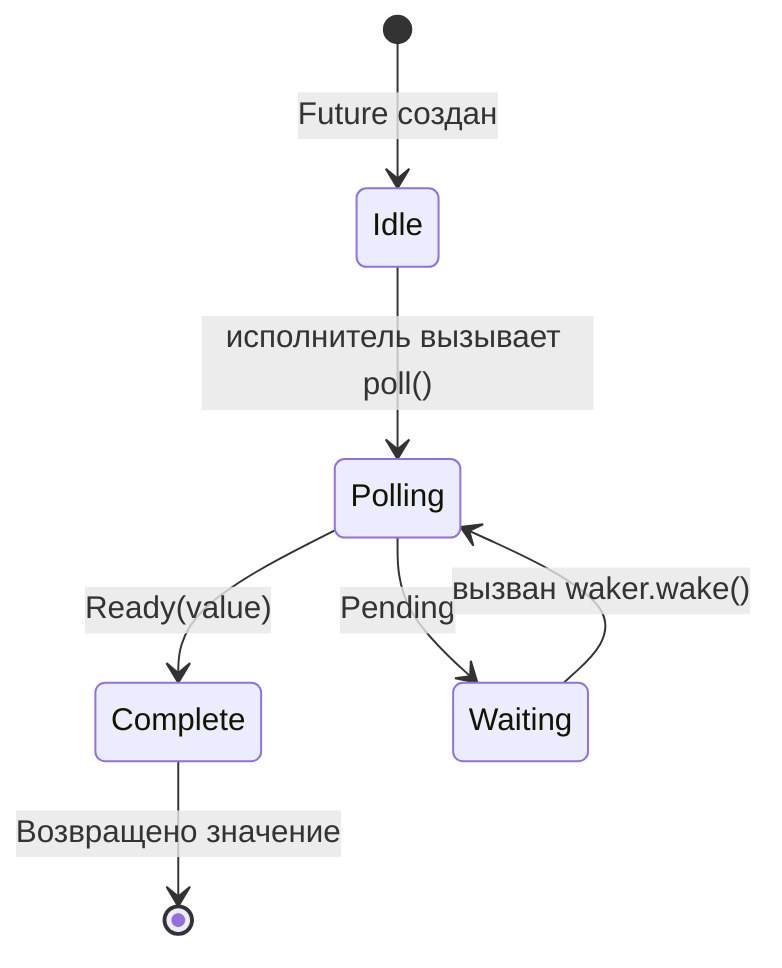

# 3. Как работает Poll 🟡

> **Чему вы научитесь:**
> - Циклу опроса исполнителя: poll → pending → wake → poll снова
> - Созданию минимального исполнителя с нуля
> - Правилам ложных пробуждений (spurious wakes) и тому, почему они важны
> - Вспомогательным функциям: `poll_fn()` и `yield_now()`

## Конечный автомат опроса (Polling)

Исполнитель выполняет цикл: опрашивает (poll) фьючер, и если тот возвращает `Pending`, паркует его до тех пор, пока не сработает соответствующий `waker`, после чего опрашивает снова. Это принципиально отличается от системных потоков (OS threads), где планированием занимается ядро операционной системы.



> **Важно:** Находясь в состоянии *Waiting*, фьючер **обязан** зарегистрировать
> `waker` в источнике ввода-вывода. Отсутствие регистрации = вечное зависание.

### Минимальный исполнитель

Чтобы развеять мифы вокруг исполнителей, давайте напишем простейший рабочий вариант:

```rust
use std::future::Future;
use std::task::{Context, Poll, RawWaker, RawWakerVTable, Waker};
use std::pin::Pin;

/// Простейший исполнитель: опрашивает в бесконечном цикле до получения Ready
fn block_on<F: Future>(mut future: F) -> F::Output {
    // Закрепляем future в стеке
    // SAFETY: `future` никогда не перемещается после этого момента — мы обращаемся
    // к нему только через закрепленную ссылку до завершения выполнения.
    let mut future = unsafe { Pin::new_unchecked(&mut future) };

    // Создаем пустой (no-op) waker (он просто продолжает опрос — неэффективно, но просто)
    fn noop_raw_waker() -> RawWaker {
        fn no_op(_: *const ()) {}
        fn clone(_: *const ()) -> RawWaker { noop_raw_waker() }
        let vtable = &RawWakerVTable::new(clone, no_op, no_op, no_op);
        RawWaker::new(std::ptr::null(), vtable)
    }

    // SAFETY: noop_raw_waker() возвращает корректный RawWaker с правильной таблицей виртуальных методов.
    let waker = unsafe { Waker::from_raw(noop_raw_waker()) };
    let mut cx = Context::from_waker(&waker);

    // Бесконечный цикл опроса до завершения future
    loop {
        match future.as_mut().poll(&mut cx) {
            Poll::Ready(value) => return value,
            Poll::Pending => {
                // Реальный исполнитель припарковал бы поток здесь
                // и ждал вызова waker.wake() — мы же просто крутимся в цикле
                std::thread::yield_now();
            }
        }
    }
}

// Использование:
fn main() {
    let result = block_on(async {
        println!("Привет из нашего мини-исполнителя!");
        42
    });
    println!("Получено: {result}");
}
```

> **Не используйте это в продакшене!** Этот код загружает процессор на 100%, выполняя холостые циклы (busy-loop). Реальные исполнители
> (`tokio`, `smol`) используют системные вызовы вроде `epoll`/`kqueue`/`io_uring` для того, чтобы поток спал, пока ввод-вывод не будет готов.
> Но этот пример показывает суть: исполнитель — это просто цикл, который вызывает `poll()`.

### Уведомления о пробуждении

Настоящий исполнитель работает по событиям. Когда все фьючеры возвращают `Pending`, исполнитель засыпает. Будильник (waker) — это механизм прерывания:

```rust
// Концептуальная модель главного цикла реального исполнителя:
fn executor_loop(tasks: &mut TaskQueue) {
    loop {
        // 1. Опрашиваем все задачи, которые были разбужены
        while let Some(task) = tasks.get_woken_task() {
            match task.poll() {
                Poll::Ready(result) => task.complete(result),
                Poll::Pending => { /* задача остается в очереди, ожидая пробуждения */ }
            }
        }Map

        // 2. Засыпаем, пока что-то не разбудит нас (epoll_wait, kevent и т.д.)
        //    Здесь основную работу выполняют mio/polling
        tasks.wait_for_events(); // блокирует поток, пока не сработает событие ввода-вывода или waker
    }
}
```

### Ложные пробуждения (Spurious Wakes)

Фьючер может быть опрошен, даже когда ввод-вывод для него еще не готов. Это называется *ложным пробуждением* (spurious wake). Фьючеры должны правильно это обрабатывать:

```rust
impl Future for MyFuture {
    type Output = Data;

    fn poll(self: Pin<&mut Self>, cx: &mut Context<'_>) -> Poll<Data> {
        // ✅ ПРАВИЛЬНО: Всегда перепроверяем реальное условие
        if let Some(data) = self.try_read_data() {
            Poll::Ready(data)
        } else {
            // Заново регистрируем waker (он мог измениться!)
            self.register_waker(cx.waker());
            Poll::Pending
        }

        // ❌ НЕПРАВИЛЬНО: Предполагать, что опрос означает готовность данных
        // let data = self.read_data(); // может заблокировать поток или вызвать панику
        // Poll::Ready(data)
    }
}
```

**Правила реализации `poll()`**:
1. **Никогда не блокируйте поток** — возвращайте `Pending` немедленно, если данные не готовы.
2. **Всегда перерегистрируйте waker** — он может измениться между опросами.
3. **Обрабатывайте ложные пробуждения** — проверяйте реальное состояние ресурса, а не предполагайте его готовность.
4. **Не опрашивайте фьючер после возврата Ready** — в этом случае поведение **не определено** (может случиться паника, возвратиться `Pending` или повторный `Ready`). Безопасный повторный опрос после завершения гарантирует только трейт `FusedFuture`.

<details>
<summary><strong>🏋️ Упражнение: Защищенный от ложных пробуждений FlagFuture</strong> (нажмите для раскрытия)</summary>

**Задача**: Реализуйте `FlagFuture`, оборачивающий общий флаг `Arc<AtomicBool>`. При опросе он проверяет, равен ли флаг `true`. Если да, то завершается с `Ready(())`. Если нет, то сохраняет waker и возвращает `Pending`. Нюанс: фьючер должен правильно обрабатывать **ложные пробуждения** — он должен перепроверять флаг при каждом опросе, никогда не предполагая, что флаг установлен, только потому, что его разбудили.

*Hint*: Вам понадобится `Arc<Mutex<Option<Waker>>>` (или аналогичный), чтобы внешний поток мог устанавливать флаг и будить фьючер. В качестве альтернативного краткого решения можно использовать `poll_fn`.

<details>
<summary>🔑 Решение</summary>

```rust
use std::future::Future;
use std::pin::Pin;
use std::sync::{Arc, Mutex};
use std::sync::atomic::{AtomicBool, Ordering};
use std::task::{Context, Poll, Waker};

struct FlagFuture {
    flag: Arc<AtomicBool>,
    waker_slot: Arc<Mutex<Option<Waker>>>,
}

impl FlagFuture {
    fn new(flag: Arc<AtomicBool>, waker_slot: Arc<Mutex<Option<Waker>>>) -> Self {
        FlagFuture { flag, waker_slot }
    }
}

impl Future for FlagFuture {
    type Output = ();

    fn poll(self: Pin<&mut Self>, cx: &mut Context<'_>) -> Poll<Self::Output> {
        // Всегда перепроверяем реальное условие — никогда не доверяем только самому факту пробуждения
        if self.flag.load(Ordering::Acquire) {
            return Poll::Ready(());
        }

        // Сохраняем/обновляем waker, чтобы получить уведомление
        let mut slot = self.waker_slot.lock().unwrap();
        *slot = Some(cx.waker().clone());

        // Повторно проверяем после сохранения waker, чтобы избежать состояния гонки:
        // флаг мог быть установлен в промежутке между нашей первой проверкой
        // и сохранением waker
        if self.flag.load(Ordering::Acquire) {
            Poll::Ready(())
        } else {
            Poll::Pending
        }
    }
}

// Сторона, устанавливающая флаг (например, другой поток или задача):
fn set_flag(flag: &AtomicBool, waker_slot: &Mutex<Option<Waker>>) {
    flag.store(true, Ordering::Release);
    if let Some(waker) = waker_slot.lock().unwrap().take() {
        waker.wake();
    }
}

// Эквивалент с использованием poll_fn:
// async fn wait_for_flag(flag: Arc<AtomicBool>, waker_slot: Arc<Mutex<Option<Waker>>>) {
//     std::future::poll_fn(|cx| {
//         if flag.load(Ordering::Acquire) {
//             return Poll::Ready(());
//         }
//         *waker_slot.lock().unwrap() = Some(cx.waker().clone());
//         if flag.load(Ordering::Acquire) { Poll::Ready(()) } else { Poll::Pending }
//     }).await
// }
```

**Ключевой вывод**: Паттерн двойной проверки (проверить → сохранить waker → проверить снова) критически важен для предотвращения состояния гонки между изменением условия и регистрацией waker. Это реальный паттерн, используемый внутри всеми фьючерами ввода-вывода, и он наглядно показывает, почему важна обработка ложных пробуждений.

</details>
</details>

### Полезные утилиты: `poll_fn` и `yield_now`

Две утилиты из стандартной библиотеки и tokio, позволяющие обойтись без написания полноценной реализации трейта `Future`:

```rust
use std::future::poll_fn;
use std::task::Poll;

// poll_fn: создание одноразового фьючера из замыкания
let value = poll_fn(|cx| {
    // Делаем что-то с cx.waker(), возвращаем Ready или Pending
    Poll::Ready(42)
}).await;

// Реальное использование: адаптация API на основе коллбеков в асинхронный вид
async fn read_when_ready(source: &MySource) -> Data {
    poll_fn(|cx| source.poll_read(cx)).await
}
```

```rust
// yield_now: добровольная передача управления исполнителю
// Полезно в ресурсоемких асинхронных циклах для предотвращения голодания других задач
async fn cpu_heavy_work(items: &[Item]) {
    for (i, item) in items.iter().enumerate() {
        process(item); // Вычисления на CPU

        // Каждые 100 элементов передаем управление, чтобы дать поработать другим задачам
        if i % 100 == 0 {
            tokio::task::yield_now().await;
        }
    }
}
```

> **Когда использовать `yield_now()`**: Если ваша асинхронная функция выполняет ресурсоемкие вычисления в цикле
> без каких-либо точек `.await`, она монополизирует поток исполнителя. Периодически вставляйте
> `yield_now().await`, чтобы работало кооперативное планирование.

> **Основные выводы — Как работает Poll**
> - Исполнитель циклически вызывает `poll()` для фьючеров, которые были разбужены
> - Фьючеры должны обрабатывать **ложные пробуждения** — всегда перепроверяйте реальное условие
> - `poll_fn()` позволяет создавать временные фьючеры из замыканий
> - `yield_now()` служит предохранительным клапаном для кооперативного планирования в тяжелых для процессора задачах

> **См. также:** [Глава 2 — Трейт Future](ch02-the-future-trait.md) для изучения определения трейта, и [Глава 5 — Разбор конечного автомата](ch05-the-state-machine-reveal.md) для изучения того, что генерирует компилятор

***
