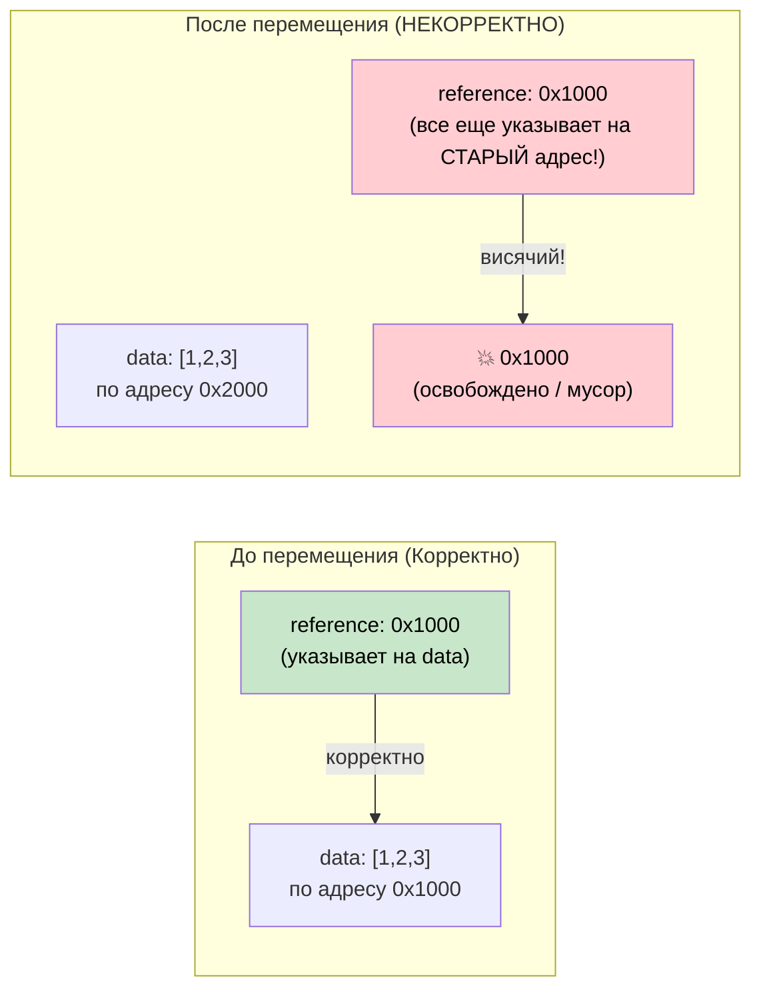

# 4. Pin и Unpin 🔴

> **Чему вы научитесь:**
> - Почему самоссылающиеся структуры ломаются при перемещении в памяти
> - Что гарантирует `Pin<P>` и как он предотвращает перемещения
> - Трем практическим паттернам закрепления: `Box::pin()`, `tokio::pin!()`, `Pin::new()`
> - Когда `Unpin` дает вам лазейку для обхода

## Зачем нужен Pin

Это одна из самых сложных для понимания концепций в асинхронном Rust. Давайте разберем ее суть шаг за шагом.

### Проблема: Самоссылающиеся структуры

Когда компилятор преобразует `async fn` в конечный автомат, этот автомат может содержать ссылки на свои собственные поля. Это создает *самоссылающуюся структуру* (self-referential struct). Ее перемещение в памяти сделает эти внутренние ссылки недействительными.

```rust
// Что генерирует компилятор (упрощенно) для:
// async fn example() {
//     let data = vec![1, 2, 3];
//     let reference = &data;       // Указывает на data выше
//     use_ref(reference).await;
// }

// Превращается во что-то вроде:
enum ExampleStateMachine {
    State0 {
        data: Vec<i32>,
        // reference: &Vec<i32>,  // ПРОБЛЕМА: указывает на `data` выше
        //                        // Если эта структура переместится, указатель станет висячим!
    },
    State1 {
        data: Vec<i32>,
        reference: *const Vec<i32>, // Внутренний указатель на поле data
    },
    Complete,
}
```



### Самоссылающиеся структуры

И это не просто теоретическая проблема. Каждая функция `async fn`, которая удерживает ссылку через точку `.await`, порождает самоссылающийся конечный автомат:

```rust
async fn problematic() {
    let data = String::from("hello");
    let slice = &data[..]; // slice заимствует data
    
    some_io().await; // <-- точка .await: конечный автомат сохраняет и data, и slice
    
    println!("{slice}"); // использует ссылку после await
}
// Сгенерированный конечный автомат содержит `data: String` и `slice: &str`,
// где `slice` указывает ВНУТРЬ `data`. Перемещение конечного автомата приведет к появлению висячего указателя.
```

### Pin на практике

Тип `Pin<P>` — это обертка, которая предотвращает перемещение значения, находящегося по указателю:

```rust
use std::pin::Pin;

let mut data = String::from("hello");

// Закрепляем его — теперь его нельзя переместить
let pinned: Pin<&mut String> = Pin::new(&mut data);

// Все еще можем использовать:
println!("{}", pinned.as_ref().get_ref()); // "hello"

// Но мы не можем получить обратно &mut String (что позволило бы сделать mem::swap):
// let mutable: &mut String = Pin::into_inner(pinned); // Только если String: Unpin
// String реализует Unpin, поэтому для String это на самом деле сработает.
// Но для самоссылающихся конечных автоматов (которые являются !Unpin) это заблокировано.
```

В реальном коде вы чаще всего сталкиваетесь с `Pin` в трех местах:

```rust
// 1. сигнатура poll() — все фьючерсы опрашиваются через Pin
fn poll(self: Pin<&mut Self>, cx: &mut Context<'_>) -> Poll<Output>;

// 2. Box::pin() — выделение памяти в куче и закрепление фьючера
let future: Pin<Box<dyn Future<Output = i32>>> = Box::pin(async { 42 });

// 3. tokio::pin!() — закрепление фьючера в стеке
tokio::pin!(my_future);
// Теперь my_future имеет тип Pin<&mut impl Future>
```

### Лазейка Unpin

Большинство типов в Rust реализуют маркерный трейт `Unpin` — они не содержат самоссылок, поэтому закрепление для них ни на что не влияет. Только сгенерированные компилятором конечные автоматы (из `async fn`) являются `!Unpin` (не реализуют `Unpin`).

```rust
// Все эти типы реализуют Unpin — их закрепление ничего не меняет:
// i32, String, Vec<T>, HashMap<K,V>, Box<T>, &T, &mut T

// Эти типы являются !Unpin — их ОБЯЗАТЕЛЬНО нужно закрепить перед опросом:
// Конечные автоматы, сгенерированные из `async fn` и `async {}`

// Практическое следствие:
// Если вы пишете Future вручную и в нем НЕТ самоссылок,
// реализуйте трейт Unpin, чтобы с ним было проще работать:
impl Unpin for MySimpleFuture {} // «Меня безопасно перемещать, поверь мне»
```

### Быстрая шпаргалка

| Что сделать | Когда | Как |
|------|------|-----|
| Закрепить фьючер в куче | При сохранении в коллекцию, при возврате из функции | `Box::pin(future)` |
| Закрепить фьючер в стеке | Локальное использование в макросе `select!` или при ручном опросе | `std::pin::pin!(future)` или `tokio::pin!(future)` |
| Закрепить в сигнатуре функции | При приеме закрепленных фьючеров | `future: Pin<&mut F>` |
| Требовать Unpin | Когда вам нужно переместить фьючер после его создания | `F: Future + Unpin` |

<details>
<summary><strong>🏋️ Упражнение: Pin и перемещение</strong> (нажмите для раскрытия)</summary>

**Задача**: Какие из этих фрагментов кода компилируются? Для каждого некомпилирующегося фрагмента объясните причину и исправьте ее.

```rust
// Фрагмент А
let fut = async { 42 };
let pinned = Box::pin(fut);
let moved = pinned; // Перемещение Box
let result = moved.await;

// Фрагмент B
let fut = async { 42 };
let mut fut = std::pin::pin!(fut);
let moved = fut; // Перемещение закрепленного фьючера
let result = moved.await;

// Фрагмент C
use std::pin::Pin;
let mut fut = async { 42 };
let pinned = Pin::new(&mut fut);
```

<details>
<summary>🔑 Решение</summary>

**Фрагмент A**: ✅ **Компилируется.** `Box::pin()` помещает фьючер в кучу. Перемещение `Box` перемещает сам *указатель*, а не фьючер. Фьючер остается закрепленным по своему адресу в куче.

**Фрагмент B**: ✅ **Компилируется.** Макрос `std::pin::pin!` закрепляет фьючер в стеке и возвращает переменную `Pin<&mut ...>`. Код `let moved = fut` перемещает **обертку `Pin`** (указатель), а не сам фьючер — фьючер остается закрепленным в стеке. Это похоже на работу с `Box::pin`: перемещение `Box` не приводит к перемещению данных в куче. Однако переменная `fut` поглощается при перемещении (move), поэтому вы не сможете использовать `fut` после этого — только `moved`:
```rust
let fut = async { 42 };
tokio::pin!(fut);
let moved = fut;        // Перемещает обертку Pin<&mut> — ОК
// fut.await;           // ❌ Ошибка: fut был перемещен
let result = moved.await; // ✅ Используйте вместо этого moved
```

**Фрагмент C**: ❌ **Не компилируется.** Функция `Pin::new()` требует реализации трейта `T: Unpin`. Асинхронные блоки генерируют типы `!Unpin`. **Решение**: Используйте `Box::pin()` или небезопасный метод `unsafe Pin::new_unchecked()`:
```rust
let fut = async { 42 };
let pinned = Box::pin(fut); // Закрепление в куче — работает с !Unpin
```

**Ключевой вывод**: `Box::pin()` — это безопасный и простой способ закрепить фьючеры типа `!Unpin` в куче. Макрос `tokio::pin!()` (или `std::pin::pin!`) закрепляет их в стеке — вы можете перемещать обертку `Pin<&mut>` (поскольку это просто указатель), но сам лежащий под ней фьючер останется на месте. Функция `Pin::new()` работает только с типами `Unpin`.

</details>
</details>

> **Основные выводы — Pin и Unpin**
> - `Pin<P>` — это обертка, которая **предотвращает перемещение адресуемого значения**; это критически важно для самоссылающихся конечных автоматов
> - `Box::pin()` — это безопасный и простой способ закрепления фьючеров в куче по умолчанию
> - `tokio::pin!()` закрепляет в стеке — вы можете перемещать обертку `Pin<&mut>`, но сам фьючер останется на месте
> - `Unpin` — это авто-трейт: типы, реализующие `Unpin`, можно перемещать даже после закрепления (большинство типов реализуют `Unpin`; асинхронные блоки — нет)

> **См. также:** [Глава 2 — Трейт Future](ch02-the-future-trait.md) для изучения `Pin<&mut Self>` в сигнатуре метода poll, и [Глава 5 — Разбор конечного автомата](ch05-the-state-machine-reveal.md) для понимания того, почему асинхронные конечные автоматы являются самоссылающимися

***
