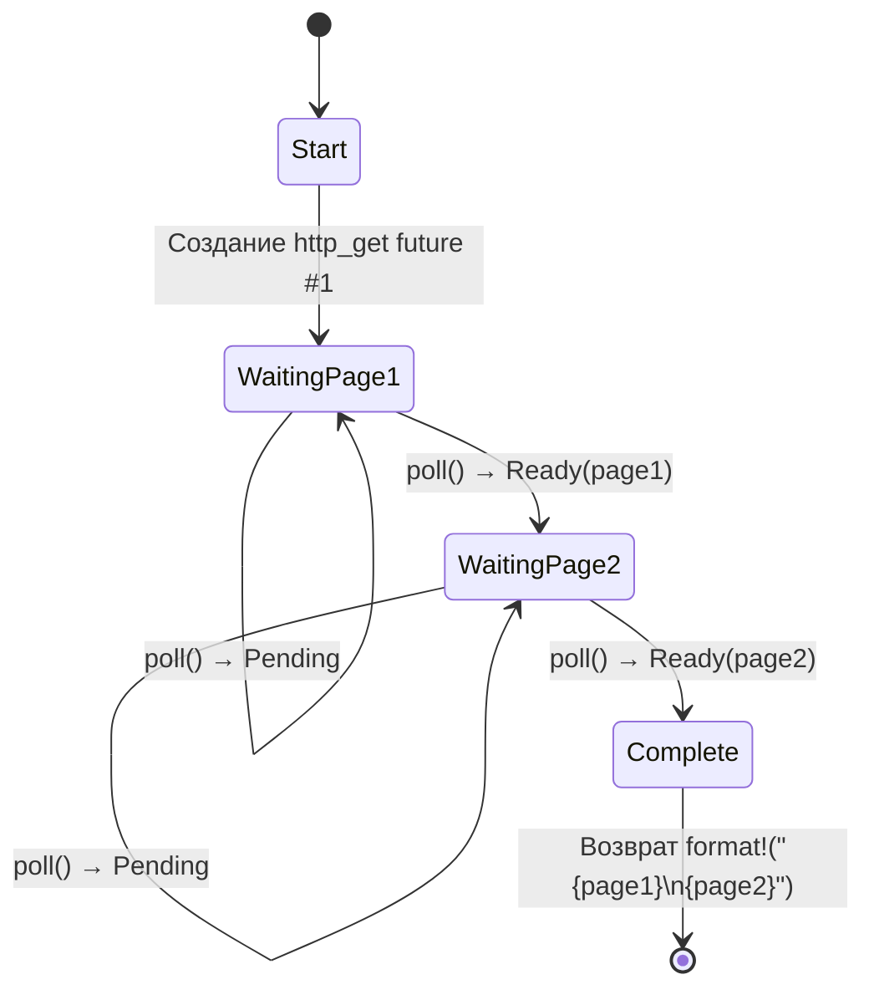

# 5. Разбор конечного автомата 🟢

> **Чему вы научитесь:**
> - Как компилятор преобразует `async fn` в конечный автомат на основе перечисления (enum)
> - Наглядному сравнению: исходный код против сгенерированных состояний
> - Почему большие выделения памяти на стеке в `async fn` раздувают размер фьючера
> - Оптимизации очистки (drop): переменные удаляются сразу, как только перестают быть нужными

## Что на самом деле генерирует компилятор

Когда вы пишете `async fn`, компилятор преобразует ваш последовательно выглядящий код в конечный автомат на основе перечисления. Понимание этого преобразования — ключ к пониманию характеристик производительности асинхронного Rust и многих его особенностей.

### Сравнение лицом к лицу: async fn против конечного автомата

```rust
// То, что вы пишете:
async fn fetch_two_pages() -> String {
    let page1 = http_get("https://example.com/a").await;
    let page2 = http_get("https://example.com/b").await;
    format!("{page1}\n{page2}")
}
```

Компилятор генерирует нечто концептуально похожее на это:

```rust
enum FetchTwoPagesStateMachine {
    // Состояние 0: Ожидается вызов http_get для page1
    Start,

    // Состояние 1: Ожидание page1, хранение future
    WaitingPage1 {
        fut1: HttpGetFuture,
    },

    // Состояние 2: Получена page1, ожидание page2
    WaitingPage2 {
        page1: String,
        fut2: HttpGetFuture,
    },

    // Конечное состояние
    Complete,
}

impl Future for FetchTwoPagesStateMachine {
    type Output = String;

    fn poll(mut self: Pin<&mut Self>, cx: &mut Context<'_>) -> Poll<String> {
        loop {
            match self.as_mut().get_mut() {
                Self::Start => {
                    let fut1 = http_get("https://example.com/a");
                    *self.as_mut().get_mut() = Self::WaitingPage1 { fut1 };
                }
                Self::WaitingPage1 { fut1 } => {
                    let page1 = match Pin::new(fut1).poll(cx) {
                        Poll::Ready(v) => v,
                        Poll::Pending => return Poll::Pending,
                    };
                    let fut2 = http_get("https://example.com/b");
                    *self.as_mut().get_mut() = Self::WaitingPage2 { page1, fut2 };
                }
                Self::WaitingPage2 { page1, fut2 } => {
                    let page2 = match Pin::new(fut2).poll(cx) {
                        Poll::Ready(v) => v,
                        Poll::Pending => return Poll::Pending,
                    };
                    let result = format!("{page1}\n{page2}");
                    *self.as_mut().get_mut() = Self::Complete;
                    return Poll::Ready(result);
                }
                Self::Complete => panic!("polled after completion"),
            }
        }
    }
}
```

> **Примечание**: Данная десугаризация является *концептуальной*. Настоящий вывод компилятора использует небезопасные проекции закрепления (pin projections) — показанные здесь вызовы `get_mut()` требуют реализации трейта `Unpin`, хотя асинхронные конечные автоматы являются `!Unpin`. Цель этого примера — проиллюстрировать переходы между состояниями, а не предоставить компилируемый код.



> **Содержимое состояний:**
> - **WaitingPage1** — хранит `fut1: HttpGetFuture` (`page2` еще не выделен в памяти)
> - **WaitingPage2** — хранит `page1: String` и `fut2: HttpGetFuture` (`fut1` уже удален через drop)

## Почему это важно для производительности

**Нулевая стоимость**: Конечный автомат представляет собой перечисление (enum), выделяемое на стеке. Никаких выделений памяти в куче для каждого фьючера, никакого сборщика мусора, никакой упаковки (boxing) — если только вы явно не используете `Box::pin()`.

**Размер**: Размер перечисления равен максимальному размеру его вариантов. Каждая точка `.await` создает новый вариант. Это означает следующее:

```rust
async fn small() {
    let a: u8 = 0;
    yield_now().await;
    let b: u8 = 0;
    yield_now().await;
}
// Размер ≈ max(size_of(u8), size_of(u8)) + дискриминант + размеры вложенных futures
//      ≈ очень маленький!

async fn big() {
    let buf: [u8; 1_000_000] = [0; 1_000_000]; // 1 МБ на стеке!
    some_io().await;
    process(&buf);
}
// Размер ≈ 1 МБ + размеры внутренних futures
// ⚠️ Не выделяйте огромные буферы на стеке в асинхронных функциях!
// Используйте вместо этого Vec<u8> или Box<[u8]>.
```

**Оптимизация drop**: При переходе из одного состояния в другое конечный автомат удаляет значения, которые больше не нужны. В примере выше `fut1` удаляется при переходе из `WaitingPage1` в `WaitingPage2` — компилятор автоматически вставляет вызовы деструктора.

> **Практическое правило**: Большие выделения данных на стеке в `async fn` раздувают размер фьючера. Если вы сталкиваетесь с переполнениями стека в асинхронном коде, проверьте наличие больших массивов или глубоко вложенных фьючеров. При необходимости используйте `Box::pin()`, чтобы разместить вложенные фьючеры в куче.

### Упражнение: Спрогнозируйте конечный автомат

<details>
<summary>🏋️ Упражнение (нажмите для раскрытия)</summary>

**Задача**: Посмотрите на эту асинхронную функцию и набросайте схему конечного автомата, который сгенерирует компилятор. Сколько состояний (вариантов перечисления) он будет иметь? Какие значения будут храниться в каждом из них?

```rust
async fn pipeline(url: &str) -> Result<usize, Error> {
    let response = fetch(url).await?;
    let body = response.text().await?;
    let parsed = parse(body).await?;
    Ok(parsed.len())
}
```

<details>
<summary>🔑 Решение</summary>

Пять состояний:

1. **Start** — хранит `url`
2. **WaitingFetch** — хранит `url` и фьючер `fetch`
3. **WaitingText** — хранит `response` и фьючер метода `text()`
4. **WaitingParse** — хранит `body` и фьючер функции `parse`
5. **Done** — возвращено `Ok(parsed.len())`

Каждая точка `.await` создает точку приостановки (yield point), то есть новый вариант перечисления. Оператор `?` добавляет пути раннего выхода, но не добавляет новых состояний — это просто `match` для проверки значения `Poll::Ready`.

</details>
</details>

> **Основные выводы — Разбор конечного автомата**
> - `async fn` компилируется в перечисление (enum), имеющее по одному варианту на каждую точку `.await`
> - Размер фьючера равен максимальному размеру из всех его вариантов — большие значения на стеке сильно увеличивают его
> - Компилятор автоматически вызывает деструкторы (`drop`) при переходе между состояниями
> - Используйте `Box::pin()` или выделение памяти в куче, если размер фьючера становится проблемой

> **См. также:** [Глава 4 — Pin и Unpin](ch04-pin-and-unpin.md) для понимания того, почему сгенерированный enum требует закрепления, и [Глава 6 — Создание Futures вручную](ch06-building-futures-by-hand.md) для ручного построения подобных конечных автоматов

***
