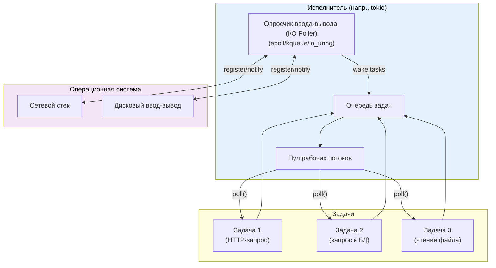
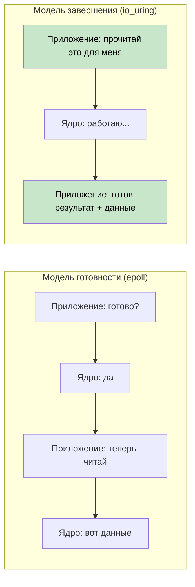
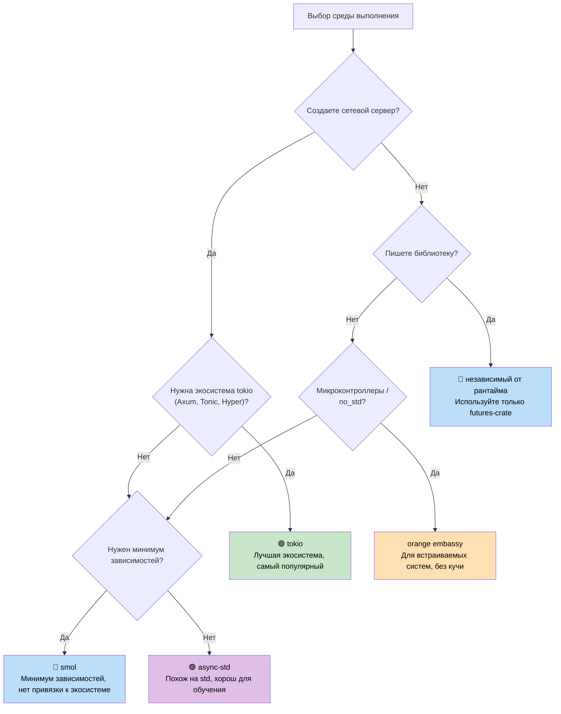

# 7. Исполнители и среды выполнения 🟡

> **Чему вы научитесь:**
> - Чем занимается исполнитель: опросом и эффективным сном
> - Шести основным средам выполнения: mio, io_uring, tokio, async-std, smol, embassy
> - Дереву решений для выбора подходящего рантайма
> - Почему важно проектировать библиотеки независимыми от конкретной среды выполнения

## Чем занимается исполнитель

У исполнителя две задачи:
1. **Опрашивать фьючеры** (poll), когда они готовы продолжить выполнение.
2. **Эффективно спать**, когда нет фьючеров, готовых к работе (используя системные API уведомлений о вводе-выводе).



### mio: Фундаментальный слой

Библиотека [mio](https://github.com/tokio-rs/mio) (Metal I/O) не является исполнителем — это самый низкоуровневый кроссплатформенный слой для получения уведомлений о вводе-выводе. Она оборачивает системные вызовы `epoll` (Linux), `kqueue` (macOS/BSD) и IOCP (Windows).

```rust
// Концептуальное использование mio (упрощенно):
use mio::{Events, Interest, Poll, Token};
use mio::net::TcpListener;

let mut poll = Poll::new()?;
let mut events = Events::with_capacity(128);

let mut server = TcpListener::bind("0.0.0.0:8080")?;
poll.registry().register(&mut server, Token(0), Interest::READABLE)?;

// Цикл событий — блокирует поток до появления какого-либо события
loop {
    poll.poll(&mut events, None)?; // Спим до события ввода-вывода
    for event in events.iter() {
        match event.token() {
            Token(0) => { /* у сервера новое входящее соединение */ }
            _ => { /* готов другой ввод-вывод */ }
        }
    }
}
```

Большинство разработчиков никогда не работают с `mio` напрямую — `tokio` и `smol` строятся поверх нее.

### io_uring: Фьючер на основе уведомлений о завершении

Система `io_uring` в Linux (ядро 5.1+) представляет собой фундаментальный сдвиг по сравнению с моделью ввода-вывода на основе готовности (readiness-based), которую используют `mio`/`epoll`:

```text
На основе готовности (epoll / mio / tokio):
  1. Запрос: «Этот сокет готов к чтению?»  → epoll_wait()
  2. Ядро: «Да, он готов»                   → событие EPOLLIN
  3. Приложение: read(fd, buf)             → всё еще может кратковременно заблокироваться!

На основе завершения (io_uring):
  1. Отправка: «Прочитай из сокета в этот буфер» → SQE (очередь отправки)
  2. Ядро: выполняет чтение асинхронно
  3. Приложение: получает готовый результат с данными → CQE (очередь завершения)
```



**Сложность с владением**: `io_uring` требует, чтобы ядро владело буфером до тех пор, пока операция не завершится. Это конфликтует со стандартным трейтом Rust `AsyncRead`, который заимствует буфер. Именно поэтому в `tokio-uring` используются другие трейты ввода-вывода:

```rust
// Стандартный tokio (на основе готовности) — заимствует буфер:
let n = stream.read(&mut buf).await?;  // buf заимствуется

// tokio-uring (на основе завершения) — забирает владение буфером:
let (result, buf) = stream.read(buf).await;  // buf передается внутрь и возвращается обратно
let n = result?;
```

```rust
// Cargo.toml: tokio-uring = "0.5"
// ПРИМЕЧАНИЕ: Только для Linux, требуется ядро 5.1+

fn main() {
    tokio_uring::start(async {
        let file = tokio_uring::fs::File::open("data.bin").await.unwrap();
        let buf = vec![0u8; 4096];
        let (result, buf) = file.read_at(buf, 0).await;
        let bytes_read = result.unwrap();
        println!("Прочитано {} байт: {:?}", bytes_read, &buf[..bytes_read]);
    });
}
```

| Критерий | epoll (tokio) | io_uring (tokio-uring) |
|--------|--------------|----------------------|
| **Модель** | Уведомление о готовности | Уведомление о завершении |
| **Системные вызовы** | epoll_wait + read/write | Пакетное кольцо SQE/CQE |
| **Владение буфером** | Остается у приложения (`&mut buf`) | Передача владения (перемещение `buf`) |
| **Платформа** | Linux, macOS (kqueue), Windows (IOCP) | Только Linux 5.1+ |
| **Zero-copy** | Нет (копирование в userspace) | Да (зарегистрированные буферы) |
| **Стабильность** | Готов к продакшену | Экспериментальный |

> **Когда использовать io_uring**: В сценариях с высокой пропускной способностью файлового ввода-вывода или сети, где узким местом становятся накладные расходы на системные вызовы (базы данных, движки хранения данных, прокси-серверы, обслуживающие более 100 тысяч соединений). Для большинства прикладных приложений стандартного `tokio` с `epoll` будет более чем достаточно.

### tokio: Среда выполнения «всё включено»

Доминирующая асинхронная среда выполнения в экосистеме Rust. Используется в Axum, Hyper, Tonic и большинстве промышленных серверов на Rust.

```rust
// Cargo.toml:
// [dependencies]
// tokio = { version = "1", features = ["full"] }

#[tokio::main]
async fn main() {
    // Запускает многопоточный рантайм с планировщиком перехвата задач (work-stealing)
    let handle = tokio::spawn(async {
        tokio::time::sleep(std::time::Duration::from_secs(1)).await;
        "готово"
    });

    let result = handle.await.unwrap();
    println!("{result}");
}
```

**Возможности Tokio**: Таймер, ввод-вывод, TCP/UDP, Unix-сокеты, обработка сигналов, примитивы синхронизации (`Mutex`, `RwLock`, `Semaphore`, каналы), файловая система, процессы, интеграция с логированием (`tracing`).

### async-std: Зеркало стандартной библиотеки

Дублирует API стандартной библиотеки (`std`), предоставляя их асинхронные версии. Менее популярен, чем Tokio, но проще для новичков.

```rust
// Cargo.toml:
// [dependencies]
// async-std = { version = "1", features = ["attributes"] }

#[async_std::main]
async fn main() {
    use async_std::fs;
    let content = fs::read_to_string("hello.txt").await.unwrap();
    println!("{content}");
}
```

### smol: Минималистичная среда выполнения

Небольшая асинхронная среда выполнения без зависимостей. Отлично подходит для библиотек, которым нужна асинхронность без затаскивания тяжелого `tokio`.

```rust
// Cargo.toml:
// [dependencies]
// smol = "2"

fn main() {
    smol::block_on(async {
        let result = smol::unblock(|| {
            // Запускает блокирующий код в пуле потоков
            std::fs::read_to_string("hello.txt")
        }).await.unwrap();
        println!("{result}");
    });
}
```

### embassy: Асинхронность для встраиваемых систем (no_std)

Асинхронная среда выполнения для микроконтроллеров и встраиваемых систем. Не требует кучи (heap) и стандартной библиотеки (`std`).

```rust
// Работает на микроконтроллерах (например, STM32, nRF52, RP2040)
#[embassy_executor::main]
async fn main(spawner: embassy_executor::Spawner) {
    // Мигание светодиодом с помощью async/await — ОСРВ не требуется!
    let mut led = Output::new(p.PA5, Level::Low, Speed::Low);
    loop {
        led.set_high();
        Timer::after(Duration::from_millis(500)).await;
        led.set_low();
        Timer::after(Duration::from_millis(500)).await;
    }
}
```

### Дереву решений для выбора среды выполнения



### Сравнительная таблица рантаймов

| Возможность | tokio | async-std | smol | embassy |
|---------|-------|-----------|------|---------|
| **Экосистема** | Доминирующая | Небольшая | Минимальная | Встраиваемые системы |
| **Многопоточность** | ✅ Work-stealing | ✅ | ✅ | ❌ (одноядерный) |
| **no_std** | ❌ | ❌ | ❌ | ✅ |
| **Таймер** | ✅ Встроенный | ✅ Встроенный | Через `async-io` | ✅ На базе HAL |
| **Ввод-вывод** | ✅ Свои абстракции | ✅ Зеркало std | Через `async-io` | ✅ Драйверы HAL |
| **Каналы** | ✅ Богатый набор | ✅ | Через `async-channel` | ✅ |
| **Сложность освоения** | Средняя | Низкая | Низкая | Высокая (из-за железа) |
| **Размер бинарника** | Большой | Средний | Маленький | Крошечный |

<details>
<summary><strong>🏋️ Упражнение: Сравнение сред выполнения</strong> (нажмите для раскрытия)</summary>

**Задача**: Напишите одну и ту же программу под три разные среды выполнения (Tokio, Smol и Async-std). Программа должна:
1. Скачивать URL (симулируйте с помощью сна длительностью 100 мс).
2. Читать файл (симулируйте с помощью сна длительностью 50 мс).
3. Выводить оба результата.

Это упражнение демонстрирует, что сам асинхронный код с async/await остается прежним — меняется только настройка среды выполнения.

<details>
<summary>🔑 Решение</summary>

```rust
// ----- Версия под tokio -----
// Cargo.toml: tokio = { version = "1", features = ["full"] }
#[tokio::main]
async fn main() {
    let (url_result, file_result) = tokio::join!(
        async {
            tokio::time::sleep(std::time::Duration::from_millis(100)).await;
            "Ответ от URL"
        },
        async {
            tokio::time::sleep(std::time::Duration::from_millis(50)).await;
            "Содержимое файла"
        },
    );
    println!("URL: {url_result}, Файл: {file_result}");
}

// ----- Версия под smol -----
// Cargo.toml: smol = "2", futures-lite = "2"
fn main() {
    smol::block_on(async {
        let (url_result, file_result) = futures_lite::future::zip(
            async {
                smol::Timer::after(std::time::Duration::from_millis(100)).await;
                "Ответ от URL"
            },
            async {
                smol::Timer::after(std::time::Duration::from_millis(50)).await;
                "Содержимое файла"
            },
        ).await;
        println!("URL: {url_result}, Файл: {file_result}");
    });
}

// ----- Версия под async-std -----
// Cargo.toml: async-std = { version = "1", features = ["attributes"] }
#[async_std::main]
async fn main() {
    let (url_result, file_result) = futures::future::join(
        async {
            async_std::task::sleep(std::time::Duration::from_millis(100)).await;
            "Ответ от URL"
        },
        async {
            async_std::task::sleep(std::time::Duration::from_millis(50)).await;
            "Содержимое файла"
        },
    ).await;
    println!("URL: {url_result}, Файл: {file_result}");
}
```

**Ключевой вывод**: Асинхронная бизнес-логика идентична для всех сред выполнения. Различаются только точка входа и API таймеров / ввода-вывода. Вот почему так ценно писать библиотеки независимыми от конкретного рантайма (используя только `std::future::Future`).

</details>
</details>

> **Основные выводы — Исполнители и среды выполнения**
> - Задача исполнителя — опрашивать фьючеры при их пробуждении и эффективно спать, используя системные API ввода-вывода
> - **Tokio** — выбор по умолчанию для веб-серверов; **Smol** — для минимального размера бинарного файла; **Embassy** — для микроконтроллеров
> - Ваша бизнес-логика должна зависеть от `std::future::Future`, а не от конкретной среды выполнения
> - Технология `io_uring` (Linux 5.1+) — это будущее высокопроизводительного ввода-вывода, но ее экосистема все еще развивается

> **См. также:** [Глава 8 — Глубокое погружение в Tokio](ch08-tokio-deep-dive.md) для изучения специфики Tokio, и [Глава 9 — Когда Tokio не подходит](ch09-when-tokio-isnt-the-right-fit.md) для поиска альтернатив

***
