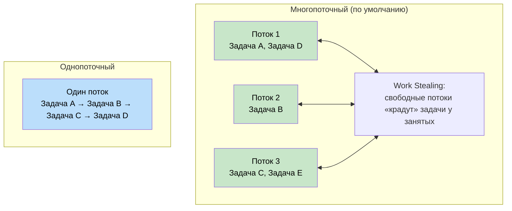
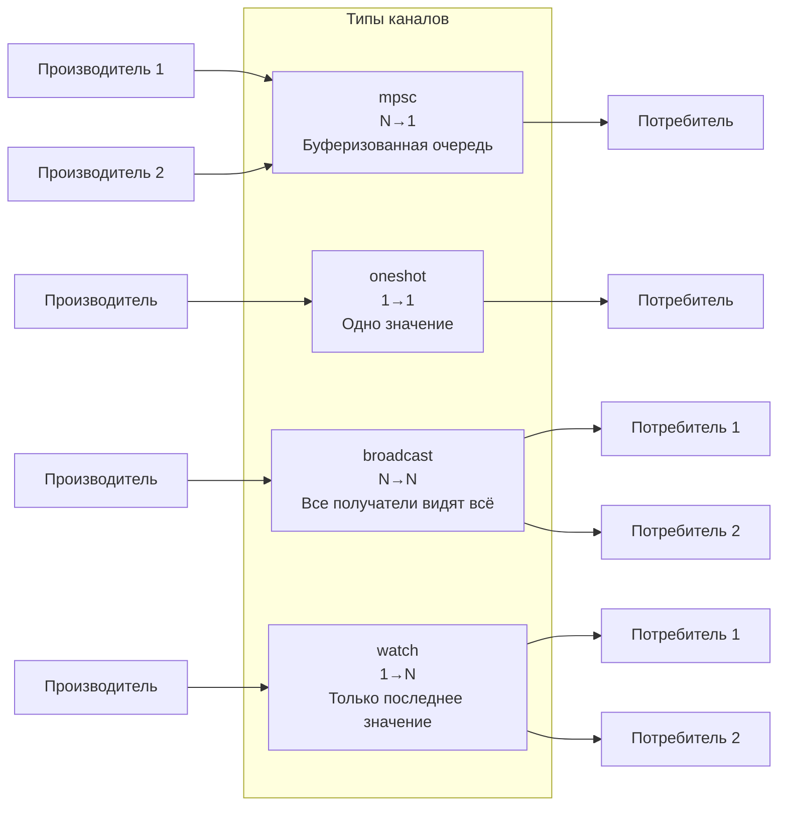
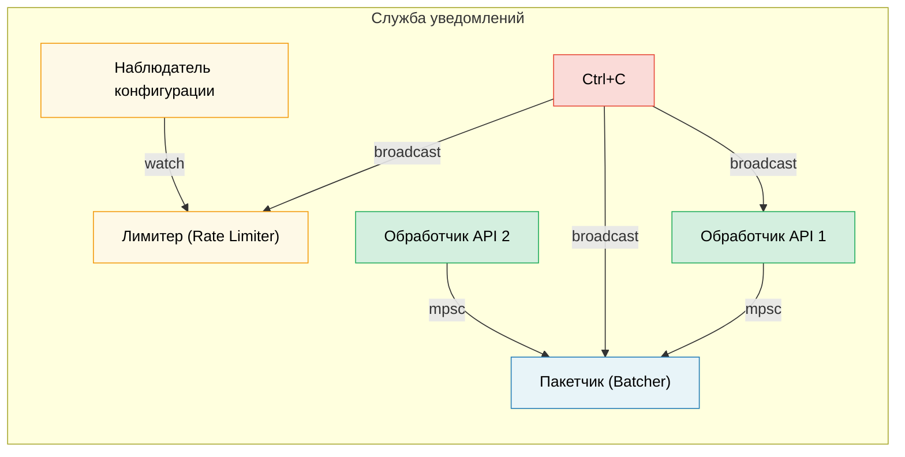

# 8. Глубокое погружение в Tokio 🟡

> **Чему вы научитесь:**
> - Режимам работы рантайма: многопоточному и однопоточному, а также правилам выбора между ними
> - Вызову `tokio::spawn`, требованию `'static` и структуре `JoinHandle`
> - Семантике отмены задач (cancel-on-drop)
> - Примитивам синхронизации: `Mutex`, `RwLock`, `Semaphore` и всем четырём типам каналов

## Режимы работы рантайма: Multi-Thread и Current-Thread

Tokio предлагает две конфигурации среды выполнения:

```rust
// Многопоточный режим (по умолчанию при #[tokio::main])
// Использует пул потоков с перехватом задач (work-stealing) — задачи могут перемещаться между потоками
#[tokio::main]
async fn main() {
    // N рабочих потоков (по умолчанию = количество ядер CPU)
    // Задачи должны реализовывать Send + 'static
}

// Однопоточный режим — всё выполняется на одном потоке
#[tokio::main(flavor = "current_thread")]
async fn main() {
    // В один поток — задачам не нужно реализовывать Send
    // Более легковесный рантайм, подходит для простых утилит или WASM
}

// Ручное создание рантайма:
let rt = tokio::runtime::Builder::new_multi_thread()
    .worker_threads(4)
    .enable_all()
    .build()
    .unwrap();

rt.block_on(async {
    println!("Запуск на кастомном рантайме");
});
```



### tokio::spawn и требование 'static

Вызов `tokio::spawn` помещает фьючер в очередь задач рантайма. Поскольку он может запуститься на *любом* рабочем потоке в *любой* момент времени, фьючер должен реализовывать `Send + 'static`:

```rust
use tokio::task;

async fn example() {
    let data = String::from("hello");

    // ✅ Работает: переносим владение внутрь задачи
    let handle = task::spawn(async move {
        println!("{data}");
        data.len()
    });

    let len = handle.await.unwrap();
    println!("Длина: {len}");
}

async fn problem() {
    let data = String::from("hello");

    // ❌ ОШИБКА: data заимствуется, а не является 'static
    // task::spawn(async {
    //     println!("{data}"); // заимствует `data` — не 'static
    // });

    // ❌ ОШИБКА: Rc не реализует Send
    // let rc = std::rc::Rc::new(42);
    // task::spawn(async move {
    //     println!("{rc}"); // Rc является !Send — не может пересекать границу потоков
    // });
}
```

**Почему `'static`?** Запущенная задача выполняется независимо и может пережить область видимости, в которой была создана. Компилятор не может доказать, что ссылки останутся действительными, поэтому требует владения данными.

**Почему `Send`?** Задача может быть возобновлена на другом потоке, отличном от того, на котором она была приостановлена. Все данные, удерживаемые через точки `.await`, должны быть безопасными для передачи между потоками.

```rust
// Распространенный паттерн: клонируем разделяемые данные в задачу
let shared = Arc::new(config);

for i in 0..10 {
    let shared = Arc::clone(&shared); // Клонируем Arc, а не сами данные
    tokio::spawn(async move {
        process_item(i, &shared).await;
    });
}
```

### JoinHandle и отмена задач

```rust
use tokio::task::JoinHandle;
use tokio::time::{sleep, Duration};

async fn cancellation_example() {
    let handle: JoinHandle<String> = tokio::spawn(async {
        sleep(Duration::from_secs(10)).await;
        "completed".to_string()
    });

    // Отменить задачу путем удаления (drop) handle? НЕТ — задача продолжит выполняться!
    // drop(handle); // Задача продолжает выполняться в фоне

    // Чтобы действительно отменить, вызовите abort():
    handle.abort();

    // Ожидание отмененной задачи возвращает JoinError
    match handle.await {
        Ok(val) => println!("Получено: {val}"),
        Err(e) if e.is_cancelled() => println!("Задача была отменена"),
        Err(e) => println!("Задача запаниковала: {e}"),
    }
}
```

> **Важно**: Сброс (drop) `JoinHandle` в Tokio **не** отменяет задачу.
> Задача просто «отделяется» (becomes detached) и продолжает выполняться в фоне. Чтобы ее отменить,
> необходимо явно вызвать `.abort()`. Это отличается от прямого сброса `Future` через drop,
> который сразу отменяет саму асинхронную операцию.

### Примитивы синхронизации Tokio

Tokio предоставляет асинхронные примитивы синхронизации. Главное правило: **никогда не используйте `std::sync::Mutex` через точки `.await`**.

```rust
use tokio::sync::{Mutex, RwLock, Semaphore, mpsc, oneshot, broadcast, watch};

// --- Mutex ---
// Асинхронный mutex: метод lock() является асинхронным и не блокирует поток ОС
let data = Arc::new(Mutex::new(vec![1, 2, 3]));
{
    let mut guard = data.lock().await; // Неблокирующее получение блокировки
    guard.push(4);
} // Мьютекс-гард удаляется здесь — блокировка снимается

// --- Каналы (Channels) ---
// mpsc: Множество производителей, один потребитель
let (tx, mut rx) = mpsc::channel::<String>(100); // Ограниченный буфер

tokio::spawn(async move {
    tx.send("hello".into()).await.unwrap();
});

let msg = rx.recv().await.unwrap();

// oneshot: Одно значение, один потребитель
let (tx, rx) = oneshot::channel::<i32>();
tx.send(42).unwrap(); // Await не требуется — отправка либо удается, либо завершается ошибкой
let val = rx.await.unwrap();

// broadcast: Множество производителей, множество потребителей (все получают каждое сообщение)
let (tx, _) = broadcast::channel::<String>(100);
let mut rx1 = tx.subscribe();
let mut rx2 = tx.subscribe();

// watch: Одно значение, множество потребителей (только последнее актуальное значение)
let (tx, rx) = watch::channel(0u64);
tx.send(42).unwrap();
println!("Последнее: {}", *rx.borrow());
```

> **Примечание:** Вызовы `.unwrap()` используются во всех этих примерах каналов для краткости.
> В реальном коде обрабатывайте ошибки отправки и приема корректно — ошибка при `.send()` означает,
> что получатель был удален, а ошибка при `.recv()` указывает на закрытие канала.



## Практический кейс: Выбор подходящего канала для службы уведомлений

Вы строите службу уведомлений, в которой:
- Множество обработчиков API генерируют события.
- Единственная фоновая задача собирает их в пакеты и отправляет.
- Наблюдатель за конфигурацией обновляет лимиты запросов на лету.
- Сигнал завершения работы должен быть доставлен всем компонентам.

**Какие каналы выбрать для каждой задачи?**

| Требование | Канал | Почему |
|-------------|---------|-----|
| Обработчики API → Пакетчик | `mpsc` (ограниченный) | N производителей, 1 потребитель. Ограниченный размер нужен для обратного давления (backpressure) — если пакетчик не успевает, обработчики API замедляются вместо переполнения памяти (OOM) |
| Наблюдатель конфига → Ограничитель | `watch` | Важна только последняя версия конфигурации. Несколько читателей (каждый рабочий поток) видят текущее значение |
| Сигнал завершения → Все компоненты | `broadcast` | Каждый компонент должен получить уведомление о завершении работы независимо |
| Один ответ проверки работоспособности | `oneshot` | Паттерн «запрос/ответ» — передача одного значения с последующим закрытием |



<details>
<summary><strong>🏋️ Упражнение: Создание пула задач</strong> (нажмите для раскрытия)</summary>

**Задача**: Напишите функцию `run_with_limit`, которая принимает список асинхронных замыканий и лимит конкурентности, выполняя не более N задач одновременно. Используйте `tokio::sync::Semaphore`.

<details>
<summary>🔑 Решение</summary>

```rust
use std::future::Future;
use std::sync::Arc;
use tokio::sync::Semaphore;

async fn run_with_limit<F, Fut, T>(tasks: Vec<F>, limit: usize) -> Vec<T>
where
    F: FnOnce() -> Fut + Send + 'static,
    Fut: Future<Output = T> + Send + 'static,
    T: Send + 'static,
{
    let semaphore = Arc::new(Semaphore::new(limit));
    let mut handles = Vec::new();

    for task in tasks {
        let permit = Arc::clone(&semaphore);
        let handle = tokio::spawn(async move {
            let _permit = permit.acquire().await.unwrap();
            // Разрешение удерживается во время работы задачи, а затем сбрасывается
            task().await
        });
        handles.push(handle);
    }

    let mut results = Vec::new();
    for handle in handles {
        results.push(handle.await.unwrap());
    }
    results
}

// Использование:
// let tasks: Vec<_> = urls.into_iter().map(|url| {
//     move || async move { fetch(url).await }
// }).collect();
// let results = run_with_limit(tasks, 10).await; // Максимум 10 одновременно
```

**Ключевой вывод**: `Semaphore` — стандартный способ ограничения конкурентности в Tokio. Каждая задача получает разрешение (permit) перед началом работы. Когда семафор заполнен, новые задачи ждут асинхронно (без блокировки потока), пока не освободится место.

</details>
</details>

> **Основные выводы — Глубокое погружение в Tokio**
> - Используйте многопоточный (`multi_thread`) режим для серверов (по умолчанию); однопоточный (`current_thread`) — для консольных утилит, тестов или `!Send`-типов
> - `tokio::spawn` требует `'static` фьючеров — используйте `Arc` или каналы для передачи данных
> - Сброс `JoinHandle` **не** отменяет задачу — вызывайте `.abort()` явно
> - Выбирайте примитивы синхронизации по потребностям: `Mutex` для общего состояния, `Semaphore` для ограничения уровня конкурентности, `mpsc`/`oneshot`/`broadcast`/`watch` для обмена данными

> **См. также:** [Глава 9 — Когда Tokio не подходит](ch09-when-tokio-isnt-the-right-fit.md) для поиска альтернатив методу `spawn`, [Глава 12 — Распространенные ошибки](ch12-common-pitfalls.md) для разбора багов с удержанием MutexGuard через await

***
