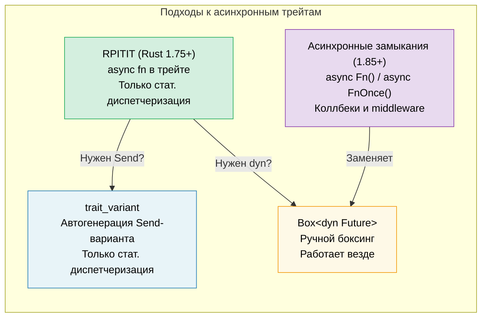

# 10. Асинхронные трейты 🟡

> **Чему вы научитесь:**
> - Почему стабилизация асинхронных методов в трейтах заняла годы
> - RPITIT: встроенной поддержке асинхронных методов трейтов (Rust 1.75+)
> - Сложностям с динамической диспетчеризацией (`dyn`) и `Send`-ограничениями в `trait_variant`
> - Асинхронным замыканиям (Rust 1.85+): `async Fn()` и `async FnOnce()`



## История: почему это заняло так много времени

Асинхронные методы в трейтах оставались самой запрашиваемой возможностью Rust на протяжении многих лет. Проблема заключалась в следующем:

```rust
// Это не компилировалось до версии Rust 1.75 (декабрь 2023 года):
trait DataStore {
    async fn get(&self, key: &str) -> Option<String>;
}
// Почему? Потому что async fn возвращает `impl Future<Output = T>`,
// а `impl Trait` в позиции возвращаемого значения трейта не поддерживался.
```

Фундаментальная сложность: когда метод трейта возвращает `impl Future`, каждый тип, реализующий этот трейт, возвращает *свой конкретный тип фьючера*. Компилятору необходимо знать размер возвращаемого значения, но методы трейтов могут использовать динамическую диспетчеризацию.

### RPITIT: Return Position Impl Trait in Trait

Начиная с версии Rust 1.75, это из коробки работает для статической диспетчеризации:

```rust
trait DataStore {
    async fn get(&self, key: &str) -> Option<String>;
    // Разворачивается в:
    // fn get(&self, key: &str) -> impl Future<Output = Option<String>>;
}

struct InMemoryStore {
    data: std::collections::HashMap<String, String>,
}

impl DataStore for InMemoryStore {
    async fn get(&self, key: &str) -> Option<String> {
        self.data.get(key).cloned()
    }
}

// ✅ Работает с обобщениями (статическая диспетчеризация):
async fn lookup<S: DataStore>(store: &S, key: &str) {
    if let Some(val) = store.get(key).await {
        println!("{key} = {val}");
    }
}
```

### dyn-диспетчеризация и Send-ограничения

Ограничение: вы не можете использовать `dyn DataStore` напрямую, так как компилятор не знает размер возвращаемого фьючера:

```rust
// ❌ Не работает:
// async fn lookup_dyn(store: &dyn DataStore, key: &str) { ... }
// Ошибка: трейт `DataStore` не является dyn-совместимым, так как метод `get`
//        помечен как `async`

// ✅ Обходной путь: Возврат упакованного (boxed) фьючера
trait DynDataStore {
    fn get(&self, key: &str) -> Pin<Box<dyn Future<Output = Option<String>> + Send + '_>>;
}
```

**Проблема с Send**: В многопоточных средах выполнения все запускаемые задачи должны реализовывать `Send`. Однако асинхронные методы трейтов не добавляют ограничения `Send` автоматически:

```rust
trait Worker {
    async fn run(self); // Фьючер может как реализовывать, так и не реализовывать Send
}

struct MyWorker;

impl Worker for MyWorker {
    async fn run(self) {
        // Если здесь используются !Send-типы, фьючер становится !Send
        let rc = std::rc::Rc::new(42);
        some_work().await;
        println!("{rc}");
    }
}

// ❌ Эта строчка выдаст ошибку, так как фьючер является !Send (Rc не реализует Send):
// tokio::spawn(worker.run()); // Требует Send + 'static
//
// Примечание: Мы используем self (по значению) здесь, так как tokio::spawn также
// требует 'static — фьючер, заимствующий &self, не может быть 'static.
// Даже без Rc, метод `async fn run(&self)` нельзя было бы запустить через spawn.
```

### Библиотека trait_variant

Библиотека `trait_variant` (созданная рабочей группой по асинхронному Rust) автоматически генерирует `Send`-версию трейта:

```rust
// Cargo.toml: trait-variant = "0.1"

#[trait_variant::make(SendDataStore: Send)]
trait DataStore {
    async fn get(&self, key: &str) -> Option<String>;
    async fn set(&self, key: &str, value: String);
}

// Теперь у вас есть два трейта:
// - DataStore: без требований Send к фьючерам
// - SendDataStore: все фьючеры реализуют Send
// Оба имеют одинаковые методы, разработчики реализуют DataStore,
// и автоматически получают SendDataStore, если их фьючеры реализуют Send.

// Используйте SendDataStore, когда вам нужно запускать задачи:
async fn spawn_lookup<S: SendDataStore + 'static>(store: Arc<S>) {
    tokio::spawn(async move {
        store.get("key").await;
    });
}

// ⚠️ Примечание: trait_variant НЕ включает dyn-диспетчеризацию.
// Сгенерированный трейт все еще возвращает impl Future, поэтому dyn SendDataStore
// не является объектно-безопасным. Для dyn-диспетчеризации вам все еще нужен ручной боксинг
// (см. подход с Box::pin выше) или библиотека async-trait.
```

### Быстрая шпаргалка: Асинхронные трейты

| Подход | Стат. диспетчеризация | Дин. диспетчеризация | Send | Синтаксический оверхед |
|----------|:---:|:---:|:---:|---|
| Встроенный `async fn` в трейте | ✅ | ❌ | Неявный | Отсутствует |
| `trait_variant` | ✅ | ❌ | Явный | `#[trait_variant::make]` |
| Ручной `Box::pin` | ✅ | ✅ | Явный | Высокий |
| Библиотека `async-trait` | ✅ | ✅ | `#[async_trait]` | Средний (proc macro) |

> **Рекомендация**: Для нового кода (Rust 1.75+) используйте встроенные асинхронные трейты. Добавляйте `trait_variant`, когда вам нужны `Send`-ограничения для запуска фоновых задач. Для динамической диспетчеризации (`dyn`) используйте ручной возврат `Box::pin` или библиотеку `async-trait`. Встроенный подход имеет нулевую стоимость для статической диспетчеризации.

### Асинхронные замыкания (Rust 1.85+)

Начиная с версии Rust 1.85, были стабилизированы асинхронные замыкания — замыкания, которые захватывают контекст и возвращают фьючер:

```rust
// До версии 1.85: неудобный обходной путь
let urls = vec!["https://a.com", "https://b.com"];
let fetchers: Vec<_> = urls.iter().map(|url| {
    let url = url.to_string();
    // Возвращает обычное замыкание, возвращающее асинхронный блок
    move || async move { reqwest::get(&url).await }
}).collect();

// После версии 1.85: асинхронные замыкания работают из коробки
let fetchers: Vec<_> = urls.iter().map(|url| {
    async move || { reqwest::get(url).await }
    // ↑ Это асинхронное замыкание — захватывает url, возвращает Future
}).collect();
```

Асинхронные замыкания реализуют новые трейты `AsyncFn`, `AsyncFnMut` и `AsyncFnOnce`, которые зеркально повторяют стандартные `Fn`, `FnMut` и `FnOnce`:

```rust
// Обобщенная функция, принимающая асинхронное замыкание
async fn retry<F>(max: usize, f: F) -> Result<String, Error>
where
    F: AsyncFn() -> Result<String, Error>,
{
    for _ in 0..max {
        if let Ok(val) = f().await {
            return Ok(val);
        }
    }
    f().await
}
```

> **Совет по миграции**: Если у вас есть код с сигнатурой `Fn() -> impl Future<Output = T>`,
> рассмотрите возможность переключения на `AsyncFn() -> T` для более чистого описания типов.

<details>
<summary><strong>🏋️ Упражнение: Проектирование асинхронного сервисного трейта</strong> (нажмите для раскрытия)</summary>

**Задача**: Спроектируйте трейт `Cache` с асинхронными методами `get` и `set`. Реализуйте его дважды: один раз на основе `HashMap` (в оперативной памяти), а второй раз — с имитацией бэкенда Redis (используйте `tokio::time::sleep` для симуляции задержек сети). Напишите обобщенную функцию, которая работает с обеими реализациями.

<details>
<summary>🔑 Решение</summary>

```rust
use std::collections::HashMap;
use std::sync::Arc;
use tokio::sync::Mutex;
use tokio::time::{sleep, Duration};

trait Cache {
    async fn get(&self, key: &str) -> Option<String>;
    async fn set(&self, key: &str, value: String);
}

// --- Реализация в оперативной памяти ---
struct MemoryCache {
    store: Mutex<HashMap<String, String>>,
}

impl MemoryCache {
    fn new() -> Self {
        MemoryCache {
            store: Mutex::new(HashMap::new()),
        }
    }
}

impl Cache for MemoryCache {
    async fn get(&self, key: &str) -> Option<String> {
        self.store.lock().await.get(key).cloned()
    }

    async fn set(&self, key: &str, value: String) {
        self.store.lock().await.insert(key.to_string(), value);
    }
}

// --- Имитация Redis-хранилища ---
struct RedisCache {
    store: Mutex<HashMap<String, String>>,
    latency: Duration,
}

impl RedisCache {
    fn new(latency_ms: u64) -> Self {
        RedisCache {
            store: Mutex::new(HashMap::new()),
            latency: Duration::from_millis(latency_ms),
        }
    }
}

impl Cache for RedisCache {
    async fn get(&self, key: &str) -> Option<String> {
        sleep(self.latency).await; // Имитируем задержку сети
        self.store.lock().await.get(key).cloned()
    }

    async fn set(&self, key: &str, value: String) {
        sleep(self.latency).await;
        self.store.lock().await.insert(key.to_string(), value);
    }
}

// --- Обобщенная функция, работающая с любым Cache ---
async fn cache_demo<C: Cache>(cache: &C, label: &str) {
    cache.set("greeting", "Hello, async!".into()).await;
    let val = cache.get("greeting").await;
    println!("[{label}] greeting = {val:?}");
}

#[tokio::main]
async fn main() {
    let mem = MemoryCache::new();
    cache_demo(&mem, "memory").await;

    let redis = RedisCache::new(50);
    cache_demo(&redis, "redis").await;
}
```

**Ключевой вывод**: Одна и та же обобщенная функция работает с обеими реализациями благодаря статической диспетчеризации. Никакого боксинга и накладных расходов на аллокацию. Если вам нужно запускать эти фьючерсы в многопоточном рантайме, добавьте макрос `trait_variant::make(SendCache: Send)` для получения ограничений `Send`. Для динамической диспетчеризации используйте ручной возврат `Box::pin` или библиотеку `async-trait`.

</details>
</details>

> **Основные выводы — Асинхронные трейты**
> - Найтиная с версии Rust 1.75, вы можете писать `async fn` прямо в трейтах (библиотека `#[async_trait]` больше не обязательна)
> - Макрос `trait_variant::make` автоматически генерирует `Send`-версию трейта для запуска фоновых задач (только при статической диспетчеризации)
> - Асинхронные замыкания (`async Fn()`) стабилизированы в Rust 1.85 — используйте их для обратных вызовов и middleware
> - Предпочитайте статическую диспетчеризацию (`<S: Service>`) вместо динамической (`dyn`) для критически важного по производительности кода

> **См. также:** [Глава 13 — Паттерны для продакшена](ch13-production-patterns.md) для изучения трейта `Service` из библиотеки Tower, [Глава 6 — Создание Futures вручную](ch06-building-futures-by-hand.md) для ручного написания реализаций трейтов

***
