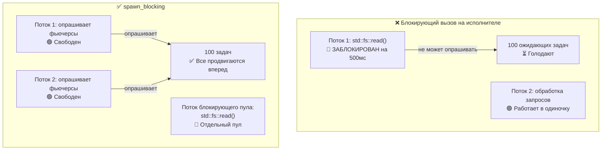

# 12. Распространенные ошибки 🔴

> **Чему вы научитесь:**
> - 9 распространенным багам асинхронного Rust и способам их исправления
> - Почему блокировка исполнителя — это ошибка №1 (и как её решает `spawn_blocking`)
> - Опасностям отмены: что происходит, когда фьючер сбрасывается посреди ожидания
> - Отладке: `tokio-console`, `tracing`, `#[instrument]`
> - Тестированию: `#[tokio::test]`, `time::pause()`, мокированию на основе трейтов

## Блокировка исполнителя

Ошибка №1 в асинхронном Rust: запуск блокирующего кода в потоке асинхронного исполнителя. Это приводит к голоданию других задач.

```rust
// ❌ НЕПРАВИЛЬНО: Блокирует весь рабочий поток исполнителя
async fn bad_handler() -> String {
    let data = std::fs::read_to_string("big_file.txt").unwrap(); // БЛОКИРУЕТ!
    process(&data)
}

// ✅ ПРАВИЛЬНО: Переносим блокирующую работу в выделенный пул потоков
async fn good_handler() -> String {
    let data = tokio::task::spawn_blocking(|| {
        std::fs::read_to_string("big_file.txt").unwrap()
    }).await.unwrap();
    process(&data)
}

// ✅ ТОЖЕ ПРАВИЛЬНО: Используем асинхронный fs из Tokio
async fn also_good_handler() -> String {
    let data = tokio::fs::read_to_string("big_file.txt").await.unwrap();
    process(&data)
}
```



### std::thread::sleep против tokio::time::sleep

```rust
// ❌ НЕПРАВИЛЬНО: Блокирует поток исполнителя на 5 секунд
async fn bad_delay() {
    std::thread::sleep(Duration::from_secs(5)); // Поток не может опрашивать ничего другого!
}

// ✅ ПРАВИЛЬНО: Передает управление исполнителю, другие задачи могут работать
async fn good_delay() {
    tokio::time::sleep(Duration::from_secs(5)).await; // Не блокирует поток!
}
```

### Удержание MutexGuard через .await

```rust
use std::sync::Mutex; // std Mutex — НЕ знает про асинхронность

// ⚠️ ОПАСНО: MutexGuard удерживается через .await
async fn bad_mutex(data: &Mutex<Vec<String>>) {
    let mut guard = data.lock().unwrap();
    guard.push("item".into());
    some_io().await; // Гард удерживается здесь — не дает другим потокам взять блокировку!
    guard.push("another".into());
}
// ПРИМЕЧАНИЕ: Это компилируется! std::sync::MutexGuard является !Send, но компилятор
// требует Send от Future только при передаче туда, где это нужно (например, в
// tokio::spawn). Прямой вызов bad_mutex(...).await скомпилируется.
// Однако tokio::spawn(bad_mutex(data)) упадет с ошибкой ограничения Send.
```

**Почему это обычно является проблемой** — но не всегда:

Удержание `std::sync::Mutex` через точку `.await` блокирует **системный поток (OS thread)** на всё время выполнения ввода-вывода, не позволяя исполнителю опрашивать другие задачи на этом потоке. Для коротких критических секций это расточительно, а для долгого ввода-вывода — это ловушка производительности.

**Однако** существуют оправданные сценарии, в которых вы *обязаны* удерживать блокировку через точку `.await` — точно так же, как транзакция базы данных удерживает блокировку между операциями чтения и коммита. Освобождение и повторный захват блокировки приводят к **состоянию гонки TOCTOU (time-of-check to time-of-use)**: другая задача может изменить данные в промежутке между вашими двумя критическими секциями. Правильное исправление зависит от конкретного случая:

```rust
// ВАРИАНТ 1: Ограничиваем область видимости гарда — подходит, когда операции независимы
async fn scoped_mutex(data: &Mutex<Vec<String>>) {
    {
        let mut guard = data.lock().unwrap();
        guard.push("item".into());
    } // Гард удаляется здесь
    some_io().await; // Блокировка снята — другие задачи могут выполняться
    {
        let mut guard = data.lock().unwrap();
        guard.push("another".into());
    }
}
// ⚠️ Осторожно: другая задача может захватить блокировку и изменить Vec между двумя секциями.
//    Это нормально, если два добавления независимы, но неверно, если "another"
//    зависит от состояния, установленного "item".

// ВАРИАНТ 2: Используем tokio::sync::Mutex — держит блокировку через .await без
//            блокирования потока ОС. Подходит, когда требуется транзакционность
//            чтения-модификации-записи через точку await.
use tokio::sync::Mutex as AsyncMutex;

async fn async_mutex(data: &AsyncMutex<Vec<String>>) {
    let mut guard = data.lock().await; // Асинхронная блокировка — не блокирует поток ОС
    guard.push("item".into());
    some_io().await; // ОК — гард Mutex из tokio реализует Send
    guard.push("another".into());
    // Гард удерживается всё время — нет гонки TOCTOU, поток ОС не заблокирован.
}
```

> **Какой Mutex когда использовать**:
> - `std::sync::Mutex`: Короткие критические секции без вызовов `.await` внутри.
> - `tokio::sync::Mutex`: Когда вам нужно удерживать блокировку через точки `.await` (транзакционная семантика, избегание гонок TOCTOU).
> - `parking_lot::Mutex`: Альтернатива для `std` с тем же интерфейсом, быстрее, компактнее, всё так же без `.await` внутри.
>
> **Золотое правило**: Не разделяйте критическую секцию вокруг точки `.await` вслепую. Спросите себя, действительно ли эти две части независимы. Если нет — если вторая половина зависит от состояния, созданного первой — используйте `tokio::sync::Mutex` или пересмотрите схему потоков данных.

### Опасности отмены (Cancellation Hazards)

Удаление (drop) фьючера отменяет его выполнение — но это может оставить данные в некорректном/неполном состоянии:

```rust
// ❌ ОПАСНО: Утечка ресурсов при отмене
async fn transfer(from: &Account, to: &Account, amount: u64) {
    from.debit(amount).await;  // Если отмена произойдет ЗДЕСЬ...
    to.credit(amount).await;   // ...деньги просто исчезнут!
}

// ✅ БЕЗОПАСНО: Делаем операции атомарными или используем компенсацию
async fn safe_transfer(from: &Account, to: &Account, amount: u64) -> Result<(), Error> {
    // Используем транзакцию базы данных (все или ничего)
    let tx = db.begin_transaction().await?;
    tx.debit(from, amount).await?;
    tx.credit(to, amount).await?;
    tx.commit().await?; // Фиксируем изменения только при успехе всей цепочки
    Ok(())
}

// ✅ ТОЖЕ БЕЗОПАСНО: Используем tokio::select! с учетом возможности отмены
tokio::select! {
    result = transfer(from, to, amount) => {
        // Перевод завершен
    }
    _ = shutdown_signal() => {
        // Не отменяем посреди перевода — даем ему завершиться
        // Или: явно откатываем изменения
    }
}
```

### Отсутствие асинхронного Drop

Трейт `Drop` в Rust является синхронным — вы **не можете** вызывать `.await` внутри метода `drop()`. Это частая причина путаницы:

```rust
struct DbConnection { /* ... */ }

impl Drop for DbConnection {
    fn drop(&mut self) {
        // ❌ Нельзя так делать — drop() синхронен!
        // self.connection.shutdown().await;

        // ✅ Обходной путь 1: Запуск задачи очистки в фоне (выстрелил и забыл)
        let conn = self.connection.take();
        tokio::spawn(async move {
            let _ = conn.shutdown().await;
        });

        // ✅ Обходной путь 2: Использовать синхронное закрытие
        // self.connection.blocking_close();
    }
}
```

**Рекомендуемый подход**: Предоставляйте явный метод `async fn close(self)` и документируйте, что вызывающая сторона должна использовать именно его. Полагайтесь на `Drop` только как на средство последней надежды (safety net), а не как на основной путь освобождения ресурсов.

### Честность select! и голодание

```rust
use tokio::sync::mpsc;

// ❌ НЕЧЕСТНО: fast всегда побеждает, slow голодает
async fn unfair(mut fast: mpsc::Receiver<i32>, mut slow: mpsc::Receiver<i32>) {
    loop {
        tokio::select! {
            Some(v) = fast.recv() => println!("fast: {v}"),
            Some(v) = slow.recv() => println!("slow: {v}"),
            // Если готовы оба, tokio случайно выбирает один.
            // Но если fast готов ВСЕГДА, slow почти никогда не опрашивается.
        }
    }
}

// ✅ ЧЕСТНО: Используем biased (приоритетный) select или вычитываем пакетами
async fn fair(mut fast: mpsc::Receiver<i32>, mut slow: mpsc::Receiver<i32>) {
    loop {
        tokio::select! {
            biased; // Всегда проверяем по порядку — явный приоритет

            Some(v) = slow.recv() => println!("slow: {v}"),  // Приоритет!
            Some(v) = fast.recv() => println!("fast: {v}"),
        }
    }
}
```

### Случайное последовательное выполнение

```rust
// ❌ ПОСЛЕДОВАТЕЛЬНО: Занимает 2 секунды в сумме
async fn slow() {
    let a = fetch("url_a").await; // 1 секунда
    let b = fetch("url_b").await; // 1 секунда (ждет завершения a!)
}

// ✅ КОНКУРЕНТНО: Занимает 1 секунду в сумме
async fn fast() {
    let (a, b) = tokio::join!(
        fetch("url_a"), // Оба запускаются сразу
        fetch("url_b"),
    );
}

// ✅ ТОЖЕ КОНКУРЕНТНО: С помощью let + join
async fn also_fast() {
    let fut_a = fetch("url_a"); // Создаем фьючер (ленивый — еще не запущен)
    let fut_b = fetch("url_b"); // Создаем фьючер
    let (a, b) = tokio::join!(fut_a, fut_b); // ТЕПЕРЬ оба выполняются конкурентно
}
```

> **Ловушка**: Код `let a = fetch(url).await; let b = fetch(url).await;` выполняется последовательно!
> Второй `.await` не начнется, пока не завершится первый. Используйте `join!` или `spawn` для конкурентного выполнения.

## Практический кейс: Отладка зависшего сервиса в продакшене

Реальный сценарий: сервис отлично обрабатывает запросы в течение 10 минут, а затем перестает отвечать. В логах нет ошибок. Нагрузка на CPU равна 0%.

**Шаги диагностики:**

1. **Подключение `tokio-console`** — показывает более 200 задач, застрявших в состоянии `Pending`.
2. **Анализ деталей задач** — все они ждут вызова `Mutex::lock().await` на одном и том же объекте.
3. **Первопричина** — одна задача удерживала `std::sync::MutexGuard` через `.await` и запаниковала, отравив (poisoning) мьютекс. Все остальные задачи теперь падают на вызове `lock().unwrap()`.

**Решение:**

| Было (сломано) | Стало (исправлено) |
|-----------------|---------------|
| `std::sync::Mutex` | `tokio::sync::Mutex` |
| `MutexGuard` через `.await` | Ограничение области видимости гарда перед `.await` |
| Нет таймаута на захват блокировки | Добавлен таймаут `tokio::time::timeout(dur, mutex.lock())` |
| Нет обработки отравленного мьютекса | `tokio::sync::Mutex` не подвержен отравлению (poisoning) |

**Чек-лист предотвращения багов:**
- [ ] Используйте `tokio::sync::Mutex`, если гард удерживается через `.await`
- [ ] Добавляйте `#[tracing::instrument]` к асинхронным функциям для отслеживания спанов
- [ ] Запускайте `tokio-console` на стейджинге, чтобы находить зависшие задачи на ранней стадии
- [ ] Создавайте эндпоинты проверки работоспособности (health check), проверяющие отзывчивость задач

<details>
<summary><strong>🏋️ Упражнение: Найдите баги</strong> (нажмите для раскрытия)</summary>

**Задача**: Найдите все асинхронные ловушки в данном коде и исправьте их.

```rust
use std::sync::Mutex;

async fn process_requests(urls: Vec<String>) -> Vec<String> {
    let results = Mutex::new(Vec::new());
    
    for url in &urls {
        let response = reqwest::get(url).await.unwrap().text().await.unwrap();
        std::thread::sleep(std::time::Duration::from_millis(100)); // Ограничение частоты
        let mut guard = results.lock().unwrap();
        guard.push(response);
        expensive_parse(&guard).await; // Парсинг всех результатов на данный момент
    }
    
    results.into_inner().unwrap()
}
```

<details>
<summary>🔑 Решение</summary>

**Найденные баги:**

1. **Последовательное скачивание** — URL-адреса загружаются один за другим, а не параллельно.
2. **`std::thread::sleep`** — Блокирует поток исполнителя.
3. **Удержание MutexGuard через `.await`** — переменная `guard` существует в момент ожидания `expensive_parse`.
4. **Отсутствие конкурентности** — следовало бы использовать `join!` или `FuturesUnordered`.

```rust
use tokio::sync::Mutex;
use std::sync::Arc;
use futures::stream::{self, StreamExt};

async fn process_requests(urls: Vec<String>) -> Vec<String> {
    // Исправление 4: Обрабатываем URL конкурентно через buffer_unordered
    let results: Vec<String> = stream::iter(urls)
        .map(|url| async move {
            let response = reqwest::get(&url).await.unwrap().text().await.unwrap();
            // Исправление 2: Используем tokio::time::sleep вместо std::thread::sleep
            tokio::time::sleep(std::time::Duration::from_millis(100)).await;
            response
        })
        .buffer_unordered(10) // До 10 параллельных запросов
        .collect()
        .await;

    // Исправление 3: Выполняем парсинг после сбора — мьютекс вообще не нужен!
    for result in &results {
        expensive_parse(result).await;
    }

    results
}
```

**Ключевой вывод**: Часто можно перестроить асинхронный код так, чтобы вообще исключить мьютексы. Соберите результаты при помощи стримов или `join!`, а затем обработайте их. Это проще, быстрее и исключает риск взаимной блокировки (deadlock).

</details>
</details>

---

## Отладка асинхронного кода

Асинхронные трассировки стека печально известны своей запутанностью: они показывают внутренний цикл опроса исполнителя, а не вашу логическую цепочку вызовов. Вот основные инструменты отладки.

### tokio-console: Инспектор задач реального времени

Инструмент [tokio-console](https://github.com/tokio-rs/console) предоставляет интерфейс, похожий на `htop`, отображающий каждую запущенную задачу: её состояние, время опроса, активность waker и потребление ресурсов.

```toml
# Cargo.toml
[dependencies]
console-subscriber = "0.4"
tokio = { version = "1", features = ["full", "tracing"] }
```

```rust
#[tokio::main]
async fn main() {
    console_subscriber::init(); // Заменяет стандартный подписчик трассировки
    // ... остальная часть вашего приложения
}
```

Затем в другом терминале:

```bash
$ RUSTFLAGS="--cfg tokio_unstable" cargo run   # Необходимый флаг компиляции
$ tokio-console                                # Подключается к 127.0.0.1:6669
```

### tracing + #[instrument]: Структурированное логирование для асинхронного кода

Библиотека [`tracing`](https://docs.rs/tracing) учитывает жизненный цикл `Future`. Спаны (spans) остаются открытыми через точки `.await`, сохраняя логический стек вызовов, даже если поток ОС переключился на другую работу:

```rust
use tracing::{info, instrument};

#[instrument(skip(db_pool), fields(user_id = %user_id))]
async fn handle_request(user_id: u64, db_pool: &Pool) -> Result<Response> {
    info!("looking up user");
    let user = db_pool.get_user(user_id).await?;  // спан остается открытым через .await
    info!(email = %user.email, "found user");
    let orders = fetch_orders(user_id).await?;     // всё еще тот же самый спан
    Ok(build_response(user, orders))
}
```

Вывод (при использовании `tracing_subscriber::fmt::json()`):

```json
{"timestamp":"...","level":"INFO","span":{"name":"handle_request","user_id":"42"},"message":"looking up user"}
{"timestamp":"...","level":"INFO","span":{"name":"handle_request","user_id":"42"},"fields":{"email":"a@b.com"},"message":"found user"}
```

### Чек-лист для отладки

| Симптом | Вероятная причина | Инструмент |
|---------|-------------|------|
| Задача зависает навсегда | Пропущен `.await` или взаимная блокировка `Mutex` | Вкладка задач в `tokio-console` |
| Низкая пропускная способность | Блокирующий вызов на асинхронном потоке | Гистограмма времени опроса в `tokio-console` |
| `Future is not Send` | Не-Send тип удерживается через `.await` | Ошибка компилятора + поиск по `#[instrument]` |
| Внезапная отмена | Родительский `select!` сбросил одну из ветвей | События жизненного цикла спанов в `tracing` |

> **Совет**: Включите `RUSTFLAGS="--cfg tokio_unstable"`, чтобы получать метрики на уровне задач в `tokio-console`. Это флаг времени компиляции, а не времени выполнения.

## Тестирование асинхронного кода

Асинхронный код ставит уникальные задачи перед тестированием: вам необходимы среда выполнения, контроль времени и стратегии проверки конкурентного поведения.

**Базовые асинхронные тесты** с макросом `#[tokio::test]`:

```rust
// Cargo.toml
// [dev-dependencies]
// tokio = { version = "1", features = ["full", "test-util"] }

#[tokio::test]
async fn test_basic_async() {
    let result = fetch_data().await;
    assert_eq!(result, "expected");
}

// Однопоточный тест (полезно для !Send типов):
#[tokio::test(flavor = "current_thread")]
async fn test_single_threaded() {
    let rc = std::rc::Rc::new(42);
    let val = async { *rc }.await;
    assert_eq!(val, 42);
}

// Многопоточный тест с явным указанием рабочих потоков:
#[tokio::test(flavor = "multi_thread", worker_threads = 2)]
async fn test_concurrent_behavior() {
    // Тестирует состояния гонки в условиях реального параллелизма
    let counter = std::sync::Arc::new(std::sync::atomic::AtomicU32::new(0));
    let c1 = counter.clone();
    let c2 = counter.clone();
    let (a, b) = tokio::join!(
        tokio::spawn(async move { c1.fetch_add(1, std::sync::atomic::Ordering::SeqCst) }),
        tokio::spawn(async move { c2.fetch_add(1, std::sync::atomic::Ordering::SeqCst) }),
    );
    a.unwrap();
    b.unwrap();
    assert_eq!(counter.load(std::sync::atomic::Ordering::SeqCst), 2);
}
```

**Манипулирование временем** — тестирование таймаутов без реального ожидания:

```rust
use tokio::time::{self, Duration, Instant};

#[tokio::test]
async fn test_timeout_behavior() {
    // Приостанавливаем время — sleep() срабатывает мгновенно, без реальной задержки времени
    time::pause();

    let start = Instant::now();
    time::sleep(Duration::from_secs(3600)).await; // «ждет» 1 час — выполняется за 0 мс
    assert!(start.elapsed() >= Duration::from_secs(3600));
    // Тест отработал за миллисекунды, а не за час!
}

#[tokio::test]
async fn test_retry_timing() {
    time::pause();

    // Проверяем, что логика повторных попыток ожидает нужное время
    let start = Instant::now();
    let result = retry_with_backoff(|| async {
        Err::<(), _>("simulated failure")
    }, 3, Duration::from_secs(1))
    .await;

    assert!(result.is_err());
    // 1с + 2с + 4с = 7с задержки (экспоненциальной)
    assert!(start.elapsed() >= Duration::from_secs(7));
}

#[tokio::test]
async fn test_deadline_exceeded() {
    time::pause();

    let result = tokio::time::timeout(
        Duration::from_secs(5),
        async {
            // Имитируем медленную операцию
            time::sleep(Duration::from_secs(10)).await;
            "done"
        }
    ).await;

    assert!(result.is_err()); // Вышел таймаут
}
```

**Мокирование асинхронных зависимостей** — используйте трейт-объекты или обобщения:

```rust
// Определяем трейт для зависимости:
trait Storage {
    async fn get(&self, key: &str) -> Option<String>;
    async fn set(&self, key: &str, value: String);
}

// Боевая (production) реализация:
struct RedisStorage { /* ... */ }
impl Storage for RedisStorage {
    async fn get(&self, key: &str) -> Option<String> {
        // Реальный вызов Redis
        todo!()
    }
    async fn set(&self, key: &str, value: String) {
        todo!()
    }
}

// Тестовый мок (mock):
struct MockStorage {
    data: std::sync::Mutex<std::collections::HashMap<String, String>>,
}

impl MockStorage {
    fn new() -> Self {
        MockStorage { data: std::sync::Mutex::new(std::collections::HashMap::new()) }
    }
}

impl Storage for MockStorage {
    async fn get(&self, key: &str) -> Option<String> {
        self.data.lock().unwrap().get(key).cloned()
    }
    async fn set(&self, key: &str, value: String) {
        self.data.lock().unwrap().insert(key.to_string(), value);
    }
}

// Тестируемая функция обобщена по Storage:
async fn cache_lookup<S: Storage>(store: &S, key: &str) -> String {
    match store.get(key).await {
        Some(val) => val,
        None => {
            let val = "computed".to_string();
            store.set(key, val.clone()).await;
            val
        }
    }
}

#[tokio::test]
async fn test_cache_miss_then_hit() {
    let mock = MockStorage::new();

    // Первый вызов: промах → вычисляем и сохраняем
    let val = cache_lookup(&mock, "key1").await;
    assert_eq!(val, "computed");

    // Второй вызов: попадание → возвращает сохраненное значение
    let val = cache_lookup(&mock, "key1").await;
    assert_eq!(val, "computed");
    assert!(mock.data.lock().unwrap().contains_key("key1"));
}
```

**Тестирование каналов и взаимодействия задач**:

```rust
#[tokio::test]
async fn test_producer_consumer() {
    let (tx, mut rx) = tokio::sync::mpsc::channel(10);

    tokio::spawn(async move {
        for i in 0..5 {
            tx.send(i).await.unwrap();
        }
        // tx сбрасывается здесь — канал закрывается
    });

    let mut received = Vec::new();
    while let Some(val) = rx.recv().await {
        received.push(val);
    }

    assert_eq!(received, vec![0, 1, 2, 3, 4]);
}
```

| Шаблон теста | Когда использовать | Ключевой инструмент |
|-------------|-------------|----------|
| `#[tokio::test]` | Все асинхронные тесты | `tokio = { features = ["macros", "rt"] }` |
| `time::pause()` | Тестирование таймаутов, повторных попыток, периодических задач | `tokio::time::pause()` |
| Мокирование трейтов | Тестирование бизнес-логики без ввода-вывода | Обобщения вроде `<S: Storage>` |
| Режим `current_thread` | Тестирование `!Send` типов или детерминированного планирования | `#[tokio::test(flavor = "current_thread")]` |
| Режим `multi_thread` | Тестирование состояний гонки | `#[tokio::test(flavor = "multi_thread")]` |

> **Основные выводы — Распространенные ошибки**
> - **Никогда не блокируйте исполнитель** — используйте `spawn_blocking` для CPU-емких и синхронных задач
> - **Никогда не удерживайте MutexGuard через .await** — жестко ограничивайте область видимости блокировок или используйте `tokio::sync::Mutex`
> - **Отмена сбрасывает фьючер мгновенно** — используйте «безопасные к отмене» паттерны для частично выполненных операций
> - Используйте `tokio-console` и `#[tracing::instrument]` для отладки асинхронного кода
> - Тестируйте асинхронный код с помощью `#[tokio::test]` и `time::pause()` для детерминированного контроля времени

> **См. также:** [Глава 8 — Глубокое погружение в Tokio](ch08-tokio-deep-dive.md) для изучения примитивов синхронизации, [Глава 13 — Паттерны для продакшена](ch13-production-patterns.md) для изучения плавного завершения работы и структурированной конкурентности

***
