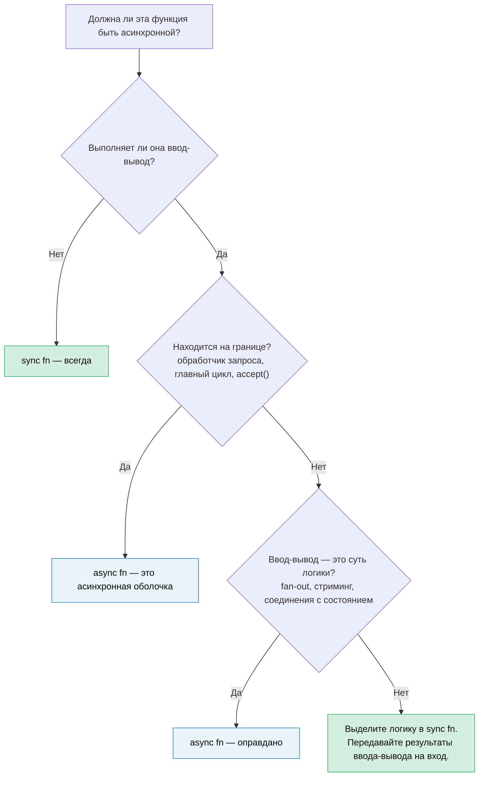

# 14. Асинхронность — это оптимизация, а не архитектура 🔴

> **Чему вы научитесь:**
> - Почему асинхронность стремится заразить всю кодовую базу — и почему это ошибка проектирования, а не фича
> - Паттерну «синхронное ядро, асинхронная оболочка» для сохранения тестируемости и простоты отладки кода
> - Способам решения сложных задач: когда бизнес-логике всё-таки нужен ввод-вывод
> - Когда `spawn_blocking` является решением проблемы, а когда лишь симптомом плохой архитектуры
> - Когда асинхронность действительно необходима в вашей основной бизнес-логике
> - Почему библиотеки с синхронным API по умолчанию легче компоновать, чем асинхронные

Вы изучили 13 глав про асинхронный Rust. Но вот самая важная вещь, о которой книга до сих пор умалчивала: **большая часть вашего кода не должна быть асинхронной.**

## Проблема цвета функций (Function Coloring)

В статье Боба Нистрома [«Какого цвета ваша функция?»](https://journal.stuffwithstuff.com/2015/02/01/what-color-is-your-function/) сформулирована главная проблема: асинхронные функции могут вызывать синхронные, но синхронные функции не могут напрямую вызывать асинхронные. Стоит одной функции стать асинхронной, как вся цепочка вызовов над ней вынуждена следовать этому примеру.

В Rust ситуация обстоит **еще хуже**, чем в C# или JavaScript, потому что асинхронность заражает не только сигнатуры функций — она заражает и сами типы:

| Синхронный код | Асинхронный аналог | В чем разница |
|---|---|---|
| `fn process(&self)` | `async fn process(&self)` | Вызывающие функции тоже должны стать асинхронными |
| `&mut T` | `Arc<Mutex<T>>` | Запускаемые задачи требуют `'static + Send` |
| `std::sync::Mutex` | `tokio::sync::Mutex` | Другой тип при удержании блокировки через `.await` |
| `impl Trait` на выходе | `impl Future<Output = T> + Send` | Стало проще после введения RPITIT (Rust 1.75, Глава 10), но сигнатура всё еще «окрашена» |
| `#[test]` | `#[tokio::test]` | Тестам необходима среда выполнения |
| Стек вызовов: 5 фреймов | Стек вызовов: 25 фреймов | Половина из них — внутренние механизмы рантайма |

Каждая строка в этой таблице — это решение, которое разработчик должен принять, правильно реализовать и затем поддерживать. При этом ни одно из них не связано напрямую с самой бизнес-логикой. Индустрия постепенно уходит от этого подхода: виртуальные потоки в Java (Project Loom) и горутины в Go позволяют писать код, выглядящий как синхронный, который рантайм дешево мультиплексирует под капотом. Rust выбрал явную асинхронность ради контроля с нулевой стоимостью (zero-cost control), но этот контроль дается ценой сложности, которую нужно платить осознанно, а не по умолчанию.

## «Но ведь потоки ОС — это дорого»

Часто можно услышать рефлекторное возражение: «Нам нужна асинхронность, потому что системные потоки обходятся слишком дорого». Это утверждение в основном неверно для масштабов, в которых работает большинство команд.

- **Память под стек**: Каждый поток ОС резервирует 8 МБ виртуального адресного пространства (по умолчанию в Linux), но операционная система выделяет физические страницы памяти только по мере обращения к ним. Поток, который большую часть времени бездействует, потребляет всего 20–80 КБ физической памяти.
- **Переключение контекста**: Занимает порядка 1–5 мкс на современном оборудовании. При 50 параллельных запросах это просто погрешность измерений. Заметным это становится только при 100 тысячах переключений в секунду.
- **Стоимость создания**: Около 10–30 мкс на поток в Linux. Использование пула потоков (`rayon`, `std::thread::scope`) снижает эти накладные расходы практически до нуля.

Честный порог, при котором асинхронность окупает свою сложность — это примерно **1–10 тысяч одновременно удерживаемых, но преимущественно бездействующих соединений**. Это «золотая зона» для `epoll`/`io_uring`, где стек каждого отдельного потока начинает выливаться в реальные расходы памяти. Всё, что ниже этого порога, проще сделать на пуле потоков: такой код легче отлаживать, и он работает достаточно быстро. Выше этого порога асинхронность побеждает. Но большинство сервисов находятся ниже этой отметки.

## Сложный пример: логика, которой также необходим ввод-вывод

Очевидно, что простая чистая функция вроде `fn add(a: i32, b: i32) -> i32` не нуждается в асинхронности. Это тривиальный вывод. Намного интереснее ситуация, когда бизнес-логике *кажется* необходимым выполнить ввод-вывод прямо посреди вычислений: валидация, проверяющая наличие товара на складе; расчет цены, запрашивающий курс валют; или пайплайн заказа, подгружающий информацию о клиенте.

Рассмотрим сервис обработки заказов. Версия, где асинхронность используется повсюду, выглядит вполне естественно:

### Вариант А: Асинхронность сквозь всё ядро

```rust
// orders.rs — асинхронность до самого низа

pub async fn process_order(order: Order) -> Result<Receipt, OrderError> {
    // Шаг 1: Валидация — чистые бизнес-правила, без ввода-вывода
    validate_items(&order)?;
    validate_quantities(&order)?;

    // Шаг 2: Проверка склада — требует вызова базы данных
    let stock = inventory_client.check(&order.items).await?;
    if !stock.all_available() {
        return Err(OrderError::OutOfStock(stock.missing()));
    }

    // Шаг 3: Расчет цены — чистая математика, но метод асинхронный, раз уж мы здесь
    let pricing = calculate_pricing(&order, &stock);

    // Шаг 4: Применение скидки — требует вызова внешнего сервиса
    let discount = discount_service.lookup(order.customer_id).await?;
    let final_price = pricing.apply_discount(discount);

    // Шаг 5: Форматирование чека — чистая функция
    Ok(Receipt::new(order, final_price))
}
```

Это вполне *разумный* асинхронный код. Здесь нет злоупотреблений `Arc<Mutex>` — просто последовательные ожидания через `.await`. Большинство разработчиков написали бы именно так и пошли дальше. Но посмотрите, что произошло: `validate_items`, `validate_quantities`, `calculate_pricing` и `Receipt::new` — это всё чистые функции, которые оказались затянуты в асинхронный контекст только потому, что шагам 2 и 4 нужен ввод-вывод. Вся функция целиком вынуждена быть асинхронной, её тестам теперь нужен рантайм, а каждый вызывающий метод выше по цепочке стал «окрашенным».

### Вариант Б: Синхронное ядро, асинхронная оболочка

Альтернатива: отделить *принятие решений* от *получения данных*:

```rust
// core.rs — чистая бизнес-логика, без асинхронности и зависимостей от tokio

pub fn validate_order(order: &Order) -> Result<ValidatedOrder, OrderError> {
    validate_items(order)?;
    validate_quantities(order)?;
    Ok(ValidatedOrder::from(order))
}

pub fn check_stock(
    order: &ValidatedOrder,
    stock: &StockResult,
) -> Result<StockedOrder, OrderError> {
    if !stock.all_available() {
        return Err(OrderError::OutOfStock(stock.missing()));
    }
    Ok(StockedOrder::from(order, stock))
}

pub fn finalize(
    order: &StockedOrder,
    discount: Discount,
) -> Receipt {
    let pricing = calculate_pricing(order);
    let final_price = pricing.apply_discount(discount);
    Receipt::new(order, final_price)
}
```

```rust
// shell.rs — тонкий асинхронный оркестратор
//
// Примечание: использование ? на сетевых вызовах требует impl From<reqwest::Error> for OrderError
// (или единого enum для ошибок). См. паттерны обработки асинхронных ошибок в Главе 12.

use crate::core;

pub async fn process_order(order: Order) -> Result<Receipt, OrderError> {
    // Синхронно: валидация
    let validated = core::validate_order(&order)?;

    // Асинхронно: запрашиваем склад (это задача оболочки)
    let stock = inventory_client.check(&validated.items).await?;

    // Синхронно: применяем бизнес-правило к полученным данным
    let stocked = core::check_stock(&validated, &stock)?;

    // Асинхронно: запрашиваем скидку
    let discount = discount_service.lookup(order.customer_id).await?;

    // Синхронно: финальные вычисления
    Ok(core::finalize(&stocked, discount))
}
```

Асинхронная оболочка представляет собой конвейер: **запрос → решение → запрос → решение**. Каждый шаг принятия решений («решение») — это синхронная функция, которая принимает результат ввода-вывода в качестве аргументов на вход, вместо того чтобы выполнять его самостоятельно внутри.

### Разница при тестировании

Синхронное ядро позволяет тестировать любые бизнес-правила без рантайма и моков:

```rust
#[test]
fn out_of_stock_rejects_order() {
    let order = validated_order(vec![item("widget", 10)]);
    let stock = stock_result(vec![("widget", 3)]); // доступно только 3

    let result = core::check_stock(&order, &stock);
    assert_eq!(result.unwrap_err(), OrderError::OutOfStock(vec!["widget"]));
}

#[test]
fn discount_applied_correctly() {
    let order = stocked_order(100_00); // цена в центах
    let receipt = core::finalize(&order, Discount::Percent(15));
    assert_eq!(receipt.final_price, 85_00);
}
```

Асинхронная оболочка покрывается более тонким *интеграционным* тестом, который проверяет связующие звенья, а не саму логику:

```rust
#[tokio::test]
async fn process_order_integration() {
    let mock_inventory = mock_service(/* возвращает информацию о складе */);
    let mock_discounts = mock_service(/* возвращает 10% */);
    let receipt = process_order(sample_order()).await.unwrap();
    assert!(receipt.final_price > 0);
    // Корректность логики уже доказана юнит-тестами ядра выше
}
```

### Почему это важно

| Критерий | Асинхронность сквозь всё ядро | Синхронное ядро + асинхронная оболочка |
|---|---|---|
| Бизнес-правила можно тестировать без рантайма | Нет | **Да** |
| Количество юнит-тестов, требующих `#[tokio::test]` | Все | **Только интеграционные тесты** |
| Сбои ввода-вывода переплетены с логическими ошибками | Да — один тип `Result` для обоих видов ошибок | **Нет** — синхронная часть возвращает логические ошибки, оболочка обрабатывает сбои ввода-вывода |
| `validate_order` можно переиспользовать в CLI / WASM | Нет — транзитивно затаскивает зависимость от tokio | **Да** — чистая функция |
| Трассировка стека сквозь бизнес-логику | Перемешана с внутренними фреймами рантайма | **Чистая** |
| Можно ли позже заменить HTTP-клиент на gRPC | Требует изменения функций ядра | **Изменения коснутся только оболочки** |

**Главная мысль**: вызовы ввода-вывода на шагах 2 и 4 не обязаны находиться внутри бизнес-логики. Они являются входными данными для неё. Синхронное ядро принимает `StockResult` и `Discount` в качестве аргументов. Откуда взялись эти значения — из HTTP-запроса, gRPC, тестовой фикстуры или кэша — это забота исключительно асинхронной оболочки.

## Запах кода: злоупотребление `spawn_blocking`

В Главе 12 мы познакомились с `spawn_blocking` как с тактическим решением проблемы случайного блокирования исполнителя. Это правильный подход для точечных блокирующих вызовов: `std::fs::read`, работа с библиотекой сжатия данных, вызов устаревших функций через FFI.

Но если вы обнаруживаете, что оборачиваете в `spawn_blocking` огромные куски кода:

```rust
async fn handler(req: Request) -> Response {
    // Если ваш код выглядит так, то граница асинхронности проведена неверно
    tokio::task::spawn_blocking(move || {
        let validated = validate(&req);       // синхронно
        let enriched = enrich(validated);      // синхронно
        let result = process(enriched);        // синхронно
        let output = format_response(result);  // синхронно
        output
    }).await.unwrap()
}
```

...это явный сигнал от вашей кодовой базы: **эта логика никогда и не должна была быть асинхронной.** Вам не нужен `spawn_blocking` — вам нужен обычный синхронный модуль, который асинхронный обработчик вызовет напрямую:

```rust
async fn handler(req: Request) -> Response {
    // validate → enrich → process → format являются синхронными.
    // spawn_blocking не нужен — они выполняются быстро и почти не нагружают процессор.
    let response = my_core::handle(req);
    response
}
```

Приберегите `spawn_blocking` для действительно тяжелых вычислений на CPU (парсинг огромных объемов данных, обработка изображений, архивация), где временные затраты могут привести к голоданию исполнителя. Для обычной бизнес-логики, выполняющейся за микросекунды, простой синхронный вызов напрямую будет проще и правильнее.

## Библиотеки: сначала синхронный API, асинхронная обертка опционально

Синхронную библиотеку могут одинаково легко использовать как синхронные, так и асинхронные вызывающие клиенты:

```rust
// Синхронная библиотека — может использоваться где угодно
let report = my_lib::analyze(&data);

// Клиент А: синхронная CLI-утилита
fn main() {
    let report = my_lib::analyze(&data);
    println!("{report}");
}

// Клиент Б: асинхронный обработчик, работает отлично
async fn handler() -> Json<Report> {
    let report = my_lib::analyze(&data); // синхронный вызов в асинхронном контексте — нормально
    Json(report)
}

// Клиент В: тяжелый анализ — клиент сам решает перенести вычисления в пул
async fn handler_heavy() -> Json<Report> {
    let data = data.clone();
    let report = tokio::task::spawn_blocking(move || {
        my_lib::analyze(&data) // клиент сам контролирует границы асинхронности
    }).await.unwrap();
    Json(report)
}
```

Асинхронная же библиотека принуждает абсолютно всех клиентов запускать рантайм:

```rust
// Асинхронная библиотека — может использоваться только из асинхронного контекста
let report = my_lib::analyze(&data).await; // вызывающий метод ОБЯЗАН быть асинхронным

// Синхронный клиент? Теперь вам нужен block_on — и надежда на то, что нет вложенного рантайма
let report = tokio::runtime::Runtime::new().unwrap().block_on(
    my_lib::analyze(&data)
); // хрупкое решение, склонное к паникам, если вы уже находитесь внутри рантайма
```

**Проектируйте API синхронными по умолчанию.** Если ваша библиотека занимается вычислениями, преобразованием данных или парсингом, у нее нет никаких причин быть асинхронной. Если она выполняет ввод-вывод, рассмотрите возможность предоставления синхронного ядра с опциональным асинхронным уровнем под feature-флагом — позвольте вызывающему коду самому определять границы асинхронности.

## Когда асинхронность действительно уместна в ядре

Не всё можно так просто разделить. Асинхронность оправдана в вашем ядре, если:

- **Конкурентные запросы (fan-out/fan-in) составляют суть логики.** Если ваше бизнес-правило звучит как «запросить цены у 5 поставщиков одновременно и выбрать самое дешевое предложение», то конкурентность здесь и есть сама логика, а не просто способ оптимизации. Пытаться сделать это через синхронный код и потоки ОС — это изобретать плохой аналог асинхронности.

- **Стриминг является сутью логики.** Обработка непрерывного потока событий с обратным давлением (backpressure) — управление таким стримом представляет собой сложную бизнес-логику, а не просто обертку над вводом-выводом.

- **Долгоживущие соединения с состоянием.** Обработчики WebSockets, двунаправленные gRPC-стримы и конечные автоматы протоколов совершают переходы состояний, которые неразрывно связаны с событиями ввода-вывода. Итоговый проект в [Главе 17](ch17-capstone-project.md) (асинхронный чат-сервер) — как раз такой случай: параллельные соединения, рассылка сообщений по комнатам и плавное завершение работы являются фундаментально асинхронными задачами.

**Критерий проверки**: если удаление ключевого слова `async` из функции заставило бы вас переписывать её с использованием потоков ОС, каналов или ручного опроса (polling), значит, асинхронность здесь полезна и оправдана. Если же удаление `async` означает простое стирание этого ключевого слова без изменения остального кода — эта функция никогда и не должна была быть асинхронной.

## Правило принятия решений



> **Практическое правило**: Начинайте с синхронного кода. Добавляйте асинхронность только на самой внешней границе ввода-вывода. Протягивайте её вглубь кодовой базы только тогда, когда можете четко объяснить, какие именно параллельные операции ввода-вывода оправдывают плату в виде усложнения кода.

---

<details>
<summary><strong>🏋️ Упражнение: Выделение синхронного ядра</strong> (нажмите для раскрытия)</summary>

Этот обработчик запросов для Axum «заражен» асинхронностью — бизнес-логика перемешана с вводом-выводом. Проведите рефакторинг, разделив код на синхронное ядро и тонкую асинхронную оболочку.

```rust
use axum::{Json, extract::Path};

async fn get_device_report(Path(device_id): Path<String>) -> Result<Json<Report>, AppError> {
    // Получаем сырую телеметрию с устройства по HTTP
    let raw = reqwest::get(format!("http://bmc-{device_id}/telemetry"))
        .await?
        .json::<RawTelemetry>()
        .await?;

    // Бизнес-логика: переводим сырые показания датчиков в калиброванные значения
    let mut readings = Vec::new();
    for sensor in &raw.sensors {
        let calibrated = (sensor.raw_value as f64) * sensor.scale + sensor.offset;
        if calibrated < sensor.min_valid || calibrated > sensor.max_valid {
            return Err(AppError::SensorOutOfRange {
                name: sensor.name.clone(),
                value: calibrated,
            });
        }
        readings.push(CalibratedReading {
            name: sensor.name.clone(),
            value: calibrated,
            unit: sensor.unit.clone(),
        });
    }

    // Бизнес-логика: классифицируем состояние устройства
    let critical_count = readings.iter()
        .filter(|r| r.value > 90.0)
        .count();
    let health = if critical_count > 2 { Health::Critical }
                 else if critical_count > 0 { Health::Warning }
                 else { Health::Ok };

    // Получаем метаданные устройства из сервиса инвентаризации
    let meta = reqwest::get(format!("http://inventory/devices/{device_id}"))
        .await?
        .json::<DeviceMetadata>()
        .await?;

    Ok(Json(Report {
        device_id,
        device_name: meta.name,
        health,
        readings,
        timestamp: chrono::Utc::now(),
    }))
}
```

**Ваши цели:**

1. Создать файл `core.rs` с синхронными функциями: `calibrate_sensors`, `classify_health` и `build_report`
2. Создать файл `shell.rs` с тонким асинхронным обработчиком, который делает запросы по сети, а затем обращается к синхронному ядру
3. Написать тесты с макросом `#[test]` (без `#[tokio::test]`) для сценариев: датчик вышел за границы диапазона, пороговые значения здоровья, и нормальный отчет

**Подсказки:**
- Синхронное ядро должно принимать `RawTelemetry` и `DeviceMetadata` в качестве аргументов на вход — оно не должно догадываться, что эти данные были получены по HTTP.
- Вам понадобится написать небольшие вспомогательные функции для тестов (например, `raw_telemetry()`, `sensor()`, `reading()`, `device_meta()`), которые собирают тестовые фикстуры. Их сигнатуры должны быть очевидны из примеров их вызова.

<details>
<summary>🔑 Решение</summary>

```rust
// core.rs — без зависимостей от асинхронного кода

pub fn calibrate_sensors(raw: &RawTelemetry) -> Result<Vec<CalibratedReading>, AppError> {
    raw.sensors.iter().map(|sensor| {
        let calibrated = (sensor.raw_value as f64) * sensor.scale + sensor.offset;
        if calibrated < sensor.min_valid || calibrated > sensor.max_valid {
            return Err(AppError::SensorOutOfRange {
                name: sensor.name.clone(),
                value: calibrated,
            });
        }
        Ok(CalibratedReading {
            name: sensor.name.clone(),
            value: calibrated,
            unit: sensor.unit.clone(),
        })
    }).collect()
}

pub fn classify_health(readings: &[CalibratedReading]) -> Health {
    let critical_count = readings.iter()
        .filter(|r| r.value > 90.0)
        .count();
    if critical_count > 2 { Health::Critical }
    else if critical_count > 0 { Health::Warning }
    else { Health::Ok }
}

pub fn build_report(
    device_id: String,
    readings: Vec<CalibratedReading>,
    meta: &DeviceMetadata,
) -> Report {
    Report {
        device_id,
        device_name: meta.name.clone(),
        health: classify_health(&readings),
        readings,
        timestamp: chrono::Utc::now(),
    }
}
```

```rust
// shell.rs — только граница асинхронности

pub async fn get_device_report(
    Path(device_id): Path<String>,
) -> Result<Json<Report>, AppError> {
    let raw = reqwest::get(format!("http://bmc-{device_id}/telemetry"))
        .await?
        .json::<RawTelemetry>()
        .await?;

    let readings = core::calibrate_sensors(&raw)?;

    let meta = reqwest::get(format!("http://inventory/devices/{device_id}"))
        .await?
        .json::<DeviceMetadata>()
        .await?;

    Ok(Json(core::build_report(device_id, readings, &meta)))
}
```

```rust
// core_tests.rs — среда выполнения не требуется

// Вспомогательные функции для фикстур — собирают данные без ввода-вывода
fn sensor(name: &str, raw_value: f64, valid_range: std::ops::Range<f64>) -> RawSensor {
    RawSensor {
        name: name.into(),
        raw_value,
        scale: 1.0,
        offset: 0.0,
        min_valid: valid_range.start,
        max_valid: valid_range.end,
        unit: "unit".into(),
    }
}

fn raw_telemetry(sensors: Vec<RawSensor>) -> RawTelemetry {
    RawTelemetry { sensors }
}

fn reading(name: &str, value: f64) -> CalibratedReading {
    CalibratedReading { name: name.into(), value, unit: "unit".into() }
}

fn device_meta(name: &str) -> DeviceMetadata {
    DeviceMetadata { name: name.into() }
}

#[test]
fn sensor_out_of_range_rejected() {
    let raw = raw_telemetry(vec![sensor("gpu_temp", 105.0, 0.0..100.0)]);
    let result = core::calibrate_sensors(&raw);
    assert!(matches!(result, Err(AppError::SensorOutOfRange { .. })));
}

#[test]
fn health_classification() {
    let readings = vec![
        reading("a", 50.0),  // нормально
        reading("b", 95.0),  // критическое состояние
        reading("c", 91.0),  // критическое состояние
        reading("d", 92.0),  // критическое состояние
    ];
    assert_eq!(core::classify_health(&readings), Health::Critical);
}

#[test]
fn normal_report() {
    let raw = raw_telemetry(vec![sensor("fan_rpm", 3000.0, 0.0..10000.0)]);
    let readings = core::calibrate_sensors(&raw).unwrap();
    let meta = device_meta("gpu-node-42");
    let report = core::build_report("dev-1".into(), readings, &meta);
    assert_eq!(report.health, Health::Ok);
    assert_eq!(report.readings.len(), 1);
}
```

**Что изменилось**: асинхронный обработчик уменьшился с 30 строк смеси логики и ввода-вывода до 8 строк чистой оркестрации. Бизнес-правила (формулы калибровки, валидация диапазонов, пороговые значения состояния здоровья) теперь тестируются обычным `#[test]`, выполняются за миллисекунды и не имеют никаких зависимостей от `tokio`, `reqwest` или HTTP-мок-серверов.

</details>
</details>

---

> **Основные выводы:**
>
> 1. Асинхронность — это **оптимизация мультиплексирования ввода-вывода**, а не архитектура приложения. Большая часть бизнес-логики должна быть синхронной.
> 2. **Синхронное ядро, асинхронная оболочка**: храните бизнес-правила в чистых синхронных функциях, принимающих результаты ввода-вывода как аргументы. Асинхронная оболочка оркеструет сетевые вызовы и передает результаты в ядро.
> 3. Если вы оборачиваете большие куски кода в `spawn_blocking`, **граница асинхронности проведена неверно** — перепишите логику в виде отдельного синхронного модуля.
> 4. **Библиотеки по умолчанию должны предоставлять синхронный API.** Асинхронная библиотека принуждает всех клиентов использовать рантайм; синхронная библиотека позволяет клиенту самому решать, где проводить границу асинхронности.
> 5. Асинхронность окупает свою сложность в задачах **параллельных запросов (fan-out/fan-in), стриминга и соединений с состоянием** — то есть в тех случаях, когда конкурентность сама по себе является бизнес-логикой.
>
> **См. также:** [Глава 12 — Распространенные ошибки](ch12-common-pitfalls.md) (использование spawn_blocking в качестве тактического решения) · [Глава 13 — Паттерны для продакшена](ch13-production-patterns.md) (обратное давление, структурированная конкурентность) · [Глава 17 — Итоговый проект: асинхронный чат-сервер](ch17-capstone-project.md) (пример, где асинхронность является идеальной архитектурой)

***
