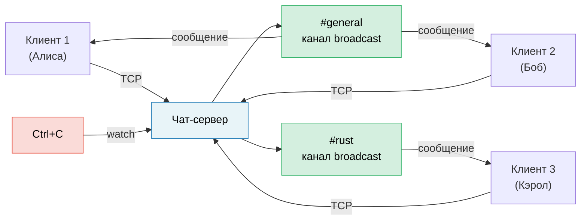

# Итоговый проект: Асинхронный чат-сервер

Этот проект объединяет паттерны из всей книги в единое приложение в продакшен-стиле. Вы создадите **многокомнатный асинхронный чат-сервер** с использованием tokio, каналов (channels), потоков данных (streams), плавного завершения работы (graceful shutdown) и правильной обработки ошибок.

**Оценочное время**: 4–6 часов | **Сложность**: ★★★

> **Что вы закрепите на практике:**
> - `tokio::spawn` и требование `'static` (Глава 8)
> - Каналы: `mpsc` для сообщений, `broadcast` для комнат, `watch` для завершения работы (Глава 8)
> - Потоки данных (Streams): чтение строк из TCP-соединений (Глава 11)
> - Распространенные ошибки: безопасность отмены (cancellation safety), `MutexGuard` через `.await` (Глава 12)
> - Паттерны для продакшена: плавное завершение работы, обратное давление (backpressure) (Глава 13)
> - Асинхронные трейты для подключаемых бэкендов (Глава 10)

## Задача

Создайте TCP-чат-сервер, в котором:

1. **Клиенты** подключаются по TCP и присоединяются к именованным комнатам.
2. **Сообщения** рассылаются (broadcast) всем клиентам в той же комнате.
3. **Команды**: `/join <комната>`, `/nick <имя>`, `/rooms`, `/quit`.
4. Сервер корректно завершает работу (graceful shutdown) по сигналу `Ctrl+C` — завершая обработку отправляемых сообщений.



## Шаг 1: Базовый цикл приема TCP-соединений (Accept Loop)

Начните с сервера, который принимает соединения и возвращает обратно (echo) отправленные строки:

```rust
use tokio::io::{AsyncBufReadExt, AsyncWriteExt, BufReader};
use tokio::net::TcpListener;

#[tokio::main]
async fn main() -> anyhow::Result<()> {
    let listener = TcpListener::bind("127.0.0.1:8080").await?;
    println!("Чат-сервер запущен на порту 8080");

    loop {
        let (socket, addr) = listener.accept().await?;
        println!("[{addr}] Подключен");

        tokio::spawn(async move {
            let (reader, mut writer) = socket.into_split();
            let mut reader = BufReader::new(reader);
            let mut line = String::new();

            loop {
                line.clear();
                match reader.read_line(&mut line).await {
                    Ok(0) | Err(_) => break, // EOF или ошибка
                    Ok(_) => {
                        let _ = writer.write_all(line.as_bytes()).await;
                    }
                }
            }
            println!("[{addr}] Отключен");
        });
    }
}
```

**Ваша задача**: Убедиться, что это компилируется и работает через `telnet localhost 8080`.

## Шаг 2: Состояние комнат с каналами Broadcast

Каждая комната представляет собой `broadcast::Sender`. Все клиенты в комнате подписываются на получение сообщений.

```rust
use std::collections::HashMap;
use std::sync::Arc;
use tokio::sync::{broadcast, RwLock};

type RoomMap = Arc<RwLock<HashMap<String, broadcast::Sender<String>>>>;

fn get_or_create_room(rooms: &mut HashMap<String, broadcast::Sender<String>>, name: &str) -> broadcast::Sender<String> {
    rooms.entry(name.to_string())
        .or_insert_with(|| {
            let (tx, _) = broadcast::channel(100); // Буфер на 100 сообщений
            tx
        })
        .clone()
}
```

**Ваша задача**: Реализовать состояние комнат так, чтобы:
- Клиенты начинали в комнате `#general`.
- `/join <room>` переключал комнаты (отписка от старой, подписка на новую).
- Сообщения рассылались всем клиентам в текущей комнате отправителя.

<details>
<summary>💡 Подсказка — Структура задачи клиента</summary>

Каждая задача клиента должна выполнять два конкурентных цикла:
1. **Чтение из TCP** → разбор команд или отправка сообщений в комнату.
2. **Чтение из приёмника broadcast (receiver)** → запись в TCP.

Используйте макрос `tokio::select!` для запуска обоих процессов:

```rust
loop {
    tokio::select! {
        // Клиент отправил нам строку
        result = reader.read_line(&mut line) => {
            match result {
                Ok(0) | Err(_) => break,
                Ok(_) => {
                    // Разбор команды или рассылка сообщения
                }
            }
        }
        // Получено сообщение из комнаты
        result = room_rx.recv() => {
            match result {
                Ok(msg) => {
                    let _ = writer.write_all(msg.as_bytes()).await;
                }
                Err(_) => break,
            }
        }
    }
}
```

</details>

## Шаг 3: Команды

Реализуйте протокол команд:

| Команда | Действие |
|:---|:---|
| `/join <комната>` | Покинуть текущую комнату, войти в новую комнату, отправить оповещение в обе |
| `/nick <имя>` | Изменить отображаемое имя |
| `/rooms` | Вывести список всех активных комнат и количество участников |
| `/quit` | Корректно отключиться |
| Всё остальное | Разослать как сообщение в чат |

**Ваша задача**: Разбирать команды из входящей строки. Для команды `/rooms` вам понадобится прочитать данные из `RoomMap` — используйте `RwLock::read()`, чтобы не блокировать других клиентов.

## Шаг 4: Плавное завершение работы (Graceful Shutdown)

Добавьте обработку `Ctrl+C`, чтобы сервер:
1. Переставал принимать новые подключения.
2. Отправлял сообщение "Сервер останавливает работу..." во все комнаты.
3. Ожидал завершения отправки сообщений, находящихся в процессе обработки.
4. Чисто завершал работу.

```rust
use tokio::sync::watch;

let (shutdown_tx, shutdown_rx) = watch::channel(false);

// В цикле приема подключений (accept loop):
loop {
    tokio::select! {
        result = listener.accept() => {
            let (socket, addr) = result?;
            // спавн задачи клиента с передачей shutdown_rx.clone()
        }
        _ = tokio::signal::ctrl_c() => {
            println!("Получен сигнал завершения работы");
            shutdown_tx.send(true)?;
            break;
        }
    }
}
```

**Ваша задача**: Добавить `shutdown_rx.changed()` в цикл `select!` каждого клиента, чтобы клиенты завершали работу при получении сигнала остановки.

## Шаг 5: Обработка ошибок и пограничные случаи

Подготовьте сервер к реальной эксплуатации (production-hardened):

1. **Отстающие получатели**: `broadcast::recv()` возвращает `RecvError::Lagged(n)`, если медленный клиент пропускает сообщения. Обработайте это корректно (логируйте и продолжайте работу, не падайте).
2. **Валидация никнеймов**: Отклоняйте пустые или слишком длинные имена.
3. **Обратное давление (Backpressure)**: Буфер канала broadcast ограничен (100). Если клиент не успевает читать сообщения, он получит ошибку `Lagged`.
4. **Таймаут (Timeout)**: Отключайте клиентов, которые бездействуют более 5 минут.

```rust
use tokio::time::{timeout, Duration};

// Оберните чтение в таймаут:
match timeout(Duration::from_secs(300), reader.read_line(&mut line)).await {
    Ok(Ok(0)) | Ok(Err(_)) | Err(_) => break, // EOF, ошибка или таймаут
    Ok(Ok(_)) => { /* обработка строки */ }
}
```

## Шаг 6: Интеграционный тест

Напишите тест, который запускает сервер, подключает двух клиентов и проверяет доставку сообщений:

```rust
#[tokio::test]
async fn two_clients_can_chat() {
    // Запуск сервера в фоновом режиме
    let server = tokio::spawn(run_server("127.0.0.1:0")); // Порт 0 = ОС выберет сама

    // Подключение двух клиентов
    let mut client1 = TcpStream::connect(addr).await.unwrap();
    let mut client2 = TcpStream::connect(addr).await.unwrap();

    // Клиент 1 отправляет сообщение
    client1.write_all(b"Hello from client 1\n").await.unwrap();

    // Клиент 2 должен его получить
    let mut buf = vec![0u8; 1024];
    let n = client2.read(&mut buf).await.unwrap();
    let msg = String::from_utf8_lossy(&buf[..n]);
    assert!(msg.contains("Hello from client 1"));
}
```

## Критерии оценки

| Критерий | Цель |
| :--- | :--- |
| Конкурентность | Несколько клиентов в разных комнатах без взаимных блокировок |
| Корректность | Сообщения доставляются только клиентам в той же комнате |
| Плавное завершение | Ctrl+C завершает доставку сообщений и безопасно останавливает сервер |
| Обработка ошибок | Корректно обрабатываются отстающие получатели, отключения и таймауты |
| Организация кода | Четкое разделение: цикл приема, задача клиента, состояние комнат |
| Тестирование | Как минимум 2 интеграционных теста |

## Идеи для расширения

Как только базовый чат-сервер заработает, попробуйте реализовать следующие улучшения:

1. **История сообщений**: Сохраняйте последние N сообщений в каждой комнате и отправляйте их новым участникам.
2. **Поддержка WebSocket**: Принимайте как TCP, так и WebSocket клиентов с помощью библиотеки `tokio-tungstenite`.
3. **Ограничение скорости (Rate limiting)**: Используйте `tokio::time::Interval` для ограничения количества сообщений от одного клиента в секунду.
4. **Метрики**: Отслеживайте количество подключенных клиентов, сообщений в секунду и количество комнат с помощью библиотеки `prometheus`.
5. **TLS**: Добавьте шифрование соединений с помощью `tokio-rustls`.

***
