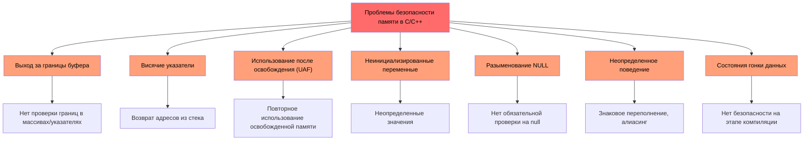
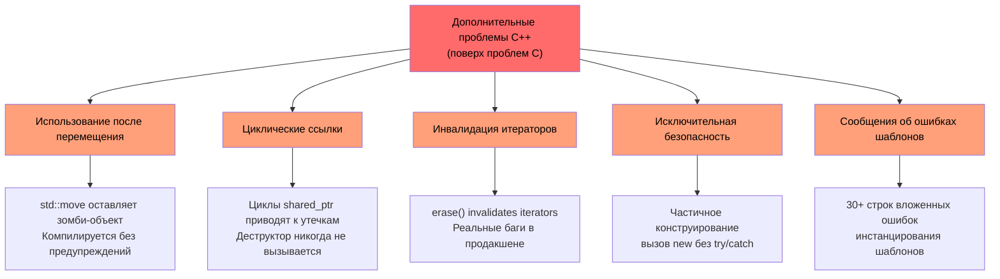
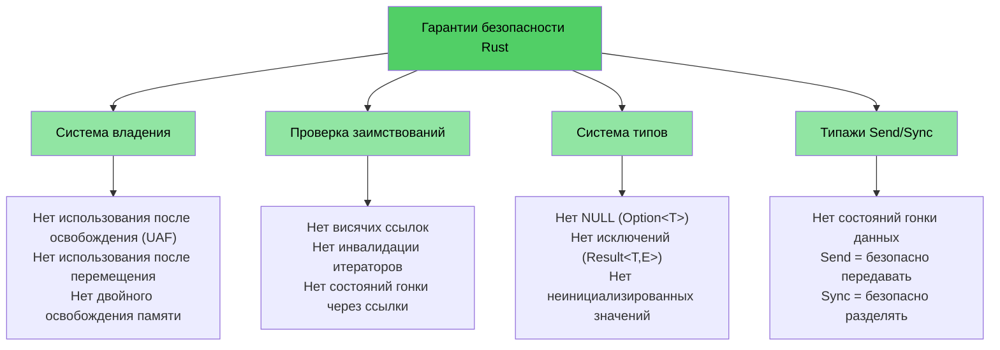

# Почему разработчикам C/C++ нужен Rust

> **Что вы узнаете:**
> - Полный список проблем, которые устраняет Rust: безопасность памяти, неопределенное поведение, состояние гонки данных и многое другое
> - Почему `shared_ptr`, `unique_ptr` и другие средства защиты в C++ являются лишь временными полумерами (bandaids), а не решением проблемы
> - Конкретные примеры уязвимостей в C и C++, которые структурно невозможны в безопасном Rust

> **Хотите сразу перейти к коду?** Перейдите к разделу [Покажите мне код](ch02-getting-started.md#enough-talk-already-show-me-some-code)

## Что устраняет Rust — полный список

Прежде чем перейти к примерам, приведем краткую сводку. Безопасный Rust **структурно предотвращает** каждую проблему из этого списка — не за счет дисциплины, инструментов или код-ревью, а с помощью системы типов и компилятора:

| **Устраняемая проблема** | **C** | **C++** | **Как Rust предотвращает ее** |
|----------------------|:-----:|:-------:|--------------------------|
| Выход за границы буфера (вверх/вниз) | ✅ | ✅ | Все массивы, срезы (slices) и строки содержат информацию о границах; индексация проверяется во время выполнения |
| Утечки памяти (без использования сборщика мусора) | ✅ | ✅ | Типаж `Drop` = правильная реализация RAII; автоматическая очистка, никакого «правила пяти» |
| Висячие указатели | ✅ | ✅ | Система времен жизни (lifetimes) доказывает во время компиляции, что ссылки живут дольше указуемых данных |
| Использование после освобождения памяти (Use-after-free) | ✅ | ✅ | Система владения превращает эту ошибку в ошибку компиляции |
| Использование после перемещения (Use-after-move) | — | ✅ | Перемещение является **деструктивным** (destructive) — исходная переменная перестает существовать |
| Неинициализированные переменные | ✅ | ✅ | Все переменные должны быть инициализированы перед использованием; компилятор строго следит за этим |
| Неопределенное поведение при переполнении целых чисел | ✅ | ✅ | Отладочные сборки вызывают панику при переполнении; релизные сборки используют циклическое переполнение (в обоих случаях поведение строго определено) |
| Разыменование NULL-указателей / ошибки сегментации (SEGV) | ✅ | ✅ | Отсутствие null-указателей; тип `Option<T>` заставляет явно обрабатывать отсутствие значения |
| Состояния гонки данных (Data races) | ✅ | ✅ | Типажи `Send`/`Sync` + проверка заимствований (borrow checker) делают состояние гонки ошибкой компиляции |
| Неконтролируемые побочные эффекты | ✅ | ✅ | Неизменяемость по умолчанию; для изменения требуется явное ключевое слово `mut` |
| Отсутствие наследования (лучшая поддерживаемость) | — | ✅ | Типажи + композиция заменяют иерархию классов; способствуют повторному использованию без жесткой связанности |
| Отсутствие исключений; предсказуемый поток управления | — | ✅ | Ошибки являются значениями (`Result<T, E>`); их невозможно проигнорировать, отсутствуют скрытые пути выполнения из-за `throw` |
| Инвалидация итераторов | — | ✅ | Проверка заимствований запрещает изменять коллекцию во время итерации по ней |
| Циклические ссылки / утечки из-за финализаторов | — | ✅ | Владение имеет древовидную структуру; циклы на `Rc` создаются только явно и могут быть предотвращены с помощью `Weak` |
| Забытая разблокировка мьютекса | ✅ | ✅ | `Mutex<T>` оборачивает сами данные; блокировка (lock guard) — единственный способ получить к ним доступ |
| Неопределенное поведение (в целом) | ✅ | ✅ | Безопасный Rust содержит **ноль** неопределенного поведения; блоки `unsafe` выделены явно и легко поддаются аудиту |

> **Главный итог:** Это не просто благие пожелания, навязываемые стандартами кодирования. Это **гарантии на этапе компиляции**. Если ваш код компилируется, подобные баги в нем существовать не могут.

---

## Общие проблемы C и C++

> **Хотите пропустить примеры?** Перейдите к разделу [Как Rust решает все эти проблемы](#how-rust-addresses-all-of-this) или сразу к разделу [Покажите мне код](ch02-getting-started.md#enough-talk-already-show-me-some-code)

Оба языка разделяют набор фундаментальных проблем безопасности памяти, которые являются основной причиной более 70% уязвимостей CVE (Common Vulnerabilities and Exposures):

### Выход за границы буфера

Массивы, указатели и строки в C не имеют встроенной информации о границах. Выйти за их пределы тривиально просто:

```c
#include <stdlib.h>
#include <string.h>

void buffer_dangers() {
    char buffer[10];
    strcpy(buffer, "This string is way too long!");  // Выход за границы буфера (buffer overflow)

    int arr[5] = {1, 2, 3, 4, 5};
    int *ptr = arr;           // Теряется информация о размере
    ptr[10] = 42;             // Нет проверки границ — неопределенное поведение
}
```

В C++ оператор `std::vector::operator[]` по-прежнему не проверяет границы. Их проверяет только метод `.at()`, но кто перехватывает эти исключения?

### Висячие указатели и использование после освобождения (use-after-free)

```c
int *bar() {
    int i = 42;
    return &i;    // Возвращает адрес стековой переменной — указатель зависает (dangling)!
}

void use_after_free() {
    char *p = (char *)malloc(20);
    free(p);
    *p = '\0';   // Использование после освобождения — неопределенное поведение
}
```

### Неинициализированные переменные и неопределенное поведение

C и C++ разрешают существование неинициализированных переменных. Полученные значения неопределены, а их чтение приводит к неопределенному поведению:

```c
int x;               // Не инициализировано
if (x > 0) { ... }  // Неопределенное поведение — x может быть чем угодно
```

Переполнение целых чисел в C является **определенным** для беззнаковых типов, но **неопределенным** для знаковых. В C++ знаковое переполнение также является неопределенным поведением. Оба компилятора могут использовать и используют это для «оптимизаций», которые ломают программы самым неожиданным образом.

### Разыменование NULL-указателей

```c
int *ptr = NULL;
*ptr = 42;           // Ошибка сегментации (SEGV), но компилятор вас не остановит
```

В C++ тип `std::optional<T>` помогает, но он слишком многословен, и его часто обходят с помощью метода `.value()`, который выбрасывает исключение.

### Визуализация: общие проблемы



---

## Дополнительные проблемы, привносимые C++

> **Для пишущих на C**: Вы можете [перейти к разделу «Как Rust решает все эти проблемы»](#how-rust-addresses-all-of-this), если вы не используете C++.
>
> **Хотите сразу перейти к коду?** Перейдите к разделу [Покажите мне код](ch02-getting-started.md#enough-talk-already-show-me-some-code)

C++ ввел умные указатели, RAII, семантику перемещения и исключения, чтобы решить проблемы C. Но это лишь **полумеры, а не радикальное решение** — они лишь смещают тип сбоя от «краша во время работы» к «более тонким багам во время выполнения»:

### `unique_ptr` и `shared_ptr` — полумеры, а не решение

Умные указатели C++ — это значительное улучшение по сравнению с сырыми `malloc`/`free`, но они не решают фундаментальных проблем:

| **Средство защиты в C++** | **Что это исправляет** | **Что это **НЕ** исправляет** |
|----------------|---------------|------------------------|
| `std::unique_ptr` | Предотвращает утечки с помощью RAII | **Использование после перемещения (use-after-move)** по-прежнему компилируется; остается «зомби»-значение nullptr |
| `std::shared_ptr` | Разделяемое владение | **Циклические ссылки** тихо утекают; дисциплина использования `weak_ptr` контролируется вручную |
| `std::optional` | Заменяет часть случаев использования null | Метод `.value()` **выбрасывает исключение**, если значение отсутствует — скрытый поток управления |
| `std::string_view` | Позволяет избегать лишнего копирования | Ссылка становится **висячей**, если исходная строка освобождается — проверка времени жизни отсутствует |
| Семантика перемещения | Эффективная передача данных | Перемещенные объекты остаются в **«валидном, но неопределенном состоянии»** — скрытый источник UB |
| RAII | Автоматическая очистка ресурсов | Требует соблюдения **«правила пяти»**; одна ошибка ломает всё |

```cpp
// unique_ptr: использование после перемещения компилируется без проблем
std::unique_ptr<int> ptr = std::make_unique<int>(42);
std::unique_ptr<int> ptr2 = std::move(ptr);
std::cout << *ptr;  // Компилируется! Неопределенное поведение во время выполнения.
                     // В Rust это вызовет ошибку компиляции: "value used after move"
```

```cpp
// shared_ptr: циклические ссылки утекают незаметно
struct Node {
    std::shared_ptr<Node> next;
    std::shared_ptr<Node> parent;  // Цикл! Деструктор никогда не будет вызван.
};
auto a = std::make_shared<Node>();
auto b = std::make_shared<Node>();
a->next = b;
b->parent = a;  // Утечка памяти — счетчик ссылок никогда не достигнет 0
                 // В Rust связка Rc<T> + Weak<T> делает циклы явными и разрываемыми
```

### Использование после перемещения — тихий убийца

В C++ `std::move` — это не перемещение, а приведение типа. Исходный объект остается в «валидном, но неопределенном состоянии». Компилятор позволяет продолжать его использовать:

```cpp
auto vec = std::make_unique<std::vector<int>>({1, 2, 3});
auto vec2 = std::move(vec);
vec->size();  // Компилируется! Но происходит разыменование nullptr — падение во время работы
```

В Rust перемещение является **деструктивным**. Исходная переменная больше недоступна:

```rust
let vec = vec![1, 2, 3];
let vec2 = vec;           // Перемещение — vec поглощается
// vec.len();             // Ошибка компиляции: использование значения после перемещения
```

### Инвалидация итераторов — реальные баги из промышленного C++ кода

Это не выдуманные примеры — они представляют собой **реальные паттерны багов**, найденные в крупных кодовых базах на C++:

```cpp
// БАГ 1: удаление элемента без переназначения итератора (неопределенное поведение)
while (it != pending_faults.end()) {
    if (*it != nullptr && (*it)->GetId() == fault->GetId()) {
        pending_faults.erase(it);   // ← итератор инвалидирован!
        removed_count++;            //   на следующей итерации используется висячий итератор
    } else {
        ++it;
    }
}
// Исправление: it = pending_faults.erase(it);
```

```cpp
// БАГ 2: удаление по индексу пропускает элементы
for (auto i = 0; i < entries.size(); i++) {
    if (config_status == ConfigDisable::Status::Disabled) {
        entries.erase(entries.begin() + i);  // ← сдвигает элементы
    }                                         //   i++ пропускает сдвинутый элемент
}
```

```cpp
// БАГ 3: один путь удаления корректен, а другой — нет
while (it != incomplete_ids.end()) {
    if (current_action == nullptr) {
        incomplete_ids.erase(it);  // ← БАГ: итератор не переназначен
        continue;
    }
    it = incomplete_ids.erase(it); // ← Корректный путь
}
```

**Все это компилируется без каких-либо предупреждений.** В Rust проверка заимствований превращает все три примера в ошибки компиляции — вы просто не можете изменять коллекцию во время итерации по ней.

### Исключительная безопасность и шаблон `dynamic_cast`/`new`

Современные проекты на C++ по-прежнему сильно полагаются на паттерны, не имеющие безопасности на этапе компиляции:

```cpp
// Типичный фабричный паттерн в C++ — каждое ветвление является потенциальным багом
DriverBase* driver = nullptr;
if (dynamic_cast<ModelA*>(device)) {
    driver = new DriverForModelA(framework);
} else if (dynamic_cast<ModelB*>(device)) {
    driver = new DriverForModelB(framework);
}
// Что если driver остался nullptr? Что если new выбросит исключение? Кто владеет driver?
```

В типичной кодовой базе на C++ объемом 100 тыс. строк вы можете обнаружить сотни вызовов `dynamic_cast` (каждый из которых — потенциальный сбой во время выполнения), сотни вызовов сырого `new` (каждый — потенциальная утечка) и сотни виртуальных методов с `virtual`/`override` (вызывающих накладные расходы на таблицы виртуальных методов повсюду).

### Висячие ссылки и захват в лямбда-выражениях

```cpp
int& get_reference() {
    int x = 42;
    return x;  // Висячая ссылка — компилируется, приводит к UB во время выполнения
}

auto make_closure() {
    int local = 42;
    return [&local]() { return local; };  // Захват висячей ссылки!
}
```

### Визуализация: дополнительные проблемы C++



---

## Как Rust решает все эти проблемы

Каждая из перечисленных выше проблем — как для C, так и для C++ — предотвращается гарантиями Rust на этапе компиляции:

| **Проблема** | **Решение в Rust** |
|---------|-----------------|
| Выход за границы буфера | Срезы несут в себе длину; индексация проверяется на соответствие границам |
| Висячие указатели / использование после освобождения (use-after-free) | Система времен жизни гарантирует валидность ссылок на этапе компиляции |
| Использование после перемещения (use-after-move) | Перемещения деструктивны — компилятор не позволит вам обратиться к исходному объекту |
| Утечки памяти | Типаж `Drop` = RAII без «правила пяти»; автоматическая и корректная очистка ресурсов |
| Циклы ссылок | Владение имеет древовидную структуру; связка `Rc` + `Weak` делает циклы явными |
| Инвалидация итераторов | Проверка заимствований запрещает изменять коллекцию во время ее заимствования |
| NULL-указатели | Отсутствие null. `Option<T>` заставляет явно обрабатывать значение через сопоставление с образцом |
| Состояния гонки данных | Типажи `Send`/`Sync` делают состояние гонки данных ошибкой компиляции |
| Неинициализированные переменные | Все переменные должны быть инициализированы; компилятор строго следит за этим |
| UB при операциях с целыми числами | Отладка паникует при переполнении; релиз производит циклическое переполнение (поведение всегда определено) |
| Исключения | Отсутствие исключений; `Result<T, E>` явно указан в сигнатуре типа и передается выше с помощью `?` |
| Сложность наследования | Типажи + композиция; нет проблемы ромбовидного наследования, нет хрупкости таблиц виртуальных методов |
| Забытая разблокировка мьютекса | `Mutex<T>` оборачивает сами данные; получение блокировки (lock guard) — единственный путь доступа |

```rust
fn rust_prevents_everything() {
    // ✅ Нет выхода за границы буфера — границы проверяются
    let arr = [1, 2, 3, 4, 5];
    // arr[10];  // паника во время выполнения, но никогда не UB

    // ✅ Нет использования после перемещения — ошибка компиляции
    let data = vec![1, 2, 3];
    let moved = data;
    // data.len();  // ошибка: значение используется после перемещения

    // ✅ Нет висячих указателей — ошибка времени жизни
    // let r;
    // { let x = 5; r = &x; }  // ошибка: x живет недостаточно долго

    // ✅ Нет null — Option обязывает делать обработку
    let maybe: Option<i32> = None;
    // maybe.unwrap();  // паника, но вместо этого вы бы использовали match или if let instead

    // ✅ Нет состояний гонки — ошибка компиляции
    // let mut shared = vec![1, 2, 3];
    // std::thread::spawn(|| shared.push(4));  // ошибка: замыкание может пережить
    // shared.push(5);                         //   заимствованное значение
}
```

### Модель безопасности Rust — полная картина



## Краткий справочник: сравнение C, C++ и Rust

| **Концепция** | **C** | **C++** | **Rust** | **Ключевое отличие** |
|-------------|-------|---------|----------|-------------------|
| Управление памятью | `malloc()/free()` | `unique_ptr`, `shared_ptr` | `Box<T>`, `Rc<T>`, `Arc<T>` | Автоматическое, без циклов и «зомби»-объектов |
| Массивы | `int arr[10]` | `std::vector<T>`, `std::array<T>` | `Vec<T>`, `[T; N]` | Проверка границ по умолчанию |
| Строки | `char*` с `\0` | `std::string`, `string_view` | `String`, `&str` | Гарантированный UTF-8, проверка времен жизни |
| Ссылки | `int*` (сырой) | `T&`, `T&&` (перемещение) | `&T`, `&mut T` | Проверка времен жизни + проверка заимствований |
| Полиморфизм | Указатели на функции | Виртуальные функции, наследование | Типажи, объекты типажей | Композиция вместо наследования |
| Обобщения | Макросы / `void*` | Шаблоны | Обобщения + ограничения типажей | Понятные сообщения об ошибках |
| Обработка ошибок | Коды возврата, `errno` | Исключения, `std::optional` | `Result<T, E>`, `Option<T>` | Нет скрытого потока управления |
| Безопасность NULL | `ptr == NULL` | `nullptr`, `std::optional<T>` | `Option<T>` | Обязательная проверка на null |
| Многопоточная безопасность | Вручную (pthreads) | Вручную (`std::mutex` и т.д.) | `Send`/`Sync` на этапе компиляции | Состояние гонки данных невозможно |
| Система сборки | Make, CMake | CMake, Make и т.д. | Cargo | Интегрированный инструментарий |
| Неопределенное поведение | Повсеместно | Тонкое (знаковое переполнение, алиасинг) | Ноль в безопасном коде | Безопасность гарантирована |

***
