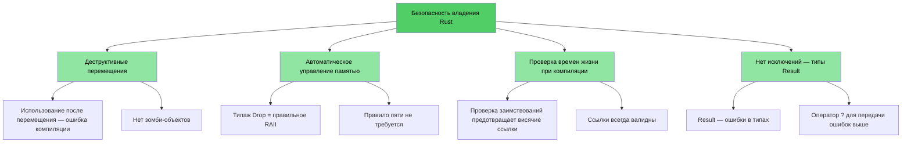
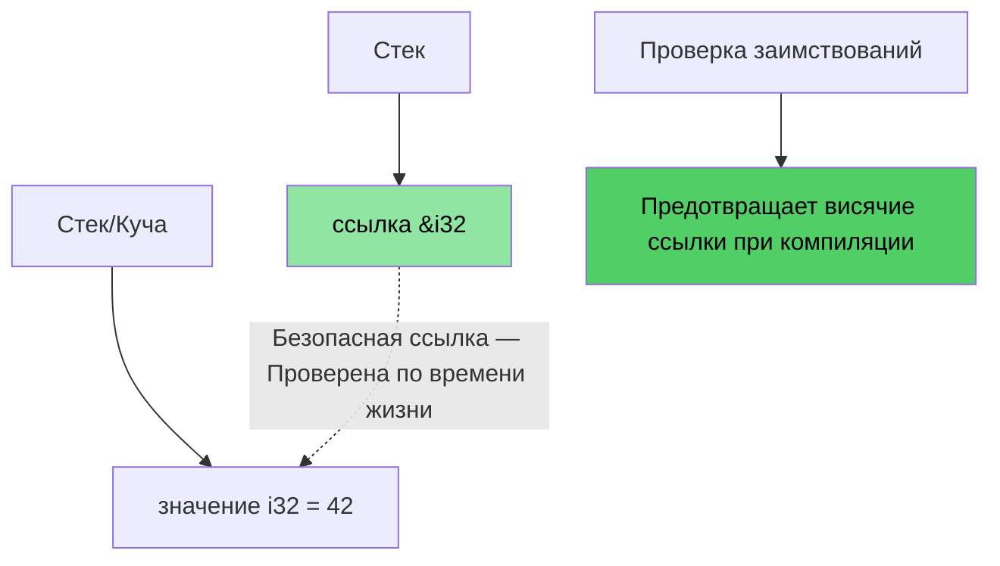
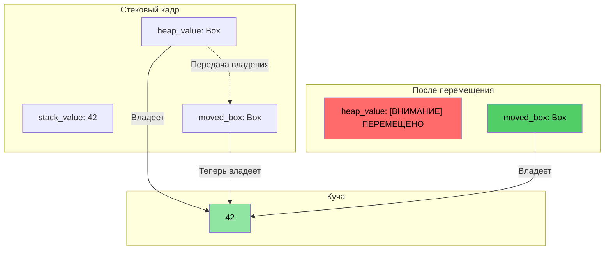
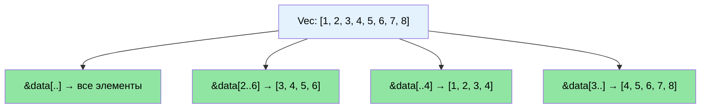

# Знакомство с докладчиком и общий подход

> **Что вы узнаете:** Структуру курса, интерактивный формат и то, как знакомые концепции C/C++ проецируются на эквиваленты в Rust. Эта глава задает ориентиры и предлагает дорожную карту для остальной части книги.

- Знакомство с докладчиком
    - Главный архитектор прошивок в команде Microsoft SCHIE (Silicon and Cloud Hardware Infrastructure Engineering)
    - Ветеран индустрии с опытом работы в области безопасности, системного программирования (прошивки, операционные системы, гипервизоры), архитектуры процессоров и платформ, а также систем на C++
    - Начал программировать на Rust в 2017 году (@AWS EC2) и с тех пор влюблен в этот язык
- Этот курс задуман как максимально интерактивный
    - Предположение: вы знаете C, C++ или оба языка
    - Примеры намеренно подобраны так, чтобы сопоставить знакомые концепции с их эквивалентами в Rust
    - **Пожалуйста, не стесняйтесь задавать уточняющие вопросы в любой момент**
- Докладчик надеется на дальнейшее плодотворное сотрудничество с командами

# Аргументы в пользу Rust
> **Хотите сразу перейти к коду?** Перейдите к разделу [Покажите мне код](ch02-getting-started.md#enough-talk-already-show-me-some-code)

Независимо от того, переходите ли вы с C или C++, основные болевые точки остаются прежними: ошибки безопасности памяти, которые успешно компилируются, но приводят к сбоям, повреждению данных или утечкам во время выполнения.

- Более **70% уязвимостей CVE** вызваны проблемами безопасности памяти — выходом за границы буфера, висячими указателями, использованием после освобождения (use-after-free)
- Умные указатели `shared_ptr` и `unique_ptr`, RAII и семантика перемещения в C++ являются шагами в правильном направлении, но это лишь **полумеры, а не радикальное решение** — они оставляют незакрытыми проблемы использования после перемещения, циклических ссылок, инвалидации итераторов и безопасности при исключениях
- Rust обеспечивает ту производительность, которую вы ожидаете от C/C++, но с **гарантиями безопасности на этапе компиляции**

> **📖 Глубокое погружение:** См. раздел [Почему разработчикам C/C++ нужен Rust](ch01-1-why-c-cpp-developers-need-rust.md) для ознакомления с конкретными примерами уязвимостей, полным списком того, что устраняет Rust, и причинами, по которым умных указателей C++ недостаточно

----

# Как Rust решает эти проблемы?

## Выход за границы буфера и нарушение границ
- Все массивы, срезы (slices) и строки в Rust имеют связанные с ними явные границы. Компилятор вставляет проверки, чтобы любое нарушение границ приводило к **аварийному завершению работы во время выполнения** (панике в терминах Rust) — и никогда к неопределенному поведению

## Висячие указатели и ссылки
- Rust вводит понятия времен жизни (lifetimes) и проверки заимствований (borrow checking), чтобы исключить появление висячих ссылок на **этапе компиляции**
- Никаких висячих указателей, никакого использования после освобождения (use-after-free) — компилятор просто не позволит вам скомпилировать такой код

## Использование после перемещения (Use-after-move)
- Система владения в Rust делает перемещение **деструктивным** (destructive) — как только вы перемещаете значение, компилятор **запрещает** использовать исходную переменную. Никаких «зомби»-объектов, никакого «валидного, но неопределенного состояния»

## Управление ресурсами
- Типаж `Drop` в Rust — это правильная реализация RAII. Компилятор автоматически освобождает ресурсы, когда они выходят из области видимости, и **предотвращает использование после перемещения**, с чем не справляется RAII в C++
- Никакого «правила пяти» не требуется (нет необходимости определять конструктор копирования, конструктор перемещения, оператор присваивания копированием, оператор присваивания перемещением и деструктор)

## Обработка ошибок
- В Rust нет исключений. Все ошибки представляют собой значения (`Result<T, E>`), что делает обработку ошибок явной и видимой в сигнатуре типа

## Инвалидация итераторов
- Проверка заимствований (borrow checker) в Rust **запрещает изменять коллекцию во время итерации по ней**. Вы просто физически не сможете написать баги, которые часто встречаются в кодовых базах на C++:
```rust
// Эквивалент удаления во время итерации в Rust: метод retain()
pending_faults.retain(|f| f.id != fault_to_remove.id);

// Или: сборка в новый вектор Vec (функциональный стиль)
let remaining: Vec<_> = pending_faults
    .into_iter()
    .filter(|f| f.id != fault_to_remove.id)
    .collect();
```

## Состояния гонки данных (Data races)
- Система типов предотвращает состояния гонки на **этапе компиляции** с помощью типажей `Send` и `Sync`

## Визуализация безопасности памяти

### Владение в Rust — безопасное проектирование

```rust
fn safe_rust_ownership() {
    // Перемещение деструктивно: исходное значение потеряно
    let data = vec![1, 2, 3];
    let data2 = data;           // Происходит перемещение
    // data.len();              // Ошибка компиляции: значение используется после перемещения
    
    // Заимствование: безопасный разделяемый доступ
    let owned = String::from("Hello, World!");
    let slice: &str = &owned;  // Заимствование — без выделения памяти
    println!("{}", slice);     // Всегда безопасно
    
    // Висячие ссылки невозможны
    /*
    let dangling_ref;
    {
        let temp = String::from("temporary");
        dangling_ref = &temp;  // Ошибка компиляции: temp живет недостаточно долго
    }
    */
}
```



## Структура памяти: ссылки в Rust



### Визуализация выделения памяти в куче с помощью Box\<T\>

```rust
fn box_allocation_example() {
    // Выделение памяти на стеке
    let stack_value = 42;
    
    // Выделение памяти в куче с помощью Box
    let heap_value = Box::new(42);
    
    // Передача владения
    let moved_box = heap_value;
    // heap_value больше недоступен
}
```



## Визуализация операций со срезами (Slice)

```rust
fn slice_operations() {
    let data = vec![1, 2, 3, 4, 5, 6, 7, 8];
    
    let full_slice = &data[..];        // [1,2,3,4,5,6,7,8]
    let partial_slice = &data[2..6];   // [3,4,5,6]
    let from_start = &data[..4];       // [1,2,3,4]
    let to_end = &data[3..];           // [4,5,6,7,8]
}
```



# Другие особенности и преимущества Rust
- Отсутствие состояний гонки данных между потоками (проверка `Send`/`Sync` на этапе компиляции)
- Отсутствие использования после перемещения (в отличие от `std::move` в C++, который оставляет «зомби»-объекты)
- Отсутствие неинициализированных переменных
    - Все переменные должны быть инициализированы перед использованием
- Отсутствие простых утечек памяти
    - Типаж `Drop` = правильная реализация RAII, «правило пяти» не требуется
    - Компилятор автоматически освобождает память, когда переменная выходит из области видимости
- Отсутствие забытых блокировок на мьютексах
    - Блокировки (lock guards) — это *единственный* способ получить доступ к данным (`Mutex<T>` оборачивает сами данные, а не доступ к ним)
- Отсутствие сложности обработки исключений
    - Ошибки являются значениями (`Result<T, E>`), видимыми в сигнатурах функций, и передаются выше с помощью `?`
- Отличная поддержка выведения типов, перечислений, сопоставления с образцом, абстракций с нулевой стоимостью
- Встроенная поддержка управления зависимостями, сборки, тестирования, форматирования, статического анализа (линтинга)
    - `cargo` заменяет собой связку make/CMake + линтер + фреймворки для тестирования

# Краткий справочник: Rust в сравнении с C/C++

| **Концепция** | **C** | **C++** | **Rust** | **Ключевое отличие** |
|-------------|-------|---------|----------|-------------------|
| Управление памятью | `malloc()/free()` | `unique_ptr`, `shared_ptr` | `Box<T>`, `Rc<T>`, `Arc<T>` | Автоматическое, без циклов |
| Массивы | `int arr[10]` | `std::vector<T>`, `std::array<T>` | `Vec<T>`, `[T; N]` | Проверка границ по умолчанию |
| Строки | `char*` с `\0` | `std::string`, `string_view` | `String`, `&str` | Гарантированный UTF-8, проверка времен жизни |
| Ссылки | `int* ptr` | `T&`, `T&&` (перемещение) | `&T`, `&mut T` | Проверка заимствований, времена жизни |
| Полиморфизм | Указатели на функции | Виртуальные функции, наследование | Типажи, объекты типажей | Композиция вместо наследования |
| Обобщенное программирование | Макросы (`void*`) | Шаблоны | Обобщения + ограничения типажей | Более понятные сообщения об ошибках |
| Обработка ошибок | Коды возврата, `errno` | Исключения, `std::optional` | `Result<T, E>`, `Option<T>` | Нет скрытого потока управления |
| Безопасность NULL | `ptr == NULL` | `nullptr`, `std::optional<T>` | `Option<T>` | Обязательная проверка на null |
| Многопоточная безопасность | Вручную (pthreads) | Ручная синхронизация | Гарантии на этапе компиляции | Состояние гонки данных невозможно |
| Система сборки | Make, CMake | CMake, Make и т.д. | Cargo | Интегрированный инструментарий |
| Неопределенное поведение | Сбои во время работы | Тонкое UB (знаковое переполнение, алиасинг) | Ошибки на этапе компиляции | Безопасность гарантирована |
