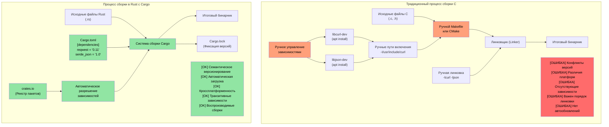
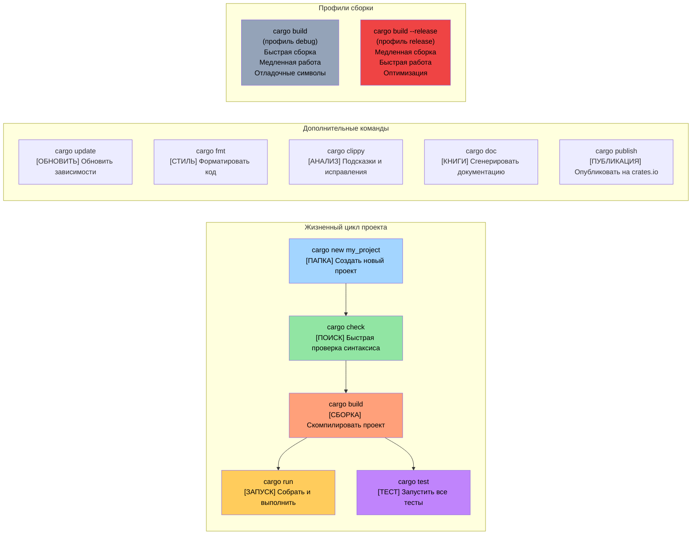

# Достаточно разговоров: покажите мне код

> **Что вы узнаете:** Вашу первую программу на Rust — `fn main()`, макрос `println!()` и принципиальные отличия макросов Rust от макросов препроцессора C/C++. К концу этой главы вы научитесь писать, компилировать и запускать простые программы на Rust.

```rust
fn main() {
    println!("Hello world from Rust");
}
```
- Приведенный выше синтаксис должен быть знаком каждому, кто имеет опыт работы с C-подобными языками
    - Все функции в Rust начинаются с ключевого слова ```fn```
    - Точкой входа по умолчанию для исполняемых файлов является функция ```main()```
    - Вызов ```println!``` похож на вызов функции, но на самом деле это **макрос**. Макросы в Rust принципиально отличаются от макросов препроцессора C/C++: они гигиеничны, типизированы и работают с синтаксическим деревом, а не просто выполняют текстовую подстановку
- Два отличных способа быстро опробовать фрагменты кода на Rust:
    - **Онлайн**: [Rust Playground](https://play.rust-lang.org/) — вставьте код, нажмите Run (Запустить), поделитесь результатами. Установка не требуется
    - **Локальный REPL**: Установите [`evcxr_repl`](https://github.com/evcxr/evcxr) для интерактивного выполнения кода в REPL (аналог интерактивного интерпретатора Python, но для Rust):
```bash
cargo install --locked evcxr_repl
evcxr   # Запуск REPL, вводите выражения Rust интерактивно
```

### Локальная установка Rust
- Rust можно установить локально следующими способами
    - Windows: https://static.rust-lang.org/rustup/dist/x86_64-pc-windows-msvc/rustup-init.exe
    - Linux / WSL: ```curl --proto '=https' --tlsv1.2 -sSf https://sh.rustup.rs | sh```
- Экосистема Rust состоит из следующих компонентов:
    - ```rustc``` — это отдельный компилятор, но напрямую он используется редко
    - Рекомендуемый инструмент ```cargo``` — это универсальный швейцарский армейский нож, который используется для управления зависимостями, сборки, тестирования, форматирования, статического анализа и т. д.
    - Инструментарий Rust поставляется по трем каналам: стабильному (```stable```), бета (```beta```) и ночному (```nightly``` — экспериментальный). Мы будем использовать стабильный канал. Используйте команду ```rustup update``` для обновления стабильной версии, новые выпуски которой выходят каждые шесть недель
- Мы также установим плагин ```rust-analyzer``` для VSCode

# Пакеты Rust (crates)
- Исполняемые файлы в Rust создаются с использованием пакетов (далее именуемых «крейтами» или пакетами)
    - Крейт может быть как самостоятельным, так и зависеть от других крейтов. Зависимости могут быть локальными или удаленными. Сторонние крейты обычно загружаются из централизованного репозитория под названием ```crates.io```. 
    - Инструмент ```cargo``` автоматически управляет загрузкой крейтов и их зависимостей. Концептуально это эквивалентно линковке библиотек в C
    - Зависимости крейта описываются в файле ```Cargo.toml```. В нем также определяется тип целевого файла крейта: отдельный исполняемый файл, статическая библиотека или динамическая библиотека (встречается реже)
    - Справочник: https://doc.rust-lang.org/cargo/reference/cargo-targets.html

## Cargo против традиционных систем сборки C

### Сравнение управления зависимостями



### Структура проекта Cargo

```text
my_project/
|-- Cargo.toml          # Конфигурация проекта (аналог package.json)
|-- Cargo.lock          # Точные версии зависимостей (генерируется авто)
|-- src/
|   |-- main.rs         # Основная точка входа для бинарного файла
|   |-- lib.rs          # Корневой файл библиотеки (если создается библиотека)
|   `-- bin/            # Дополнительные бинарные цели
|-- tests/              # Интеграционные тесты
|-- examples/           # Примеры кода
|-- benches/            # Бенчмарки
`-- target/             # Артефакты сборки (аналог build/ или obj/ в C)
    |-- debug/          # Отладочные сборки (быстрая компиляция, медленная работа)
    `-- release/        # Релизные сборки (медленная компиляция, быстрая работа)
```

### Часто используемые команды Cargo



# Пример: cargo и крейты
- В этом примере мы создадим отдельный исполняемый крейт без сторонних зависимостей
- Используйте следующие команды для создания нового крейта с именем ```helloworld```:
```bash
cargo new helloworld
cd helloworld
cat Cargo.toml
```
- По умолчанию команда ```cargo run``` скомпилирует и запустит отладочную (```debug```, неоптимизированную) версию крейта. Чтобы выполнить релизную версию, используйте ```cargo run --release```
- Обратите внимание, что скомпилированный исполняемый файл находится в папке ```target``` внутри папки ```debug``` или ```release``` соответственно
- Вы также могли заметить файл ```Cargo.lock``` в корневой папке проекта. Он генерируется автоматически, и его не следует редактировать вручную
    - Мы вернемся к подробному рассмотрению назначения ```Cargo.lock``` позже
