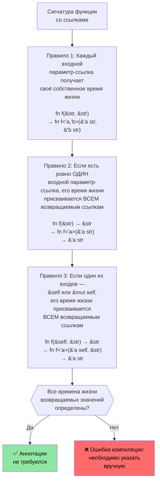

# Времена жизни и заимствование в Rust

> **Что вы узнаете:** Как система времен жизни (lifetime) в Rust гарантирует, что ссылки никогда не станут висячими — от неявных времен жизни до явных аннотаций и трех правил сокращения (elision rules), благодаря которым большинство кода обходится без аннотаций. Понимание времен жизни здесь имеет важное значение перед переходом к умным указателям в следующем разделе.

- Rust требует соблюдения правила: одна изменяемая ссылка или любое количество неизменяемых ссылок.
    - Время жизни любой ссылки должно быть не меньше времени жизни исходного владельца. Это неявные времена жизни, которые выводятся компилятором автоматически (подробнее см. https://doc.rust-lang.org/nomicon/lifetime-elision.html).
```rust
fn borrow_mut(x: &mut u32) {
    *x = 43;
}
fn main() {
    let mut x = 42;
    let y = &mut x;
    borrow_mut(y);
    let _z = &x; // Разрешено, так как компилятор знает, что y далее не используется
    //println!("{y}"); // Не скомпилируется, если раскомментировать эту строку
    borrow_mut(&mut x); // Разрешено, так как _z не используется 
    let z = &x; // Хорошо — изменяемое заимствование x завершилось после возврата из borrow_mut()
    println!("{z}");
}
```

# Аннотации времен жизни в Rust
- Явные аннотации времен жизни требуются при работе с несколькими временами жизни.
    - Времена жизни обозначаются символом `'` и могут содержать любой идентификатор (`'a`, `'b`, `'static` и т. д.).
    - Помощь компилятору нужна тогда, когда он не может определить, как долго должны жить ссылки.
- **Типичный сценарий**: функция возвращает ссылку, но от какого из входных параметров она получена?
```rust
#[derive(Debug)]
struct Point {x: u32, y: u32}

// Без аннотации времени жизни это не скомпилируется:
// fn left_or_right(pick_left: bool, left: &Point, right: &Point) -> &Point

// С аннотацией времени жизни — все ссылки разделяют одно и то же время жизни 'a
fn left_or_right<'a>(pick_left: bool, left: &'a Point, right: &'a Point) -> &'a Point {
    if pick_left { left } else { right }
}

// Более сложный случай: разные времена жизни для входных параметров
fn get_x_coordinate<'a, 'b>(p1: &'a Point, _p2: &'b Point) -> &'a u32 {
    &p1.x  // Время жизни возвращаемого значения связано с p1, а не с p2
}

fn main() {
    let p1 = Point {x: 20, y: 30};
    let result;
    {
        let p2 = Point {x: 42, y: 50};
        result = left_or_right(true, &p1, &p2);
        // Это работает, так как мы используем result до того, как p2 выйдет из области видимости
        println!("Selected: {result:?}");
    }
    // Это НЕ сработает — result ссылается на p2, которой больше нет:
    // println!("After scope: {result:?}");
}
```

# Аннотации времен жизни в Rust
- Аннотации времен жизни также необходимы для ссылок внутри структур данных.
```rust
use std::collections::HashMap;
#[derive(Debug)]
struct Point {x: u32, y: u32}
struct Lookup<'a> {
    map: HashMap<u32, &'a Point>,
}
fn main() {
    let p = Point{x: 42, y: 42};
    let p1 = Point{x: 50, y: 60};
    let mut m = Lookup {map : HashMap::new()};
    m.map.insert(0, &p);
    m.map.insert(1, &p1);
    {
        let p3 = Point{x: 60, y:70};
        //m.map.insert(3, &p3); // Не скомпилируется
        // p3 удаляется здесь, но m будет жить дольше
    }
    for (k, v) in m.map {
        println!("{v:?}");
    }
    // m удаляется здесь
    // p1 и p удаляются здесь именно в таком порядке
} 
```

# Упражнение: Первое слово с использованием времен жизни

🟢 **Начальный уровень** — практика сокращения времен жизни в действии

Напишите функцию `fn first_word(s: &str) -> &str`, которая возвращает первое слово из строки (разделенное пробелами). Подумайте, почему этот код компилируется без явных аннотаций времен жизни (подсказка: правила сокращения времен жизни №1 и №2).

<details><summary>Решение (нажмите, чтобы развернуть)</summary>

```rust
fn first_word(s: &str) -> &str {
    // Компилятор применяет правила сокращения времен жизни (elision rules):
    // Правило 1: входной &str получает время жизни 'a → fn first_word(s: &'a str) -> &str
    // Правило 2: один входной параметр → выход получает то же время жизни → fn first_word(s: &'a str) -> &'a str
    match s.find(' ') {
        Some(pos) => &s[..pos],
        None => s,
    }
}

fn main() {
    let text = "hello world foo";
    let word = first_word(text);
    println!("First word: {word}");  // "hello"
    
    let single = "onlyone";
    println!("First word: {}", first_word(single));  // "onlyone"
}
```

</details>

# Упражнение: Хранение срезов с временами жизни

🟡 **Средний уровень** — ваше первое знакомство с аннотациями времен жизни
- Создайте структуру, которая хранит ссылки на срезы (slices) ```&str```.
    - Создайте длинную строку ```&str``` и сохраните ссылки на ее срезы внутри структуры.
    - Напишите функцию, которая принимает структуру и возвращает содержащийся в ней срез.
```rust
// TODO: Создайте структуру для хранения ссылки на срез
struct SliceStore {

}
fn main() {
    let s = "This is long string";
    let s1 = &s[0..];
    let s2 = &s[1..2];
    // let slice = struct SliceStore {...};
    // let slice2 = struct SliceStore {...};
}
```

<details><summary>Решение (нажмите, чтобы развернуть)</summary>

```rust
struct SliceStore<'a> {
    slice: &'a str,
}

impl<'a> SliceStore<'a> {
    fn new(slice: &'a str) -> Self {
        SliceStore { slice }
    }

    fn get_slice(&self) -> &'a str {
        self.slice
    }
}

fn main() {
    let s = "This is a long string";
    let store1 = SliceStore::new(&s[0..4]);   // "This"
    let store2 = SliceStore::new(&s[5..7]);   // "is"
    println!("store1: {}", store1.get_slice());
    println!("store2: {}", store2.get_slice());
}
// Вывод:
// store1: This
// store2: is
```

</details>

---

## Глубокое погружение в правила сокращения времен жизни

Программисты на C часто спрашивают: «Если времена жизни так важны, почему в большинстве функций на Rust нет аннотаций `'a`?» Ответ кроется в **сокращении времен жизни (lifetime elision)** — компилятор применяет три детерминированных правила для автоматического вывода времен жизни.

### Три правила сокращения

Компилятор Rust применяет эти правила **по порядку** к сигнатурам функций. Если после применения правил все выходные времена жизни определены, аннотации не требуются.



### Примеры правил

**Правило 1** — каждый входной параметр-ссылка получает свой параметр времени жизни:
```rust
// Что пишете вы:
fn first_word(s: &str) -> &str { ... }

// Что видит компилятор после Правила 1:
fn first_word<'a>(s: &'a str) -> &str { ... }
// Только один входной параметр-ссылка → применяется Правило 2
```

**Правило 2** — единственное входное время жизни распространяется на все выходные данные:
```rust
// После Правила 2:
fn first_word<'a>(s: &'a str) -> &'a str { ... }
// ✅ Все выходные времена жизни определены — аннотации не нужны!
```

**Правило 3** — время жизни `&self` распространяется на выходные данные:
```rust
// Что пишете вы:
impl SliceStore<'_> {
    fn get_slice(&self) -> &str { self.slice }
}

// Что видит компилятор после Правил 1 + 3:
impl SliceStore<'_> {
    fn get_slice<'a>(&'a self) -> &'a str { self.slice }
}
// ✅ Аннотация не требуется — время жизни &self используется для вывода
```

**Когда сокращение не работает** — вам придется использовать аннотации:
```rust
// Две входных ссылки, нет &self → Правила 2 и 3 не применимы
// fn longest(a: &str, b: &str) -> &str  ← НЕ СКОМПИЛИРУЕТСЯ

// Решение: сообщить компилятору, от какого входа заимствуется выход
fn longest<'a>(a: &'a str, b: &'a str) -> &'a str {
    if a.len() >= b.len() { a } else { b }
}
```

### Ментальная модель для C-программистов

В C каждый указатель независим — программист мысленно отслеживает, к какому выделению памяти относится каждый указатель, а компилятор полностью доверяет вам. В Rust времена жизни делают это отслеживание **явным и проверяемым на этапе компиляции**:

| C | Rust | Что происходит |
|---|------|-------------|
| `char* get_name(struct User* u)` | `fn get_name(&self) -> &str` | Применяется Правило 3: выходной параметр заимствует время жизни от `self` |
| `char* concat(char* a, char* b)` | `fn concat<'a>(a: &'a str, b: &'a str) -> &'a str` | Необходимо аннотировать — два входных параметра |
| `void process(char* in, char* out)` | `fn process(input: &str, output: &mut String)` | Нет ссылки на выходе — время жизни не требуется |
| `char* buf; /* кто владеет этим? */` | Ошибка компиляции, если время жизни указано неверно | Компилятор находит висячие указатели |

### Время жизни `'static`

`'static` означает, что ссылка валидна на **протяжении всего времени работы программы**. Это аналог глобальной переменной или строкового литерала в C:

```rust
// Строковые литералы всегда имеют время жизни 'static — они находятся в секции read-only бинарного файла
let s: &'static str = "hello";  // То же самое, что и: static const char* s = "hello"; в C

// Константы также имеют время жизни 'static
static GREETING: &str = "hello";

// Часто встречается в ограничениях типажей при создании потоков:
fn spawn<F: FnOnce() + Send + 'static>(f: F) { /* ... */ }
// 'static здесь означает: "замыкание не должно заимствовать никаких локальных переменных"
// (либо переместите их внутрь замыкания, либо используйте только данные со временем жизни 'static)
```

### Упражнение: Предскажите сокращение

🟡 **Средний уровень**

Для каждой сигнатуры функции ниже предскажите, сможет ли компилятор автоматически сократить времена жизни. Если нет, добавьте необходимые аннотации:

```rust
// 1. Сможет ли компилятор сократить?
fn trim_prefix(s: &str) -> &str { &s[1..] }

// 2. Сможет ли компилятор сократить?
fn pick(flag: bool, a: &str, b: &str) -> &str {
    if flag { a } else { b }
}

// 3. Сможет ли компилятор сократить?
struct Parser { data: String }
impl Parser {
    fn next_token(&self) -> &str { &self.data[..5] }
}

// 4. Сможет ли компилятор сократить?
fn split_at(s: &str, pos: usize) -> (&str, &str) {
    (&s[..pos], &s[pos..])
}
```

<details><summary>Решение (нажмите, чтобы развернуть)</summary>

```rust,ignore
// 1. ДА — Правило 1 дает 'a для s, Правило 2 переносит его на результат
fn trim_prefix(s: &str) -> &str { &s[1..] }

// 2. НЕТ — Две входные ссылки, нет &self. Необходимо аннотировать:
fn pick<'a>(flag: bool, a: &'a str, b: &'a str) -> &'a str {
    if flag { a } else { b }
}

// 3. ДА — Правило 1 дает 'a для &self, Правило 3 переносит его на результат
impl Parser {
    fn next_token(&self) -> &str { &self.data[..5] }
}

// 4. ДА — Правило 1 дает 'a для s (только одна входная ссылка),
//    Правило 2 распространяет его на ОБА выходных значения. Оба среза заимствуют данные из s.
fn split_at(s: &str, pos: usize) -> (&str, &str) {
    (&s[..pos], &s[pos..])
}
```

</details>
