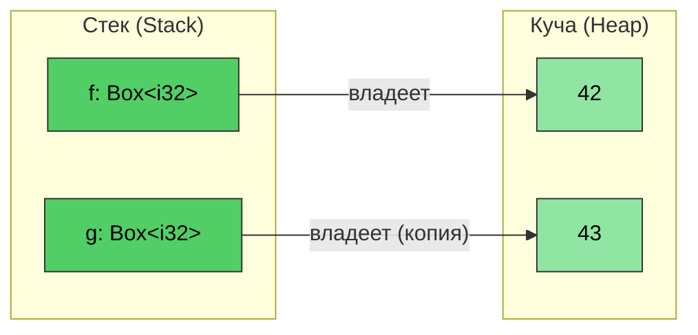
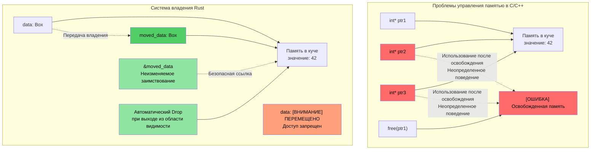
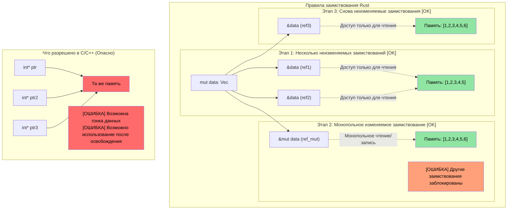

# Rust `Box<T>`

> **Что вы узнаете:** Умные указатели Rust — `Box<T>` для выделения памяти в куче, `Rc<T>` для совместного владения и `Cell<T>`/`RefCell<T>` для внутренней изменяемости (interior mutability). Эти концепции построены на основе владения и времен жизни из предыдущих разделов. Также вы вкратце ознакомитесь с `Weak<T>` для предотвращения циклов ссылок.

**Зачем нужен `Box<T>`?** В C вы используете `malloc`/`free` для выделения памяти в куче. В C++, `std::unique_ptr<T>` оборачивает вызовы `new`/`delete`. Указатель `Box<T>` в Rust — это эквивалент, представляющий собой выделенный в куче указатель с одним владельцем, который автоматически освобождается при выходе из области видимости. В отличие от `malloc`, здесь нет необходимости вызывать `free`. В отличие от `unique_ptr`, здесь невозможно использовать переменную после перемещения — компилятор полностью предотвращает это.

**Когда использовать `Box` вместо стека:**
- Содержимый тип имеет большой размер, и вы не хотите копировать его на стеке.
- Вам нужен рекурсивный тип (например, узел связанного списка, содержащий сам себя).
- Вам нужны объекты типажей (`Box<dyn Trait>`).

- ```Box<T>``` можно использовать для создания указателя на объект, размещенный в куче. Указатель всегда имеет фиксированный размер независимо от типа ```<T>```.
```rust
fn main() {
    // Создает указатель на целое число (со значением 42), размещенное в куче
    let f = Box::new(42);
    println!("{} {}", *f, f);
    // Клонирование Box создает новую аллокацию в куче
    let mut g = f.clone();
    *g = 43;
    println!("{f} {g}");
    // g and f выходят из области видимости здесь и автоматически освобождаются
}
```


## Визуализация владения и заимствования

### Сравнение C/C++ и Rust: Управление указателями и владением

```c
// C - Ручное управление памятью, потенциальные проблемы
void c_pointer_problems() {
    int* ptr1 = malloc(sizeof(int));
    *ptr1 = 42;
    
    int* ptr2 = ptr1;  // Оба указывают на одну и ту же память
    int* ptr3 = ptr1;  // Три указателя на одну и ту же память
    
    free(ptr1);        // Освобождение памяти
    
    *ptr2 = 43;        // Использование после освобождения — неопределенное поведение!
    *ptr3 = 44;        // Использование после освобождения — неопределенное поведение!
}
```

> **Для разработчиков на C++:** Умные указатели помогают, но не предотвращают все проблемы:
>
> ```cpp
> // C++ - Умные указатели помогают, но не предотвращают все проблемы
> void cpp_pointer_issues() {
>     auto ptr1 = std::make_unique<int>(42);
>     
>     // auto ptr2 = ptr1;  // Ошибка компиляции: unique_ptr нельзя скопировать
>     auto ptr2 = std::move(ptr1);  // Хорошо: владение передано
>     
>     // Но C++ все еще разрешает использование после перемещения:
>     // std::cout << *ptr1;  // Компилируется! Но приводит к неопределенному поведению!
>     
>     // Псевдонимы shared_ptr:
>     auto shared1 = std::make_shared<int>(42);
>     auto shared2 = shared1;  // Оба владеют данными
>     // Кто "на самом деле" владеет ими? Никто. Накладные расходы на подсчет ссылок повсюду.
> }
> ```

```rust
// Rust - Система владения предотвращает эти проблемы
fn rust_ownership_safety() {
    let data = Box::new(42);  // data владеет памятью в куче
    
    let moved_data = data;    // Владение переходит к moved_data
    // data больше не доступна — попытка использования вызовет ошибку компиляции
    
    let borrowed = &moved_data;  // Неизменяемое заимствование
    println!("{}", borrowed);    // Безопасно для использования
    
    // moved_data автоматически освобождается при выходе из области видимости
}
```



### Визуализация правил заимствования

```rust
fn borrowing_rules_example() {
    let mut data = vec![1, 2, 3, 4, 5];
    
    // Несколько неизменяемых заимствований — ОК
    let ref1 = &data;
    let ref2 = &data;
    println!("{:?} {:?}", ref1, ref2);  // Оба могут использоваться
    
    // Изменяемое заимствование — монопольный доступ
    let ref_mut = &mut data;
    ref_mut.push(6);
    // ref1 и ref2 не могут использоваться, пока активен ref_mut
    
    // После окончания работы с ref_mut неизменяемые ссылки снова работают
    let ref3 = &data;
    println!("{:?}", ref3);
}
```



---

## Внутренняя изменяемость: `Cell<T>` и `RefCell<T>`

Напомним, что по умолчанию переменные в Rust неизменяемы. Иногда желательно, чтобы большая часть структуры была доступна только для чтения, но при этом разрешалась запись в какое-то отдельное поле.

```rust
struct Employee {
    employee_id : u64,   // Это поле должно быть неизменяемым
    on_vacation: bool,   // Что если мы хотим разрешить запись в это поле, но сделать employee_id неизменяемым?
}
```

- Вспомним, что Rust разрешает использовать либо *одну изменяемую* ссылку на переменную, либо любое количество *неизменяемых* ссылок — это правило проверяется на *этапе компиляции*.
- Что если нам нужно передать *неизменяемый* вектор сотрудников, *но* разрешить обновление поля `on_vacation`, при этом гарантируя, что `employee_id` не изменится?

### `Cell<T>` — внутренняя изменяемость для типов с типажом Copy

- `Cell<T>` обеспечивает **внутреннюю изменяемость** (interior mutability), то есть доступ на запись к определенным элементам ссылок, которые в остальном доступны только для чтения.
- Работает путем копирования значений внутрь и наружу (для использования метода `.get()` требуется реализация типажа `Copy` для `T`).

### `RefCell<T>` — внутренняя изменяемость с проверкой заимствований во время выполнения

- `RefCell<T>` представляет собой вариант, который работает со ссылками.
    - Выполняет проверки заимствования в Rust во **время работы программы** (runtime), а не на этапе компиляции.
    - Разрешает одно *изменяемое* заимствование, но вызывает **панику (panic)**, если существуют другие активные заимствования.
    - Используйте метод `.borrow()` для неизменяемого доступа и `.borrow_mut()` для изменяемого доступа.

### Выбор между `Cell` и `RefCell`

| Критерий | `Cell<T>` | `RefCell<T>` |
|-----------|-----------|-------------|
| Работает с | Типами с типажом `Copy` (целые числа, bool, числа с плавающей запятой) | Любыми типами (`String`, `Vec`, структуры) |
| Способ доступа | Копирует значения внутрь/наружу (`.get()`, `.set()`) | Заимствует на месте (`.borrow()`, `.borrow_mut()`) |
| Поведение при ошибке | Не может завершиться ошибкой — проверки времени выполнения отсутствуют | Вызывает **панику**, если вы выполняете изменяемое заимствование, пока активно другое заимствование |
| Накладные расходы | Нулевые — просто копирует байты | Небольшие — отслеживает состояние заимствований во время выполнения |
| Когда использовать | Нужен изменяемый флаг, счетчик или небольшое значение внутри неизменяемой структуры | Нужно изменять `String`, `Vec` или сложный тип внутри неизменяемой структуры |

---

## Совместное владение: `Rc<T>`

`Rc<T>` позволяет использовать совместное владение *неизменяемыми* данными с подсчетом ссылок. Что если мы хотим хранить одного и того же сотрудника `Employee` в нескольких местах без копирования?

```rust
#[derive(Debug)]
struct Employee {
    employee_id: u64,
}
fn main() {
    let mut us_employees = vec![];
    let mut all_global_employees = Vec::<Employee>::new();
    let employee = Employee { employee_id: 42 };
    us_employees.push(employee);
    // Не скомпилируется — employee уже перемещен
    //all_global_employees.push(employee);
}
```

`Rc<T>` решает эту проблему, разрешая общий *неизменяемый* доступ:
- Содержимый тип разыменовывается автоматически.
- Значение удаляется, когда счетчик ссылок становится равным 0.

```rust
use std::rc::Rc;
#[derive(Debug)]
struct Employee {employee_id: u64}
fn main() {
    let mut us_employees = vec![];
    let mut all_global_employees = vec![];
    let employee = Employee { employee_id: 42 };
    let employee_rc = Rc::new(employee);
    us_employees.push(employee_rc.clone());
    all_global_employees.push(employee_rc.clone());
    let employee_one = all_global_employees.get(0); // Общая неизменяемая ссылка
    for e in us_employees {
        println!("{}", e.employee_id);  // Общая неизменяемая ссылка
    }
    println!("{employee_one:?}");
}
```

> **Для разработчиков на C++: Соответствие умных указателей**
>
> | Умный указатель C++ | Аналог в Rust | Ключевое отличие |
> |---|---|---|
> | `std::unique_ptr<T>` | `Box<T>` | Вариант в Rust является поведением по умолчанию — перемещение работает на уровне языка, а не подключается отдельно |
> | `std::shared_ptr<T>` | `Rc<T>` (однопоточный) / `Arc<T>` (многопоточный) | У `Rc` нет атомарных накладных расходов; используйте `Arc` только для совместного использования между потоками |
> | `std::weak_ptr<T>` | `Weak<T>` (через `Rc::downgrade()` или `Arc::downgrade()`) | Та же цель: разрешение циклов ссылок |
>
> **Ключевое различие**: в C++ вы *выбираете* использование умных указателей. В Rust обычное владение переменными (`T`) и заимствование (`&T`) покрывают большинство сценариев — прибегайте к `Box`/`Rc`/`Arc` только тогда, когда вам действительно необходимо выделение памяти в куче или совместное владение.

### Разрыв циклов ссылок с помощью `Weak<T>`

`Rc<T>` использует подсчет ссылок — если два объекта `Rc` ссылаются друг на друга, ни один из них никогда не будет удален (образуется цикл). `Weak<T>` решает эту проблему:

```rust
use std::rc::{Rc, Weak};

struct Node {
    value: i32,
    parent: Option<Weak<Node>>,  // Слабая ссылка — не препятствует удалению
}

fn main() {
    let parent = Rc::new(Node { value: 1, parent: None });
    let child = Rc::new(Node {
        value: 2,
        parent: Some(Rc::downgrade(&parent)),  // Слабая ссылка на родителя
    });

    // Для использования Weak попробуйте преобразовать её в Rc с помощью upgrade — возвращает Option<Rc<T>>
    if let Some(parent_rc) = child.parent.as_ref().unwrap().upgrade() {
        println!("Parent value: {}", parent_rc.value);
    }
    println!("Parent strong count: {}", Rc::strong_count(&parent)); // 1, а не 2
}
```

> `Weak<T>` более подробно рассматривается в главе [Избегание избыточного использования clone()](ch17-1-avoiding-excessive-clone.md). Сейчас главное помнить: **используйте `Weak` для обратных ссылок в древовидных структурах или графах, чтобы избежать утечек памяти.**

---

## Объединение `Rc` с внутренней изменяемостью

Настоящая сила раскрывается при совмещении `Rc<T>` (совместное владение) с `Cell<T>` или `RefCell<T>` (внутренняя изменяемость). Это позволяет нескольким владельцам **читать и изменять** общие данные:

| Шаблон | Сценарий использования |
|---------|----------|
| `Rc<RefCell<T>>` | Общие изменяемые данные (для одного потока) |
| `Arc<Mutex<T>>` | Общие изменяемые данные (для нескольких потоков — см. [главу 13](ch13-concurrency.md)) |
| `Rc<Cell<T>>` | Общие изменяемые Copy-типы (простые флаги, счетчики) |

---

# Упражнение: Совместное владение и внутренняя изменяемость

🟡 **Средний уровень**

- **Часть 1 (Rc)**: Создайте структуру `Employee` с полями `employee_id: u64` и `name: String`. Поместите ее в `Rc<Employee>` и скопируйте (клонируйте) в два разных вектора (`us_employees` and `global_employees`). Выведите информацию из обоих векторов, чтобы показать, что они разделяют одни и те же данные.
- **Часть 2 (Cell)**: Добавьте поле `on_vacation: Cell<bool>` в структуру `Employee`. Передайте неизменяемую ссылку `&Employee` в функцию и переключите флаг `on_vacation` внутри этой функции без объявления ссылки изменяемой.
- **Часть 3 (RefCell)**: Замените поле `name: String` на `name: RefCell<String>` и напишите функцию, которая добавляет суффикс к имени сотрудника через неизменяемую ссылку `&Employee`.

**Стартовый код:**
```rust
use std::cell::{Cell, RefCell};
use std::rc::Rc;

#[derive(Debug)]
struct Employee {
    employee_id: u64,
    name: RefCell<String>,
    on_vacation: Cell<bool>,
}

fn toggle_vacation(emp: &Employee) {
    // TODO: Переключите on_vacation с помощью Cell::set()
}

fn append_title(emp: &Employee, title: &str) {
    // TODO: Заимствуйте name изменяемо через RefCell и вызовите push_str для добавления суффикса
}

fn main() {
    // TODO: Создайте сотрудника, оберните в Rc, склонируйте в два вектора,
    // вызовите toggle_vacation и append_title, выведите результаты
}
```

<details><summary>Решение (нажмите, чтобы развернуть)</summary>

```rust
use std::cell::{Cell, RefCell};
use std::rc::Rc;

#[derive(Debug)]
struct Employee {
    employee_id: u64,
    name: RefCell<String>,
    on_vacation: Cell<bool>,
}

fn toggle_vacation(emp: &Employee) {
    emp.on_vacation.set(!emp.on_vacation.get());
}

fn append_title(emp: &Employee, title: &str) {
    emp.name.borrow_mut().push_str(title);
}

fn main() {
    let emp = Rc::new(Employee {
        employee_id: 42,
        name: RefCell::new("Alice".to_string()),
        on_vacation: Cell::new(false),
    });

    let mut us_employees = vec![];
    let mut global_employees = vec![];
    us_employees.push(Rc::clone(&emp));
    global_employees.push(Rc::clone(&emp));

    // Переключаем отпуск через неизменяемую ссылку
    toggle_vacation(&emp);
    println!("On vacation: {}", emp.on_vacation.get()); // true

    // Добавляем суффикс к имени через неизменяемую ссылку
    append_title(&emp, ", Sr. Engineer");
    println!("Name: {}", emp.name.borrow()); // "Alice, Sr. Engineer"

    // Оба вектора видят одни и те же данные (Rc разделяет владение)
    println!("US: {:?}", us_employees[0].name.borrow());
    println!("Global: {:?}", global_employees[0].name.borrow());
    println!("Rc strong count: {}", Rc::strong_count(&emp));
}
// Вывод:
// On vacation: true
// Name: Alice, Sr. Engineer
// US: "Alice, Sr. Engineer"
// Global: "Alice, Sr. Engineer"
// Rc strong count: 3
```

</details>
