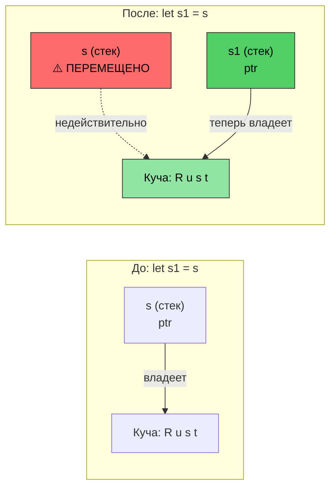
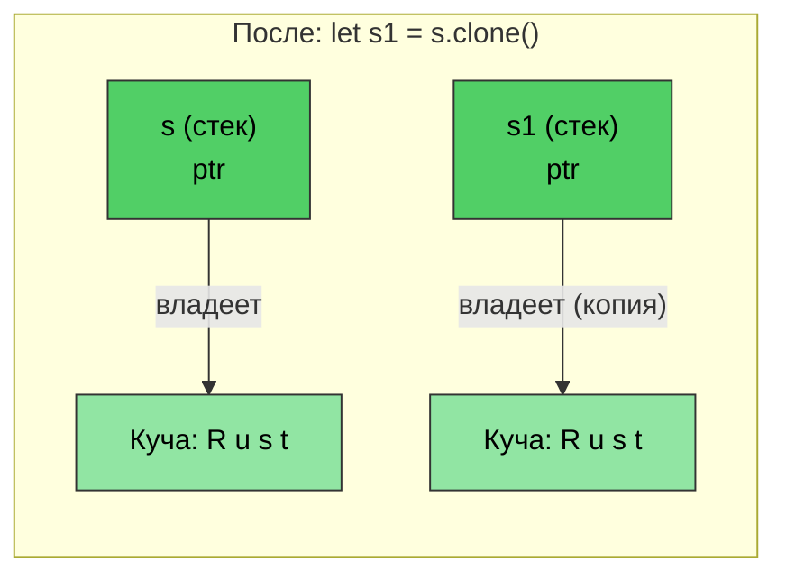

# Управление памятью в Rust

> **Что вы узнаете:** Систему владения Rust — важнейшую концепцию языка. После этой главы вы разберетесь с семантикой перемещения (move semantics), правилами заимствования (borrowing rules) и типажом `Drop`. Если вы усвоите эту главу, остальная часть Rust пойдет сама собой. Если вам будет трудно, прочитайте ее еще раз — у большинства разработчиков на C/C++ понимание владения складывается со второго прочтения.

- Управление памятью в C/C++ является источником ошибок:
    - В C: память выделяется с помощью `malloc()` и освобождается через `free()`. Нет никаких проверок от висячих указателей (dangling pointers), использования после освобождения (use-after-free) или двойного освобождения (double-free).
    - В C++: RAII (Resource Acquisition Is Initialization) и умные указатели помогают, но `std::move(ptr)` скомпилируется даже после перемещения — использование после перемещения (use-after-move) приводит к неопределенному поведению (UB).
- Rust делает RAII **абсолютно надежным**:
    - Перемещение (move) является **деструктивным** — компилятор не позволит вам обратиться к переменной, из которой было выполнено перемещение.
    - Нет необходимости в Правиле пяти (rule of five) (не нужны конструктор копирования, конструктор перемещения, оператор копирующего присваивания, оператор перемещающего присваивания и деструктор).
    - Rust дает полный контроль над выделением памяти, но гарантирует безопасность на **этапе компиляции**.
    - Это достигается за счет сочетания таких механизмов, как владение (ownership), заимствование (borrowing), изменяемость (mutability) и времена жизни (lifetimes).
    - В Rust выделение памяти во время работы программы может происходить как на стеке, так и в куче.

> **Для разработчиков на C++ — Соответствие умных указателей:**
>
> | **C++** | **Rust** | **Улучшение безопасности** |
> |---------|----------|----------------------|
> | `std::unique_ptr<T>` | `Box<T>` | Невозможно использование после перемещения |
> | `std::shared_ptr<T>` | `Rc<T>` (однопоточный) | Отсутствие циклов ссылок по умолчанию |
> | `std::shared_ptr<T>` (потокобезопасный) | `Arc<T>` | Явная потокобезопасность |
> | `std::weak_ptr<T>` | `Weak<T>` | Необходимо проверять валидность |
> | Необработанный указатель (Raw pointer) | `*const T` / `*mut T` | Только в блоках `unsafe` |
>
> Для разработчиков на C: `Box<T>` заменяет пару `malloc`/`free`. `Rc<T>` заменяет ручной подсчет ссылок. Необработанные указатели существуют, но они ограничены блоками `unsafe`.

# Владение, заимствование и времена жизни в Rust
- Напомним, что Rust разрешает только одну изменяемую ссылку на переменную и несколько ссылок только для чтения.
    - Начальное объявление переменной устанавливает ```владение``` (ownership).
    - Последующие ссылки ```заимствуют``` (borrow) значение у первоначального владельца. Правило заключается в том, что область видимости заимствования никогда не может превышать область видимости владельца. Другими словами, ```время жизни``` (lifetime) заимствования не может превышать время жизни владельца.
```rust
fn main() {
    let a = 42; // Владелец
    let b = &a; // Первое заимствование
    {
        let aa = 42;
        let c = &a; // Второе заимствование; a всё ещё в области видимости
        // Хорошо: c выходит из области видимости здесь
        // aa выходит из области видимости здесь
    }
    // let d = &aa; // Не скомпилируется, если aa не перемещена во внешнюю область видимости
    // b неявно выходит из области видимости перед a
    // a выходит из области видимости последней
}
```

- Rust может передавать параметры в методы с использованием нескольких различных механизмов:
    - По значению (копирование): обычно типы, которые можно тривиально скопировать (например, u8, u32, i8, i32).
    - По ссылке: это эквивалентно передаче указателя на фактическое значение. Это также называют заимствованием, и ссылка может быть неизменяемой (```&```) или изменяемой (```&mut```).
    - Путем перемещения: это передает «владение» значением функции. Вызывающая сторона больше не может ссылаться на исходное значение.
```rust
fn foo(x: &u32) {
    println!("{x}");
}
fn bar(x: u32) {
    println!("{x}");
}
fn main() {
    let a = 42;
    foo(&a);    // По ссылке
    bar(a);     // По значению (копирование)
}
```

- Rust запрещает возвращать висячие ссылки из методов:
    - Ссылки, возвращаемые методами, должны оставаться в области видимости.
    - Rust автоматически ```освободит``` (drop) ссылку, когда она выйдет из области видимости.
```rust
fn no_dangling() -> &u32 {
    // время жизни a начинается здесь
    let a = 42;
    // Не скомпилируется. Время жизни a заканчивается здесь
    &a
}

fn ok_reference(a: &u32) -> &u32 {
    // Хорошо, потому что время жизни a всегда превышает выполнение ok_reference()
    a
}
fn main() {
    let a = 42;     // время жизни a начинается здесь
    let b = ok_reference(&a);
    // время жизни b заканчивается здесь
    // время жизни a заканчивается здесь
}
```

# Семантика перемещения в Rust
- По умолчанию присваивание в Rust передает владение.
```rust
fn main() {
    let s = String::from("Rust");    // Выделение строки в куче
    let s1 = s; // Передача владения в s1. С этого момента s недействительна
    println!("{s1}");
    // Это не скомпилируется
    //println!("{s}");
    // s1 выходит из области видимости здесь, и память освобождается
    // s выходит из области видимости здесь, но ничего не происходит, так как она ничем не владеет
}
```

*После `let s1 = s` владение переходит к `s1`. Данные в куче остаются на месте — перемещается только указатель на стеке. `s` теперь недействительна.*

----
# Семантика перемещения и заимствование в Rust
```rust
fn foo(s : String) {
    println!("{s}");
    // Память в куче, на которую указывает s, будет освобождена здесь
}
fn bar(s : &String) {
    println!("{s}");
    // Ничего не происходит — s заимствована
}
fn main() {
    let s = String::from("Rust string move example");    // Выделение строки в куче
    foo(s); // Передача владения; s теперь недействительна
    // println!("{s}");  // не скомпилируется
    let t = String::from("Rust string borrow example");
    bar(&t);    // t продолжает владеть строкой
    println!("{t}"); 
}
```

# Семантика перемещения и владение в Rust
- Владение можно передать перемещением:
    - Запрещено использовать существующие ссылки после завершения перемещения.
    - Подумайте о заимствовании, если перемещение нежелательно.
```rust
struct Point {
    x: u32,
    y: u32,
}
fn consume_point(p: Point) {
    println!("{} {}", p.x, p.y);
}
fn borrow_point(p: &Point) {
    println!("{} {}", p.x, p.y);
}
fn main() {
    let p = Point {x: 10, y: 20};
    // Попробуйте поменять местами эти две строки
    borrow_point(&p);
    consume_point(p);
}
```

# Rust Clone
- Метод ```clone()``` можно использовать для копирования исходной памяти. Исходная ссылка продолжает оставаться валидной (минус в том, что выделяется в 2 раза больше памяти).
```rust
fn main() {
    let s = String::from("Rust");    // Выделение строки в куче
    let s1 = s.clone(); // Копирование строки; создается новая аллокация в куче
    println!("{s1}");  
    println!("{s}");
    // s1 выходит из области видимости здесь, и память освобождается
    // s выходит из области видимости здесь, и память освобождается
}
```

*`clone()` создает **отдельное** выделение памяти в куче. И `s`, и `s1` остаются действительными — каждый владеет своей копией.*

# Типаж Copy в Rust
- Rust реализует семантику копирования для встроенных типов с помощью типажа ```Copy```.
    - Примеры включают u8, u32, i8, i32 и т. д. Семантика копирования использует передачу по значению.
    - Определенные пользователем типы данных могут опционально использовать семантику копирования с помощью макроса ```derive```, чтобы автоматически реализовать типаж ```Copy```.
    - Компилятор выделит место для копии после нового присваивания.
```rust
// Попробуйте закомментировать это, чтобы увидеть изменения в let p1 = p; ниже
#[derive(Copy, Clone, Debug)]   // Мы обсудим это подробнее позже
struct Point{x: u32, y:u32}
fn main() {
    let p = Point {x: 42, y: 40};
    let p1 = p;     // Теперь вместо перемещения будет выполнено копирование
    println!("p: {p:?}");
    println!("p1: {p:?}");
    let p2 = p1.clone();    // Семантически то же самое, что и копирование
}
```

# Типаж Drop в Rust

- Rust автоматически вызывает метод `drop()` в конце области видимости.
    - `drop` является частью обобщенного типажа `Drop`. Компилятор предоставляет пустую реализацию (NOP) по умолчанию для всех типов, но типы могут переопределять её. Например, тип `String` переопределяет её для освобождения памяти, выделенной в куче.
    - Для разработчиков на C: это заменяет необходимость ручных вызовов `free()` — ресурсы освобождаются автоматически при выходе из области видимости (RAII).
- **Ключевая безопасность:** Вы не можете вызвать `.drop()` напрямую (компилятор это запрещает). Вместо этого используйте функцию `drop(obj)`, которая перемещает значение в функцию, запускает его деструктор и предотвращает любое дальнейшее использование, исключая ошибки двойного освобождения.

> **Для разработчиков на C++:** `Drop` напрямую соответствует деструкторам C++ (`~ClassName()`):
>
> | | **Деструктор C++** | **Rust `Drop`** |
> |---|---|---|
> | **Синтаксис** | `~MyClass() { ... }` | `impl Drop for MyType { fn drop(&mut self) { ... } }` |
> | **Когда вызывается** | Конец области видимости (RAII) | Конец области видимости (так же) |
> | **Вызов при перемещении** | Источник остается в «валидном, но неопределенном» состоянии — деструктор всё ещё вызывается для перемещенного объекта | Источник **исчезает** — для перемещенного значения деструктор не вызывается |
> | **Ручной вызов** | `obj.~MyClass()` (опасно, редко используется) | `drop(obj)` (безопасно — забирает владение, вызывает `drop`, предотвращает дальнейшее использование) |
> | **Порядок** | Обратный порядку объявления | Обратный порядку объявления (так же) |
> | **Правило пяти** | Необходимо управлять конструктором копирования, конструктором перемещения, оператором копирующего присваивания, оператором перемещающего присваивания и деструктором | Только `Drop` — компилятор берет на себя семантику перемещения, а `Clone` подключается по желанию |
> | **Нужен виртуальный деструктор?** | Да, если удаление идет через указатель на базовый класс | Нет — наследование отсутствует, поэтому проблемы со срезкой объектов (slicing) нет |

```rust
struct Point {x: u32, y:u32}

// Эквивалентно: ~Point() { printf("Goodbye point x:%u, y:%u\n", x, y); }
impl Drop for Point {
    fn drop(&mut self) {
        println!("Goodbye point x:{}, y:{}", self.x, self.y);
    }
}
fn main() {
    let p = Point{x: 42, y: 42};
    {
        let p1 = Point{x:43, y: 43};
        println!("Exiting inner block");
        // Здесь вызывается p1.drop() — аналогично деструктору C++ при выходе из области видимости
    }
    println!("Exiting main");
    // Здесь вызывается p.drop()
}
```

# Упражнение: Move, Copy и Drop

🟡 **Средний уровень** — свободно экспериментируйте; компилятор подскажет вам
- Проведите собственные эксперименты с ```Point``` с `Copy` и без него в ```#[derive(Debug)]``` ниже, чтобы убедиться, что вы понимаете различия. Идея состоит в том, чтобы получить четкое понимание того, как работает перемещение по сравнению с копированием, поэтому обязательно задавайте вопросы.
- Реализуйте собственный ```Drop``` для ```Point```, который устанавливает x и y в 0 внутри ```drop```. Этот шаблон полезен, например, для освобождения блокировок и других ресурсов.
```rust
struct Point{x: u32, y: u32}
fn main() {
    // Создайте Point, присвойте его другой переменной, создайте новую область видимости,
    // передайте точку в функцию и т. д.
}
```

<details><summary>Решение (нажмите, чтобы развернуть)</summary>

```rust
#[derive(Debug)]
struct Point { x: u32, y: u32 }

impl Drop for Point {
    fn drop(&mut self) {
        println!("Dropping Point({}, {})", self.x, self.y);
        self.x = 0;
        self.y = 0;
        // Примечание: установка значений в 0 при сбросе демонстрирует шаблон,
        // но вы не сможете прочитать эти значения после завершения drop
    }
}

fn consume(p: Point) {
    println!("Consuming: {:?}", p);
    // p удаляется здесь
}

fn main() {
    let p1 = Point { x: 10, y: 20 };
    let p2 = p1;  // Перемещение — p1 больше не валидна
    // println!("{:?}", p1);  // Не скомпилируется: p1 была перемещена

    {
        let p3 = Point { x: 30, y: 40 };
        println!("p3 in inner scope: {:?}", p3);
        // p3 удаляется здесь (конец области видимости)
    }

    consume(p2);  // p2 перемещается в consume и удаляется там
    // println!("{:?}", p2);  // Не скомпилируется: p2 была перемещена

    // Теперь попробуйте: добавьте #[derive(Copy, Clone)] к Point (и удалите реализацию Drop)
    // и посмотрите, как p1 остается валидной после let p2 = p1;
}
// Вывод:
// p3 in inner scope: Point { x: 30, y: 40 }
// Dropping Point(30, 40)
// Consuming: Point { x: 10, y: 20 }
// Dropping Point(10, 20)
```

</details>
