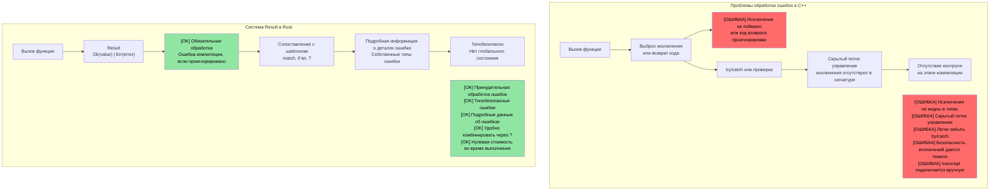
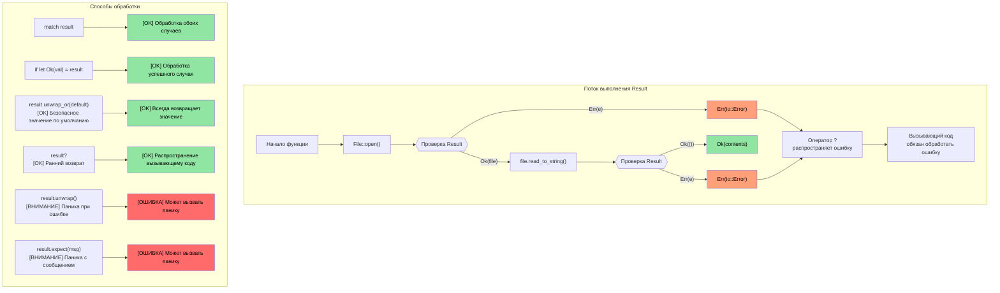

## Связь перечислений с Option и Result

> **Что вы узнаете:** Как Rust заменяет пустые указатели (null pointers) типом `Option<T>`, а исключения — типом `Result<T, E>`, и как оператор `?` делает распространение ошибок лаконичным. Это самый характерный шаблон Rust — ошибки являются значениями, а не скрытым потоком управления.

- Помните тип `enum` (перечисление), который мы изучили ранее? Типы `Option` и `Result` в Rust — это просто перечисления, определенные в стандартной библиотеке:
```rust
// Именно так Option определен в std:
enum Option<T> {
    Some(T),  // Содержит значение
    None,     // Значение отсутствует
}

// И Result:
enum Result<T, E> {
    Ok(T),    // Успех со значением
    Err(E),   // Ошибка с подробностями
}
```
- Это означает, что всё, что вы узнали о сопоставлении с шаблоном с помощью `match`, работает напрямую с `Option` и `Result`.
- В Rust **нет пустого указателя (null pointer)** — его заменяет `Option<T>`, и компилятор заставляет вас обрабатывать случай `None`.

### Сравнение с C++: Исключения против Result
| **Шаблон C++** | **Аналог в Rust** | **Преимущество** |
|----------------|--------------------|--------------|
| `throw std::runtime_error(msg)` | `Err(MyError::Runtime(msg))` | Ошибка в типе возвращаемого значения — невозможно забыть обработать |
| `try { } catch (...) { }` | `match result { Ok(v) => ..., Err(e) => ... }` | Отсутствие скрытого потока управления |
| `std::optional<T>` | `Option<T>` | Требуется исчерпывающее сопоставление — невозможно забыть None |
| аннотация `noexcept` | По умолчанию — все функции Rust являются "noexcept" | Исключения не существуют |
| `errno` / коды возврата | `Result<T, E>` | Типобезопасно, нельзя проигнорировать |

# Тип Option в Rust
- Тип ```Option``` в Rust — это ```enum``` (перечисление) с двумя вариантами: ```Some<T>``` и ```None```.
    - Идея заключается в том, что он представляет собой тип, допускающий отсутствие значения (аналог nullable-типа), то есть он либо содержит валидное значение этого типа (```Some<T>```), либо не содержит его (```None```).
    - Тип ```Option``` используется в API, где результат операции либо успешно возвращает значение, либо завершается неудачей (но конкретная ошибка не имеет значения). Например, рассмотрим поиск подстроки в строке.
```rust
fn main() {
    // Возвращает Option<usize>
    let a = "1234".find("1");
    match a {
        Some(a) => println!("Found 1 at index {a}"),
        None => println!("Couldn't find 1")
    }
}
```

# Тип Option в Rust
- Тип ```Option``` в Rust можно обрабатывать различными способами:
    - Метод ```unwrap()``` вызывает панику, если ```Option<T>``` равен ```None```, и возвращает ```T``` в противном случае. Это наименее предпочтительный подход.
    - Метод ```or()``` можно использовать для возврата альтернативного значения.
    - Конструкция ```if let``` позволяет выполнить проверку на наличие ```Some<T>```.

> **Шаблоны для промышленной разработки**: См. разделы [Безопасное извлечение значения с помощью unwrap_or](ch17-2-avoiding-unchecked-indexing.md#safe-value-extraction-with-unwrap_or) и [Функциональные преобразования: map, map_err, find_map](ch17-2-avoiding-unchecked-indexing.md#functional-transforms-map-map_err-find_map) для примеров из реального промышленного кода на Rust.
```rust
fn main() {
  // Возвращает Option<usize>
  let a = "1234".find("1");
  println!("{a:?} {}", a.unwrap());
  let a = "1234".find("5").or(Some(42));
  println!("{a:?}");
  if let Some(a) = "1234".find("1") {
      println!("{a}");
  } else {
    println!("Not found in string");
  }
  // Это вызовет панику
  // "1234".find("5").unwrap();
}
```

# Тип Result в Rust
- Result — это тип ```enum``` (перечисление), аналогичный ```Option```, с двумя вариантами: ```Ok<T>``` или ```Err<E>```.
    - ```Result``` широко используется в API Rust, выполнение которых может завершиться ошибкой. Идея в том, что в случае успеха функции возвращают ```Ok<T>```, а в случае ошибки — конкретную ошибку ```Err<E>```.
```rust
  use std::num::ParseIntError;
  fn main() {
  let a : Result<i32, ParseIntError>  = "1234z".parse();
  match a {
      Ok(n) => println!("Parsed {n}"),
      Err(e) => println!("Parsing failed {e:?}"),
  }
  let a : Result<i32, ParseIntError>  = "1234z".parse().or(Ok(-1));
  println!("{a:?}");
  if let Ok(a) = "1234".parse::<i32>() {
    println!("Let OK {a}");  
  }
  // Это вызовет панику
  //"1234z".parse().unwrap();
}
```

## Option and Result: две стороны одной медали

`Option` и `Result` тесно связаны между собой — тип `Option<T>` по сути представляет собой `Result<T, ()>` (результат, в котором ошибка не несет никакой информации):

| `Option<T>` | `Result<T, E>` | Значение |
|-------------|---------------|---------|
| `Some(value)` | `Ok(value)` | Успех — значение присутствует |
| `None` | `Err(error)` | Ошибка — нет значения (Option) или подробности об ошибке (Result) |

**Преобразование между ними:**

```rust
fn main() {
    let opt: Option<i32> = Some(42);
    let res: Result<i32, &str> = opt.ok_or("value was None");  // Option → Result
    
    let res: Result<i32, &str> = Ok(42);
    let opt: Option<i32> = res.ok();  // Result → Option (отбрасывает ошибку)
    
    // Они разделяют многие общие методы:
    // .map(), .and_then(), .unwrap_or(), .unwrap_or_else(), .is_some()/is_ok()
}
```

> **Практическое правило**: Используйте `Option`, когда отсутствие значения нормально (например, поиск ключа в словаре). Используйте `Result`, когда сбой требует объяснения причин (например, файловый ввод-вывод, парсинг данных).

# Упражнение: Реализация функции log() с использованием Option

🟢 **Начальный уровень**

- Реализуйте функцию ```log()```, принимающую параметр типа ```Option<&str>```. Если параметр равен ```None```, она должна выводить строку по умолчанию.
- Функция должна возвращать ```Result``` с типом ```()``` как для успешного выполнения, так и для ошибки (в данном случае у нас никогда не возникнет ошибка).

<details><summary>Решение (нажмите, чтобы развернуть)</summary>

```rust
fn log(message: Option<&str>) -> Result<(), ()> {
    match message {
        Some(msg) => println!("LOG: {msg}"),
        None => println!("LOG: (no message provided)"),
    }
    Ok(())
}

fn main() {
    let _ = log(Some("System initialized"));
    let _ = log(None);
    
    // Альтернативный вариант с использованием unwrap_or:
    let msg: Option<&str> = None;
    println!("LOG: {}", msg.unwrap_or("(default message)"));
}
// Вывод:
// LOG: System initialized
// LOG: (no message provided)
// LOG: (default message)
```

</details>

----
# Обработка ошибок в Rust
 - Ошибки в Rust могут быть невосстановимыми (критическими) или восстановимыми. Критические ошибки приводят к панике (```panic```).
    - В целом следует избегать ситуаций, приводящих к ```панике```. Паники вызываются багами в программе, включая выход за границы индекса, вызов ```unwrap()``` для ```Option<None>``` и т. д.
    - Допустимо использовать явный вызов паники для условий, возникновение которых должно быть невозможным. Для проверки корректности (sanity checks) можно использовать макросы ```panic!``` или ```assert!```.
```rust
fn main() {
   let x : Option<u32> = None;
   // println!("{x}", x.unwrap()); // Вызовет панику
   println!("{}", x.unwrap_or(0));  // Хорошо — выведет 0
   let x = 41;
   //assert!(x == 42); // Вызовет панику
   //panic!("Something went wrong"); // Безусловная паника
   let _a = vec![0, 1];
   // println!("{}", a[2]); // Паника выхода за границы; используйте a.get(2), возвращающий Option<T>
}
```

## Обработка ошибок: C++ против Rust

### Проблемы обработки ошибок на основе исключений в C++

```cpp
// Обработка ошибок в C++ — исключения создают скрытый поток управления
#include <fstream>
#include <stdexcept>

std::string read_config(const std::string& path) {
    std::ifstream file(path);
    if (!file.is_open()) {
        throw std::runtime_error("Cannot open: " + path);
    }
    std::string content;
    // Что если getline выбросит исключение? Закроется ли файл корректно?
    // С использованием RAII — да, но как насчет других ресурсов?
    std::getline(file, content);
    return content;  // Что если вызывающая сторона не использует try/catch?
}

int main() {
    // ОШИБКА: Забыли обернуть в try/catch!
    auto config = read_config("nonexistent.txt");
    // Исключение распространяется молча, программа аварийно завершается
    // Ничто в сигнатуре функции не предупреждало нас об этом
    return 0;
}
```



### Визуализация работы с `Result<T, E>`

```rust
// Обработка ошибок в Rust — комплексная и обязательная
use std::fs::File;
use std::io::Read;

fn read_file_content(filename: &str) -> Result<String, std::io::Error> {
    let mut file = File::open(filename)?;  // Оператор ? автоматически распространяет ошибки
    let mut contents = String::new();
    file.read_to_string(&mut contents)?;
    Ok(contents)  // Вариант успешного выполнения
}

fn main() {
    match read_file_content("example.txt") {
        Ok(content) => println!("File content: {}", content),
        Err(error) => println!("Failed to read file: {}", error),
        // Компилятор заставляет нас обработать оба варианта!
    }
}
```



# Обработка ошибок в Rust
- Rust использует ```enum Result<T, E>``` для обработки восстановимых ошибок.
    - Вариант ```Ok<T>``` содержит результат в случае успеха, а ```Err<E>``` содержит ошибку.
```rust
fn main() {
    let x = "1234x".parse::<u32>();
    match x {
        Ok(x) => println!("Parsed number {x}"),
        Err(e) => println!("Parsing error {e:?}"),
    }
    let x  = "1234".parse::<u32>();
    // То же самое, что и выше, но с валидным числом
    if let Ok(x) = &x {
        println!("Parsed number {x}")
    } else if let Err(e) = &x {
        println!("Error: {e:?}");
    }
}
```

# Обработка ошибок в Rust
- Оператор попытки ```?``` является удобным сокращением для шаблона ```match``` с вариантами ```Ok``` / ```Err```.
    - Обратите внимание, что метод должен возвращать ```Result<T, E>``` для возможности использования ```?```.
    - Тип для ```Result<T, E>``` может варьироваться. В примере ниже мы возвращаем тот же тип ошибки (```std::num::ParseIntError```), который возвращает метод ```str::parse()```.
```rust
fn double_string_number(s : &str) -> Result<u32, std::num::ParseIntError> {
   let x = s.parse::<u32>()?; // Возвращает ошибку немедленно, если парсинг не удался
   Ok(x*2)
}
fn main() {
    let result = double_string_number("1234");
    println!("{result:?}");
    let result = double_string_number("1234x");
    println!("{result:?}");
}
```

# Обработка ошибок в Rust
- Ошибки можно преобразовывать в другие типы или к значениям по умолчанию (https://doc.rust-lang.org/std/result/enum.Result.html#method.unwrap_or_default).
```rust
// Изменяет тип ошибки на () в случае неудачи
fn double_string_number(s : &str) -> Result<u32, ()> {
   let x = s.parse::<u32>().map_err(|_|())?; // Возвращает ошибку немедленно, если парсинг не удался
   Ok(x*2)
}
```
```rust
fn double_string_number(s : &str) -> Result<u32, ()> {
   let x = s.parse::<u32>().unwrap_or_default(); // Возвращает 0 по умолчанию при ошибке парсинга
   Ok(x*2)
}
```
```rust
fn double_optional_number(x : Option<u32>) -> Result<u32, ()> {
    // Метод ok_or преобразует Option<None> в Result<u32, ()>
    x.ok_or(()).map(|x|x*2) // .map() применяется только к варианту Ok(u32)
}
```

# Упражнение: обработка ошибок

🟡 **Средний уровень**
- Реализуйте функцию ```log()``` с одним параметром типа u32. Если параметр не равен 42, верните ошибку. Типом ```Result<>``` для успешного выполнения и ошибки является ```()```.
- Напишите функцию ```call_log()```, которая выходит с тем же типом ```Result<>```, если ```log()``` возвращает ошибку. В противном случае выведите сообщение о том, что функция log была успешно вызвана.

```rust
fn log(x: u32) -> ?? {

}

fn call_log(x: u32) -> ?? {
    // Вызов log(x), затем немедленный выход в случае ошибки
    println!("log was successfully called");
}

fn main() {
    call_log(42);
    call_log(43);
}
``` 

<details><summary>Решение (нажмите, чтобы развернуть)</summary>

```rust
fn log(x: u32) -> Result<(), ()> {
    if x == 42 {
        Ok(())
    } else {
        Err(())
    }
}

fn call_log(x: u32) -> Result<(), ()> {
    log(x)?;  // Немедленный выход, если log() возвращает ошибку
    println!("log was successfully called with {x}");
    Ok(())
}

fn main() {
    let _ = call_log(42);  // Выведет: log was successfully called with 42
    let _ = call_log(43);  // Вернет Err(()), ничего не выведет
}
// Вывод:
// log was successfully called with 42
```

</details>
