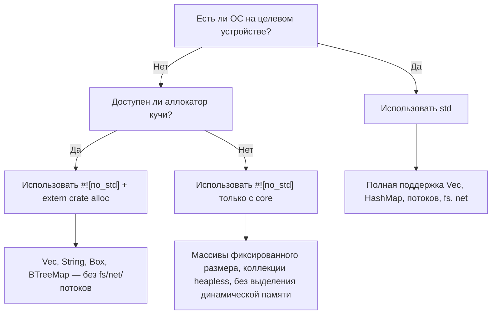

# `no_std` — Rust без стандартной библиотеки

> **Чему вы научитесь:** Как писать код на Rust для систем без ОС (bare-metal) и встроенных систем с использованием `#![no_std]` — разделение на крейты `core` и `alloc`, обработчики паники, а также сравнение со встраиваемым C без `libc`.

Если вы пришли из сферы разработки встроенных систем на C, вы уже привыкли работать без библиотеки `libc` или с минимальной средой выполнения. В Rust есть полноценный аналог: атрибут **`#![no_std]`**.

## Что такое `no_std`?

При добавлении атрибута `#![no_std]` в корень крейта компилятор убирает неявное подключение библиотеки `extern crate std;` и линкует бинарный файл только с **`core`** (и при необходимости с **`alloc`**).

| Уровень | Что предоставляет | Требуется ли ОС / куча? |
|-------|-----------------|---------------------|
| `core` | Примитивные типы, `Option`, `Result`, `Iterator`, математические операции, `slice`, `str`, атомики, `fmt` | **Нет** — работает на «голом железе» (bare metal) |
| `alloc` | `Vec`, `String`, `Box`, `Rc`, `Arc`, `BTreeMap` | Требуется глобальный аллокатор, но **ОС не нужна** |
| `std` | `HashMap`, `fs`, `net`, `thread`, `io`, `env`, `process` | **Да** — требуется ОС |

> **Практическое правило для разработчиков встраиваемых систем:** если ваш проект на C линкуется с флагом `-lc` и использует `malloc`, то вы, скорее всего, сможете использовать связку `core` + `alloc`. Если же код выполняется на голом железе без `malloc`, ограничьтесь только `core`.

## Объявление `no_std`

```rust
// src/lib.rs  (или src/main.rs для исполняемого файла с #![no_main])
#![no_std]

// Вы по-прежнему можете использовать всё из библиотеки core:
use core::fmt;
use core::result::Result;
use core::option::Option;

// Если у вас есть аллокатор, подключите типы, использующие кучу:
extern crate alloc;
use alloc::vec::Vec;
use alloc::string::String;
```

Для исполняемого файла на голом железе вам также понадобятся атрибут `#![no_main]` и обработчик паники:

```rust
#![no_std]
#![no_main]

use core::panic::PanicInfo;

#[panic_handler]
fn panic(_info: &PanicInfo) -> ! {
    loop {} // зависание при панике — замените сбросом или миганием светодиода вашей платы
}

// Точка входа зависит от вашей библиотеки HAL / скрипта компоновщика
```

## Что вы теряете (и альтернативы)

| Возможность `std` | Альтернатива в `no_std` |
|---------------|---------------------|
| `println!` | `core::write!` в интерфейс UART / `defmt` |
| `HashMap` | `heapless::FnvIndexMap` (фиксированная емкость) или `BTreeMap` (с `alloc`) |
| `Vec` | `heapless::Vec` (выделяется на стеке, фиксированная емкость) |
| `String` | `heapless::String` или `&str` |
| `std::io::Read/Write` | `embedded_io::Read/Write` |
| `thread::spawn` | Обработчики прерываний, задачи RTIC |
| `std::time` | Аппаратные периферийные таймеры |
| `std::fs` | Драйверы флеш-памяти / EEPROM |

## Важные crates в экосистеме `no_std` для встроенных систем

| Библиотека (Crate) | Назначение | Примечания |
|-------|---------|-------|
| [`heapless`](https://crates.io/crates/heapless) | Фиксированная емкость для `Vec`, `String`, `Queue`, `Map` | Аллокатор не требуется — всё выделяется на стеке |
| [`defmt`](https://crates.io/crates/defmt) | Эффективное логирование через отладчик/ITM | Похоже на printf, но форматирование откладывается и происходит на хост-машине |
| [`embedded-hal`](https://crates.io/crates/embedded-hal) | Трейты аппаратной абстракции (SPI, I²C, GPIO, UART) | Реализуйте один раз, запускайте на любом микроконтроллере |
| [`cortex-m`](https://crates.io/crates/cortex-m) | Встроенные инструкции ARM Cortex-M и доступ к регистрам | Низкоуровневый доступ, аналог CMSIS |
| [`cortex-m-rt`](https://crates.io/crates/cortex-m-rt) | Код запуска и инициализации среды (Runtime) для Cortex-M | Заменяет ваш файл `startup.s` |
| [`rtic`](https://crates.io/crates/rtic) | Реализация конкурентности на основе прерываний реального времени | Планирование задач на этапе компиляции, нулевые накладные расходы |
| [`embassy`](https://crates.io/crates/embassy-executor) | Асинхронный исполнитель (executor) для встроенных систем | Использование `async/await` на голом железе |
| [`postcard`](https://crates.io/crates/postcard) | Сериализация serde для `no_std` (бинарная) | Заменяет `serde_json`, когда нет ресурсов для работы со строками |
| [`thiserror`](https://crates.io/crates/thiserror) | Макрос Derive для трейта `Error` | Работает в `no_std` начиная с версии v2; предпочтительнее anyhow |
| [`smoltcp`](https://crates.io/crates/smoltcp) | Стек TCP/IP для `no_std` | Когда требуется работа с сетью без операционной системы |

## C против Rust: сравнение для голого железа

Типичный пример мигания светодиодом (blinky) на встраиваемом C:

```c
// C — bare metal, vendor HAL
#include "stm32f4xx_hal.h"

void SysTick_Handler(void) {
    HAL_GPIO_TogglePin(GPIOA, GPIO_PIN_5);
}

int main(void) {
    HAL_Init();
    __HAL_RCC_GPIOA_CLK_ENABLE();
    GPIO_InitTypeDef gpio = { .Pin = GPIO_PIN_5, .Mode = GPIO_MODE_OUTPUT_PP };
    HAL_GPIO_Init(GPIOA, &gpio);
    HAL_SYSTICK_Config(HAL_RCC_GetHCLKFreq() / 1000);
    while (1) {}
}
```

Эквивалент на Rust (с использованием `embedded-hal` + библиотеки поддержки платы):

```rust
#![no_std]
#![no_main]

use cortex_m_rt::entry;
use panic_halt as _; // panic handler: infinite loop
use stm32f4xx_hal::{pac, prelude::*};

#[entry]
fn main() -> ! {
    let dp = pac::Peripherals::take().unwrap();
    let gpioa = dp.GPIOA.split();
    let mut led = gpioa.pa5.into_push_pull_output();

    let rcc = dp.RCC.constrain();
    let clocks = rcc.cfgr.freeze();
    let mut delay = dp.TIM2.delay_ms(&clocks);

    loop {
        led.toggle();
        delay.delay_ms(500u32);
    }
}
```

**Ключевые отличия для разработчиков на C:**
- Метод `Peripherals::take()` возвращает `Option` — это гарантирует использование паттерна Одиночка (Singleton) на этапе компиляции (исключаются ошибки двойной инициализации).
- Метод `.split()` передает владение отдельными пинами — нет риска, что два независимых программных модуля будут одновременно управлять одним и тем же пином.
- Весь доступ к регистрам контролируется по типам — вы не сможете случайно записать значение в регистр, предназначенный только для чтения.
- Проверка заимствований (borrow checker) предотвращает возникновение гонок за данные между функцией `main` и обработчиками прерываний (при использовании RTIC).

## Когда использовать `no_std` в отличие от `std`



# Упражнение: Кольцевой буфер для `no_std`

🔴 **Сложная задача** — объединяет обобщения, `MaybeUninit` и `#[cfg(test)]` в контексте `no_std`

Во встраиваемых системах часто требуется кольцевой буфер (circular buffer) фиксированного размера, который никогда не выделяет память динамически. Реализуйте его, используя исключительно библиотеку `core` (без `alloc` и без `std`).

**Требования:**
- Обобщенный тип элементов `T: Copy`
- Фиксированная емкость `N` (const generic)
- `push(&mut self, item: T)` — перезаписывает самый старый элемент, если буфер полон
- `pop(&mut self) -> Option<T>` — возвращает самый старый элемент
- `len(&self) -> usize`
- `is_empty(&self) -> bool`
- Должен компилироваться в режиме `#![no_std]`

```rust
// Начальный код
#![no_std]

use core::mem::MaybeUninit;

pub struct RingBuffer<T: Copy, const N: usize> {
    buf: [MaybeUninit<T>; N],
    head: usize,  // следующая позиция для записи
    tail: usize,  // следующая позиция для чтения
    count: usize,
}

impl<T: Copy, const N: usize> RingBuffer<T, N> {
    pub const fn new() -> Self {
        todo!()
    }
    pub fn push(&mut self, item: T) {
        todo!()
    }
    pub fn pop(&mut self) -> Option<T> {
        todo!()
    }
    pub fn len(&self) -> usize {
        todo!()
    }
    pub fn is_empty(&self) -> bool {
        todo!()
    }
}
```

<details>
<summary>Решение</summary>

```rust
#![no_std]

use core::mem::MaybeUninit;

pub struct RingBuffer<T: Copy, const N: usize> {
    buf: [MaybeUninit<T>; N],
    head: usize,
    tail: usize,
    count: usize,
}

impl<T: Copy, const N: usize> RingBuffer<T, N> {
    pub const fn new() -> Self {
        Self {
            // SAFETY: MaybeUninit не требует инициализации
            buf: unsafe { MaybeUninit::uninit().assume_init() },
            head: 0,
            tail: 0,
            count: 0,
        }
    }

    pub fn push(&mut self, item: T) {
        self.buf[self.head] = MaybeUninit::new(item);
        self.head = (self.head + 1) % N;
        if self.count == N {
            // Буфер полон — перезаписываем самый старый элемент, продвигаем tail
            self.tail = (self.tail + 1) % N;
        } else {
            self.count += 1;
        }
    }

    pub fn pop(&mut self) -> Option<T> {
        if self.count == 0 {
            return None;
        }
        // SAFETY: Мы читаем только те позиции, которые ранее были записаны методом push()
        let item = unsafe { self.buf[self.tail].assume_init() };
        self.tail = (self.tail + 1) % N;
        self.count -= 1;
        Some(item)
    }

    pub fn len(&self) -> usize {
        self.count
    }

    pub fn is_empty(&self) -> bool {
        self.count == 0
    }
}

#[cfg(test)]
mod tests {
    use super::*;

    #[test]
    fn basic_push_pop() {
        let mut rb = RingBuffer::<u32, 4>::new();
        assert!(rb.is_empty());

        rb.push(10);
        rb.push(20);
        rb.push(30);
        assert_eq!(rb.len(), 3);

        assert_eq!(rb.pop(), Some(10));
        assert_eq!(rb.pop(), Some(20));
        assert_eq!(rb.pop(), Some(30));
        assert_eq!(rb.pop(), None);
    }

    #[test]
    fn overwrite_on_full() {
        let mut rb = RingBuffer::<u8, 3>::new();
        rb.push(1);
        rb.push(2);
        rb.push(3);
        // Буфер полон: [1, 2, 3]

        rb.push(4); // Перезаписывает 1 → [4, 2, 3], tail сдвигается
        assert_eq!(rb.len(), 3);
        assert_eq!(rb.pop(), Some(2)); // старейший оставшийся
        assert_eq!(rb.pop(), Some(3));
        assert_eq!(rb.pop(), Some(4));
        assert_eq!(rb.pop(), None);
    }
}
```

**Почему это важно для разработчиков встроенных систем на C:**
- `MaybeUninit` — это эквивалент неинициализированной памяти в Rust. Компилятор не будет заполнять ее нулями автоматически, аналогично объявлению `char buf[N];` в C.
- Блоки `unsafe` минимальны (всего 2 строки), и каждый содержит поясняющий комментарий `// SAFETY:`.
- Функция `const fn new()` означает, что вы можете создавать кольцевые буферы в статических переменных (`static`) без вызова конструктора во время выполнения.
- Тесты запускаются на вашей хост-машине с помощью команды `cargo test`, несмотря на то, что целевой код написан в режиме `no_std`.

</details>
