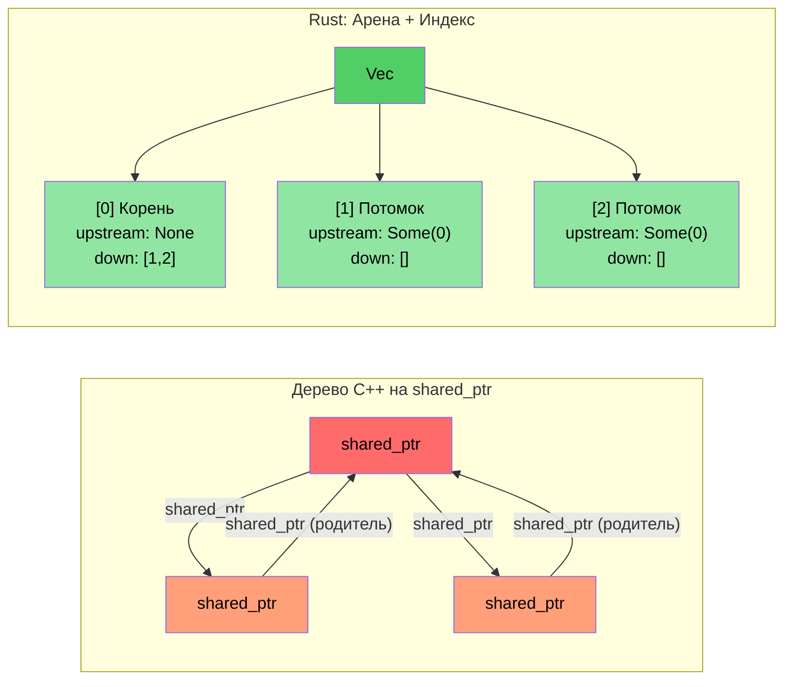

# Обзор практического опыта: перенос проекта с C++ на Rust

> **Чему вы научитесь:** Урокам реального переноса около 100 тысяч строк кода на C++ в примерно 90 тысяч строк кода на Rust в рамках ~20 крейтов. Пяти ключевым паттернам трансформации и архитектурным решениям, стоящим за ними.

- Мы перенесли крупную систему диагностики на C++ (около 100 тыс. строк кода) на Rust (~20 крейтов Rust, около 90 тыс. строк кода).
- В этом разделе показаны **реальные паттерны**, которые были использованы — не игрушечные примеры, а настоящий продакшн-код.
- Пять ключевых преобразований:

| **№** | **Паттерн в C++** | **Паттерн в Rust** | **Результат** |
|-------|----------------|-----------------|-----------|
| 1 | Иерархия классов + `dynamic_cast` | Диспетчеризация перечислений (enum dispatch) + `match` | ~400 → 0 вызовов `dynamic_cast` |
| 2 | Дерево на `shared_ptr` / `enable_shared_from_this` | Арена + связи по индексам | Отсутствие циклов ссылок |
| 3 | Сырой указатель `Framework*` в каждом модуле | `DiagContext<'a>` с заимствованием времени жизни | Проверка валидности при компиляции |
| 4 | Божественный объект (God object) | Компонуемые структуры состояния | Модульность и тестируемость |
| 5 | Везде `vector<unique_ptr<Base>>` | Объекты типажей (trait objects) **только** при необходимости (~25 использований) | Статическая диспетчеризация по умолчанию |

### Сравнение показателей «до» и «после»

| **Показатель** | **C++ (Оригинал)** | **Rust (Переписанная версия)** |
|------------|---------------------|------------------------|
| `dynamic_cast` / приведение типов вниз | ~400 | 0 |
| `virtual` / `override` методы | ~900 | ~25 (`Box<dyn Trait>`) |
| Выделение памяти через сырой `new` | ~200 | 0 (все типы владеемые) |
| `shared_ptr` / подсчет ссылок | ~10 (библиотека топологии) | 0 (`Arc` только на границе FFI) |
| Определения `enum class` | ~60 | ~190 `pub enum` |
| Выражения сопоставления с паттерном | Недоступно | ~750 `match` |
| Божественные объекты (>5 тыс. строк) | 2 | 0 |

----

# Практический пример 1: Иерархия наследования → Диспетчеризация перечислений

## Паттерн в C++: иерархия классов событий
```cpp
// C++ оригинал: Каждый тип событий GPU представляет собой класс, наследуемый от GpuEventBase
class GpuEventBase {
public:
    virtual ~GpuEventBase() = default;
    virtual void Process(DiagFramework* fw) = 0;
    uint16_t m_recordId;
    uint8_t  m_sensorType;
    // ... общие поля
};

class GpuPcieDegradeEvent : public GpuEventBase {
public:
    void Process(DiagFramework* fw) override;
    uint8_t m_linkSpeed;
    uint8_t m_linkWidth;
};

class GpuPcieFatalEvent : public GpuEventBase { /* ... */ };
class GpuBootEvent : public GpuEventBase { /* ... */ };
// ... более 10 классов событий, наследуемых от GpuEventBase

// Обработка требует использования dynamic_cast:
void ProcessEvents(std::vector<std::unique_ptr<GpuEventBase>>& events,
                   DiagFramework* fw) {
    for (auto& event : events) {
        if (auto* degrade = dynamic_cast<GpuPcieDegradeEvent*>(event.get())) {
            // обработка деградации...
        } else if (auto* fatal = dynamic_cast<GpuPcieFatalEvent*>(event.get())) {
            // обработка фатальной ошибки...
        }
        // ... еще 10 веток
    }
}
```

## Решение на Rust: диспетчеризация перечислений
```rust
// Пример: types.rs — без наследования, таблиц виртуальных методов (vtable) и dynamic_cast
#[derive(Debug, Clone, PartialEq, Eq, Serialize, Deserialize)]
pub enum GpuEventKind {
    PcieDegrade,
    PcieFatal,
    PcieUncorr,
    Boot,
    BaseboardState,
    EccError,
    OverTemp,
    PowerRail,
    ErotStatus,
    Unknown,
}
```

```rust
// Пример: manager.rs — раздельные типизированные Vec, приведение типов вниз не требуется
pub struct GpuEventManager {
    sku: SkuVariant,
    degrade_events: Vec<GpuPcieDegradeEvent>,   // Конкретный тип, а не Box<dyn>
    fatal_events: Vec<GpuPcieFatalEvent>,
    uncorr_events: Vec<GpuPcieUncorrEvent>,
    boot_events: Vec<GpuBootEvent>,
    baseboard_events: Vec<GpuBaseboardEvent>,
    ecc_events: Vec<GpuEccEvent>,
    // ... каждый тип события получает свой собственный Vec
}

// Аксессоры возвращают типизированные срезы — полное отсутствие неопределенности
impl GpuEventManager {
    pub fn degrade_events(&self) -> &[GpuPcieDegradeEvent] {
        &self.degrade_events
    }
    pub fn fatal_events(&self) -> &[GpuPcieFatalEvent] {
        &self.fatal_events
    }
}
```

### Почему бы не использовать `Vec<Box<dyn GpuEvent>>`?
- **Неправильный подход** (дословный перевод): положить все события в одну гетерогенную коллекцию, а затем приводить типы вниз — именно так поступает C++ с `vector<unique_ptr<Base>>`.
- **Правильный подход**: раздельные типизированные `Vec` устраняют *любую* необходимость приведения типов вниз. Каждый потребитель запрашивает именно тот тип событий, который ему нужен.
- **Производительность**: раздельные `Vec` обеспечивают лучшую локальность кэша (все события деградации расположены в памяти непрерывно).

----

# Практический пример 2: Дерево на shared_ptr → Шаблон «Арена/индекс»

## Паттерн в C++: дерево с подсчетом ссылок
```cpp
// C++ библиотека топологии: PcieDevice использует enable_shared_from_this
// так как родительским и дочерним узлам требуется ссылаться друг на друга
class PcieDevice : public std::enable_shared_from_this<PcieDevice> {
public:
    std::shared_ptr<PcieDevice> m_upstream;
    std::vector<std::shared_ptr<PcieDevice>> m_downstream;
    // ... данные устройства
    
    void AddChild(std::shared_ptr<PcieDevice> child) {
        child->m_upstream = shared_from_this();  // Цикл «родитель ↔ потомок»!
        m_downstream.push_back(child);
    }
};
// Проблема: связи родитель→потомок и потомок→родитель создают циклы ссылок
// Для разрыва циклов требуется weak_ptr, но о нем легко забыть
```

## Решение на Rust: арена со связями по индексам
```rust
// Пример: components.rs — плоский Vec владеет всеми устройствами
pub struct PcieDevice {
    pub base: PcieDeviceBase,
    pub kind: PcieDeviceKind,

    // Связи в дереве через индексы — без подсчета ссылок и циклов
    pub upstream_idx: Option<usize>,      // Индекс в векторе арены
    pub downstream_idxs: Vec<usize>,      // Индексы в векторе арены
}

// «Арена» — это просто Vec<PcieDevice>, которым владеет дерево:
pub struct DeviceTree {
    devices: Vec<PcieDevice>,  // Плоское владение — один Vec владеет всем
}

impl DeviceTree {
    pub fn parent(&self, device_idx: usize) -> Option<&PcieDevice> {
        self.devices[device_idx].upstream_idx
            .map(|idx| &self.devices[idx])
    }
    
    pub fn children(&self, device_idx: usize) -> Vec<&PcieDevice> {
        self.devices[device_idx].downstream_idxs
            .iter()
            .map(|&idx| &self.devices[idx])
            .collect()
    }
}
```

### Ключевая идея
- **Никаких `shared_ptr`, `weak_ptr` или `enable_shared_from_this`**.
- **Невозможны циклы ссылок** — индексы представляют собой обычные значения `usize`.
- **Более высокая производительность кэша** — все устройства расположены в памяти непрерывно.
- **Более простая логика** — один владелец (Vec) и множество читателей (индексы).



----
