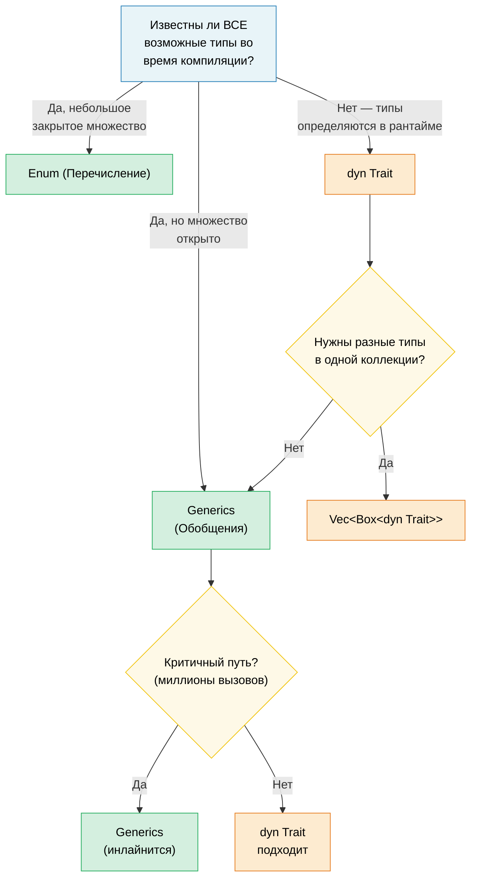

# 1. Обобщения (Generics) — полная картина 🟢

> **Чему вы научитесь:**
> - Как мономорфизация обеспечивает обобщения с нулевой стоимостью (zero-cost generics) и когда она приводит к раздуванию кода (code bloat)
> - Критерии выбора: обобщения против перечислений и против объектов типажей (trait objects)
> - Константные обобщения (const generics) для задания размеров массивов на этапе компиляции и `const fn` для вычислений во время компиляции
> - Когда стоит предпочесть динамическую диспетчеризацию статической на редко используемых путях выполнения (cold paths)

## Мономорфизация и нулевая стоимость

Обобщения в Rust **мономорфизируются** — компилятор генерирует специализированную копию каждой обобщённой функции для каждого конкретного типа, с которым она используется. Это противоположно Java/C#, где обобщения стираются во время выполнения (type erasure).

```rust
fn max_of<T: PartialOrd>(a: T, b: T) -> T {
    if a >= b { a } else { b }
}

fn main() {
    max_of(3_i32, 5_i32);     // Компилятор генерирует max_of_i32
    max_of(2.0_f64, 7.0_f64); // Компилятор генерирует max_of_f64
    max_of("a", "z");         // Компилятор генерирует max_of_str
}
```

**Что компилятор фактически производит** (концептуально):

```rust
// Три отдельные функции — без диспетчеризации во время выполнения, без vtable:
fn max_of_i32(a: i32, b: i32) -> i32 { if a >= b { a } else { b } }
fn max_of_f64(a: f64, b: f64) -> f64 { if a >= b { a } else { b } }
fn max_of_str<'a>(a: &'a str, b: &'a str) -> &'a str { if a >= b { a } else { b } }
```

> **Почему функции `max_of_str` требуется `<'a>`, а `max_of_i32` — нет?** `i32` и `f64`
> реализуют типаж `Copy` — функция возвращает владеемое значение. Но `&str` — это ссылка,
> поэтому компилятор должен знать время жизни возвращаемой ссылки. Аннотация `<'a>`
> означает: «возвращаемый `&str` живет не меньше, чем оба входных значения».

**Преимущества**: Нулевая стоимость во время выполнения (zero runtime cost) — сгенерированный код идентичен специализированному коду, написанному вручную. Оптимизатор может инлайнить (встраивать), векторизовать и оптимизировать каждую копию независимо.

**Сравнение с C++**: Обобщения в Rust работают аналогично шаблонам C++, но с одним ключевым отличием — **проверка ограничений происходит на этапе определения, а не при инстанцировании**. В C++ шаблон компилируется только тогда, когда он используется с конкретным типом, что приводит к загадочным сообщениям об ошибках глубоко в коде библиотек. В Rust ограничение `T: PartialOrd` проверяется при определении функции, поэтому ошибки выявляются на ранней стадии, а сообщения о них понятны.

```rust,compile_fail
// Rust: ошибка на этапе определения — «T не реализует Display»
fn broken<T>(val: T) {
    println!("{val}"); // ❌ Ошибка: T не реализует Display
}
```

```rust
// Решение: добавьте ограничение
fn fixed<T: std::fmt::Display>(val: T) {
    println!("{val}"); // ✅
}
```

### Когда обобщения вредят: раздувание кода (Code Bloat)

У мономорфизации есть обратная сторона — размер бинарного файла. Каждое уникальное инстанцирование дублирует тело функции:

```rust,ignore
// Эта безобидная функция...
fn serialize<T: serde::Serialize>(value: &T) -> Vec<u8> {
    serde_json::to_vec(value).unwrap()
}

// ...используемая с 50 различными типами → 50 копий в бинарном файле.
```

**Стратегии минимизации**:

```rust,ignore
// 1. Извлеките необобщенное ядро (паттерн «outline»)
fn serialize<T: serde::Serialize>(value: &T) -> Result<Vec<u8>, serde_json::Error> {
    // Обобщённая часть: только вызов сериализации
    let json_value = serde_json::to_value(value)?;
    // Необобщённая часть: вынесена в отдельную функцию
    serialize_value(json_value)
}

fn serialize_value(value: serde_json::Value) -> Result<Vec<u8>, serde_json::Error> {
    // Эта функция существует в бинарном файле в единственном экземпляре
    serde_json::to_vec(&value)
}

// 2. Используйте объекты типажей (динамическую диспетчеризацию), когда инлайнинг не критичен
fn log_item(item: &dyn std::fmt::Display) {
    // Одна копия — для диспетчеризации используется vtable
    println!("[LOG] {item}");
}
```

> **Практическое правило**: Используйте обобщения для часто выполняемых путей (hot paths), где важен инлайнинг (встраивание).
> Используйте `dyn Trait` для редко выполняемых путей (cold paths) — таких как обработка ошибок, логирование, конфигурирование,
> где накладные расходы на вызов через vtable незначительны.

### Обобщения против перечислений и против объектов типажей — руководство по выбору

В Rust существует три способа реализации принципа «разные типы, один интерфейс»:

| Подход | Диспетчеризация | Известен во время | Расширяемый? | Накладные расходы |
|----------|----------|----------|-------------|----------|
| **Обобщения (Generics)** (`impl Trait` / `<T: Trait>`) | Статическая (мономорфизация) | Компиляции | ✅ (открытое множество) | Нулевые — встраивание кода |
| **Перечисление (Enum)** | Ветка сопоставления (match) | Компиляции | ❌ (закрытое множество) | Нулевые — без vtable |
| **Объект типажа (Trait object)** (`dyn Trait`) | Динамическая (vtable) | Выполнения (Runtime) | ✅ (открытое множество) | Указатель на vtable + косвенный вызов |

```rust,ignore
// --- ОБОБЩЕНИЯ: открытое множество, нулевая стоимость, время компиляции ---
fn process<H: Handler>(handler: H, request: Request) -> Response {
    handler.handle(request) // Мономорфизировано — одна копия для каждого H
}

// --- ENUM: закрытое множество, нулевая стоимость, исчерпывающее сопоставление ---
enum Shape {
    Circle(f64),
    Rect(f64, f64),
    Triangle(f64, f64, f64),
}

impl Shape {
    fn area(&self) -> f64 {
        match self {
            Shape::Circle(r) => std::f64::consts::PI * r * r,
            Shape::Rect(w, h) => w * h,
            Shape::Triangle(a, b, c) => {
                let s = (a + b + c) / 2.0;
                (s * (s - a) * (s - b) * (s - c)).sqrt()
            }
        }
    }
}
// Добавление нового варианта заставляет обновить ВСЕ ветки match — компилятор
// требует исчерпывающего сопоставления. Отлично подходит для случая «я контролирую все варианты».

// --- ОБЪЕКТ ТИПАЖА: открытое множество, накладные расходы времени выполнения, расширяемость ---
fn log_all(items: &[Box<dyn std::fmt::Display>]) {
    for item in items {
        println!("{item}"); // диспетчеризация через vtable
    }
}
```

**Схема принятия решений**:



### Константные обобщения (Const Generics)

Начиная с версии Rust 1.51, вы можете параметризовать типы и функции *константными значениями*, а не только типами:

```rust
// Обертка массива, параметризованная размером
struct Matrix<const ROWS: usize, const COLS: usize> {
    data: [[f64; COLS]; ROWS],
}

impl<const ROWS: usize, const COLS: usize> Matrix<ROWS, COLS> {
    fn new() -> Self {
        Matrix { data: [[0.0; COLS]; ROWS] }
    }

    fn transpose(&self) -> Matrix<COLS, ROWS> {
        let mut result = Matrix::<COLS, ROWS>::new();
        for r in 0..ROWS {
            for c in 0..COLS {
                result.data[c][r] = self.data[r][c];
            }
        }
        result
    }
}

// Компилятор гарантирует корректность размерностей:
fn multiply<const M: usize, const N: usize, const P: usize>(
    a: &Matrix<M, N>,
    b: &Matrix<N, P>, // N должен совпадать!
) -> Matrix<M, P> {
    let mut result = Matrix::<M, P>::new();
    for i in 0..M {
        for j in 0..P {
            for k in 0..N {
                result.data[i][j] += a.data[i][k] * b.data[k][j];
            }
        }
    }
    result
}

// Использование:
let a = Matrix::<2, 3>::new(); // 2×3
let b = Matrix::<3, 4>::new(); // 3×4
let c = multiply(&a, &b);      // 2×4 ✅

// let d = Matrix::<5, 5>::new();
// multiply(&a, &d); // ❌ Ошибка компиляции: ожидался Matrix<3, _>, получен Matrix<5, 5>
```

> **Сравнение с C++**: Это похоже на `template<int N>` в C++, но константные
> обобщения в Rust проверяются компилятором превентивно и не страдают от сложности SFINAE.

### Константные функции (const fn)

Ключевое слово `const fn` помечает функцию как вычисляемую на этапе компиляции — аналог `constexpr` в C++. Результат такой функции можно использовать в контекстах `const` и `static`:

```rust
// Базовая const fn — вычисляется на этапе компиляции при использовании в константном контексте
const fn celsius_to_fahrenheit(c: f64) -> f64 {
    c * 9.0 / 5.0 + 32.0
}

const BOILING_F: f64 = celsius_to_fahrenheit(100.0); // Вычисляется во время компиляции
const FREEZING_F: f64 = celsius_to_fahrenheit(0.0);  // 32.0

// Константные конструкторы — создание статических переменных без lazy_static!
struct BitMask(u32);

impl BitMask {
    const fn new(bit: u32) -> Self {
        BitMask(1 << bit)
    }

    const fn or(self, other: BitMask) -> Self {
        BitMask(self.0 | other.0)
    }

    const fn contains(&self, bit: u32) -> bool {
        self.0 & (1 << bit) != 0
    }
}

// Статическая таблица поиска — без накладных расходов во время выполнения и ленивой инициализации
const GPIO_INPUT:  BitMask = BitMask::new(0);
const GPIO_OUTPUT: BitMask = BitMask::new(1);
const GPIO_IRQ:    BitMask = BitMask::new(2);
const GPIO_IO:     BitMask = GPIO_INPUT.or(GPIO_OUTPUT);

// Карты регистров в виде константных массивов:
const SENSOR_THRESHOLDS: [u16; 4] = {
    let mut table = [0u16; 4];
    table[0] = 50;   // Предупреждение
    table[1] = 70;   // Высокий уровень
    table[2] = 85;   // Критический уровень
    table[3] = 100;  // Отключение
    table
};
// Вся таблица существует в бинарном файле — куча не используется, рантайм-инициализации нет.
```

**Что МОЖНО делать в `const fn`** (по состоянию на Rust 1.79+):
- Арифметические, битовые операции, сравнения
- Управляющие конструкции: `if`/`else`, `match`, `loop`, `while`
- Создание и изменение локальных переменных (`let mut`)
- Вызов других `const fn`
- Работа со ссылками (`&`, `&mut` — внутри константного контекста)
- Вызов `panic!()` (приводит к ошибке компиляции, если управление доходит до него на этапе компиляции)
- Базовая математика с плавающей точкой (`+`, `-`, `*`, `/`; сложные операции вроде `sqrt`/`sin` пока недоступны)

**Что делать НЕЛЬЗЯ** (на данный момент):
- Выделять память в куче (`Box`, `Vec`, `String`)
- Вызывать методы типажей (допускаются только собственные методы типов, inherent methods)
- Выполнять ввод-вывод или вызывать побочные эффекты

```rust
// const fn с паникой — превращается в ошибку компиляции:
const fn checked_div(a: u32, b: u32) -> u32 {
    if b == 0 {
        panic!("division by zero"); // Ошибка компиляции, если b равно 0 на этапе компиляции
    }
    a / b
}

const RESULT: u32 = checked_div(100, 4);  // ✅ 25
// const BAD: u32 = checked_div(100, 0);  // ❌ Ошибка компиляции: "division by zero"
```

> **Сравнение с C++**: `const fn` — это аналог `constexpr` в Rust. Ключевое отличие:
> в Rust этот режим явно запрашивается разработчиком (opt-in), а компилятор строго проверяет,
> что используются только константные операции. В C++ функции `constexpr` могут
> незаметно переходить на вычисление в рантайме — в Rust константный контекст
> *требует* вычисления на этапе компиляции, иначе компиляция завершится ошибкой.

> **Практический совет**: По возможности делайте конструкторы и простые вспомогательные функции
> с ключевым словом `const fn` — это ничего не стоит, но позволяет вызывающему коду использовать
> их в константных контекстах. В коде диагностики оборудования `const fn` идеально подходит для
> определения регистров, создания битовых масок и таблиц пороговых значений.

> **Ключевые выводы — Обобщения**
> - Мономорфизация дает абстракции с нулевой стоимостью, но может раздувать размер бинарника — используйте `dyn Trait` на редко используемых путях (cold paths)
> - Константные обобщения (`[T; N]`) заменяют шаблоны C++ проверкой размеров массивов на этапе компиляции
> - `const fn` позволяет отказаться от макросов вроде `lazy_static!` для значений, вычисляемых на этапе компиляции

> **См. также:** [Глава 2 — Углублённое изучение типажей](ch02-traits-in-depth.md) для изучения ограничений типажей, ассоциированных типов и объектов типажей. [Глава 4 — PhantomData](ch04-phantomdata-types-that-carry-no-data.md) для изучения обобщённых маркеров нулевого размера.

---

### Упражнение: Обобщённый кэш с вытеснением ★★ (~30 мин)

Создайте структуру обобщённого кэша `Cache<K, V>`, которая хранит пары ключ-значение с настраиваемой максимальной емкостью. При заполнении кэша старейшая запись вытесняется (FIFO). Требования:

- `fn new(capacity: usize) -> Self`
- `fn insert(&mut self, key: K, value: V)` — вытесняет старейшую запись, если достигнута максимальная емкость
- `fn get(&self, key: &K) -> Option<&V>`
- `fn len(&self) -> usize`
- Ограничение: `K: Eq + Hash + Clone`

<details>
<summary>🔑 Решение</summary>

```rust
use std::collections::{HashMap, VecDeque};
use std::hash::Hash;

struct Cache<K, V> {
    map: HashMap<K, V>,
    order: VecDeque<K>,
    capacity: usize,
}

impl<K: Eq + Hash + Clone, V> Cache<K, V> {
    fn new(capacity: usize) -> Self {
        Cache {
            map: HashMap::with_capacity(capacity),
            order: VecDeque::with_capacity(capacity),
            capacity,
        }
    }

    fn insert(&mut self, key: K, value: V) {
        if self.capacity == 0 {
            // нет емкости!
            return;
        }
        if self.map.contains_key(&key) {
            self.map.insert(key, value);
            return;
        }
        if self.map.len() >= self.capacity {
            if let Some(oldest) = self.order.pop_front() {
                self.map.remove(&oldest);
            }
        }
        self.order.push_back(key.clone());
        self.map.insert(key, value);
    }

    fn get(&self, key: &K) -> Option<&V> {
        self.map.get(key)
    }

    fn len(&self) -> usize {
        self.map.len()
    }
}

fn main() {
    // Тест простого кэша
    let mut cache = Cache::new(3);
    cache.insert("a", 1);
    cache.insert("b", 2);
    cache.insert("c", 3);
    assert_eq!(cache.len(), 3);

    cache.insert("d", 4); // Вытесняет "a"
    assert_eq!(cache.get(&"a"), None);
    assert_eq!(cache.get(&"d"), Some(&4));

    // Оставлено читателю: каким типом должен быть атрибут `capacity`,
    // чтобы гарантировать, что такой бесполезный кэш не может быть определен?
    let mut empty_cache = Cache::new(0);
    empty_cache.insert("0", 0);
    assert_eq!(empty_cache.get(&"0"), None);
    assert_eq!(empty_cache.len(), 0);

    println!("Cache works! len = {}", cache.len());
}
```

</details>

***
