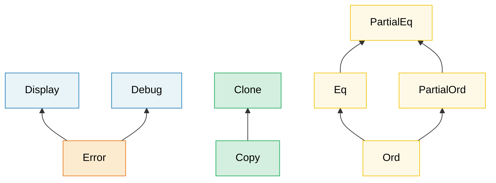

# 2. Углублённое изучение типажей (Traits) 🟡

> **Чему вы научитесь:**
> - Ассоциированные типы против обобщённых параметров — и когда использовать каждый из них
> - GAT (обобщённые ассоциированные типы), общие реализации (blanket impls), маркерные типажи и правила dyn-совместимости
> - Как под капотом устроены таблицы виртуальных методов (vtables) и «толстые» указатели (fat pointers)
> - Типажи-расширения (extension traits), диспетчеризация через перечисления (enum dispatch) и паттерны типизированных команд (typed commands)

## Ассоциированные типы против обобщённых параметров

Оба механизма позволяют типажу работать с различными типами, но служат разным целям:

```rust
// --- АССОЦИИРОВАННЫЙ ТИП: одна реализация на тип ---
trait Iterator {
    type Item; // Каждый итератор выдает ровно ОДИН тип элементов

    fn next(&mut self) -> Option<Self::Item>;
}

// Пользовательский итератор, который всегда выдает i32 — выбора нет
struct Counter { max: i32, current: i32 }

impl Iterator for Counter {
    type Item = i32; // Ровно один тип Item на реализацию
    fn next(&mut self) -> Option<i32> {
        if self.current < self.max {
            self.current += 1;
            Some(self.current)
        } else {
            None
        }
    }
}

// --- ОБОБЩЁННЫЙ ПАРАМЕТР: несколько реализаций на тип ---
trait Convert<T> {
    fn convert(&self) -> T;
}

// Один тип может реализовывать Convert для МНОЖЕСТВА целевых типов:
impl Convert<f64> for i32 {
    fn convert(&self) -> f64 { *self as f64 }
}
impl Convert<String> for i32 {
    fn convert(&self) -> String { self.to_string() }
}
```

**Когда что использовать**:

| Использование | Когда |
|-----|------|
| **Ассоциированный тип** | Существует ровно ОДИН естественный результат на имплементирующий тип. Примеры: `Iterator::Item`, `Deref::Target`, `Add::Output` |
| **Обобщённый параметр** | Тип может осмысленно реализовывать типаж для МНОЖЕСТВА различных типов. Примеры: `From<T>`, `AsRef<T>`, `PartialEq<Rhs>` |

**Интуитивное правило**: Если логично спросить «какой тип элементов (`Item`) у этого итератора?», используйте ассоциированный тип. Если логично спросить «может ли этот тип конвертироваться в `f64`? в `String`? в `bool`?», используйте обобщённый параметр.

```rust
// Реальный пример: std::ops::Add
trait Add<Rhs = Self> {
    type Output; // Ассоциированный тип — сложение дает ОДИН результирующий тип
    fn add(self, rhs: Rhs) -> Self::Output;
}

// Rhs — это обобщённый параметр, вы можете складывать Meters с разными типами:
struct Meters(f64);
struct Centimeters(f64);

impl Add<Meters> for Meters {
    type Output = Meters;
    fn add(self, rhs: Meters) -> Meters { Meters(self.0 + rhs.0) }
}
impl Add<Centimeters> for Meters {
    type Output = Meters;
    fn add(self, rhs: Centimeters) -> Meters { Meters(self.0 + rhs.0 / 100.0) }
}
```

### Обобщённые ассоциированные типы (GAT)

Начиная с версии Rust 1.65, ассоциированные типы сами могут иметь обобщённые параметры. Это делает возможными **заимствующие итераторы (lending iterators)** — итераторы, возвращающие ссылки, привязанные к самому итератору, а не к лежащей в его основе коллекции:

```rust
// Без GAT — заимствующий итератор выразить невозможно:
// trait LendingIterator {
//     type Item<'a>;  // ← Это отвергалось до версии 1.65
// }

// С использованием GAT (Rust 1.65+):
trait LendingIterator {
    type Item<'a> where Self: 'a;

    fn next(&mut self) -> Option<Self::Item<'_>>;
}

// Пример: итератор, выдающий перекрывающиеся окна (overlapping windows)
struct WindowIter<'data> {
    data: &'data [u8],
    pos: usize,
    window_size: usize,
}

impl<'data> LendingIterator for WindowIter<'data> {
    type Item<'a> = &'a [u8] where Self: 'a;

    fn next(&mut self) -> Option<&[u8]> {
        if self.pos + self.window_size <= self.data.len() {
            let window = &self.data[self.pos..self.pos + self.window_size];
            self.pos += 1;
            Some(window)
        } else {
            None
        }
    }
}
```

> **Когда вам нужны GAT**: Заимствующие итераторы, потоковые парсеры (streaming parsers) или любые типажи, в которых время жизни ассоциированного типа зависит от заимствования `&self`. Для большинства обычных задач достаточно простых ассоциированных типов.

### Супертипажи и иерархии типажей

Типажи могут требовать реализации других типажей в качестве предварительного условия, образуя иерархии:



> Стрелки указывают от субтипажа к супертипажу: реализация `Error` требует наличия `Display` + `Debug`.

Типаж может требовать, чтобы исполнители также реализовывали другие типажи:

```rust
use std::fmt;

// Display является супертипажом для Error
trait Error: fmt::Display + fmt::Debug {
    fn source(&self) -> Option<&(dyn Error + 'static)> { None }
}
// Любой тип, реализующий Error, ДОЛЖЕН также реализовывать Display и Debug

// Создание собственных иерархий:
trait Identifiable {
    fn id(&self) -> u64;
}

trait Timestamped {
    fn created_at(&self) -> chrono::DateTime<chrono::Utc>;
}

// Entity требует реализации обоих типажей:
trait Entity: Identifiable + Timestamped {
    fn is_active(&self) -> bool;
}

// Реализация Entity обязывает вас реализовать все три типажа:
struct User { id: u64, name: String, created: chrono::DateTime<chrono::Utc> }

impl Identifiable for User {
    fn id(&self) -> u64 { self.id }
}
impl Timestamped for User {
    fn created_at(&self) -> chrono::DateTime<chrono::Utc> { self.created }
}
impl Entity for User {
    fn is_active(&self) -> bool { true }
}
```

### Общие реализации (Blanket Implementations)

Вы можете реализовать типаж для ВСЕХ типов, которые удовлетворяют определенному ограничению:

```rust
// Так сделано в std: любой тип, реализующий Display, автоматически получает реализацию ToString
impl<T: fmt::Display> ToString for T {
    fn to_string(&self) -> String {
        format!("{self}")
    }
}
// Теперь i32, &str, ваши собственные типы — всё, что имеет Display, получает метод to_string() бесплатно.

// Собственная общая реализация:
trait Loggable {
    fn log(&self);
}

// Любой тип, реализующий Debug, автоматически становится Loggable:
impl<T: std::fmt::Debug> Loggable for T {
    fn log(&self) {
        eprintln!("[LOG] {self:?}");
    }
}

// Теперь любой тип с поддержкой Debug имеет метод .log():
// 42.log();              // [LOG] 42
// "hello".log();         // [LOG] "hello"
// vec![1, 2, 3].log();   // [LOG] [1, 2, 3]
```

> **Внимание**: Общие реализации (blanket impls) очень мощны, но их применение необратимо — вы не сможете добавить более специфичную реализацию для конкретного типа, который уже покрыт общей реализацией (из-за правил orphan rules и когерентности/coherence). Проектируйте их обдуманно.

### Маркерные типажи (Marker Traits)

Типажи без методов — они лишь помечают тип как обладающий определенным свойством:

```rust
// Маркерные типажи стандартной библиотеки:
// Send    — безопасно передавать между потоками
// Sync    — безопасно разделять (&T) между потоками
// Unpin   — безопасно перемещать после пиннинга (pinning)
// Sized   — имеет известный размер во время компиляции
// Copy    — может быть дублирован с помощью memcpy

// Ваш собственный маркерный типаж:
/// Маркер: этот датчик прошел заводскую калибровку
pub trait Calibrated {}

struct RawSensor { reading: f64 }
struct CalibratedSensor { reading: f64 }

impl Calibrated for CalibratedSensor {}

// В производстве могут использоваться только калиброванные датчики:
fn record_measurement<S: Calibrated>(sensor: &S) {
    // ...
}
// record_measurement(&RawSensor { reading: 0.0 }); // ❌ Ошибка компиляции
// record_measurement(&CalibratedSensor { reading: 0.0 }); // ✅
```

Этот напрямую связано с **паттерном состояний типов (type-state pattern)** в Главе 3.

<a id="dyn-compatibility-formerly-object-safety"></a>
### Dyn-совместимость (ранее «безопасность объектов» / Object Safety)

> **Замечание о названии**: до версии Rust 1.84 это свойство называлось *object safety* (безопасность объектов). Этот термин вводил в заблуждение в обеих своих частях — в Rust нет «объектов» в понимании ООП, и это свойство никак не связано с безопасностью памяти. Вопрос заключается лишь в следующем: «можно ли использовать данный типаж как `dyn Trait`?». Теперь компилятор сообщает: `the trait 'X' is not dyn compatible` (код ошибки по-прежнему `E0038`), однако большинство существующих статей, документаций крейтов и ответов на Stack Overflow всё ещё используют термин «object safe» — концепция осталась прежней.

Не любой типаж можно использовать как `dyn Trait`. Типаж является **dyn-совместимым** только если выполняются следующие условия:

1. **`Sized` не должен быть супертипажом (supertrait)** — то есть типаж не должен требовать `Self: Sized`
2. **У методов нет обобщённых параметров типа** — параметры времени жизни (*lifetimes*) *разрешены*, поскольку они стираются до этапа кодогенерации и не требуют отдельной записи в vtable
3. **`Self` не используется** нигде в сигнатуре метода, кроме как в типе получателя (*receiver*) — это относится как к аргументам, так и к возвращаемым типам
4. **Каждая ассоциированная функция должна быть диспетчеризируемой либо явно исключена.** Для диспетчеризируемого метода требуется получатель типа `&self`, `&mut self`, `self: Box<Self>`, `self: Rc<Self>`, `self: Arc<Self>` или `self: Pin<P>`, где `P` — один из перечисленных типов. Любая другая сигнатура — включая обычный конструктор `fn create() -> Self` — должна содержать ограничение `where Self: Sized`, чтобы исключить метод из таблицы виртуальных методов (vtable)
5. **Все супертипажи должны быть dyn-совместимыми** — это свойство наследуется
6. **Нет ассоциированных констант** и **нет обобщённых ассоциированных типов (GAT)**. Обычные ассоциированные типы разрешены, но должны быть зафиксированы в месте использования: `dyn Iterator<Item = u32>`, но никогда просто `dyn Iterator`
7. **Нет непрозрачных возвращаемых типов (opaque return types)** у диспетчеризируемых методов — ни `async fn` (скрывающего тип `Future`), ни возвращаемого `impl Trait` (RPITIT)

```rust
// ✅ Dyn-совместим — может использоваться как dyn Drawable
trait Drawable {
    fn draw(&self);
    fn bounding_box(&self) -> (f64, f64, f64, f64);
}

let shapes: Vec<Box<dyn Drawable>> = vec![/* ... */]; // ✅ Работает

// ❌ НЕ dyn-совместим — упоминает Self вне типа получателя (receiver)
trait Cloneable {
    fn clone_self(&self) -> Self;
    //                      ^^^^ "...because method `clone_self` references
    //                            the `Self` type in its return type"
}
// let items: Vec<Box<dyn Cloneable>> = ...; // ❌ Ошибка компиляции

// ❌ То же правило, но в позиции аргумента — именно поэтому PartialEq не dyn-совместим
trait Comparable {
    fn equals(&self, other: &Self) -> bool;
    //                       ^^^^ "...references the `Self` type in this parameter"
}

// ⚠️ Оборачивание в Box НЕ решает проблему — Box<Self> всё так же ссылается на Self
trait Spawner {
    fn spawn(&self) -> Box<Self>; // ❌ Всё ещё не dyn-совместим
}

// ✅ Возвращайте Box<dyn Trait> взамен — это конкретный тип, а не Self.
// Это стандартная идиома «клонирования через объект типажа»:
trait CloneableDyn {
    fn clone_box(&self) -> Box<dyn CloneableDyn>;
}

// ❌ НЕ dyn-совместим — обобщённый метод
trait Converter {
    fn convert<T>(&self) -> T;
    //        ^^^ vtable не может содержать бесконечное количество мономорфизаций
}

// ✅ Dyn-совместим — обобщённый LIFETIME разрешён, запрещены только параметры типа
trait Tokenizer {
    fn first_token<'a>(&self, input: &'a str) -> &'a str;
    //            ^^^^ Одной ячейки vtable достаточно: времена жизни стираются
}

// ❌ НЕ dyn-совместим — ассоциированная функция без получателя (receiver)
trait Factory {
    fn create() -> Self;
    // "...because associated function `create` has no `self` parameter"
}

// ✅ Та же функция, но исключённая из vtable — типаж снова становится dyn-совместимым
trait FactoryFixed {
    fn describe(&self) -> String;          // диспетчеризируемый метод
    fn create() -> Self where Self: Sized; // исключен из vtable
}

// ❌ НЕ dyn-совместим — унаследован от супертипажа, который сам не dyn-совместим.
//    С самим Derived всё в порядке; компилятор указывает на Base::make.
trait Base {
    fn make() -> Self;
}
trait Derived: Base {
    fn show(&self);
}
// let d: &dyn Derived = ...; // ❌ Ошибка компиляции из-за `Base::make`

// ❌ НЕ dyn-совместим — ассоциированная константа не может быть представлена в vtable
trait Sensor {
    const MAX: f64;
    //    ^^^ "...because it contains associated const `MAX`"
    fn read(&self) -> f64;
}
// Обходной путь: сделайте её методом — `fn max_reading(&self) -> f64`. Обратите внимание,
// что лазейки с `where Self: Sized` здесь НЕТ; синтаксис `const MAX: f64 where Self: Sized;`
// даже не поддерживается в stable Rust (обобщённые константы нестабильны).

// ❌ НЕ dyn-совместим — GAT представляет собой семейство типов, а не один конкретный тип
trait LendingIterator {
    type Item<'a> where Self: 'a;
    //   ^^^^ "...because it contains generic associated type `Item`"
    fn next(&mut self) -> Option<Self::Item<'_>>;
}
// Это тот же самый LendingIterator из раздела о GAT выше: цена lending iterator в том,
// что `dyn LendingIterator` никогда не сможет существовать.

// ❌ НЕ dyn-совместим — непрозрачный возвращаемый тип (RPITIT)
trait Container {
    fn items(&self) -> impl Iterator<Item = u32>;
    //                 ^^^^ "...references an `impl Trait` type in its return type"
}

// ❌ НЕ dyn-совместим — `async fn` представляет собой ту же проблему, только в синтаксическом сахаре
trait DataStore {
    async fn get(&self, key: &str) -> Option<String>;
    // "...because method `get` is `async`"
}
// Обходной путь для обоих случаев: сотрите тип вручную и верните конкретный упакованный в Box
// объект типажа — `Box<dyn Iterator<Item = u32> + '_>` и
// `Pin<Box<dyn Future<Output = Option<String>> + '_>>` являются обычными типами,
// поэтому они получают обычные слоты в vtable.

// ⚠️ `self` по значению НЕ является диспетчеризируемым получателем — он неявно
//    подразумевает `where Self: Sized`. Типаж остаётся dyn-совместимым, но сам метод
//    просто отсутствует в vtable и не может быть вызван через `dyn Trait`:
trait Consume {
    fn describe(&self) -> String; // находится в vtable
    fn consume(self) -> String;   // неявно подразумевает `where Self: Sized`
}
// let t: &dyn Consume = &token;  // ✅ объект типажа в порядке
// boxed.consume();               // ❌ error[E0161]: cannot move a value
//                                //    of type `dyn Consume`
```

**Обходные пути**:

```rust
// Добавьте `where Self: Sized`, чтобы исключить метод из vtable:
trait MyTrait {
    fn regular_method(&self); // Включен в vtable

    fn generic_method<T>(&self) -> T
    where
        Self: Sized; // Исключен из vtable — не может быть вызван через dyn MyTrait
}

// Теперь dyn MyTrait корректен, но generic_method может быть вызван
// только тогда, когда конкретный тип известен.
```

> **Практическое правило**: Если вы планируете использовать `dyn Trait`, делайте методы простыми —
> без обобщённых параметров типа, без упоминания `Self` вне получателя (receiver) и без супертипажа `Sized`.
> Обратите внимание на асимметрию: `trait Widget: Sized` фатально, тогда как `where Self: Sized` на отдельном
> методе — это санкционированный способ исключения из vtable, показанный выше.
> Если сомневаетесь, попробуйте написать `let _: Box<dyn YourTrait>;` и посмотрите на подсказки компилятора.

> **Почему `AsyncFn` не является dyn-совместимым**: справочник языка (*Reference*) выносит `AsyncFn`,
> `AsyncFnMut` и `AsyncFnOnce` в отдельное правило, но сообщение компилятора показывает, что это просто
> следствие описанного выше правила о GAT — компилятор указывает на `AsyncFnMut::CallRefFuture<'a>`,
> обобщённый ассоциированный тип в стандартной библиотеке. Обычные трейты `Fn`/`FnMut`/`FnOnce` не имеют такого типа
> и полностью dyn-совместимы, поэтому `Box<dyn Fn(u32) -> u32>` работает отлично.

> **См. также**: раздел о RPITIT ниже использует `-> impl Trait` в определении типажа — это удобно,
> но лишает типаж его dyn-совместимости. В главе [Асинхронная книга — Гл. 10](../async-book/ch10-async-traits.html)
> подробно рассматриваются тонкости с `async fn` и обходной путь через `Pin<Box<dyn Future>>`.

### Устройство объектов типажей под капотом — таблицы виртуальных методов (vtables) и «толстые» указатели (Fat Pointers)

Переменная типа `&dyn Trait` (или `Box<dyn Trait>`) представляет собой **«толстый» указатель (fat pointer)**, состоящий из двух машинных слов:

```text
┌──────────────────────────────────────────────────┐
│  &dyn Drawable (на 64-битной системе: 16 байт)    │
├──────────────┬───────────────────────────────────┤
│  data_ptr    │  vtable_ptr                       │
│  (8 байт)    │  (8 байт)                         │
│  ↓           │  ↓                                │
│  ┌─────────┐ │  ┌──────────────────────────────┐ │
│  │ Circle  │ │  │ vtable для <Circle как       │ │
│  │ {       │ │  │           Drawable>          │ │
│  │  r: 5.0 │ │  │                              │ │
│  │ }       │ │  │  drop_in_place: 0x7f...a0    │ │
│  └─────────┘ │  │  size:           8           │ │
│              │  │  align:          8           │ │
│              │  │  draw:          0x7f...b4    │ │
│              │  │  bounding_box:  0x7f...c8    │ │
│              │  └──────────────────────────────┘ │
└──────────────┴───────────────────────────────────┘
```

**Как устроен вызов через vtable** (например, `shape.draw()`):

1. Из «толстого» указателя считывается адрес `vtable_ptr` (второе слово)
2. Производится индексация по таблице виртуальных методов (vtable) для поиска указателя на функцию `draw`
3. Функция вызывается, а в качестве аргумента `self` передается `data_ptr`

Этот механизм по стоимости аналогичен виртуальной диспетчеризации в C++ (одно разыменование указателя на вызов), однако Rust сохраняет указатель на vtable в самом «толстом» указателе, а не внутри объекта. Таким образом, обычный объект `Circle` на стеке вообще не несет в себе указателя на vtable и не тратит лишнюю память.

```rust
trait Drawable {
    fn draw(&self);
    fn area(&self) -> f64;
}

struct Circle { radius: f64 }

impl Drawable for Circle {
    fn draw(&self) { println!("Drawing circle r={}", self.radius); }
    fn area(&self) -> f64 { std::f64::consts::PI * self.radius * self.radius }
}

struct Square { side: f64 }

impl Drawable for Square {
    fn draw(&self) { println!("Drawing square s={}", self.side); }
    fn area(&self) -> f64 { self.side * self.side }
}

fn main() {
    let shapes: Vec<Box<dyn Drawable>> = vec![
        Box::new(Circle { radius: 5.0 }),
        Box::new(Square { side: 3.0 }),
    ];

    // Каждый элемент — это «толстый» указатель: (data_ptr, vtable_ptr)
    // Таблицы виртуальных методов (vtable) для Circle и Square РАЗНЫЕ
    for shape in &shapes {
        shape.draw();  // диспетчеризация через vtable → Circle::draw или Square::draw
        println!("  area = {:.2}", shape.area());
    }

    // Сравнение размеров:
    println!("size_of::<&Circle>()        = {}", size_of::<&Circle>());
    // → 8 байт (один указатель — компилятор знает точный тип)
    println!("size_of::<&dyn Drawable>()  = {}", size_of::<&dyn Drawable>());
    // → 16 байт (data_ptr + vtable_ptr)
}
```

**Модель затрат производительности**:

| Характеристика | Статическая диспетчеризация (`impl Trait` / обобщения) | Динамическая диспетчеризация (`dyn Trait`) |
|--------|------------------------------------------|-------------------------------|
| Накладные расходы на вызов | Нулевые — встраивается (inline) LLVM | Одно разыменование указателя на вызов |
| Встраивание (Inlining) | ✅ Компилятор может выполнить инлайнинг | ❌ Непрозрачный указатель на функцию |
| Размер бинарного файла | Больше (одна копия на каждый тип) | Меньше (одна общая функция) |
| Размер указателя | Обычный (1 слово) | «Толстый» (2 слова) |
| Гетерогенные коллекции | ❌ | ✅ `Vec<Box<dyn Trait>>` |

> **Когда важна стоимость вызова через vtable**: В узких циклах, где метод типажа вызывается миллионы
> раз, накладные расходы на косвенную адресацию и невозможность инлайнинга могут оказаться существенными
> (в 2-10 раз медленнее). Для редко используемых путей (cold paths), конфигурационных файлов или плагинных архитектур
> гибкость `dyn Trait` вполне оправдывает эти небольшие затраты.

### Высокоранговые ограничения времен жизни (HRTBs)

Иногда требуется функция, которая работает со ссылками *любого* времени жизни, а не какого-то одного конкретного. В таких случаях используется синтаксис `for<'a>`:

```rust
// Проблема: этой функции нужно замыкание, способное обрабатывать
// ссылки с ЛЮБЫМ временем жизни, а не с каким-то одним конкретным.

// ❌ Это слишком ограничительно — 'a фиксируется вызывающим кодом:
// fn apply<'a, F: Fn(&'a str) -> &'a str>(f: F, data: &'a str) -> &'a str

// ✅ HRTB: F должно работать для ВСЕХ возможных времен жизни:
fn apply<F>(f: F, data: &str) -> &str
where
    F: for<'a> Fn(&'a str) -> &'a str,
{
    f(data)
}

fn main() {
    let result = apply(|s| s.trim(), "  hello  ");
    println!("{result}"); // "hello"
}
```

**Когда вы будете сталкиваться с HRTBs**:
- Типажи вида `Fn(&T) -> &U` — в большинстве случаев компилятор автоматически выводит `for<'a>`
- Реализация нестандартных типажей, которые должны корректно работать с различными заимствованиями
- Десериализация с помощью `serde`: `for<'de> Deserialize<'de>`

```rust,ignore
// DeserializeOwned в serde определяется как:
// trait DeserializeOwned: for<'de> Deserialize<'de> {}
// Смысл: «может быть десериализовано из данных с ЛЮБЫМ временем жизни»
// (то есть результат не заимствует данные из входного буфера)

use serde::de::DeserializeOwned;

fn parse_json<T: DeserializeOwned>(input: &str) -> T {
    serde_json::from_str(input).unwrap()
}
```

> **Практический совет**: Вам редко придется писать `for<'a>` самостоятельно. Обычно это ограничение
> возникает в типажах параметров замыканий, где компилятор обрабатывает его неявно.
> Но умение распознавать его в сообщениях об ошибках (например, «expected a `for<'a> Fn(&'a ...)` bound»)
> поможет вам понять, чего именно требует компилятор.

### `impl Trait` — в позиции аргумента и в позиции возвращаемого значения

Синтаксическая конструкция `impl Trait` может использоваться в двух позициях, которые имеют **разную семантику**:

```rust
// --- impl Trait в позиции аргумента (APIT) ---
// «Вызывающий код выбирает тип» — синтаксический сахар для обобщенного параметра
fn print_all(items: impl Iterator<Item = i32>) {
    for item in items { println!("{item}"); }
}
// Эквивалентно:
fn print_all_verbose<I: Iterator<Item = i32>>(items: I) {
    for item in items { println!("{item}"); }
}
// Вызывающий код решает: print_all(vec![1,2,3].into_iter())
//                 print_all(0..10)

// --- impl Trait в позиции возвращаемого значения (RPIT) ---
// «Вызываемая функция выбирает тип» — функция возвращает один конкретный тип
fn evens(limit: i32) -> impl Iterator<Item = i32> {
    (0..limit).filter(|x| x % 2 == 0)
    // Конкретный тип: Filter<Range<i32>, Closure>
    // но вызывающий код видит лишь «некий Iterator<Item = i32>»
}
```

**Ключевое отличие**:

| | APIT (`fn foo(x: impl T)`) | RPIT (`fn foo() -> impl T`) |
|---|---|---|
| Кто выбирает тип? | Вызывающий код | Вызываемая функция (тело функции) |
| Мономорфизировано? | Да — одна копия на тип | Да — один конкретный тип |
| Синтаксис Turbofish? | Нет (вызов `foo::<X>()` запрещен) | Неприменимо |
| Эквивалентно | `fn foo<X: T>(x: X)` | Экзистенциальный тип |

#### RPIT в определениях типажей (RPITIT)

Начиная с версии Rust 1.75, вы можете использовать `-> impl Trait` непосредственно при описании методов в типажах:

```rust
trait Container {
    fn items(&self) -> impl Iterator<Item = &str>;
    //                 ^^^^ Каждый исполнитель возвращает собственный конкретный тип
}

struct CsvRow {
    fields: Vec<String>,
}

impl Container for CsvRow {
    fn items(&self) -> impl Iterator<Item = &str> {
        self.fields.iter().map(String::as_str)
    }
}

struct FixedFields;

impl Container for FixedFields {
    fn items(&self) -> impl Iterator<Item = &str> {
        ["host", "port", "timeout"].into_iter()
    }
}
```

> **До версии Rust 1.75** для достижения аналогичного поведения в типажах приходилось использовать
> `Box<dyn Iterator>` или ассоциированный тип. Поддержка RPITIT избавляет от необходимости выделения памяти на куче.
>
> **Но это лишает dyn-совместимости**: `-> impl Trait` является непрозрачным типом возвращаемого значения,
> поэтому `dyn Container` будет отклонен (см. [Dyn-совместимость](#dyn-compatibility-formerly-object-safety),
> правило 7). Если вам нужен объект типажа, продолжайте возвращать
> `Box<dyn Iterator<Item = &str> + '_>` ценой аллокации.

#### Выбор между `impl Trait` и `dyn Trait`

```text
Известен ли конкретный тип во время компиляции?
├── ДА → Используйте impl Trait или обобщения (нулевая стоимость, поддерживается инлайнинг)
└── НЕТ → Нужна ли гетерогенная коллекция?
     ├── ДА → Используйте dyn Trait (Box<dyn T>, &dyn T)
     └── НЕТ → Нужен ли ОДИНАКОВЫЙ объект типажа на границе API?
          ├── ДА → Используйте dyn Trait
          └── НЕТ → Используйте обобщения / impl Trait
```

| Характеристика | `impl Trait` | `dyn Trait` |
|---------|-------------|------------|
| Диспетчеризация | Статическая (мономорфизация) | Динамическая (vtable) |
| Производительность | Максимальная (поддерживается инлайнинг) | Одно разыменование на вызов |
| Гетерогенные коллекции | ❌ | ✅ |
| Размер бинарного файла | По одной копии для каждого типа | Общий код |
| Должен ли типаж быть dyn-совместимым? | Нет | Да |
| Работает в определениях типажей | ✅ (начиная с Rust 1.75+) | Всегда |

***

## Стирание типов с помощью `Any` и `TypeId`

Иногда требуется хранить значения *неизвестных* типов и приводить их к исходному типу позже — паттерн, аналогичный `void*` в C или `object` в C#. В Rust для этих целей используется `std::any::Any`:

```rust
use std::any::Any;

// Хранение гетерогенных значений:
fn log_value(value: &dyn Any) {
    if let Some(s) = value.downcast_ref::<String>() {
        println!("String: {s}");
    } else if let Some(n) = value.downcast_ref::<i32>() {
        println!("i32: {n}");
    } else {
        // TypeId позволяет проверить тип во время выполнения:
        println!("Unknown type: {:?}", value.type_id());
    }
}

// Полезно для систем плагинов, шин событий или ECS-архитектур:
struct AnyMap(std::collections::HashMap<std::any::TypeId, Box<dyn Any + Send>>);

impl AnyMap {
    fn new() -> Self { AnyMap(std::collections::HashMap::new()) }

    fn insert<T: Any + Send + 'static>(&mut self, value: T) {
        self.0.insert(std::any::TypeId::of::<T>(), Box::new(value));
    }

    fn get<T: Any + Send + 'static>(&self) -> Option<&T> {
        self.0.get(&std::any::TypeId::of::<T>())?
            .downcast_ref()
    }
}

fn main() {
    let mut map = AnyMap::new();
    map.insert(42_i32);
    map.insert(String::from("hello"));

    assert_eq!(map.get::<i32>(), Some(&42));
    assert_eq!(map.get::<String>().map(|s| s.as_str()), Some("hello"));
    assert_eq!(map.get::<f64>(), None); // Ни разу не вставлялся
}
```

> **Когда использовать `Any`**: Системы плагинов/расширений, карты с индексацией по типам (`typemap`),
> приведение ошибок (`anyhow::Error::downcast_ref`). Если набор типов известен во время компиляции,
> отдавайте предпочтение обобщениям или объектам типажей — `Any` представляет собой крайнюю меру,
> при которой безопасность времени компиляции приносится в жертву гибкости.

***

## Типажи-расширения — добавление методов к чужим типам

Правило сиротства (orphan rule) в Rust не позволяет вам реализовывать чужой типаж для чужого типа. Стандартным решением этой проблемы являются **типажи-расширения (extension traits)**: в своем пакете (crate) вы определяете новый типаж, методы которого имеют общую реализацию (blanket implementation) для всех типов, удовлетворяющих заданному ограничению. Пользователю библиотеки достаточно импортировать этот типаж, чтобы новые методы появились у существующих типов.

Этот паттерн повсеместно встречается в экосистеме Rust: `itertools::Itertools`, `futures::StreamExt`, `tokio::io::AsyncReadExt`, `tower::ServiceExt`.

### Проблема

```rust
// Мы хотим добавить метод .mean() для всех итераторов, возвращающих f64.
// Но типаж Iterator определен в std, а f64 является примитивом — правило сиротства запрещает это:
//
// impl<I: Iterator<Item = f64>> I {   // ❌ Нельзя добавлять собственные методы к чужому типу
//     fn mean(self) -> f64 { ... }
// }
```

### Решение: типаж-расширение

```rust
/// Методы-расширения для итераторов по числовым значениям.
pub trait IteratorExt: Iterator {
    /// Вычисляет среднее арифметическое. Возвращает `None` для пустого итератора.
    fn mean(self) -> Option<f64>
    where
        Self: Sized,
        Self::Item: Into<f64>;
}

// Общая реализация — автоматически применяется ко ВСЕМ итераторам
impl<I: Iterator> IteratorExt for I {
    fn mean(self) -> Option<f64>
    where
        Self: Sized,
        Self::Item: Into<f64>,
    {
        let mut sum: f64 = 0.0;
        let mut count: u64 = 0;
        for item in self {
            sum += item.into();
            count += 1;
        }
        if count == 0 { None } else { Some(sum / count as f64) }
    }
}

// Использование — просто импортируйте типаж:
use crate::IteratorExt;  // Один импорт — и метод становится доступен на всех итераторах

fn analyze_temperatures(readings: &[f64]) -> Option<f64> {
    readings.iter().copied().mean()  // Метод .mean() теперь доступен!
}

fn analyze_sensor_data(data: &[i32]) -> Option<f64> {
    data.iter().copied().mean()  // Работает и для i32 (поскольку i32 реализует Into<f64>)
}
```

### Реальный пример: расширения для результатов диагностики

```rust
use std::collections::HashMap;

struct DiagResult {
    component: String,
    passed: bool,
    message: String,
}

/// Типаж-расширение для Vec<DiagResult> — добавляет специализированные методы анализа.
pub trait DiagResultsExt {
    fn passed_count(&self) -> usize;
    fn failed_count(&self) -> usize;
    fn overall_pass(&self) -> bool;
    fn failures_by_component(&self) -> HashMap<String, Vec<&DiagResult>>;
}

impl DiagResultsExt for Vec<DiagResult> {
    fn passed_count(&self) -> usize {
        self.iter().filter(|r| r.passed).count()
    }

    fn failed_count(&self) -> usize {
        self.iter().filter(|r| !r.passed).count()
    }

    fn overall_pass(&self) -> bool {
        self.iter().all(|r| r.passed)
    }

    fn failures_by_component(&self) -> HashMap<String, Vec<&DiagResult>> {
        let mut map = HashMap::new();
        for r in self.iter().filter(|r| !r.passed) {
            map.entry(r.component.clone()).or_default().push(r);
        }
        map
    }
}

// Теперь любой Vec<DiagResult> имеет эти методы:
fn report(results: Vec<DiagResult>) {
    if !results.overall_pass() {
        let failures = results.failures_by_component();
        for (component, fails) in &failures {
            eprintln!("{component}: {} failures", fails.len());
        }
    }
}
```

### Соглашение об именовании

В экосистеме Rust для типажей-расширений принято использовать суффикс `Ext`:

| Пакет (Crate) | Типаж-расширение | Что расширяет |
|-------|----------------|---------|
| `itertools` | `Itertools` | `Iterator` |
| `futures` | `StreamExt`, `FutureExt` | `Stream`, `Future` |
| `tokio` | `AsyncReadExt`, `AsyncWriteExt` | `AsyncRead`, `AsyncWrite` |
| `tower` | `ServiceExt` | `Service` |
| `bytes` | `BufMut` (частично) | `&mut [u8]` |
| Ваш пакет | `DiagResultsExt` | `Vec<DiagResult>` |

### Когда использовать

| Ситуация | Стоит использовать типаж-расширение? |
|-----------|:---:|
| Добавление вспомогательных методов к чужому типу | ✅ |
| Группировка предметной логики для обобщённых коллекций | ✅ |
| Методу требуется доступ к приватным полям типа | ❌ (используйте обертку/newtype) |
| Метод логически относится к новому типу под вашим контролем | ❌ (просто добавьте его к своему типу) |
| Вы хотите, чтобы метод был доступен без импорта типажа | ❌ (это возможно только для собственных методов) |

***

## Диспетчеризация через перечисления (Enum Dispatch) — статическая полиморфизация без `dyn`

Когда у вас есть **закрытое множество** типов, реализующих один и тот же типаж, вы можете заменить `dyn Trait` на перечисление (enum), варианты которого содержат конкретные типы. Это исключает косвенную адресацию через vtable и выделение памяти на куче, сохраняя тот же интерфейс для вызывающей стороны.

### Проблема с использованием `dyn Trait`

```rust
trait Sensor {
    fn read(&self) -> f64;
    fn name(&self) -> &str;
}

struct Gps { lat: f64, lon: f64 }
struct Thermometer { temp_c: f64 }
struct Accelerometer { g_force: f64 }

impl Sensor for Gps {
    fn read(&self) -> f64 { self.lat }
    fn name(&self) -> &str { "GPS" }
}
impl Sensor for Thermometer {
    fn read(&self) -> f64 { self.temp_c }
    fn name(&self) -> &str { "Thermometer" }
}
impl Sensor for Accelerometer {
    fn read(&self) -> f64 { self.g_force }
    fn name(&self) -> &str { "Accelerometer" }
}

// Гетерогенная коллекция с использованием dyn — работает, но имеет свои недостатки:
fn read_all_dyn(sensors: &[Box<dyn Sensor>]) -> Vec<f64> {
    sensors.iter().map(|s| s.read()).collect()
    // Каждый вызов .read() проходит через vtable
    // Каждый Box выделяет память в куче
}
```

### Решение с помощью диспетчеризации через перечисления

```rust
// Заменяем объект типажа на перечисление:
enum AnySensor {
    Gps(Gps),
    Thermometer(Thermometer),
    Accelerometer(Accelerometer),
}

impl AnySensor {
    fn read(&self) -> f64 {
        match self {
            AnySensor::Gps(s) => s.read(),
            AnySensor::Thermometer(s) => s.read(),
            AnySensor::Accelerometer(s) => s.read(),
        }
    }

    fn name(&self) -> &str {
        match self {
            AnySensor::Gps(s) => s.name(),
            AnySensor::Thermometer(s) => s.name(),
            AnySensor::Accelerometer(s) => s.name(),
        }
    }
}

// Теперь: без выделения памяти на куче, без vtable, данные хранятся inline
fn read_all(sensors: &[AnySensor]) -> Vec<f64> {
    sensors.iter().map(|s| s.read()).collect()
    // Каждый вызов .read() — это ветка сопоставления шаблонов; компилятор может инлайнить всё
}

fn main() {
    let sensors = vec![
        AnySensor::Gps(Gps { lat: 47.6, lon: -122.3 }),
        AnySensor::Thermometer(Thermometer { temp_c: 72.5 }),
        AnySensor::Accelerometer(Accelerometer { g_force: 1.02 }),
    ];

    for sensor in &sensors {
        println!("{}: {:.2}", sensor.name(), sensor.read());
    }
}
```

### Реализация типажа для самого перечисления

Для обеспечения совместимости вы можете реализовать исходный типаж непосредственно для самого перечисления:

```rust
impl Sensor for AnySensor {
    fn read(&self) -> f64 {
        match self {
            AnySensor::Gps(s) => s.read(),
            AnySensor::Thermometer(s) => s.read(),
            AnySensor::Accelerometer(s) => s.read(),
        }
    }

    fn name(&self) -> &str {
        match self {
            AnySensor::Gps(s) => s.name(),
            AnySensor::Thermometer(s) => s.name(),
            AnySensor::Accelerometer(s) => s.name(),
        }
    }
}

// Теперь AnySensor работает везде, где ожидается Sensor через обобщения:
fn report<S: Sensor>(s: &S) {
    println!("{}: {:.2}", s.name(), s.read());
}
```

### Сокращение дублирования кода с помощью макроса

Передача вызовов в ветках match является повторяющейся рутиной. Декларативный макрос позволяет избавиться от неё:

```rust
macro_rules! dispatch_sensor {
    ($self:expr, $method:ident $(, $arg:expr)*) => {
        match $self {
            AnySensor::Gps(s) => s.$method($($arg),*),
            AnySensor::Thermometer(s) => s.$method($($arg),*),
            AnySensor::Accelerometer(s) => s.$method($($arg),*),
        }
    };
}

impl Sensor for AnySensor {
    fn read(&self) -> f64     { dispatch_sensor!(self, read) }
    fn name(&self) -> &str    { dispatch_sensor!(self, name) }
}
```

Для крупных проектов использование пакета `enum_dispatch` полностью автоматизирует этот процесс:

```rust
use enum_dispatch::enum_dispatch;

#[enum_dispatch]
trait Sensor {
    fn read(&self) -> f64;
    fn name(&self) -> &str;
}

#[enum_dispatch(Sensor)]
enum AnySensor {
    Gps,
    Thermometer,
    Accelerometer,
}
// Весь код делегирования генерируется автоматически.
```

### Выбор между `dyn Trait` и Enum Dispatch

```text
Является ли множество типов закрытым (известно во время компиляции)?
├── ДА → Предпочтительно использовать enum dispatch (быстрее, без аллокаций в куче)
│         ├── Мало вариантов (< ~20)?     → Напишите перечисление вручную
│         └── Много вариантов или растет? → Используйте пакет enum_dispatch
└── НЕТ → Необходимо использовать dyn Trait (плагины, типы от пользователей библиотеки)
```

| Свойство | `dyn Trait` | Enum Dispatch |
|----------|:-----------:|:-------------:|
| Накладные расходы на диспетчеризацию | Адресация по vtable (~2 нс) | Предсказание переходов (~0.3 нс) |
| Выделение памяти на куче | Обычно да (Box) | Отсутствует (inline) |
| Дружественность к кэшу | Нет (переходы по указателям) | Да (непрерывные данные) |
| Открытость для новых типов | ✅ (любой может реализовать типаж) | ❌ (закрытое множество) |
| Размер кода | Общий | Одна копия на каждый вариант |
| Должен ли типаж быть dyn-совместимым | Да | Нет |
| Добавление варианта | Без изменений кода | Обновить enum + ветки match |

### Когда использовать Enum Dispatch

| Сценарий | Рекомендация |
|----------|---------------|
| Типы диагностических тестов (CPU, GPU, NIC, память...) | ✅ Enum dispatch — закрытое множество типов, известных при компиляции |
| Протоколы шин передачи данных (SPI, I2C, UART...) | ✅ Enum dispatch или конфигурационный типаж |
| Система плагинов (пользователь загружает .so во время работы) | ❌ Используйте `dyn Trait` |
| 2-3 варианта | ✅ Диспетчеризация через перечисление вручную |
| 10+ вариантов со множеством методов | ✅ Использование библиотеки `enum_dispatch` |
| Критичный к производительности внутренний цикл | ✅ Enum dispatch (устраняет вызовы через vtable) |

***

## Примеси возможностей (Capability Mixins) — ассоциированные типы для композиции с нулевой стоимостью

В таких языках, как Ruby, композиция поведения часто достигается через **примеси (mixins)** — вызов `include SomeModule` добавляет методы в класс. В Rust аналогичный результат достигается с помощью **ассоциированных типов + стандартных методов типажа + общих реализаций (blanket impls)**, но со следующими преимуществами:

* Все зависимости разрешаются на этапе **компиляции** — никаких неожиданностей вроде отсутствующих методов во время выполнения
* Каждый ассоциированный тип является **настройкой**, меняющей поведение стандартных методов типажа
* Компилятор **мономорфизирует** каждую комбинацию — нулевые накладные расходы на vtable

### Проблема: перекрестные зависимости аппаратных шин

Процедуры диагностики оборудования часто используют общие операции (чтение датчика IPMI, переключение линии GPIO, получение температуры по SPI), но разным тестам требуются разные их комбинации. Иерархий наследования в Rust нет. Передача дескриптора каждой шины в качестве аргумента функции приводит к громоздким сигнатурам. Нам нужен способ выборочно **подмешивать (mix in)** возможности работы с аппаратными шинами.

### Шаг 1 — Определение базовых типажей-ингредиентов

Каждый ингредиент предоставляет одну аппаратную возможность через ассоциированный тип:

```rust
use std::io;

// ── Абстракции шин (типажи, предоставляемые командой аппаратного обеспечения) ──
pub trait SpiBus {
    fn spi_transfer(&self, tx: &[u8], rx: &mut [u8]) -> io::Result<()>;
}

pub trait I2cBus {
    fn i2c_read(&self, addr: u8, reg: u8, buf: &mut [u8]) -> io::Result<()>;
    fn i2c_write(&self, addr: u8, reg: u8, data: &[u8]) -> io::Result<()>;
}

pub trait GpioPin {
    fn set_high(&self) -> io::Result<()>;
    fn set_low(&self) -> io::Result<()>;
    fn read_level(&self) -> io::Result<bool>;
}

pub trait IpmiBmc {
    fn raw_command(&self, net_fn: u8, cmd: u8, data: &[u8]) -> io::Result<Vec<u8>>;
    fn read_sensor(&self, sensor_id: u8) -> io::Result<f64>;
}

// ── Типажи-ингредиенты — по одному на шину, содержат ассоциированный тип ──
pub trait HasSpi {
    type Spi: SpiBus;
    fn spi(&self) -> &Self::Spi;
}

pub trait HasI2c {
    type I2c: I2cBus;
    fn i2c(&self) -> &Self::I2c;
}

pub trait HasGpio {
    type Gpio: GpioPin;
    fn gpio(&self) -> &Self::Gpio;
}

pub trait HasIpmi {
    type Ipmi: IpmiBmc;
    fn ipmi(&self) -> &Self::Ipmi;
}
```

Каждый такой ингредиент крайне прост, обобщён и может тестироваться изолированно.

### Шаг 2 — Определение примесей (Mixin Traits)

Типаж-примесь объявляет требуемые ингредиенты в качестве супертипажей, а затем реализует все свои методы через **реализации по умолчанию (defaults)** — типы-исполнители получают их автоматически:

```rust
/// Примесь: диагностика вентиляторов — требует I2C (тахометр) + GPIO (разрешение PWM)
pub trait FanDiagMixin: HasI2c + HasGpio {
    /// Чтение оборотов вентилятора (RPM) с микросхемы тахометра по I2C.
    fn read_fan_rpm(&self, fan_id: u8) -> io::Result<u32> {
        let mut buf = [0u8; 2];
        self.i2c().i2c_read(0x48 + fan_id, 0x00, &mut buf)?;
        Ok(u16::from_be_bytes(buf) as u32 * 60) // показания тахометра → RPM
    }

    /// Включение или отключение выхода PWM вентилятора через GPIO.
    fn set_fan_pwm(&self, enable: bool) -> io::Result<()> {
        if enable { self.gpio().set_high() }
        else      { self.gpio().set_low() }
    }

    /// Полная проверка работоспособности вентилятора — чтение RPM + проверка соответствия порогу.
    fn check_fan_health(&self, fan_id: u8, min_rpm: u32) -> io::Result<bool> {
        let rpm = self.read_fan_rpm(fan_id)?;
        Ok(rpm >= min_rpm)
    }
}

/// Примесь: мониторинг температуры — требует SPI (АЦП термопары) + IPMI (датчики BMC)
pub trait TempMonitorMixin: HasSpi + HasIpmi {
    /// Чтение термопары через SPI АЦП (например, MAX31855).
    fn read_thermocouple(&self) -> io::Result<f64> {
        let mut rx = [0u8; 4];
        self.spi().spi_transfer(&[0x00; 4], &mut rx)?;
        let raw = i32::from_be_bytes(rx) >> 18; // 14-битное знаковое число
        Ok(raw as f64 * 0.25)
    }

    /// Чтение показаний датчика температуры, управляемого BMC, через IPMI.
    fn read_bmc_temp(&self, sensor_id: u8) -> io::Result<f64> {
        self.ipmi().read_sensor(sensor_id)
    }

    /// Перекрестная валидация: показания термопары и BMC должны совпадать с точностью до delta.
    fn validate_temps(&self, sensor_id: u8, max_delta: f64) -> io::Result<bool> {
        let tc = self.read_thermocouple()?;
        let bmc = self.read_bmc_temp(sensor_id)?;
        Ok((tc - bmc).abs() <= max_delta)
    }
}

/// Примесь: последовательность подачи питания — требует GPIO (разрешение шины) + IPMI (логирование событий)
pub trait PowerSeqMixin: HasGpio + HasIpmi {
    /// Установка сигнала GPIO power-good и проверка через датчик IPMI.
    fn enable_power_rail(&self, sensor_id: u8) -> io::Result<bool> {
        self.gpio().set_high()?;
        std::thread::sleep(std::time::Duration::from_millis(50));
        let voltage = self.ipmi().read_sensor(sensor_id)?;
        Ok(voltage > 0.8) // выше 80% от номинала = норма
    }

    /// Снятие питания и логирование отключения с помощью OEM-команды IPMI.
    fn disable_power_rail(&self) -> io::Result<()> {
        self.gpio().set_low()?;
        // Логирование события OEM "power rail disabled" в BMC
        self.ipmi().raw_command(0x2E, 0x01, &[0x00, 0x01])?;
        Ok(())
    }
}
```

### Шаг 3 — Общие реализации делают типаж настоящей «примесью»

Волшебная строка — предоставляем ингредиенты, получаем методы:

```rust
impl<T: HasI2c + HasGpio>  FanDiagMixin    for T {}
impl<T: HasSpi  + HasIpmi>  TempMonitorMixin for T {}
impl<T: HasGpio + HasIpmi>  PowerSeqMixin   for T {}
```

Любая структура, реализующая правильные типажи-ингредиенты, **автоматически** приобретает все методы примесей — без написания шаблонного кода (boilerplate), форвардинга вызовов или наследования.

### Шаг 4 — Интеграция в Production-код

```rust
// ── Конкретные реализации шин (платформа Linux) ────────────────
struct LinuxSpi  { dev: String }
struct LinuxI2c  { dev: String }
struct SysfsGpio { pin: u32 }
struct IpmiTool  { timeout_secs: u32 }

impl SpiBus for LinuxSpi {
    fn spi_transfer(&self, _tx: &[u8], _rx: &mut [u8]) -> io::Result<()> {
        // spidev ioctl — опущено для краткости
        Ok(())
    }
}
impl I2cBus for LinuxI2c {
    fn i2c_read(&self, _addr: u8, _reg: u8, _buf: &mut [u8]) -> io::Result<()> {
        // i2c-dev ioctl — опущено для краткости
        Ok(())
    }
    fn i2c_write(&self, _addr: u8, _reg: u8, _data: &[u8]) -> io::Result<()> { Ok(()) }
}
impl GpioPin for SysfsGpio {
    fn set_high(&self) -> io::Result<()>  { /* /sys/class/gpio */ Ok(()) }
    fn set_low(&self) -> io::Result<()>   { Ok(()) }
    fn read_level(&self) -> io::Result<bool> { Ok(true) }
}
impl IpmiBmc for IpmiTool {
    fn raw_command(&self, _nf: u8, _cmd: u8, _data: &[u8]) -> io::Result<Vec<u8>> {
        // вызов утилиты ipmitool — опущено для краткости
        Ok(vec![])
    }
    fn read_sensor(&self, _id: u8) -> io::Result<f64> { Ok(25.0) }
}

// ── Production-платформа — все четыре шины ─────────────────────────
struct DiagPlatform {
    spi:  LinuxSpi,
    i2c:  LinuxI2c,
    gpio: SysfsGpio,
    ipmi: IpmiTool,
}

impl HasSpi  for DiagPlatform { type Spi  = LinuxSpi;  fn spi(&self)  -> &LinuxSpi  { &self.spi  } }
impl HasI2c  for DiagPlatform { type I2c  = LinuxI2c;  fn i2c(&self)  -> &LinuxI2c  { &self.i2c  } }
impl HasGpio for DiagPlatform { type Gpio = SysfsGpio; fn gpio(&self) -> &SysfsGpio { &self.gpio } }
impl HasIpmi for DiagPlatform { type Ipmi = IpmiTool;  fn ipmi(&self) -> &IpmiTool  { &self.ipmi } }

// Теперь DiagPlatform имеет ВСЕ методы примесей:
fn production_diagnostics(platform: &DiagPlatform) -> io::Result<()> {
    let rpm = platform.read_fan_rpm(0)?;       // из FanDiagMixin
    let tc  = platform.read_thermocouple()?;   // из TempMonitorMixin
    let ok  = platform.enable_power_rail(42)?;  // из PowerSeqMixin
    println!("Fan: {rpm} RPM, Temp: {tc}°C, Power: {ok}");
    Ok(())
}
```

### Шаг 5 — Тестирование с помощью заглушек/макетов (Mocks) (аппаратное обеспечение не требуется)

```rust
#[cfg(test)]
mod tests {
    use super::*;
    use std::cell::Cell;

    struct MockSpi  { temp: Cell<f64> }
    struct MockI2c  { rpm: Cell<u32> }
    struct MockGpio { level: Cell<bool> }
    struct MockIpmi { sensor_val: Cell<f64> }

    impl SpiBus for MockSpi {
        fn spi_transfer(&self, _tx: &[u8], rx: &mut [u8]) -> io::Result<()> {
            // Кодирование тестовой температуры в формат MAX31855
            let raw = ((self.temp.get() / 0.25) as i32) << 18;
            rx.copy_from_slice(&raw.to_be_bytes());
            Ok(())
        }
    }
    impl I2cBus for MockI2c {
        fn i2c_read(&self, _addr: u8, _reg: u8, buf: &mut [u8]) -> io::Result<()> {
            let tach = (self.rpm.get() / 60) as u16;
            buf.copy_from_slice(&tach.to_be_bytes());
            Ok(())
        }
        fn i2c_write(&self, _: u8, _: u8, _: &[u8]) -> io::Result<()> { Ok(()) }
    }
    impl GpioPin for MockGpio {
        fn set_high(&self)  -> io::Result<()>   { self.level.set(true);  Ok(()) }
        fn set_low(&self)   -> io::Result<()>   { self.level.set(false); Ok(()) }
        fn read_level(&self) -> io::Result<bool> { Ok(self.level.get()) }
    }
    impl IpmiBmc for MockIpmi {
        fn raw_command(&self, _: u8, _: u8, _: &[u8]) -> io::Result<Vec<u8>> { Ok(vec![]) }
        fn read_sensor(&self, _: u8) -> io::Result<f64> { Ok(self.sensor_val.get()) }
    }

    // ── Частичная платформа: только шины, относящиеся к вентиляторам ──
    struct FanTestRig {
        i2c:  MockI2c,
        gpio: MockGpio,
    }
    impl HasI2c  for FanTestRig { type I2c  = MockI2c;  fn i2c(&self)  -> &MockI2c  { &self.i2c  } }
    impl HasGpio for FanTestRig { type Gpio = MockGpio; fn gpio(&self) -> &MockGpio { &self.gpio } }
    // FanTestRig получает FanDiagMixin, но НЕ TempMonitorMixin или PowerSeqMixin

    #[test]
    fn fan_health_check_passes_above_threshold() {
        let rig = FanTestRig {
            i2c:  MockI2c  { rpm: Cell::new(6000) },
            gpio: MockGpio { level: Cell::new(false) },
        };
        assert!(rig.check_fan_health(0, 4000).unwrap());
    }

    #[test]
    fn fan_health_check_fails_below_threshold() {
        let rig = FanTestRig {
            i2c:  MockI2c  { rpm: Cell::new(2000) },
            gpio: MockGpio { level: Cell::new(false) },
        };
        assert!(!rig.check_fan_health(0, 4000).unwrap());
    }
}
```

Обратите внимание, что `FanTestRig` реализует только `HasI2c + HasGpio` — он автоматически получает методы `FanDiagMixin`, но компилятор **запретит** вызов `rig.read_thermocouple()`, поскольку `HasSpi` не реализован. Область видимости примеси контролируется непосредственно во время компиляции.

### Условные методы — возможности шире, чем у Ruby

Вы можете добавлять ограничения `where` к отдельным стандартным методам типажа. Метод будет **существовать** для типа-исполнителя только тогда, когда его ассоциированный тип удовлетворяет дополнительному ограничению:

```rust
/// Маркерный типаж для контроллеров SPI с поддержкой DMA
pub trait DmaCapable: SpiBus {
    fn dma_transfer(&self, tx: &[u8], rx: &mut [u8]) -> io::Result<()>;
}

/// Маркерный типаж для выводов GPIO с поддержкой прерываний
pub trait InterruptCapable: GpioPin {
    fn wait_for_edge(&self, timeout_ms: u32) -> io::Result<bool>;
}

pub trait AdvancedDiagMixin: HasSpi + HasGpio {
    // Доступно всегда
    fn basic_probe(&self) -> io::Result<bool> {
        let mut rx = [0u8; 1];
        self.spi().spi_transfer(&[0xFF], &mut rx)?;
        Ok(rx[0] != 0x00)
    }

    // Существует только тогда, когда SPI-контроллер поддерживает DMA
    fn bulk_sensor_read(&self, buf: &mut [u8]) -> io::Result<()>
    where
        Self::Spi: DmaCapable,
    {
        self.spi().dma_transfer(&vec![0x00; buf.len()], buf)
    }

    // Существует только тогда, когда вывод GPIO поддерживает прерывания
    fn wait_for_fault_signal(&self, timeout_ms: u32) -> io::Result<bool>
    where
        Self::Gpio: InterruptCapable,
    {
        self.gpio().wait_for_edge(timeout_ms)
    }
}

impl<T: HasSpi + HasGpio> AdvancedDiagMixin for T {}
```

Если SPI вашей платформы не поддерживает DMA, попытка вызова `bulk_sensor_read()` приведет к **ошибке компиляции**, а не к сбою во время выполнения. В Ruby наиболее близким аналогом является проверка `respond_to?` — но она выполняется на этапе работы программы, а не компиляции.

### Компонуемость: наложение примесей

Несколько примесей могут использовать один и тот же базовый ингредиент — «проблема ромба» (diamond problem) отсутствует:

```text
┌─────────────┐    ┌───────────┐    ┌──────────────┐
│ FanDiagMixin│    │TempMonitor│    │ PowerSeqMixin│
│  (I2C+GPIO) │    │ (SPI+IPMI)│    │  (GPIO+IPMI) │
└──────┬──────┘    └─────┬─────┘    └──────┬───────┘
       │                 │                 │
       │   ┌─────────────┴─────────────┐   │
       └──►│      DiagPlatform         │◄──┘
           │ HasSpi+HasI2c+HasGpio     │
           │        +HasIpmi           │
           └───────────────────────────┘
```

`DiagPlatform` реализует `HasGpio` **один раз**, и как `FanDiagMixin`, так и `PowerSeqMixin` используют один и тот же `self.gpio()`. В Ruby это было бы два модуля, каждый из которых вызывает `self.gpio_pin` — и если бы они ожидали разные номера выводов, конфликт обнаружился бы только в рантайме. В Rust эту неоднозначность можно разрешить на уровне типов.

### Сравнение: Примеси в Ruby против примесей возможностей в Rust

| Критерий | Примеси в Ruby | Примеси возможностей в Rust |
|-----------|-------------|------------------------|
| Диспетчеризация | В рантайме (поиск по таблице методов) | При компиляции (мономорфизация) |
| Безопасность композиции | Линеаризация MRO скрывает конфликты | Компилятор отклоняет неоднозначность |
| Условные методы | `respond_to?` во время выполнения | Ограничения `where` при компиляции |
| Накладные расходы | Диспетчеризация методов + сборка мусора | Нулевая стоимость (инлайнинг) |
| Тестируемость | Заглушки/макеты через метапрограммирование | Обобщения над типами-макетами (mock types) |
| Добавление новых шин | `include` во время выполнения | Добавить типаж-ингредиент, перекомпилировать |
| Гибкость времени выполнения | `extend`, `prepend`, открытые классы | Отсутствует (полностью статично) |

### Когда использовать примеси возможностей

| Сценарий | Использовать примеси? |
|----------|:-----------:|
| Несколько тестов диагностики используют одну логику чтения шины | ✅ |
| Тестовый стенд требует использования различных подмножеств шин | ✅ (частичные структуры-ингредиенты) |
| Методы применимы только для определенных возможностей шин (DMA, IRQ) | ✅ (условные ограничения `where`) |
| Требуется динамическая загрузка модулей (плагины) | ❌ (используйте `dyn Trait` или enum dispatch) |
| Одиночная структура с одной шиной — совместное использование не нужно | ❌ (упрощайте дизайн) |
| Ингредиенты находятся в разных пакетах с проблемами когерентности | ⚠️ (используйте newtype-обертки) |

> **Ключевые выводы — Примеси возможностей**
>
> 1. **Типаж-ингредиент** = ассоциированный тип + метод доступа (например, `HasSpi`)
> 2. **Типаж-примесь** = ограничения супертипажа на ингредиенты + тела методов по умолчанию
> 3. **Общая реализация (Blanket impl)** = `impl<T: HasX + HasY> Mixin for T {}` — автоматически добавляет методы
> 4. **Условные методы** = ограничения `where Self::Spi: DmaCapable` для отдельных методов по умолчанию
> 5. **Частичные платформы** = тестовые структуры, реализующие только необходимые ингредиенты
> 6. **Нулевая стоимость выполнения** — компилятор генерирует специализированный код для каждого типа платформы

***

## Типизированные команды — безопасность возвращаемых типов в стиле GADT

В Haskell **обобщённые алгебраические типы данных (GADTs)** позволяют каждому конструктору типа данных уточнять параметр типа, гарантируя проверку типов (например, `Expr Int` и `Expr Bool` проверяются компилятором). В Rust нет прямого синтаксиса GADT, но **типажи с ассоциированными типами** позволяют добиться аналогичных гарантий: тип команды **определяет** тип ответа, и их ошибочное смешивание приводит к ошибке компиляции.

Этот паттерн особенно эффективен при диагностике оборудования, где команды IPMI, чтение регистров и запросы датчиков возвращают различные физические величины, которые никогда не должны путаться между собой.

### Проблема: болото нетипизированных `Vec<u8>`

Большинство библиотек для работы с IPMI на C/C++ — и их наивные порты на Rust — используют «сырые» байты повсюду:

```rust
use std::io;

struct BmcConnectionUntyped { timeout_secs: u32 }

impl BmcConnectionUntyped {
    fn raw_command(&self, net_fn: u8, cmd: u8, data: &[u8]) -> io::Result<Vec<u8>> {
        // ... вызов ipmitool ...
        Ok(vec![0x00, 0x19, 0x00]) // заглушка
    }
}

fn diagnose_thermal_untyped(bmc: &BmcConnectionUntyped) -> io::Result<()> {
    // Чтение температуры процессора — ID датчика 0x20
    let raw = bmc.raw_command(0x04, 0x2D, &[0x20])?;
    let cpu_temp = raw[0] as f64;  // 🤞 надеемся, что байт 0 — это показание

    // Чтение скорости вентилятора — ID датчика 0x30
    let raw = bmc.raw_command(0x04, 0x2D, &[0x30])?;
    let fan_rpm = raw[0] as u32;  // 🐛 БАГ: скорость вентилятора занимает 2 байта в формате LE

    // Чтение входного напряжения — ID датчика 0x40
    let raw = bmc.raw_command(0x04, 0x2D, &[0x40])?;
    let voltage = raw[0] as f64;  // 🐛 БАГ: нужно разделить на 1000

    // 🐛 Сравнение °C и RPM — компилируется, но бессмысленно
    if cpu_temp > fan_rpm as f64 {
        println!("uh oh");
    }

    // 🐛 Передача вольт вместо температуры — компилируется без проблем
    log_temp_untyped(voltage);
    log_volts_untyped(cpu_temp);

    Ok(())
}

fn log_temp_untyped(t: f64)  { println!("Temp: {t}°C"); }
fn log_volts_untyped(v: f64) { println!("Voltage: {v}V"); }
```

**Каждое значение имеет тип `f64`** — компилятор не знает, где температура, где RPM, а где напряжение. Четыре различных багов компилируются без каких-либо предупреждений:

| № | Баг | Последствие | Когда обнаруживается |
|---|-----|-------------|------------|
| 1 | Обороты вентилятора считываются как 1 байт вместо 2 | Чтение 25 RPM вместо 6400 | В продакшене, в 3 часа ночи при ложной тревоге |
| 2 | Напряжение не разделено на 1000 | 12000 В вместо 12.0 В | Порог срабатывает на каждом блоке питания |
| 3 | Сравнение °C с RPM | Бессмысленный булев результат | Возможно, никогда |
| 4 | Напряжение передано в `log_temp_untyped()` | Незаметная порча данных в логах | Спустя 6 месяцев, при изучении истории |

### Решение: типизированные команды через ассоциированные типы

#### Шаг 1 — Специализированные newtype-обертки для предметной области

```rust
#[derive(Debug, Clone, Copy, PartialEq, PartialOrd)]
struct Celsius(f64);

#[derive(Debug, Clone, Copy, PartialEq, PartialOrd)]
struct Rpm(u32);

#[derive(Debug, Clone, Copy, PartialEq, PartialOrd)]
struct Volts(f64);

#[derive(Debug, Clone, Copy, PartialEq, PartialOrd)]
struct Watts(f64);
```

#### Шаг 2 — Типаж команды (эквивалент GADT)

Ассоциированный тип `Response` является ключевым — он связывает каждую команду с типом возвращаемого значения:

```rust
trait IpmiCmd {
    /// «Индекс» GADT — определяет, что возвращает execute().
    type Response;

    fn net_fn(&self) -> u8;
    fn cmd_byte(&self) -> u8;
    fn payload(&self) -> Vec<u8>;

    /// Разбор ответа инкапсулирован ЗДЕСЬ — каждая команда знает формат своих данных.
    fn parse_response(&self, raw: &[u8]) -> io::Result<Self::Response>;
}
```

#### Шаг 3 — По одной структуре на команду, код парсинга пишется единожды

```rust
struct ReadTemp { sensor_id: u8 }
impl IpmiCmd for ReadTemp {
    type Response = Celsius;  // ← «эта команда возвращает температуру»
    fn net_fn(&self) -> u8 { 0x04 }
    fn cmd_byte(&self) -> u8 { 0x2D }
    fn payload(&self) -> Vec<u8> { vec![self.sensor_id] }
    fn parse_response(&self, raw: &[u8]) -> io::Result<Celsius> {
        // Знаковый байт согласно IPMI SDR — пишется один раз, тестируется один раз
        Ok(Celsius(raw[0] as i8 as f64))
    }
}

struct ReadFanSpeed { fan_id: u8 }
impl IpmiCmd for ReadFanSpeed {
    type Response = Rpm;     // ← «эта команда возвращает обороты в минуту (RPM)»
    fn net_fn(&self) -> u8 { 0x04 }
    fn cmd_byte(&self) -> u8 { 0x2D }
    fn payload(&self) -> Vec<u8> { vec![self.fan_id] }
    fn parse_response(&self, raw: &[u8]) -> io::Result<Rpm> {
        // 2 байта LE — корректный формат, закодирован один раз
        Ok(Rpm(u16::from_le_bytes([raw[0], raw[1]]) as u32))
    }
}

struct ReadVoltage { rail: u8 }
impl IpmiCmd for ReadVoltage {
    type Response = Volts;   // ← «эта команда возвращает напряжение»
    fn net_fn(&self) -> u8 { 0x04 }
    fn cmd_byte(&self) -> u8 { 0x2D }
    fn payload(&self) -> Vec<u8> { vec![self.rail] }
    fn parse_response(&self, raw: &[u8]) -> io::Result<Volts> {
        // Милливольты → Вольты, всегда корректно
        Ok(Volts(u16::from_le_bytes([raw[0], raw[1]]) as f64 / 1000.0))
    }
}

struct ReadFru { fru_id: u8 }
impl IpmiCmd for ReadFru {
    type Response = String;
    fn net_fn(&self) -> u8 { 0x0A }
    fn cmd_byte(&self) -> u8 { 0x11 }
    fn payload(&self) -> Vec<u8> { vec![self.fru_id, 0x00, 0x00, 0xFF] }
    fn parse_response(&self, raw: &[u8]) -> io::Result<String> {
        Ok(String::from_utf8_lossy(raw).to_string())
    }
}
```

#### Шаг 4 — Исполнитель (без использования `dyn`, мономорфизированный)

```rust
struct BmcConnection { timeout_secs: u32 }

impl BmcConnection {
    /// Обобщённый метод для любой команды — компилятор генерирует отдельную версию для каждого типа команды.
    fn execute<C: IpmiCmd>(&self, cmd: &C) -> io::Result<C::Response> {
        let raw = self.raw_send(cmd.net_fn(), cmd.cmd_byte(), &cmd.payload())?;
        cmd.parse_response(&raw)
    }

    fn raw_send(&self, _nf: u8, _cmd: u8, _data: &[u8]) -> io::Result<Vec<u8>> {
        Ok(vec![0x19, 0x00]) // заглушка — реальная реализация вызывает ipmitool
    }
}
```

#### Шаг 5 — Вызывающий код: все четыре бага превращаются в ошибки компиляции

```rust
fn diagnose_thermal(bmc: &BmcConnection) -> io::Result<()> {
    let cpu_temp: Celsius = bmc.execute(&ReadTemp { sensor_id: 0x20 })?;
    let fan_rpm:  Rpm     = bmc.execute(&ReadFanSpeed { fan_id: 0x30 })?;
    let voltage:  Volts   = bmc.execute(&ReadVoltage { rail: 0x40 })?;

    // Баг №1 — НЕВОЗМОЖЕН: логика парсинга инкапсулирована в ReadFanSpeed::parse_response
    // Баг №2 — НЕВОЗМОЖЕН: масштабирование инкапсулировано в ReadVoltage::parse_response

    // Баг №3 — ОШИБКА КОМПИЛЯЦИИ:
    // if cpu_temp > fan_rpm { }
    //    ^^^^^^^^   ^^^^^^^
    //    Celsius    Rpm      → "mismatched types" ❌

    // Баг №4 — ОШИБКА КОМПИЛЯЦИИ:
    // log_temperature(voltage);
    //                 ^^^^^^^  Volts, ожидался Celsius ❌

    // Компилируются только логически корректные сравнения:
    if cpu_temp > Celsius(85.0) {
        println!("CPU overheating: {:?}", cpu_temp);
    }
    if fan_rpm < Rpm(4000) {
        println!("Fan too slow: {:?}", fan_rpm);
    }

    Ok(())
}

fn log_temperature(t: Celsius) { println!("Temp: {:?}", t); }
fn log_voltage(v: Volts)       { println!("Voltage: {:?}", v); }
```

### Макрос для создания диагностических сценариев

Для больших диагностических процедур, выполняющих множество команд последовательно, макрос позволяет использовать лаконичный декларативный синтаксис, сохраняя при этом полную типизацию:

```rust
/// Выполняет серию типизированных команд IPMI, возвращая кортеж результатов.
/// Каждый элемент кортежа имеет соответствующий тип ответа (Response) команды.
macro_rules! diag_script {
    ($bmc:expr; $($cmd:expr),+ $(,)?) => {{
        ( $( $bmc.execute(&$cmd)?, )+ )
    }};
}

fn full_pre_flight(bmc: &BmcConnection) -> io::Result<()> {
    // Разворачивается в: (Celsius, Rpm, Volts, String) — каждый тип отслеживается
    let (temp, rpm, volts, board_pn) = diag_script!(bmc;
        ReadTemp     { sensor_id: 0x20 },
        ReadFanSpeed { fan_id:    0x30 },
        ReadVoltage  { rail:      0x40 },
        ReadFru      { fru_id:    0x00 },
    );

    println!("Board: {:?}", board_pn);
    println!("CPU: {:?}, Fan: {:?}, 12V: {:?}", temp, rpm, volts);

    // Типобезопасные проверки порогов:
    assert!(temp  < Celsius(95.0), "CPU too hot");
    assert!(rpm   > Rpm(3000),     "Fan too slow");
    assert!(volts > Volts(11.4),   "12V rail sagging");

    Ok(())
}
```

Этот макрос является лишь синтаксическим сахаром — тип возвращаемого кортежа `(Celsius, Rpm, Volts, String)` полностью выводится компилятором. Попробуйте поменять две команды местами, и деструктуризация сломается на этапе компиляции, а не во время выполнения.

### Диспетчеризация через перечисления для динамических списков команд

Если вам требуется хранить список `Vec` из разных команд (например, настраиваемый сценарий, загружаемый из JSON), используйте диспетчеризацию через перечисления, чтобы избежать использования `dyn`:

```rust
enum AnyReading {
    Temp(Celsius),
    Rpm(Rpm),
    Volt(Volts),
    Text(String),
}

enum AnyCmd {
    Temp(ReadTemp),
    Fan(ReadFanSpeed),
    Voltage(ReadVoltage),
    Fru(ReadFru),
}

impl AnyCmd {
    fn execute(&self, bmc: &BmcConnection) -> io::Result<AnyReading> {
        match self {
            AnyCmd::Temp(c)    => Ok(AnyReading::Temp(bmc.execute(c)?)),
            AnyCmd::Fan(c)     => Ok(AnyReading::Rpm(bmc.execute(c)?)),
            AnyCmd::Voltage(c) => Ok(AnyReading::Volt(bmc.execute(c)?)),
            AnyCmd::Fru(c)     => Ok(AnyReading::Text(bmc.execute(c)?)),
        }
    }
}
```

```rust
/// Динамический диагностический сценарий — команды загружаются во время выполнения
fn run_script(bmc: &BmcConnection, script: &[AnyCmd]) -> io::Result<Vec<AnyReading>> {
    script.iter().map(|cmd| cmd.execute(bmc)).collect()
}
```

При этом вы теряете отслеживание типа для конкретных элементов кортежа (все элементы приводятся к общему `AnyReading`), но получаете гибкость времени выполнения — при этом логика парсинга по-прежнему инкапсулирована внутри реализаций `IpmiCmd`.

### Тестирование типизированных команд

```rust
#[cfg(test)]
mod tests {
    use super::*;

    struct StubBmc {
        responses: std::collections::HashMap<u8, Vec<u8>>,
    }

    impl StubBmc {
        fn execute<C: IpmiCmd>(&self, cmd: &C) -> io::Result<C::Response> {
            let key = cmd.payload()[0]; // ID датчика в качестве ключа
            let raw = self.responses.get(&key)
                .ok_or_else(|| io::Error::new(io::ErrorKind::NotFound, "no stub"))?;
            cmd.parse_response(raw)
        }
    }

    #[test]
    fn read_temp_parses_signed_byte() {
        let bmc = StubBmc {
            responses: [( 0x20, vec![0xE7] )].into() // -25 как i8 = 0xE7
        };
        let temp = bmc.execute(&ReadTemp { sensor_id: 0x20 }).unwrap();
        assert_eq!(temp, Celsius(-25.0));
    }

    #[test]
    fn read_fan_parses_two_byte_le() {
        let bmc = StubBmc {
            responses: [( 0x30, vec![0x00, 0x19] )].into() // 0x1900 = 6400
        };
        let rpm = bmc.execute(&ReadFanSpeed { fan_id: 0x30 }).unwrap();
        assert_eq!(rpm, Rpm(6400));
    }

    #[test]
    fn read_voltage_scales_millivolts() {
        let bmc = StubBmc {
            responses: [( 0x40, vec![0xE8, 0x2E] )].into() // 0x2EE8 = 12008 мВ
        };
        let v = bmc.execute(&ReadVoltage { rail: 0x40 }).unwrap();
        assert!((v.0 - 12.008).abs() < 0.001);
    }
}
```

Разбор каждой команды тестируется независимо. Если в новой редакции спецификации IPMI формат `ReadFanSpeed` изменится с 2-байтового LE на 4-байтовый BE, вы обновите **одну** реализацию `parse_response`, и тесты сразу выявят регрессии.

### Соответствие GADT в Haskell

```text
Haskell GADT                         Эквивалент в Rust
────────────────                     ───────────────────────
data Cmd a where                     trait IpmiCmd {
  ReadTemp :: SensorId -> Cmd Temp       type Response;
  ReadFan  :: FanId    -> Cmd Rpm        ...
                                     }

eval :: Cmd a -> IO a                fn execute<C: IpmiCmd>(&self, cmd: &C)
                                         -> io::Result<C::Response>

Уточнение типов в ветках case        Мономорфизация: компилятор генерирует
                                     execute::<ReadTemp>() → возвращает Celsius
                                     execute::<ReadFanSpeed>() → возвращает Rpm
```

В обоих случаях гарантируется, что **команда строго определяет возвращаемый тип**. В Rust это достигается за счет мономорфизации обобщений, а не за счет анализа случаев на уровне типов — та же безопасность при нулевой стоимости времени выполнения.

### Итог: сравнение подходов «До» и «После»

| Критерий | Нетипизированный (`Vec<u8>`) | Типизированные команды |
|-----------|:---:|:---:|
| Строк кода на датчик | ~3 (дублируется в каждом месте вызова) | ~15 (пишется и тестируется один раз) |
| Вероятность ошибок разбора | В каждом месте вызова | В единственной реализации `parse_response` |
| Ошибки из-за путаницы единиц измерения | Возможны без ограничений | Исключены (ошибка компиляции) |
| Добавление нового датчика | Править N файлов, копировать парсинг | Добавить 1 структуру + 1 реализацию типажа |
| Накладные расходы в рантайме | — | Отсутствуют (мономорфизация) |
| Автодополнение в IDE | `f64` повсюду | Самодокументируемые `Celsius`, `Rpm`, `Volts` |
| Трудоемкость код-ревью | Проверка разбора сырых байтов везде | Проверка одной `parse_response` на датчик |
| Декларативный сценарий (DSL) | Неприменимо | `diag_script!(bmc; ReadTemp{..}, ReadFan{..})` → `(Celsius, Rpm)` |
| Динамические сценарии | Ручная диспетчеризация | Перечисление `AnyCmd` — по-прежнему без `dyn` |

### Когда использовать типизированные команды

| Сценарий | Рекомендация |
|----------|:--------------:|
| Чтение датчиков IPMI с различными физическими единицами | ✅ Типизированные команды |
| Карта регистров с полями различной разрядности | ✅ Типизированные команды |
| Сообщения сетевого протокола (запрос → ответ) | ✅ Типизированные команды |
| Одиночный тип команды с одним форматом ответа | ❌ Избыточно — просто возвращайте этот тип |
| Прототипирование / исследование незнакомого устройства | ❌ Начните с сырых байтов, добавьте типы позже |
| Система плагинов, где команды неизвестны при компиляции | ⚠️ Используйте диспетчеризацию через перечисление `AnyCmd` |

> **Ключевые выводы — Типажи**
> - Ассоциированные типы = одна реализация на тип; обобщённые параметры = много реализаций на тип
> - GAT открывают возможность создания заимствующих итераторов и паттернов асинхронных методов в типажах
> - Используйте диспетчеризацию через перечисления для закрытых множеств типов (быстро); `dyn Trait` для открытых множеств (гибко)
> - `Any` + `TypeId` — средство обхода правил, когда типы времени компиляции неизвестны

> **См. также:** [Глава 1 — Обобщения](ch01-generics-the-full-picture.md) для изучения мономорфизации и ситуаций, когда обобщения приводят к раздуванию кода. [Глава 3 — Newtype и Type-State](ch03-the-newtype-and-type-state-patterns.md) для изучения использования типажей с паттерном конфигурационного типажа.

---

### Упражнение: Репозиторий с ассоциированными типами ★★★ (~40 мин)

Спроектируйте типаж `Repository` с ассоциированными типами `Error`, `Id` и `Item`. Реализуйте его для хранилища в памяти и продемонстрируйте типобезопасность времени компиляции.

<details>
<summary>🔑 Решение</summary>

```rust
use std::collections::HashMap;

trait Repository {
    type Item;
    type Id;
    type Error;

    fn get(&self, id: &Self::Id) -> Result<Option<&Self::Item>, Self::Error>;
    fn insert(&mut self, item: Self::Item) -> Result<Self::Id, Self::Error>;
    fn delete(&mut self, id: &Self::Id) -> Result<bool, Self::Error>;
}

#[derive(Debug, Clone)]
struct User {
    name: String,
    email: String,
}

struct InMemoryUserRepo {
    data: HashMap<u64, User>,
    next_id: u64,
}

impl InMemoryUserRepo {
    fn new() -> Self {
        InMemoryUserRepo { data: HashMap::new(), next_id: 1 }
    }
}

impl Repository for InMemoryUserRepo {
    type Item = User;
    type Id = u64;
    type Error = std::convert::Infallible;

    fn get(&self, id: &u64) -> Result<Option<&User>, Self::Error> {
        Ok(self.data.get(id))
    }

    fn insert(&mut self, item: User) -> Result<u64, Self::Error> {
        let id = self.next_id;
        self.next_id += 1;
        self.data.insert(id, item);
        Ok(id)
    }

    fn delete(&mut self, id: &u64) -> Result<bool, Self::Error> {
        Ok(self.data.remove(id).is_some())
    }
}

fn create_and_fetch<R: Repository>(repo: &mut R, item: R::Item) -> Result<(), R::Error>
where
    R::Item: std::fmt::Debug,
    R::Id: std::fmt::Debug,
{
    let id = repo.insert(item)?;
    println!("Inserted with id: {id:?}");
    let retrieved = repo.get(&id)?;
    println!("Retrieved: {retrieved:?}");
    Ok(())
}

fn main() {
    let mut repo = InMemoryUserRepo::new();
    create_and_fetch(&mut repo, User {
        name: "Alice".into(),
        email: "alice@example.com".into(),
    }).unwrap();
}
```

</details>

***
