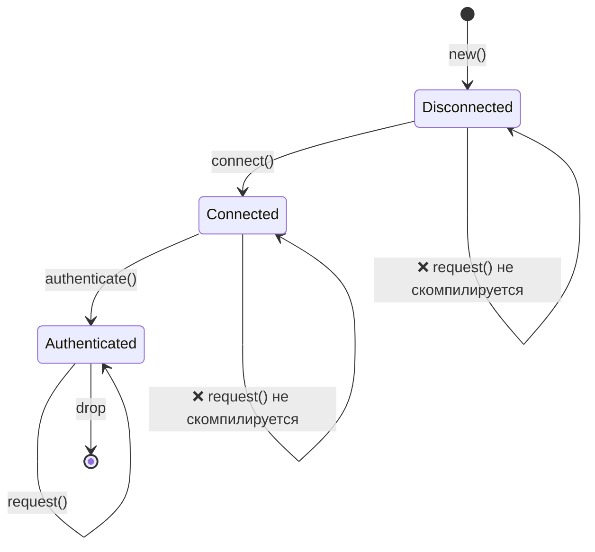
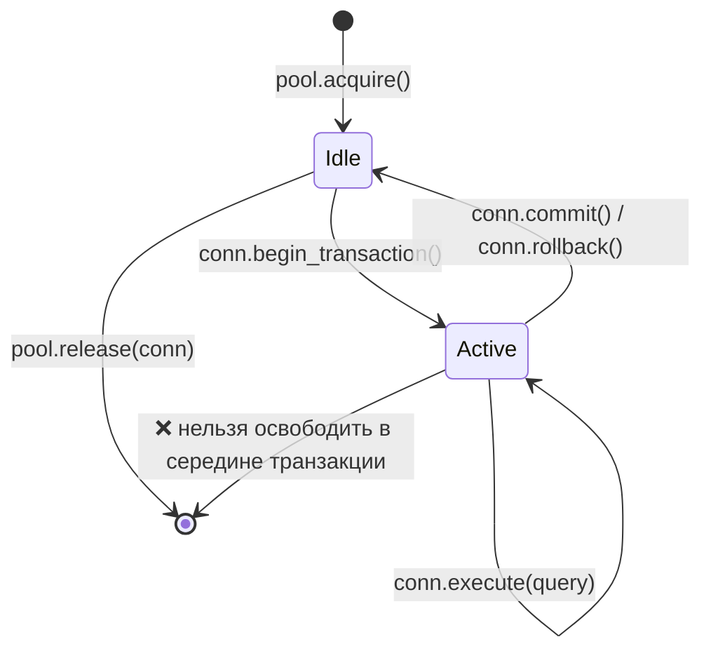
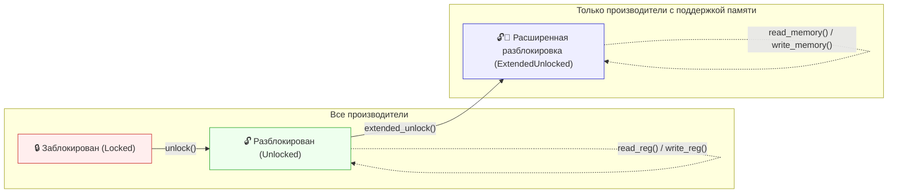
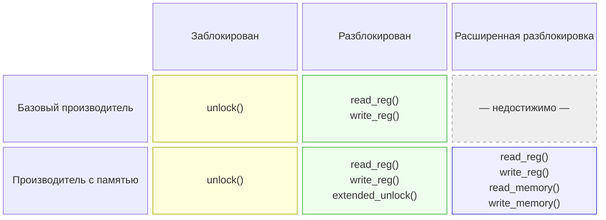

# 3. Шаблоны Newtype и Type-State 🟡

> **Чему вы научитесь:**
> - Шаблону newtype для обеспечения безопасности типов на этапе компиляции с нулевыми накладными расходами (zero-cost)
> - Шаблону type-state: делаем недопустимые переходы между состояниями непредставимыми в коде
> - Шаблону строитель (builder) с использованием состояний типов для принудительного контроля конструирования на этапе компиляции
> - Шаблону config-трейта (config trait) для укрощения взрывного роста обобщённых параметров (generic parameters)

## Newtype: безопасность типов с нулевой стоимостью (Zero-Cost)

Шаблон newtype оборачивает существующий тип в одноэлементную кортежную структуру для создания отдельного типа с нулевыми накладными расходами времени выполнения:

```rust
// Без newtype — легко перепутать:
fn create_user(name: String, email: String, age: u32, employee_id: u32) { }
// create_user(name, email, age, id);  — но что если мы перепутаем местами age и id?
// create_user(name, email, id, age);  — КОМПИЛИРУЕТСЯ БЕЗ ПРОБЛЕМ, БАГ

// С newtype — компилятор ловит ошибки:
struct UserName(String);
struct Email(String);
struct Age(u32);
struct EmployeeId(u32);

fn create_user(name: UserName, email: Email, age: Age, id: EmployeeId) { }
// create_user(name, email, EmployeeId(42), Age(30));
// ❌ Ошибка компиляции: ожидался тип Age, получен EmployeeId
```

### `impl Deref` для Newtype — возможности и опасности

Реализация трейта `Deref` для newtype позволяет автоматически приводить его к ссылке на внутренний тип, предоставляя вам все методы внутреннего типа «бесплатно»:

```rust
use std::ops::Deref;

struct Email(String);

impl Email {
    fn new(raw: &str) -> Result<Self, &'static str> {
        if raw.contains('@') {
            Ok(Email(raw.to_string()))
        } else {
            Err("invalid email: missing @")
        }
    }
}

impl Deref for Email {
    type Target = str;
    fn deref(&self) -> &str { &self.0 }
}

// Теперь Email автоматически разыменовывается (auto-deref) в &str:
let email = Email::new("user@example.com").unwrap();
println!("Length: {}", email.len()); // Использует str::len через Deref
```

Это удобно, но фактически **пробивает брешь** в границе абстракции вашего newtype, поскольку *каждый* метод целевого типа становится доступным для вызова на вашей обёртке.

#### Когда `Deref` уместен

| Сценарий | Пример | Почему это нормально |
|----------|---------|---------------|
| Обёртки умных указателей | `Box<T>`, `Arc<T>`, `MutexGuard<T>` | Единственная цель обёртки — вести себя как `T` |
| Прозрачные «тонкие» обёртки | `String` → `str`, `PathBuf` → `Path`, `Vec<T>` → `[T]` | Обёртка представляет собой надмножество целевого типа |
| Ваш newtype действительно является внутренним типом | `struct Hostname(String)`, когда вам всегда нужны все строковые операции | Ограничение API не принесло бы никакой пользы |

#### Когда `Deref` является антипаттерном

| Сценарий | Проблема |
|----------|---------|
| **Доменные типы с инвариантами** | `Email` разыменовывается в `&str`, поэтому вызывающий код может вызвать `.split_at()`, `.trim()` и т. д., ни один из которых не сохраняет инвариант «должен содержать @». Если кто-то сохранит обрезанный `&str` и воссоздаст объект, инвариант будет утерян. |
| **Типы, для которых вы хотите ограничить API** | `struct Password(String)` с `Deref<Target = str>` раскрывает методы `.as_bytes()`, `.chars()`, вывод `Debug` — именно то, что вы пытаетесь скрыть. |
| **Эмуляция наследования** | Использование `Deref` для автоматического приведения `ManagerWidget` к `Widget` имитирует наследование из ООП. Это настоятельно не рекомендуется — см. Руководство по API Rust (C-DEREF). |

> **Практическое правило**: Если ваш newtype существует для *повышения безопасности типов* или *ограничения API*, не реализуйте `Deref`. Если же он существует для *добавления возможностей* при сохранении всего интерфейса внутреннего типа (как умный указатель), то `Deref` — это правильный выбор.

#### `DerefMut` — двойной риск

Если вы также реализуете `DerefMut`, вызывающий код сможет напрямую *мутировать* внутреннее значение, обходя любую валидацию в конструкторах:

```rust
use std::ops::{Deref, DerefMut};

struct PortNumber(u16);

impl Deref for PortNumber {
    type Target = u16;
    fn deref(&self) -> &u16 { &self.0 }
}

impl DerefMut for PortNumber {
    fn deref_mut(&mut self) -> &mut u16 { &mut self.0 }
}

let mut port = PortNumber(443);
*port = 0; // Обход валидации — теперь это недопустимый порт
```

Реализуйте `DerefMut` только тогда, когда у внутреннего типа нет инвариантов, требующих защиты.

#### Вместо этого отдавайте предпочтение явному делегированию

Если вам нужны лишь *некоторые* методы внутреннего типа, делегируйте их явно:

```rust
struct Email(String);

impl Email {
    fn new(raw: &str) -> Result<Self, &'static str> {
        if raw.contains('@') { Ok(Email(raw.to_string())) }
        else { Err("отсутствует @") }
    }

    // Предоставляем только то, что имеет смысл:
    pub fn as_str(&self) -> &str { &self.0 }
    pub fn len(&self) -> usize { self.0.len() }
    pub fn domain(&self) -> &str {
        self.0.split('@').nth(1).unwrap_or("")
    }
    // .split_at(), .trim(), .replace() — НЕ доступны извне
}
```

#### Clippy и экосистема

- Линтер **`clippy::wrong_self_convention`** может сработать, когда приведение через `Deref` приводит к неожиданному разрешению методов (например, вызов `is_empty()` разрешается в версию внутреннего типа вместо той, которую вы намеревались переопределить).
- **Руководство по API Rust** (C-DEREF) гласит: *«только умные указатели должны реализовывать `Deref`»*. Относитесь к этому как к строгому правилу по умолчанию и отклоняйтесь от него только при наличии четкого обоснования.
- Если вам нужна совместимость с трейтами (например, передача `Email` в функции, ожидающие `&str`), рассмотрите возможность реализации трейтов `AsRef<str>` и `Borrow<str>` — они обеспечивают явное преобразование без сюрпризов, связанных с автоматическим приведением типов.

#### Матрица принятия решений

```text
Хотите ли вы, чтобы ВСЕ методы внутреннего типа были доступны для вызова?
  ├─ ДА → Накладывает ли ваш тип ограничения на инварианты или ограничивает API?
  │    ├─ НЕТ  → impl Deref ✅  (умный указатель / прозрачная обёртка)
  │    └─ ДА   → Не реализуйте Deref ❌ (утечка инвариантов)
  └─ НЕТ  → Не реализуйте Deref ❌  (используйте AsRef / явное делегирование)
```

### Type-State: принудительный контроль протокола на этапе компиляции

Шаблон type-state (состояние типа) использует систему типов, чтобы гарантировать правильный порядок выполнения операций. Недопустимые состояния становятся **непредставимыми**.



> Каждый переход *потребляет* `self` и возвращает новый тип — компилятор гарантирует правильный порядок вызовов.

```rust
// Задача: Сетевое соединение, которое должно быть:
// 1. Создано
// 2. Установлено (Connected)
// 3. Аутентифицировано (Authenticated)
// 4. Использовано для запросов (request)
// Вызов request() до authenticate() должен приводить к ошибке КОМПИЛЯЦИИ.

// --- Маркеры состояний типа (типы нулевого размера) ---
struct Disconnected;
struct Connected;
struct Authenticated;

// --- Соединение, параметризованное состоянием ---
struct Connection<State> {
    address: String,
    _state: std::marker::PhantomData<State>,
}

// Только разорванные (Disconnected) соединения могут подключаться:
impl Connection<Disconnected> {
    fn new(address: &str) -> Self {
        Connection {
            address: address.to_string(),
            _state: std::marker::PhantomData,
        }
    }

    fn connect(self) -> Connection<Connected> {
        println!("Подключение к {}...", self.address);
        Connection {
            address: self.address,
            _state: std::marker::PhantomData,
        }
    }
}

// Только установленные (Connected) соединения могут проходить аутентификацию:
impl Connection<Connected> {
    fn authenticate(self, _token: &str) -> Connection<Authenticated> {
        println!("Аутентификация...");
        Connection {
            address: self.address,
            _state: std::marker::PhantomData,
        }
    }
}

// Только прошедшие аутентификацию (Authenticated) соединения могут делать запросы:
impl Connection<Authenticated> {
    fn request(&self, path: &str) -> String {
        format!("GET {} с {}", path, self.address)
    }
}

fn main() {
    let conn = Connection::new("api.example.com");
    // conn.request("/data"); // ❌ Ошибка компиляции: метод `request` отсутствует у Connection<Disconnected>

    let conn = conn.connect();
    // conn.request("/data"); // ❌ Ошибка компиляции: метод `request` отсутствует у Connection<Connected>

    let conn = conn.authenticate("secret-token");
    let response = conn.request("/data"); // ✅ Работает только после аутентификации
    println!("{response}");
}
```

> **Ключевое понимание**: Каждый переход состояния *потребляет* `self` и возвращает новый тип.
> Вы не можете использовать старое состояние после перехода — компилятор следит за этим.
> Нулевая стоимость во время выполнения — `PhantomData` имеет нулевой размер, состояния стираются на этапе компиляции.

**Сравнение с C++/C#**: В C++ или C# вы бы реализовывали это с помощью проверок во время выполнения (`if (!authenticated) throw ...`). В Rust шаблон type-state переносит эти проверки на этап компиляции — недопустимые состояния буквально становятся непредставимыми в системе типов.

### Шаблон строитель (Builder) со состоянием типа

Практическое применение — строитель, который гарантирует заполнение обязательных полей:

```rust
use std::marker::PhantomData;

// Типы-маркеры для обязательных полей
struct NeedsName;
struct NeedsPort;
struct Ready;

struct ServerConfig<State> {
    name: Option<String>,
    port: Option<u16>,
    max_connections: usize, // Необязательно, имеет значение по умолчанию
    _state: PhantomData<State>,
}

impl ServerConfig<NeedsName> {
    fn new() -> Self {
        ServerConfig {
            name: None,
            port: None,
            max_connections: 100,
            _state: PhantomData,
        }
    }

    fn name(self, name: &str) -> ServerConfig<NeedsPort> {
        ServerConfig {
            name: Some(name.to_string()),
            port: self.port,
            max_connections: self.max_connections,
            _state: PhantomData,
        }
    }
}

impl ServerConfig<NeedsPort> {
    fn port(self, port: u16) -> ServerConfig<Ready> {
        ServerConfig {
            name: self.name,
            port: Some(port),
            max_connections: self.max_connections,
            _state: PhantomData,
        }
    }
}

impl ServerConfig<Ready> {
    fn max_connections(mut self, n: usize) -> Self {
        self.max_connections = n;
        self
    }

    fn build(self) -> Server {
        Server {
            name: self.name.unwrap(),
            port: self.port.unwrap(),
            max_connections: self.max_connections,
        }
    }
}

struct Server {
    name: String,
    port: u16,
    max_connections: usize,
}

fn main() {
    // Сначала необходимо предоставить имя (name), затем порт (port), после чего можно вызвать build:
    let server = ServerConfig::new()
        .name("my-server")
        .port(8080)
        .max_connections(500)
        .build();

    // ServerConfig::new().port(8080); // ❌ Ошибка компиляции: метод `port` отсутствует у NeedsName
    // ServerConfig::new().name("x").build(); // ❌ Ошибка компиляции: метод `build` отсутствует у NeedsPort
}
```

---

## Практический пример: безопасный с точки зрения типов пул соединений

Реальные системы нуждаются в пулах соединений, где соединения переходят из одного четко определенного состояния в другое. Ниже показано, как шаблон typestate обеспечивает корректность работы в пуле промышленного уровня (production):



```rust
use std::marker::PhantomData;

// Состояния
struct Idle;
struct InTransaction;

struct PooledConnection<State> {
    id: u32,
    _state: PhantomData<State>,
}

struct Pool {
    next_id: u32,
}

impl Pool {
    fn new() -> Self { Pool { next_id: 0 } }

    fn acquire(&mut self) -> PooledConnection<Idle> {
        self.next_id += 1;
        println!("[pool] Получено соединение #{}", self.next_id);
        PooledConnection { id: self.next_id, _state: PhantomData }
    }

    // Только простаивающие (Idle) соединения могут быть возвращены — предотвращает утечки в процессе транзакции
    fn release(&self, conn: PooledConnection<Idle>) {
        println!("[pool] Освобождено соединение #{}", conn.id);
    }
}

impl PooledConnection<Idle> {
    fn begin_transaction(self) -> PooledConnection<InTransaction> {
        println!("[conn #{}] BEGIN", self.id);
        PooledConnection { id: self.id, _state: PhantomData }
    }
}

impl PooledConnection<InTransaction> {
    fn execute(&self, query: &str) {
        println!("[conn #{}] EXEC: {}", self.id, query);
    }

    fn commit(self) -> PooledConnection<Idle> {
        println!("[conn #{}] COMMIT", self.id);
        PooledConnection { id: self.id, _state: PhantomData }
    }

    fn rollback(self) -> PooledConnection<Idle> {
        println!("[conn #{}] ROLLBACK", self.id);
        PooledConnection { id: self.id, _state: PhantomData }
    }
}

fn main() {
    let mut pool = Pool::new();

    let conn = pool.acquire();
    let conn = conn.begin_transaction();
    conn.execute("INSERT INTO users VALUES ('Alice')");
    conn.execute("INSERT INTO orders VALUES (1, 42)");
    let conn = conn.commit(); // Возврат к состоянию Idle
    pool.release(conn);       // ✅ Работает только для соединений в состоянии Idle

    // pool.release(conn_active); // ❌ Ошибка компиляции: невозможно освободить InTransaction
}
```

**Почему это важно в реальных условиях**: Утечка соединения посреди транзакции приводит к удержанию блокировок базы данных на неопределенное время. Шаблон typestate делает это невозможным — вы буквально не сможете вернуть соединение в пул, пока транзакция не будет зафиксирована (committed) или откачена (rolled back).

---

## Шаблон Config Trait — укрощение взрывного роста обобщённых параметров

### Проблема

По мере того как структура берет на себя все больше обязанностей, каждая из которых подкреплена обобщённым типом (generic), ограниченным трейтом, сигнатура типа разрастается до громоздких размеров:

```rust
trait SpiBus   { fn spi_transfer(&self, tx: &[u8], rx: &mut [u8]) -> Result<(), BusError>; }
trait ComPort  { fn com_send(&self, data: &[u8]) -> Result<usize, BusError>; }
trait I3cBus   { fn i3c_read(&self, addr: u8, buf: &mut [u8]) -> Result<(), BusError>; }
trait SmBus    { fn smbus_read_byte(&self, addr: u8, cmd: u8) -> Result<u8, BusError>; }
trait GpioBus  { fn gpio_set(&self, pin: u32, high: bool); }

// ❌ Каждый новый трейт шины добавляет еще один обобщённый параметр
struct DiagController<S: SpiBus, C: ComPort, I: I3cBus, M: SmBus, G: GpioBus> {
    spi: S,
    com: C,
    i3c: I,
    smbus: M,
    gpio: G,
}
// Блоки impl, сигнатуры функций и вызывающие стороны — все они должны повторять весь список параметров.
// Добавление 6-й шины означает необходимость редактирования каждого упоминания DiagController<S, C, I, M, G>.
```

Это явление часто называют **«взрывом обобщённых параметров» (generic parameter explosion)**. Оно лавинообразно нарастает в блоках `impl`, параметрах функций и у конечных потребителей — каждому из них приходится дублировать весь список параметров.

### Решение: Трейт конфигурации (Config Trait)

Сгруппируйте все ассоциированные типы (associated types) в один трейт. После этого у структуры будет ровно **один** обобщённый параметр, независимо от того, сколько типов компонентов она содержит:

```rust
#[derive(Debug)]
enum BusError {
    Timeout,
    NakReceived,
    HardwareFault(String),
}

// --- Трейты шин (без изменений) ---
trait SpiBus {
    fn spi_transfer(&self, tx: &[u8], rx: &mut [u8]) -> Result<(), BusError>;
    fn spi_write(&self, data: &[u8]) -> Result<(), BusError>;
}

trait ComPort {
    fn com_send(&self, data: &[u8]) -> Result<usize, BusError>;
    fn com_recv(&self, buf: &mut [u8], timeout_ms: u32) -> Result<usize, BusError>;
}

trait I3cBus {
    fn i3c_read(&self, addr: u8, buf: &mut [u8]) -> Result<(), BusError>;
    fn i3c_write(&self, addr: u8, data: &[u8]) -> Result<(), BusError>;
}

// --- Config-трейт: один ассоциированный тип на компонент ---
trait BoardConfig {
    type Spi: SpiBus;
    type Com: ComPort;
    type I3c: I3cBus;
}

// --- DiagController теперь имеет ровно ОДИН обобщённый параметр ---
struct DiagController<Cfg: BoardConfig> {
    spi: Cfg::Spi,
    com: Cfg::Com,
    i3c: Cfg::I3c,
}
```

`DiagController<Cfg>` больше никогда не потребует добавления новых обобщённых параметров.
Добавление 4-й шины означает лишь добавление одного ассоциированного типа в `BoardConfig` и одного поля в `DiagController` — при этом сигнатуры в зависимом коде останутся без изменений.

### Реализация контроллера

```rust
impl<Cfg: BoardConfig> DiagController<Cfg> {
    fn new(spi: Cfg::Spi, com: Cfg::Com, i3c: Cfg::I3c) -> Self {
        DiagController { spi, com, i3c }
    }

    fn read_flash_id(&self) -> Result<u32, BusError> {
        let cmd = [0x9F]; // JEDEC Read ID
        let mut id = [0u8; 4];
        self.spi.spi_transfer(&cmd, &mut id)?;
        Ok(u32::from_be_bytes(id))
    }

    fn send_bmc_command(&self, cmd: &[u8]) -> Result<Vec<u8>, BusError> {
        self.com.com_send(cmd)?;
        let mut resp = vec![0u8; 256];
        let n = self.com.com_recv(&mut resp, 1000)?;
        resp.truncate(n);
        Ok(resp)
    }

    fn read_sensor_temp(&self, sensor_addr: u8) -> Result<i16, BusError> {
        let mut buf = [0u8; 2];
        self.i3c.i3c_read(sensor_addr, &mut buf)?;
        Ok(i16::from_be_bytes(buf))
    }

    fn run_full_diag(&self) -> Result<DiagReport, BusError> {
        let flash_id = self.read_flash_id()?;
        let bmc_resp = self.send_bmc_command(b"VERSION\n")?;
        let cpu_temp = self.read_sensor_temp(0x48)?;
        let gpu_temp = self.read_sensor_temp(0x49)?;

        Ok(DiagReport {
            flash_id,
            bmc_version: String::from_utf8_lossy(&bmc_resp).to_string(),
            cpu_temp_c: cpu_temp,
            gpu_temp_c: gpu_temp,
        })
    }
}

#[derive(Debug)]
struct DiagReport {
    flash_id: u32,
    bmc_version: String,
    cpu_temp_c: i16,
    gpu_temp_c: i16,
}
```

### Связывание в Production

Единая реализация `impl BoardConfig` выбирает конкретные драйверы оборудования:

```rust
struct PlatformSpi  { dev: String, speed_hz: u32 }
struct UartCom      { dev: String, baud: u32 }
struct LinuxI3c     { dev: String }

impl SpiBus for PlatformSpi {
    fn spi_transfer(&self, tx: &[u8], rx: &mut [u8]) -> Result<(), BusError> {
        // В реальном окружении здесь был бы ioctl(SPI_IOC_MESSAGE)
        rx[0..4].copy_from_slice(&[0xEF, 0x40, 0x18, 0x00]);
        Ok(())
    }
    fn spi_write(&self, _data: &[u8]) -> Result<(), BusError> { Ok(()) }
}

impl ComPort for UartCom {
    fn com_send(&self, _data: &[u8]) -> Result<usize, BusError> { Ok(0) }
    fn com_recv(&self, buf: &mut [u8], _timeout: u32) -> Result<usize, BusError> {
        let resp = b"BMC v2.4.1\n";
        buf[..resp.len()].copy_from_slice(resp);
        Ok(resp.len())
    }
}

impl I3cBus for LinuxI3c {
    fn i3c_read(&self, _addr: u8, buf: &mut [u8]) -> Result<(), BusError> {
        buf[0] = 0x00; buf[1] = 0x2D; // 45°C
        Ok(())
    }
    fn i3c_write(&self, _addr: u8, _data: &[u8]) -> Result<(), BusError> { Ok(()) }
}

// ✅ Одна структура, одна реализация impl — все конкретные типы разрешаются здесь
struct ProductionBoard;
impl BoardConfig for ProductionBoard {
    type Spi = PlatformSpi;
    type Com = UartCom;
    type I3c = LinuxI3c;
}

fn main() {
    let ctrl = DiagController::<ProductionBoard>::new(
        PlatformSpi { dev: "/dev/spidev0.0".into(), speed_hz: 10_000_000 },
        UartCom     { dev: "/dev/ttyS0".into(),     baud: 115200 },
        LinuxI3c    { dev: "/dev/i3c-0".into() },
    );
    let report = ctrl.run_full_diag().unwrap();
    println!("{report:#?}");
}
```

### Связывание в тестах с помощью мок-объектов (Mocks)

Замените весь аппаратный уровень, определив другую реализацию `BoardConfig`:

```rust
struct MockSpi  { flash_id: [u8; 4] }
struct MockCom  { response: Vec<u8> }
struct MockI3c  { temps: std::collections::HashMap<u8, i16> }

impl SpiBus for MockSpi {
    fn spi_transfer(&self, _tx: &[u8], rx: &mut [u8]) -> Result<(), BusError> {
        rx[..4].copy_from_slice(&self.flash_id);
        Ok(())
    }
    fn spi_write(&self, _data: &[u8]) -> Result<(), BusError> { Ok(()) }
}

impl ComPort for MockCom {
    fn com_send(&self, _data: &[u8]) -> Result<usize, BusError> { Ok(0) }
    fn com_recv(&self, buf: &mut [u8], _timeout: u32) -> Result<usize, BusError> {
        let n = self.response.len().min(buf.len());
        buf[..n].copy_from_slice(&self.response[..n]);
        Ok(n)
    }
}

impl I3cBus for MockI3c {
    fn i3c_read(&self, addr: u8, buf: &mut [u8]) -> Result<(), BusError> {
        let temp = self.temps.get(&addr).copied().unwrap_or(0);
        buf[..2].copy_from_slice(&temp.to_be_bytes());
        Ok(())
    }
    fn i3c_write(&self, _addr: u8, _data: &[u8]) -> Result<(), BusError> { Ok(()) }
}

struct TestBoard;
impl BoardConfig for TestBoard {
    type Spi = MockSpi;
    type Com = MockCom;
    type I3c = MockI3c;
}

#[cfg(test)]
mod tests {
    use super::*;

    fn make_test_controller() -> DiagController<TestBoard> {
        let mut temps = std::collections::HashMap::new();
        temps.insert(0x48, 45i16);
        temps.insert(0x49, 72i16);

        DiagController::<TestBoard>::new(
            MockSpi  { flash_id: [0xEF, 0x40, 0x18, 0x00] },
            MockCom  { response: b"BMC v2.4.1\n".to_vec() },
            MockI3c  { temps },
        )
    }

    #[test]
    fn test_flash_id() {
        let ctrl = make_test_controller();
        assert_eq!(ctrl.read_flash_id().unwrap(), 0xEF401800);
    }

    #[test]
    fn test_sensor_temps() {
        let ctrl = make_test_controller();
        assert_eq!(ctrl.read_sensor_temp(0x48).unwrap(), 45);
        assert_eq!(ctrl.read_sensor_temp(0x49).unwrap(), 72);
    }

    #[test]
    fn test_full_diag() {
        let ctrl = make_test_controller();
        let report = ctrl.run_full_diag().unwrap();
        assert_eq!(report.flash_id, 0xEF401800);
        assert_eq!(report.cpu_temp_c, 45);
        assert_eq!(report.gpu_temp_c, 72);
        assert!(report.bmc_version.contains("2.4.1"));
    }
}
```

### Последующее добавление новой шины

Когда вам понадобится 4-я шина, изменятся только две вещи — `BoardConfig` и `DiagController`.
**Никаких изменений в сигнатурах ниже по течению.** Количество обобщённых параметров по-прежнему равно одному:

```rust
trait SmBus {
    fn smbus_read_byte(&self, addr: u8, cmd: u8) -> Result<u8, BusError>;
}

// 1. Добавляем один ассоциированный тип:
trait BoardConfig {
    type Spi: SpiBus;
    type Com: ComPort;
    type I3c: I3cBus;
    type Smb: SmBus;     // ← новое
}

// 2. Добавляем одно поле:
struct DiagController<Cfg: BoardConfig> {
    spi: Cfg::Spi,
    com: Cfg::Com,
    i3c: Cfg::I3c,
    smb: Cfg::Smb,       // ← новое
}

// 3. Указываем конкретный тип в каждой реализации Config:
impl BoardConfig for ProductionBoard {
    type Spi = PlatformSpi;
    type Com = UartCom;
    type I3c = LinuxI3c;
    type Smb = LinuxSmbus; // ← новое
}
```

### Когда использовать этот шаблон

| Ситуация | Использовать Config Trait? | Альтернатива |
|-----------|:-:|---|
| 3 и более обобщённых типов с ограничениями трейтов в структуре | ✅ Да | — |
| Нужно заменять весь слой оборудования/платформы | ✅ Да | — |
| Всего 1-2 обобщённых параметра | ❌ Избыточно | Прямые обобщённые параметры (generics) |
| Требуется полиморфизм времени выполнения | ❌ | Объекты `dyn Trait` |
| Открытая система плагинов | ❌ | Карта типов (type-map) / `Any` |
| Трейты компонентов образуют естественную группу (плата, платформа) | ✅ Да | — |

### Ключевые свойства

- **Всегда один обобщённый параметр** — `DiagController<Cfg>` никогда не разрастется до `<A, B, C, ...>`
- **Полностью статическая диспетчеризация** — нет таблиц виртуальных методов (vtables), нет `dyn`, нет выделения памяти в куче для объектов трейтов
- **Удобная замена для тестирования** — определите `TestBoard` с мок-реализациями, без условной компиляции
- **Безопасность на этапе компиляции** — если забыть ассоциированный тип, это вызовет ошибку компиляции, а не падение во время выполнения
- **Проверено на практике** — этот шаблон используется в системе frame платформы Substrate/Polkadot для управления более чем 20 ассоциированными типами через один трейт `Config`

> **Основные выводы — Newtype и Type-State**
> - Newtype обеспечивает безопасность типов во время компиляции с нулевыми накладными расходами
> - Type-state превращает недопустимые переходы состояний в ошибки компиляции, а не в баги времени выполнения
> - Трейты конфигурации (Config traits) укрощают взрывной рост обобщённых параметров в крупных системах

> **См. также:** [Гл. 4 — PhantomData](ch04-phantomdata-types-that-carry-no-data.md) для изучения маркеров нулевого размера, которые лежат в основе type-state. [Гл. 2 — Трейты во всех деталях](ch02-traits-in-depth.md) для изучения ассоциированных типов, используемых в шаблоне Config Trait.

---

## Практический пример: Двухосный Typestate — Производитель × Состояние протокола

Описанные выше шаблоны работают с одной осью за раз: typestate контролирует *порядок выполнения протокола*, а абстракция через трейты отвечает за поддержку *нескольких производителей*. Реальным системам часто требуются **обе оси одновременно**: обёртка `Handle<Vendor, State>`, доступные методы которой зависят как от *выбранного производителя (vendor)*, **так и** от *состояния (state)*, в котором находится дескриптор.

В этом разделе рассматривается шаблон **условной реализации по двум осям (dual-axis conditional `impl`)**, где блоки `impl` ограничиваются как границами трейта производителя, так и трейтом-маркером состояния.

### Двумерная проблема

Рассмотрим интерфейс отладочного зонда (JTAG/SWD). Несколько производителей выпускают зонды, и каждый зонд должен быть разблокирован, прежде чем его регистры станут доступны. Некоторые производители дополнительно поддерживают чтение памяти напрямую, но только после *расширенной разблокировки (extended unlock)*, которая настраивает порт доступа к памяти:



**Матрица возможностей** (какие методы существуют для той или иной комбинации производителя и состояния) является двумерной:



Задача: выразить эту матрицу **полностью на этапе компиляции** со статической диспетчеризацией, чтобы вызов `extended_unlock()` для базового зонда или вызов `read_memory()` для разблокированного, но не расширенного дескриптора приводил к ошибке компиляции.

### Решение: `Jtag<V, S>` с маркерами трейтов

**Шаг 1 — Токены состояния и маркеры возможностей:**

```rust,ignore
use std::marker::PhantomData;

// Токены состояния нулевого размера — без накладных расходов во время выполнения
struct Locked;
struct Unlocked;
struct ExtendedUnlocked;

// Трейты-маркеры описывают, какими возможностями обладает каждое состояние
trait HasRegAccess {}
impl HasRegAccess for Unlocked {}
impl HasRegAccess for ExtendedUnlocked {}

trait HasMemAccess {}
impl HasMemAccess for ExtendedUnlocked {}
```

> **Почему маркерные трейты, а не просто конкретные состояния?**
> Написание `impl<V, S: HasRegAccess> Jtag<V, S>` означает, что метод `read_reg()` работает в *любом* состоянии с доступом к регистрам — на сегодня это `Unlocked` and `ExtendedUnlocked`. Но если завтра вы добавите состояние `DebugHalted`, вам потребуется дописать всего одну строчку:
> `impl HasRegAccess for DebugHalted {}`. Все функции работы с регистрами заработают с ним автоматически — без каких-либо изменений в их коде.

**Шаг 2 — Трейты производителей (низкоуровневые операции):**

```rust,ignore
// Каждый производитель зондов реализует эти методы
trait JtagVendor {
    fn raw_unlock(&mut self);
    fn raw_read_reg(&self, addr: u32) -> u32;
    fn raw_write_reg(&mut self, addr: u32, val: u32);
}

// Производители с поддержкой доступа к памяти также реализуют этот супертрейт (super-trait)
trait JtagMemoryVendor: JtagVendor {
    fn raw_extended_unlock(&mut self);
    fn raw_read_memory(&self, addr: u64, buf: &mut [u8]);
    fn raw_write_memory(&mut self, addr: u64, data: &[u8]);
}
```

**Шаг 3 — Обёртка с условными блоками `impl`:**

```rust,ignore
struct Jtag<V, S = Locked> {
    vendor: V,
    _state: PhantomData<S>,
}

// Создание — всегда начинается с состояния Locked
impl<V: JtagVendor> Jtag<V, Locked> {
    fn new(vendor: V) -> Self {
        Jtag { vendor, _state: PhantomData }
    }

    fn unlock(mut self) -> Jtag<V, Unlocked> {
        self.vendor.raw_unlock();
        Jtag { vendor: self.vendor, _state: PhantomData }
    }
}

// Ввод-вывод регистров — любой производитель, любое состояние с поддержкой HasRegAccess
impl<V: JtagVendor, S: HasRegAccess> Jtag<V, S> {
    fn read_reg(&self, addr: u32) -> u32 {
        self.vendor.raw_read_reg(addr)
    }
    fn write_reg(&mut self, addr: u32, val: u32) {
        self.vendor.raw_write_reg(addr, val);
    }
}

// Расширенная разблокировка — только для производителей с поддержкой памяти и только из состояния Unlocked
impl<V: JtagMemoryVendor> Jtag<V, Unlocked> {
    fn extended_unlock(mut self) -> Jtag<V, ExtendedUnlocked> {
        self.vendor.raw_extended_unlock();
        Jtag { vendor: self.vendor, _state: PhantomData }
    }
}

// Ввод-вывод памяти — только для производителей с поддержкой памяти и только в состоянии ExtendedUnlocked
impl<V: JtagMemoryVendor, S: HasMemAccess> Jtag<V, S> {
    fn read_memory(&self, addr: u64, buf: &mut [u8]) {
        self.vendor.raw_read_memory(addr, buf);
    }
    fn write_memory(&mut self, addr: u64, data: &[u8]) {
        self.vendor.raw_write_memory(addr, data);
    }
}
```

Каждый блок `impl` кодирует одну ячейку (или строку) матрицы возможностей.
Компилятор сам следит за соблюдением правил матрицы — никаких проверок времени выполнения здесь нет.

### Реализации от производителей

Добавление поддержки производителя означает реализацию низкоуровневых (raw) методов для **одной структуры** — никакого дублирования структур под каждое состояние или шаблонного кода делегирования:

```rust,ignore
// Производитель A: базовый зонд — только доступ к регистрам
struct BasicProbe { port: u16 }

impl JtagVendor for BasicProbe {
    fn raw_unlock(&mut self)                    { /* последовательность сброса TAP */ }
    fn raw_read_reg(&self, addr: u32) -> u32    { /* сканирование DR */  0 }
    fn raw_write_reg(&mut self, addr: u32, val: u32) { /* сканирование DR */ }
}
// BasicProbe НЕ реализует JtagMemoryVendor.
// Метод extended_unlock() не скомпилируется для Jtag<BasicProbe, _>.

// Производитель B: полнофункциональный зонд — регистры + память
struct DapProbe { serial: String }

impl JtagVendor for DapProbe {
    fn raw_unlock(&mut self)                    { /* переключение SWD, чтение DPIDR */ }
    fn raw_read_reg(&self, addr: u32) -> u32    { /* чтение регистра AP */ 0 }
    fn raw_write_reg(&mut self, addr: u32, val: u32) { /* запись в регистр AP */ }
}

impl JtagMemoryVendor for DapProbe {
    fn raw_extended_unlock(&mut self)           { /* выбор MEM-AP, подача питания */ }
    fn raw_read_memory(&self, addr: u64, buf: &mut [u8])  { /* чтение MEM-AP */ }
    fn raw_write_memory(&mut self, addr: u64, data: &[u8]) { /* запись в MEM-AP */ }
}
```

### Что предотвращает компилятор

| Попытка | Ошибка | Почему |
|---------|-------|-----|
| `Jtag<_, Locked>::read_reg()` | метод `read_reg` не найден | `Locked` не реализует `HasRegAccess` |
| `Jtag<BasicProbe, _>::extended_unlock()` | метод `extended_unlock` не найден | `BasicProbe` не реализует `JtagMemoryVendor` |
| `Jtag<_, Unlocked>::read_memory()` | метод `read_memory` не найден | `Unlocked` не реализует `HasMemAccess` |
| Повторный вызов `unlock()` | значение использовано после перемещения | `unlock()` потребляет `self` |

Все четыре ошибки отлавливаются **на этапе компиляции**. Никаких паник, никаких `Option`, никаких перечислений (enums) состояния времени выполнения.

### Написание обобщённых функций

Функции привязываются только к тем осям, которые им действительно важны:

```rust,ignore
/// Работает с ЛЮБЫМ производителем в ЛЮБОМ состоянии, которое дает доступ к регистрам.
fn read_idcode<V: JtagVendor, S: HasRegAccess>(jtag: &Jtag<V, S>) -> u32 {
    jtag.read_reg(0x00)
}

/// Компилируется только для производителей с поддержкой памяти в состоянии ExtendedUnlocked.
fn dump_firmware<V: JtagMemoryVendor, S: HasMemAccess>(jtag: &Jtag<V, S>) {
    let mut buf = [0u8; 256];
    jtag.read_memory(0x0800_0000, &mut buf);
}
```

Функции `read_idcode` не важно, находитесь ли вы в состоянии `Unlocked` или `ExtendedUnlocked` — ей требуется только выполнение ограничения `HasRegAccess`. Именно здесь проявляется преимущество использования маркерных трейтов по сравнению с жестким кодированием конкретных состояний в сигнатурах.

### Тот же шаблон в другой предметной области: Бэкенды хранилищ данных

Этот двухосный подход не привязан к аппаратному обеспечению. Ниже показана аналогичная структура для слоя хранения данных, где лишь некоторые бэкенды поддерживают транзакции:

```rust,ignore
// Состояния
struct Closed;
struct Open;
struct InTransaction;

trait HasReadWrite {}
impl HasReadWrite for Open {}
impl HasReadWrite for InTransaction {}

// Трейты производителей (бэкендов)
trait StorageBackend {
    fn raw_open(&mut self);
    fn raw_read(&self, key: &[u8]) -> Option<Vec<u8>>;
    fn raw_write(&mut self, key: &[u8], value: &[u8]);
}

trait TransactionalBackend: StorageBackend {
    fn raw_begin(&mut self);
    fn raw_commit(&mut self);
    fn raw_rollback(&mut self);
}

// Обёртка
struct Store<B, S = Closed> { backend: B, _s: PhantomData<S> }

impl<B: StorageBackend> Store<B, Closed> {
    fn open(mut self) -> Store<B, Open> { self.backend.raw_open(); /* ... */ todo!() }
}
impl<B: StorageBackend, S: HasReadWrite> Store<B, S> {
    fn read(&self, key: &[u8]) -> Option<Vec<u8>>  { self.backend.raw_read(key) }
    fn write(&mut self, key: &[u8], val: &[u8])    { self.backend.raw_write(key, val) }
}
impl<B: TransactionalBackend> Store<B, Open> {
    fn begin(mut self) -> Store<B, InTransaction>   { /* ... */ todo!() }
}
impl<B: TransactionalBackend> Store<B, InTransaction> {
    fn commit(mut self) -> Store<B, Open>           { /* ... */ todo!() }
    fn rollback(mut self) -> Store<B, Open>         { /* ... */ todo!() }
}
```

Простой бэкенд на базе плоских файлов реализует только `StorageBackend` — для него вызов `begin()` не скомпилируется. Бэкенд базы данных дополнительно реализует `TransactionalBackend` — для него становится доступен полный цикл `Open → InTransaction → Open`.

### Когда стоит применять этот шаблон

| Сигнал | Почему подходит двухосный подход |
|--------|--------------------|
| Две независимые оси: «кто предоставляет функционал» и «в каком состоянии он находится» | Матрица блоков `impl` напрямую кодирует обе оси |
| Некоторые провайдеры обладают строго бóльшими возможностями, чем другие | Супертрейт (`MemoryVendor: Vendor`) + условный `impl` |
| Ошибка в использовании состояния или возможностей является багом безопасности/коррексности | Предотвращение ошибок на этапе компиляции > проверки во время выполнения |
| Требуется статическая диспетчеризация (без vtables) | `PhantomData` + обобщения (generics) = нулевая стоимость |

| Сигнал | Подумайте о более простом решении |
|--------|---------------------------|
| Меняется только одна ось (состояние ИЛИ производитель, но не оба сразу) | Одноосный typestate или обычные объекты трейтов |
| Три или более независимых оси | Шаблон Config Trait (описан выше) объединяет оси в ассоциированные типы |
| Допустим полиморфизм времени выполнения | Перечисление (`enum`) для состояния + диспетчеризация `dyn` проще |

> **Когда две оси превращаются в три или более:**
> Если вы ловите себя на написании сигнатур вроде `Handle<V, S, D, T>` (производитель, состояние, уровень отладки, транспорт), то список обобщённых параметров прозрачно намекает на проблему.
> Попробуйте свернуть ось *производителя* в ассоциированный тип config-трейта (см. раздел [Шаблон Config Trait — укрощение взрывного роста обобщённых параметров](#config-trait-pattern--taming-generic-parameter-explosion) выше в этой главе), оставив только ось *состояния* в качестве обобщённого параметра: `Handle<Cfg, S>`. Config-трейт объединит `type Vendor`, `type Transport` и т. д. в один параметр, в то время как ось состояния сохранит свои гарантии переходов во время компиляции.
> Это естественная эволюция архитектуры, а не полная её переработка — вы просто переносите типы, связанные с производителем, в `Cfg`, оставляя механизм typestate без изменений.

> **Главный вывод:** Двухосный шаблон представляет собой пересечение typestate и абстракции на базе трейтов. Каждый блок `impl` соответствует одной ячейке матрицы (производитель × состояние). Компилятор полностью контролирует всю матрицу — никаких проверок состояния во время выполнения, никаких паник из-за невозможных состояний и никаких накладных расходов.

---

### Упражнение: Безопасный конечный автомат ★★ (~30 мин)

Создайте конечный автомат светофора, используя шаблон type-state. Светофор должен переключаться в строгом порядке `Red → Green → Yellow → Red` (Красный → Зеленый → Желтый → Красный), и никакой другой порядок не должен быть возможен.

<details>
<summary>🔑 Решение</summary>

```rust
use std::marker::PhantomData;

struct Red;
struct Green;
struct Yellow;

struct TrafficLight<State> {
    _state: PhantomData<State>,
}

impl TrafficLight<Red> {
    fn new() -> Self {
        println!("🔴 Красный — СТОП");
        TrafficLight { _state: PhantomData }
    }

    fn go(self) -> TrafficLight<Green> {
        println!("🟢 Зеленый — ИДТИ");
        TrafficLight { _state: PhantomData }
    }
}

impl TrafficLight<Green> {
    fn caution(self) -> TrafficLight<Yellow> {
        println!("🟡 Желтый — ВНИМАНИЕ");
        TrafficLight { _state: PhantomData }
    }
}

impl TrafficLight<Yellow> {
    fn stop(self) -> TrafficLight<Red> {
        println!("🔴 Красный — СТОП");
        TrafficLight { _state: PhantomData }
    }
}

fn main() {
    let light = TrafficLight::new(); // Красный
    let light = light.go();          // Зеленый
    let light = light.caution();     // Желтый
    let _light = light.stop();       // Красный

    // light.caution(); // ❌ Ошибка компиляции: метод `caution` отсутствует у Red
    // TrafficLight::new().stop(); // ❌ Ошибка компиляции: метод `stop` отсутствует у Red
}
```

**Главный вывод**: Недопустимые переходы являются ошибками компиляции, а не паниками во время выполнения.

</details>

***
