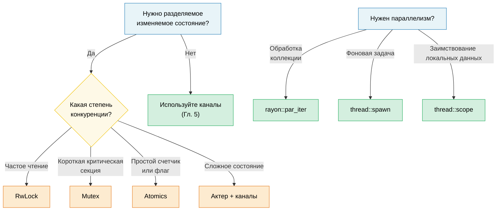

# 6. Конкурентность, параллелизм и потоки 🟡

> **Чему вы научитесь:**
> - Точной разнице между конкурентностью и параллелизмом
> - Потокам ОС, связанным потокам (scoped threads) и библиотеке rayon для параллелизма данных
> - Примитивам общего состояния: Arc, Mutex, RwLock, Atomics, Condvar
> - Ленивой инициализации с помощью OnceLock/LazyLock и бесконфликтным (lock-free) шаблонам

## Терминология: Конкурентность ≠ Параллелизм

Эти термины часто путают. Ниже приведено их точное различие:

| | Конкурентность (Concurrency) | Параллелизм (Parallelism) |
|---|---|---|
| **Определение** | Управление несколькими задачами, продвижение которых происходит поочередно | Одновременное выполнение нескольких задач |
| **Аппаратные требования** | Достаточно одного ядра | Требуется несколько ядер |
| **Аналогия** | Один повар, несколько блюд (повар переключается между ними) | Несколько поваров, каждый работает над своим блюдом |
| **Инструменты в Rust** | `async/await`, каналы, `select!` | `rayon`, `thread::spawn`, `par_iter()` |

```text
Конкурентность (одно ядро):          Параллелизм (много ядер):

Task A: ██░░██░░██                   Task A: ██████████
Task B: ░░██░░██░░                   Task B: ██████████
─────────────────→ время             ─────────────────→ время
(поочередно на одном ядре)           (одновременно на двух ядрах)
```

### std::thread — потоки ОС

Потоки в Rust отображаются 1:1 на потоки операционной системы. Каждый поток получает свой собственный стек (обычно размером 2–8 МБ):

```rust
use std::thread;
use std::time::Duration;

fn main() {
    // Запускаем поток — принимает замыкание
    let handle = thread::spawn(|| {
        for i in 0..5 {
            println!("spawned thread: {i}");
            thread::sleep(Duration::from_millis(100));
        }
        42 // Возвращаемое значение
    });

    // Выполняем работу в основном потоке одновременно с запущенным
    for i in 0..3 {
        println!("main thread: {i}");
        thread::sleep(Duration::from_millis(150));
    }

    // Ожидаем завершения потока и получаем его возвращаемое значение
    let result = handle.join().unwrap(); // unwrap вызывает панику, если поток запаниковал
    println!("Thread returned: {result}");
}
```

**Требования к типам для thread::spawn**:

```rust
// Замыкание должно быть:
// 1. Send — может быть передано в другой поток
// 2. 'static — не может заимствовать данные из вызывающей области видимости
// 3. FnOnce — принимает владение захваченными переменными

let data = vec![1, 2, 3];

// ❌ Заимствование data — не 'static
// thread::spawn(|| println!("{data:?}"));

// ✅ Перемещаем владение внутрь потока
thread::spawn(move || println!("{data:?}"));
// Переменная data здесь больше недоступна
```

### Связанные потоки (Scoped Threads, std::thread::scope)

Начиная с Rust 1.63, связанные потоки (scoped threads) решают проблему требования `'static` — такие потоки могут заимствовать данные из родительской области видимости:

```rust
use std::thread;

fn main() {
    let mut data = vec![1, 2, 3, 4, 5];

    thread::scope(|s| {
        // Поток 1: заимствует общую ссылку
        s.spawn(|| {
            let sum: i32 = data.iter().sum();
            println!("Sum: {sum}");
        });

        // Поток 2: также заимствует общую ссылку (несколько читателей разрешено)
        s.spawn(|| {
            let max = data.iter().max().unwrap();
            println!("Max: {max}");
        });

        // ❌ Нельзя получить мутабельное заимствование, пока существуют немутабельные ссылки:
        // s.spawn(|| data.push(6));
    });
    // ВСЕ связанные потоки присоединяются (join) здесь — гарантированно до выхода из scope

    // Теперь мутировать безопасно — все связанные потоки завершили свою работу
    data.push(6);
    println!("Updated: {data:?}");
}
```

> **Это невероятно важно**: До появления связанных потоков приходилось вызывать `Arc::clone()` для всего, чем нужно поделиться с потоками. Теперь можно заимствовать данные напрямую, а компилятор гарантирует, что все потоки завершатся до того, как данные выйдут из области видимости.

### rayon — параллелизм данных

Библиотека `rayon` предоставляет параллельные итераторы, которые автоматически распределяют работу по пулу потоков:

```rust,ignore
// Cargo.toml: rayon = "1"
use rayon::prelude::*;

fn main() {
    let data: Vec<u64> = (0..1_000_000).collect();

    // Последовательно:
    let sum_seq: u64 = data.iter().map(|x| x * x).sum();

    // Параллельно — просто замените .iter() на .par_iter():
    let sum_par: u64 = data.par_iter().map(|x| x * x).sum();

    assert_eq!(sum_seq, sum_par);

    // Параллельная сортировка:
    let mut numbers = vec![5, 2, 8, 1, 9, 3];
    numbers.par_sort();

    // Параллельная обработка с map/filter/collect:
    let results: Vec<_> = data
        .par_iter()
        .filter(|&&x| x % 2 == 0)
        .map(|&x| expensive_computation(x))
        .collect();
}

fn expensive_computation(x: u64) -> u64 {
    // Имитация ресурсоемких вычислений на CPU
    (0..1000).fold(x, |acc, _| acc.wrapping_mul(7).wrapping_add(13))
}
```

**Когда использовать rayon, а когда потоки**:

| Инструмент | Когда использовать |
|-----|------|
| `rayon::par_iter()` | Параллельная обработка коллекций (map, filter, reduce) |
| `thread::spawn` | Долгоживущие фоновые задачи, воркеры ввода-вывода (I/O) |
| `thread::scope` | Короткоживущие параллельные задачи, заимствующие локальные данные |
| `async` + `tokio` | Конкурентные задачи, ограниченные вводом-выводом (сеть, файлы) |

### Общее состояние: Arc, Mutex, RwLock, Atomics

Когда потокам необходимо общее изменяемое состояние, Rust предоставляет безопасные абстракции:

> **Примечание**: В этих примерах `.unwrap()` при вызовах `.lock()`, `.read()` и `.write()` используется для краткости. Эти вызовы завершаются ошибкой только в том случае, если другой поток запаниковал во время удержания блокировки («отравление» или «poisoning» блокировки). Промышленный код должен самостоятельно определять, следует ли восстанавливать работу при отравленных блокировках или распространять ошибку дальше.

```rust
use std::sync::{Arc, Mutex, RwLock};
use std::sync::atomic::{AtomicU64, Ordering};
use std::thread;

// --- Arc<Mutex<T>>: разделяемый доступ + эксклюзивный доступ ---
fn mutex_example() {
    let counter = Arc::new(Mutex::new(0u64));
    let mut handles = vec![];

    for _ in 0..10 {
        let counter = Arc::clone(&counter);
        handles.push(thread::spawn(move || {
            for _ in 0..1000 {
                let mut guard = counter.lock().unwrap();
                *guard += 1;
            } // Страж (guard) удаляется → блокировка снимается
        }));
    }

    for h in handles { h.join().unwrap(); }
    println!("Counter: {}", counter.lock().unwrap()); // 10000
}

// --- Arc<RwLock<T>>: множество читателей ИЛИ один писатель ---
fn rwlock_example() {
    let config = Arc::new(RwLock::new(String::from("initial")));

    // Множество читателей — не блокируют друг друга
    let readers: Vec<_> = (0..5).map(|id| {
        let config = Arc::clone(&config);
        thread::spawn(move || {
            let guard = config.read().unwrap();
            println!("Reader {id}: {guard}");
        })
    }).collect();

    // Писатель — блокирует доступ и ждет завершения всех читателей
    {
        let mut guard = config.write().unwrap();
        *guard = "updated".to_string();
    }

    for r in readers { r.join().unwrap(); }
}

// --- Атомики (Atomics): без блокировок (lock-free) для простых значений ---
fn atomic_example() {
    let counter = Arc::new(AtomicU64::new(0));
    let mut handles = vec![];

    for _ in 0..10 {
        let counter = Arc::clone(&counter);
        handles.push(thread::spawn(move || {
            for _ in 0..1000 {
                counter.fetch_add(1, Ordering::Relaxed);
                // Без блокировок, без мьютексов — аппаратная атомарная инструкция
            }
        }));
    }

    for h in handles { h.join().unwrap(); }
    println!("Atomic counter: {}", counter.load(Ordering::Relaxed)); // 10000
}
```

### Краткое сравнение

| Примитив | Сценарий использования | Накладные расходы | Конкуренция за ресурс |
|-----------|----------|------|------------|
| `Mutex<T>` | Короткие критические секции | Блокировка + разблокировка | Потоки выстраиваются в очередь |
| `RwLock<T>` | Частые чтения, редкие записи | Блокировка чтения-записи | Читатели параллельны, писатель монополен |
| `AtomicU64` и т.д. | Счетчики, флаги | Аппаратная операция CAS | Lock-free — нет ожидания |
| Каналы | Передача сообщений | Операции с очередью | Разделение производителя и потребителя |

### Переменные состояния (Condition Variables, `Condvar`)

`Condvar` позволяет потоку **ожидать** оповещения от другого потока о том, что условие стало истинным, без использования активного ожидания (busy-looping). Переменная состояния всегда работает в паре с `Mutex`:

```rust
use std::sync::{Arc, Mutex, Condvar};
use std::thread;

let pair = Arc::new((Mutex::new(false), Condvar::new()));
let pair2 = Arc::clone(&pair);

// Запускаемый поток: ожидает, пока ready == true
let handle = thread::spawn(move || {
    let (lock, cvar) = &*pair2;
    let mut ready = lock.lock().unwrap();
    while !*ready {
        ready = cvar.wait(ready).unwrap(); // атомарно разблокирует мьютекс + усыпляет поток
    }
    println!("Worker: condition met, proceeding");
});

// Основной поток: устанавливает ready = true, затем сигнализирует
{
    let (lock, cvar) = &*pair;
    let mut ready = lock.lock().unwrap();
    *ready = true;
    cvar.notify_one(); // будит один ожидающий поток (используйте notify_all, чтобы разбудить все)
}
handle.join().unwrap();
```

> **Шаблон проектирования**: Всегда перепроверяйте условие в цикле `while` после возврата из `wait()` — операционная система допускает ложные пробуждения (spurious wakeups).

### Ленивая инициализация: OnceLock и LazyLock

До версии Rust 1.80 для инициализации глобальной статической переменной, требующей вычислений во время выполнения (например, разбор конфигурационного файла, компиляция регулярного выражения), требовался макрос `lazy_static!` или библиотека `once_cell`. Теперь стандартная библиотека предоставляет два типа, которые закрывают эти потребности нативно:

```rust
use std::sync::{OnceLock, LazyLock};
use std::collections::HashMap;

// OnceLock — инициализируется при первом использовании с помощью `get_or_init`.
// Полезно, когда значение инициализации зависит от аргументов времени выполнения.
static CONFIG: OnceLock<HashMap<String, String>> = OnceLock::new();

fn get_config() -> &'static HashMap<String, String> {
    CONFIG.get_or_init(|| {
        // Затратно: чтение и парсинг конфигурационного файла — происходит ровно один раз.
        let mut m = HashMap::new();
        m.insert("log_level".into(), "info".into());
        m
    })
}

// LazyLock — инициализируется при первом доступе, замыкание указывается в месте объявления.
// Эквивалентно lazy_static!, но без использования макроса.
static REGEX: LazyLock<regex::Regex> = LazyLock::new(|| {
    regex::Regex::new(r"^[a-zA-Z0-9_]+$").unwrap()
});

fn is_valid_identifier(s: &str) -> bool {
    REGEX.is_match(s) // Первый вызов компилирует регулярное выражение; последующие вызовы используют скомпилированное.
}
```

| Тип | Стабилизирован | Время инициализации | Когда использовать |
|------|-----------|-------------|----------|
| `OnceLock<T>` | Rust 1.70 | В месте вызова (`get_or_init`) | Инициализация зависит от аргументов времени выполнения |
| `LazyLock<T>` | Rust 1.80 | В месте определения (замыкание) | Инициализация является самодостаточной |
| `lazy_static!` | — | В месте определения (макрос) | Старые кодовые базы (рекомендуется мигрировать) |
| `const fn` + `static` | Всегда | На этапе компиляции | Значение можно вычислить во время компиляции |

> **Совет по миграции**: Замените `lazy_static! { static ref X: T = expr; }` на
> `static X: LazyLock<T> = LazyLock::new(|| expr);` — семантика та же, макрос не используется, внешняя зависимость отсутствует.

### Шаблоны без блокировок (Lock-Free)

Для написания высокопроизводительного кода избегайте блокировок:

```rust
use std::sync::atomic::{AtomicBool, AtomicUsize, Ordering};
use std::sync::Arc;

// Шаблон 1: Спинлок (Spin Lock) (для образовательных целей — лучше используйте std::sync::Mutex)
// ⚠️ ВНИМАНИЕ: Это исключительно учебный пример. Настоящие спинлоки требуют:
//   - Стража RAII (чтобы паника при удерживаемой блокировке не приводила к бесконечному взаимному блокированию (deadlock))
//   - Гарантий справедливости (fairness) (данная реализация может страдать от «голодания» потоков под нагрузкой)
//   - Стратегии ожидания (backoff) (экспоненциальный откат, передача управления ОС)
// В промышленном коде используйте std::sync::Mutex or parking_lot::Mutex.
struct SpinLock {
    locked: AtomicBool,
}

impl SpinLock {
    fn new() -> Self { SpinLock { locked: AtomicBool::new(false) } }

    fn lock(&self) {
        while self.locked
            .compare_exchange_weak(false, true, Ordering::Acquire, Ordering::Relaxed)
            .is_err()
        {
            std::hint::spin_loop(); // Указание процессору: мы находимся в цикле ожидания
        }
    }

    fn unlock(&self) {
        self.locked.store(false, Ordering::Release);
    }
}

// Шаблон 2: Бесконфликтный SPSC-буфер (один производитель, один потребитель)
// В реальных проектах используйте crossbeam::queue::ArrayQueue или аналог.
// Пишите свою реализацию только в целях обучения.

// Шаблон 3: Счетчик последовательности (Sequence counter) для чтения без блокировок
// ⚠️ Лучше всего подходит для типов размером в одно машинное слово (u64, f64); при чтении более широких типов T может произойти разделение (tearing).
struct SeqLock<T: Copy> {
    seq: AtomicUsize,
    data: std::cell::UnsafeCell<T>,
}

unsafe impl<T: Copy + Send> Sync for SeqLock<T> {}

impl<T: Copy> SeqLock<T> {
    fn new(val: T) -> Self {
        SeqLock {
            seq: AtomicUsize::new(0),
            data: std::cell::UnsafeCell::new(val),
        }
    }

    fn read(&self) -> T {
        loop {
            let s1 = self.seq.load(Ordering::Acquire);
            if s1 & 1 != 0 { continue; } // Писатель в процессе работы, пробуем еще раз

            // БЕЗОПАСНОСТЬ (SAFETY): Мы используем ptr::read_volatile, чтобы компилятор не
            // менял порядок и не кэшировал чтение. Протокол SeqLock (проверка
            // s1 == s2 после чтения) гарантирует, что мы повторим попытку, если писатель был активен.
            // Это повторяет шаблон SeqLock в C, где чтение данных должно использовать
            // волатильную/ослабленную семантику (volatile/relaxed), чтобы избежать разделения (tearing) при параллельном доступе.
            let value = unsafe { core::ptr::read_volatile(self.data.get() as *const T) };

            // Барьер Acquire: гарантирует, что чтение данных выше упорядочено перед
            // повторной проверкой счетчика последовательности.
            std::sync::atomic::fence(Ordering::Acquire);
            let s2 = self.seq.load(Ordering::Relaxed);

            if s1 == s2 { return value; } // Писатель не вмешивался
            // иначе пробуем еще раз
        }
    }

    /// # Договор безопасности (Safety contract)
    /// Только ОДИН поток может вызывать `write()` одновременно. Если требуется несколько
    /// писателей, оберните вызов `write()` во внешний `Mutex`.
    fn write(&self, val: T) {
        // Увеличиваем до нечетного значения (сигнализирует о том, что идет запись).
        // AcqRel: сторона Acquire предотвращает переупорядочивание последующей записи данных
        // до этого увеличения (читатели должны увидеть нечетное значение раньше, чем увидят
        // частично записанные данные). Сторона Release технически не нужна для одного писателя,
        // но она безвредна и обеспечивает согласованность.
        self.seq.fetch_add(1, Ordering::AcqRel);
        // БЕЗОПАСНОСТЬ: Инвариант одного писателя поддерживается вызывающей стороной (см. доку выше).
        // UnsafeCell допускает внутреннюю изменяемость; счетчик seq защищает читателей.
        unsafe { *self.data.get() = val; }
        // Увеличиваем до четного значения (сигнализирует о завершении записи).
        // Release: гарантирует, что запись данных будет видна до того, как читатели увидят четное значение seq.
        self.seq.fetch_add(1, Ordering::Release);
    }
}
```

> **⚠️ Ограничение модели памяти Rust**: Неатомарная запись через `UnsafeCell` в `write()`, выполняемая конкурентно с неатомарным `ptr::read_volatile` в `read()`, технически считается состоянием гонки (data race) в рамках абстрактной машины Rust — даже несмотря на то, что протокол SeqLock гарантирует повтор чтения при устаревших данных. Это поведение аналогично шаблону SeqLock в ядре C и на практике работает корректно на всем современном оборудовании для типов `T`, которые помещаются в одно машинное слово (например, `u64`). Для более широких типов рассмотрите возможность использования `AtomicU64` для поля данных или обертывания доступа в `Mutex`. См. [руководство по небезопасному коду в Rust (Rust unsafe code guidelines)](https://rust-lang.github.io/unsafe-code-guidelines/) для получения актуальной информации по конкурентности с `UnsafeCell`.

> **Практический совет**: Написать корректный бесконфликтный (lock-free) код сложно. Используйте `Mutex` или `RwLock`, если только профилирование не покажет, что конкуренция за блокировку является вашим узким местом. Когда вам действительно нужен lock-free, берите проверенные библиотеки (`crossbeam`, `arc-swap`, `dashmap`), а не пишите свои велосипеды.

> **Основные выводы — Конкурентность**
> - Связанные потоки (`thread::scope`) позволяют заимствовать данные из стека без использования `Arc`
> - `rayon::par_iter()` распараллеливает итераторы вызовом всего одного метода
> - Используйте `OnceLock`/`LazyLock` вместо `lazy_static!`; отдавайте предпочтение `Mutex`, прежде чем переходить к атомикам
> - Бесконфликтный (lock-free) код сложен — предпочитайте проверенные библиотеки собственным реализациям

> **См. также:** [Гл. 5 — Каналы](ch05-channels-and-message-passing.md) для изучения конкурентности на основе передачи сообщений. [Гл. 8 — Умные указатели](ch09-smart-pointers-and-interior-mutability.md) для подробностей об Arc/Rc.



---

### Упражнение: Параллельный Map на связанных потоках ★★ (~25 мин)

Напишите функцию `parallel_map<T, R>(data: &[T], f: fn(&T) -> R, num_threads: usize) -> Vec<R>`, которая разбивает `data` на `num_threads` частей (чанков) и обрабатывает каждый в связанном потоке. Не используйте `rayon` — используйте `std::thread::scope`.

<details>
<summary>🔑 Решение</summary>

```rust
fn parallel_map<T: Sync, R: Send>(data: &[T], f: fn(&T) -> R, num_threads: usize) -> Vec<R> {
    let chunk_size = (data.len() + num_threads - 1) / num_threads;
    let mut results = Vec::with_capacity(data.len());

    std::thread::scope(|s| {
        let mut handles = Vec::new();
        for chunk in data.chunks(chunk_size) {
            handles.push(s.spawn(move || {
                chunk.iter().map(f).collect::<Vec<_>>()
            }));
        }
        for h in handles {
            results.extend(h.join().unwrap());
        }
    });

    results
}

fn main() {
    let data: Vec<u64> = (1..=20).collect();
    let squares = parallel_map(&data, |x| x * x, 4);
    assert_eq!(squares, (1..=20).map(|x: u64| x * x).collect::<Vec<_>>());
    println!("Параллельные квадраты: {squares:?}");
}
```

</details>

***
