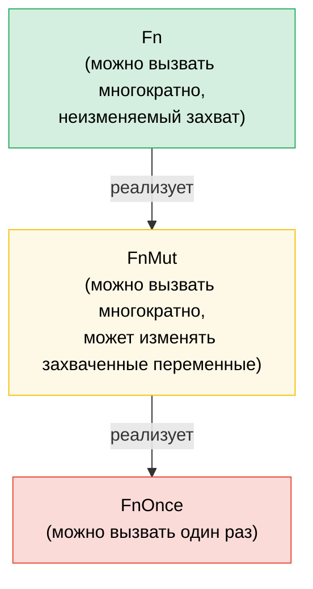

# 7. Замыкания и функции высшего порядка 🟢

> **Что вы узнаете:**
> - Три типажа замыканий (`Fn`, `FnMut`, `FnOnce`) и то, как работает захват переменных
> - Передачу замыканий в качестве параметров и их возврат из функций
> - Цепочки комбинаторов и адаптеры итераторов для функционального стиля программирования
> - Проектирование собственных API высшего порядка с правильными ограничениями типажей (trait bounds)

## Fn, FnMut, FnOnce — типажи замыканий

Каждое замыкание в Rust реализует один или несколько из трех типажей в зависимости от того, как оно захватывает переменные:

```rust
// FnOnce — потребляет захваченные значения (может быть вызвано только один раз)
let name = String::from("Alice");
let greet = move || {
    println!("Hello, {name}!"); // Принимает владение `name`
    drop(name); // name потребляется
};
greet(); // ✅ Первый вызов
// greet(); // ❌ Нельзя вызвать снова — `name` было потреблено

// FnMut — заимствует захваченные значения изменяемо (может быть вызвано много раз)
let mut count = 0;
let mut increment = || {
    count += 1; // Заимствует `count` изменяемо
};
increment(); // count == 1
increment(); // count == 2

// Fn — заимствует захваченные значения неизменяемо (может быть вызвано много раз, конкурентно)
let prefix = "Result";
let display = |x: i32| {
    println!("{prefix}: {x}"); // Заимствует `prefix` неизменяемо
};
display(1);
display(2);
```

**Иерархия**: `Fn` : `FnMut` : `FnOnce` — каждый является субтипажем следующего:

```text
FnOnce  ← всё может быть вызвано хотя бы один раз
 ↑
FnMut   ← может вызываться многократно (может изменять состояние)
 ↑
Fn      ← может вызываться многократно и конкурентно (без изменения состояния)
```

Если замыкание реализует `Fn`, оно также реализует `FnMut` и `FnOnce`.

### Замыкания как параметры и возвращаемые значения

```rust
// --- Параметры ---

// Статическая диспетчеризация (мономорфизированная — самая быстрая)
fn apply_twice<F: Fn(i32) -> i32>(f: F, x: i32) -> i32 {
    f(f(x))
}

// Также записывается с помощью impl Trait:
fn apply_twice_v2(f: impl Fn(i32) -> i32, x: i32) -> i32 {
    f(f(x))
}

// Динамическая диспетчеризация (объект типажа — гибкая, с небольшими накладными расходами)
fn apply_dyn(f: &dyn Fn(i32) -> i32, x: i32) -> i32 {
    f(x)
}

// --- Возвращаемые значения ---

// Нельзя вернуть замыкания по значению без упаковывания в Box (они имеют анонимные типы):
fn make_adder(n: i32) -> Box<dyn Fn(i32) -> i32> {
    Box::new(move |x| x + n)
}

// С помощью impl Trait (проще, мономорфизировано, но не может быть динамическим):
fn make_adder_v2(n: i32) -> impl Fn(i32) -> i32 {
    move |x| x + n
}

fn main() {
    let double = |x: i32| x * 2;
    println!("{}", apply_twice(double, 3)); // 12

    let add5 = make_adder(5);
    println!("{}", add5(10)); // 15
}
```

### Цепочки комбинаторов и адаптеры итераторов

Функции высшего порядка особенно полезны при работе с итераторами — это идиоматичный стиль Rust:

```rust
// Цикл в стиле C (императивный):
let data = vec![1, 2, 3, 4, 5, 6, 7, 8, 9, 10];
let mut result = Vec::new();
for x in &data {
    if x % 2 == 0 {
        result.push(x * x);
    }
}

// Идиоматичный Rust (функциональная цепочка комбинаторов):
let result: Vec<i32> = data.iter()
    .filter(|&&x| x % 2 == 0)
    .map(|&x| x * x)
    .collect();

// Одинаковая производительность — итераторы ленивы и оптимизируются LLVM
assert_eq!(result, vec![4, 16, 36, 64, 100]);
```

**Шпаргалка по популярным комбинаторам**:

| Комбинатор | Что он делает | Пример |
|-----------|-------------|---------|
| `.map(f)` | Преобразует каждый элемент | `.map(\|x\| x * 2)` |
| `.filter(p)` | Сохраняет элементы, для которых предикат истинен | `.filter(\|x\| x > &5)` |
| `.filter_map(f)` | Отображение + фильтрация за один шаг (возвращает `Option`) | `.filter_map(\|x\| x.parse().ok())` |
| `.flat_map(f)` | Отображение с последующим уплощением вложенных итераторов | `.flat_map(\|s\| s.chars())` |
| `.fold(init, f)` | Сворачивает в одно значение (аналог `Aggregate` в C#) | `.fold(0, \|acc, x\| acc + x)` |
| `.any(p)` / `.all(p)` | Быстрая логическая проверка (с ранним выходом) | `.any(\|x\| x > 100)` |
| `.enumerate()` | Добавляет индекс к элементам | `.enumerate().map(\|(i, x)\| ...)` |
| `.zip(other)` | Объединяет в пары с другим итератором | `.zip(labels.iter())` |
| `.take(n)` / `.skip(n)` | Берёт/пропускает первые N элементов | `.take(10)` |
| `.chain(other)` | Объединяет два итератора последовательно | `.chain(extra.iter())` |
| `.peekable()` | Позволяет заглядывать вперед без потребления элементов | `.peek()` |
| `.collect()` | Собирает элементы в коллекцию | `.collect::<Vec<_>>()` |

### Реализация собственных API высшего порядка

Проектируйте API, принимающие замыкания для кастомизации поведения:

```rust
/// Повторяет операцию с настраиваемой стратегией
fn retry<T, E, F, S>(
    mut operation: F,
    mut should_retry: S,
    max_attempts: usize,
) -> Result<T, E>
where
    F: FnMut() -> Result<T, E>,
    S: FnMut(&E, usize) -> bool, // (ошибка, попытка) → попробовать снова?
{
    for attempt in 1..=max_attempts {
        match operation() {
            Ok(val) => return Ok(val),
            Err(e) if attempt < max_attempts && should_retry(&e, attempt) => {
                continue;
            }
            Err(e) => return Err(e),
        }
    }
    unreachable!()
}

// Использование — вызывающий код управляет логикой повторных попыток:
```

```rust
# fn connect_to_database() -> Result<(), String> { Ok(()) }
# fn http_get(_url: &str) -> Result<String, String> { Ok(String::new()) }
# trait TransientError { fn is_transient(&self) -> bool; }
# impl TransientError for String { fn is_transient(&self) -> bool { true } }
# let url = "http://example.com";
let result = retry(
    || connect_to_database(),
    |err, attempt| {
        eprintln!("Attempt {attempt} failed: {err}");
        true // Всегда повторять попытку
    },
    3,
);

// Использование — повтор только при определенных ошибках:
let result = retry(
    || http_get(url),
    |err, _| err.is_transient(), // Повторять только временные ошибки
    5,
);
```

### Паттерн `with` — контекстный доступ к ресурсу

Иногда требуется гарантировать, что ресурс находится в определенном состоянии во время выполнения операции и восстанавливается после её завершения — независимо от того, как завершается вызывающий код (ранний возврат, `?`, паника). Вместо того чтобы предоставлять прямой доступ к ресурсу и надеяться, что вызывающий код не забудет выполнить инициализацию и очистку, **одолжите его через замыкание**:

```text
инициализация → вызов замыкания с ресурсом → очистка
```

Вызывающий код никогда не касается настройки (setup) или разбора (teardown). Разработчики не могут забыть это сделать, не могут ошибиться и не могут удерживать ресурс дольше области видимости замыкания.

#### Пример: направление GPIO-контакта

Контроллер GPIO управляет контактами (пинами), поддерживающими двунаправленный ввод-вывод. Некоторым клиентам нужен контакт, настроенный на ввод (input), другим — на вывод (output). Вместо того чтобы открывать низкоуровневый доступ к контакту и доверять клиентам правильную установку направления, контроллер предоставляет методы `with_pin_input` и `with_pin_output`:

```rust
/// Направление пина GPIO — не публичное, вызывающий код не настраивает его напрямую.
#[derive(Debug, Clone, Copy, PartialEq)]
enum Direction { In, Out }

/// Дескриптор пина GPIO, одалживаемый замыканию. Не может быть сохранен или клонирован —
/// он существует только на время работы обратного вызова (callback).
pub struct GpioPin<'a> {
    pin_number: u8,
    _controller: &'a GpioController,
}

impl GpioPin<'_> {
    pub fn read(&self) -> bool {
        // Чтение уровня пина из аппаратного регистра
        println!("  reading pin {}", self.pin_number);
        true // заглушка
    }

    pub fn write(&self, high: bool) {
        // Установка уровня пина через аппаратный регистр
        println!("  writing pin {} = {high}", self.pin_number);
    }
}

pub struct GpioController {
    current_direction: std::cell::Cell<Option<Direction>>,
}

impl GpioController {
    pub fn new() -> Self {
        GpioController {
            current_direction: std::cell::Cell::new(None),
        }
    }

    /// Конфигурирует пин как вход (input), выполняет замыкание, восстанавливает состояние.
    /// Вызывающий код получает `GpioPin`, который живет только во время работы обратного вызова.
    pub fn with_pin_input<R>(
        &self,
        pin: u8,
        mut f: impl FnMut(&GpioPin<'_>) -> R,
    ) -> R {
        let prev = self.current_direction.get();
        self.set_direction(pin, Direction::In);
        let handle = GpioPin { pin_number: pin, _controller: self };
        let result = f(&handle);
        // Восстанавливаем предыдущее направление (или оставляем как есть — зависит от политики)
        if let Some(dir) = prev {
            self.set_direction(pin, dir);
        }
        result
    }

    /// Конфигурирует пин как выход (output), выполняет замыкание, восстанавливает состояние.
    pub fn with_pin_output<R>(
        &self,
        pin: u8,
        mut f: impl FnMut(&GpioPin<'_>) -> R,
    ) -> R {
        let prev = self.current_direction.get();
        self.set_direction(pin, Direction::Out);
        let handle = GpioPin { pin_number: pin, _controller: self };
        let result = f(&handle);
        if let Some(dir) = prev {
            self.set_direction(pin, dir);
        }
        result
    }

    fn set_direction(&self, pin: u8, dir: Direction) {
        println!("  [hw] pin {pin} → {dir:?}");
        self.current_direction.set(Some(dir));
    }
}

fn main() {
    let gpio = GpioController::new();

    // Вызывающий код 1: нужен ввод — не знает и не заботится о том, как управляется направление
    let level = gpio.with_pin_input(4, |pin| {
        pin.read()
    });
    println!("Pin 4 level: {level}");

    // Вызывающий код 2: нужен вывод — та же структура API, другие гарантии
    gpio.with_pin_output(4, |pin| {
        pin.write(true);
        // выполняем другую работу...
        pin.write(false);
    });

    // Нельзя использовать дескриптор пина вне замыкания:
    // let escaped_pin = gpio.with_pin_input(4, |pin| pin);
    // ❌ ОШИБКА: заимствованное значение живет недостаточно долго
}
```

**Что гарантирует паттерн `with`:**
- Направление **всегда устанавливается до** запуска вызывающего кода.
- Направление **всегда восстанавливается после**, даже если замыкание завершается досрочно.
- Дескриптор `GpioPin` **не может выйти за пределы (escape)** замыкания — проверка заимствований (borrow checker) контролирует это с помощью времени жизни, привязанного к ссылке на контроллер.
- Вызывающему коду не нужно импортировать `Direction` или вызывать `set_direction` — это API невозможно использовать неправильно.

#### Где встречается этот паттерн

Паттерн `with` используется во всей стандартной библиотеке Rust и экосистеме:

| API | Инициализация (Setup) | Обратный вызов (Callback) | Очистка (Teardown) |
|-----|-------|----------|----------|
| `std::thread::scope` | Создание области видимости | `\|s\| { s.spawn(...) }` | Ожидание завершения (join) всех потоков |
| `Mutex::lock` | Захват блокировки | Использование `MutexGuard` (RAII, не замыкание, но схожая идея) | Освобождение при выходе из области видимости (drop) |
| `tempfile::tempdir` | Создание временной директории | Использование пути | Удаление при выходе из области видимости (drop) |
| `std::io::BufWriter::new` | Буферизация записи | Операции записи | Сброс буфера (flush) при выходе из области видимости (drop) |
| GPIO `with_pin_*` (выше) | Установка направления | Использование дескриптора пина | Восстановление направления |

Вариант на основе замыканий наиболее эффективен, когда:
- **Инициализация и очистка идут в паре**, и забыть о любой из них — это баг.
- **Ресурс не должен пережить операцию** — проверка заимствований (borrow checker) естественно обеспечивает это требование.
- **Существует несколько конфигураций** (`with_pin_input` против `with_pin_output`) — каждый метод `with_*` инкапсулирует свою инициализацию, не выставляя детали конфигурации вызывающему коду.

> **`with` против RAII (Drop):** Оба подхода гарантируют очистку. Используйте RAII / `Drop`, когда вызывающему коду нужно удерживать ресурс между несколькими операциями или вызовами функций. Используйте `with`, когда операция строго ограничена контекстом (**bracketed**) — одна инициализация, один блок работы, одна очистка — и вы не хотите давать вызывающему коду возможность нарушить эти границы.

> **FnMut против Fn при проектировании API**: Используйте `FnMut` в качестве ограничения по умолчанию — это наиболее гибкий вариант (вызывающий код может передавать замыкания `Fn` или `FnMut`). Требуйте `Fn` только в том случае, если вам необходимо вызывать замыкание конкурентно (например, из нескольких потоков). Требуйте `FnOnce`, если вы вызываете его строго один раз.

> **Основные выводы — Замыкания**
> - `Fn` заимствует, `FnMut` заимствует изменяемо, `FnOnce` потребляет — принимайте самое слабое ограничение, необходимое вашему API.
> - `impl Fn` для параметров, `Box<dyn Fn>` для хранения, `impl Fn` для возвращаемого значения (или `Box<dyn Fn>` для динамического возврата).
> - Цепочки комбинаторов (`map`, `filter`, `and_then`) элегантно компонуются и инлайнятся в эффективные циклы.
> - Паттерн `with` (контекстный доступ через замыкание) гарантирует инициализацию/очистку и предотвращает утечку ресурса наружу — используйте его, когда клиент не должен управлять жизненным циклом конфигурации ресурса.

> **См. также:** [Главу 2 — Подробный разбор типажей](ch02-traits-in-depth.md) о связи `Fn`/`FnMut`/`FnOnce` с объектами типажей. [Главу 8 — Функциональный стиль против императивного](ch08-functional-vs-imperative-when-elegance-wins.md) о выборе между комбинаторами и циклами. [Главу 15 — Проектирование API](ch15-crate-architecture-and-api-design.md) для удобных паттернов параметров.



> Любое замыкание `Fn` также является `FnMut`, а любое `FnMut` является `FnOnce`. Принимайте `FnMut` по умолчанию — это наиболее гибкое ограничение для вызывающего кода.

---

### Упражнение: Конвейер комбинаторов высшего порядка ★★ (~25 мин)

Создайте структуру `Pipeline`, которая выстраивает трансформации в цепочку. Она должна поддерживать метод `.pipe(f)` для добавления трансформации и метод `.execute(input)` для запуска всей цепочки.

<details>
<summary>🔑 Решение</summary>

```rust
struct Pipeline<T> {
    transforms: Vec<Box<dyn Fn(T) -> T>>,
}

impl<T: 'static> Pipeline<T> {
    fn new() -> Self {
        Pipeline { transforms: Vec::new() }
    }

    fn pipe(mut self, f: impl Fn(T) -> T + 'static) -> Self {
        self.transforms.push(Box::new(f));
        self
    }

    fn execute(self, input: T) -> T {
        self.transforms.into_iter().fold(input, |val, f| f(val))
    }
}

fn main() {
    let result = Pipeline::new()
        .pipe(|s: String| s.trim().to_string())
        .pipe(|s| s.to_uppercase())
        .pipe(|s| format!(">>> {s} <<<"))
        .execute("  hello world  ".to_string());

    println!("{result}"); // >>> HELLO WORLD <<<

    let result = Pipeline::new()
        .pipe(|x: i32| x * 2)
        .pipe(|x| x + 10)
        .pipe(|x| x * x)
        .execute(5);

    println!("{result}"); // (5*2 + 10)^2 = 400
}
```

</details>

***
