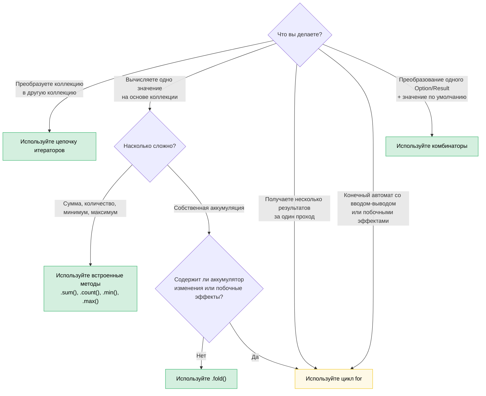

# 8. Функциональный стиль против императивного: когда побеждает элегантность (и когда нет)

> **Сложность:** 🟡 Средняя (Intermediate) | **Время:** 2–3 часа | **Необходимые знания:** [Глава 7 — Замыкания](ch07-closures-and-higher-order-functions.md)

Rust обеспечивает подлинный паритет между функциональным и императивным стилями. В отличие от Haskell (функционального по определению) или C (императивного по умолчанию), Rust позволяет вам выбирать — и правильный выбор зависит от того, что именно вы выражаете в коде. Эта глава поможет развить интуицию для правильного выбора.

**Главный принцип:** функциональный стиль раскрывает себя во всей красе, когда вы *трансформируете данные через конвейер (pipeline)*. Императивный стиль незаменим, когда вы *управляете переходами состояний с побочными эффектами (side effects)*. Большинство реального кода сочетает в себе и то, и другое, и мастерство заключается в том, чтобы понимать, где проходит эта граница.

---

## 8.1 Комбинатор, о котором вы не знали, но который вам нужен

Многие разработчики на Rust пишут так:

```rust
let value = if let Some(x) = maybe_config() {
    x
} else {
    default_config()
};
process(value);
```

Хотя они могли бы написать следующее:

```rust
process(maybe_config().unwrap_or_else(default_config));
```

Или другой распространенный паттерн:

```rust
let display_name = if let Some(name) = user.nickname() {
    name.to_uppercase()
} else {
    "ANONYMOUS".to_string()
};
```

Который можно переписать как:

```rust
let display_name = user.nickname()
    .map(|n| n.to_uppercase())
    .unwrap_or_else(|| "ANONYMOUS".to_string());
```

Функциональная версия не просто короче — она сразу сообщает, *что* происходит (преобразование, затем значение по умолчанию), не заставляя вас отслеживать поток управления. Версия с `if let` заставляет читать ветви кода, чтобы понять, что оба пути в конечном итоге ведут к одному результату.

### Семейство комбинаторов Option

Мысленная модель: `Option<T>` — это коллекция, состоящая из одного элемента или пустая. Каждому комбинатору для `Option` можно найти аналог среди операций над коллекциями.

| Вы пишете... | Вместо... | Что это сообщает |
|---|---|---|
| `opt.unwrap_or(default)` | `if let Some(x) = opt { x } else { default }` | "Использовать это значение или запасное" |
| `opt.unwrap_or_else(\|\| expensive())` | `if let Some(x) = opt { x } else { expensive() }` | То же самое, но запасное значение вычисляется лениво |
| `opt.map(f)` | `match opt { Some(x) => Some(f(x)), None => None }` | "Преобразовать содержимое, сохранить отсутствие значения" |
| `opt.and_then(f)` | `match opt { Some(x) => f(x), None => None }` | "Связать в цепочку операции, которые могут завершиться ошибкой" (flatmap) |
| `opt.filter(\|x\| pred(x))` | `match opt { Some(x) if pred(&x) => Some(x), _ => None }` | "Оставить только если условие истинно" |
| `opt.zip(other)` | `if let (Some(a), Some(b)) = (opt, other) { Some((a,b)) } else { None }` | "Оба или ни одного" |
| `opt.or(fallback)` | `if opt.is_some() { opt } else { fallback }` | "Первое доступное" |
| `opt.or_else(\|\| try_another())` | `if opt.is_some() { opt } else { try_another() }` | "Попробовать альтернативы по очереди" |
| `opt.map_or(default, f)` | `if let Some(x) = opt { f(x) } else { default }` | "Преобразовать или вернуть значение по умолчанию" (в одну строку) |
| `opt.map_or_else(default_fn, f)` | `if let Some(x) = opt { f(x) } else { default_fn() }` | То же самое, но с замыканиями для обеих ветвей |
| `opt?` | `match opt { Some(x) => x, None => return None }` | "Пробросить отсутствие значения на уровень выше" |

### Семейство комбинаторов Result

Те же паттерны применимы к `Result<T, E>`:

| Вы пишете... | Вместо... | Что это сообщает |
|---|---|---|
| `res.map(f)` | `match res { Ok(x) => Ok(f(x)), Err(e) => Err(e) }` | Преобразовать успешный результат |
| `res.map_err(f)` | `match res { Ok(x) => Ok(x), Err(e) => Err(f(e)) }` | Преобразовать ошибку |
| `res.and_then(f)` | `match res { Ok(x) => f(x), Err(e) => Err(e) }` | Связать в цепочку операции, которые могут завершиться ошибкой |
| `res.unwrap_or_else(\|e\| default(e))` | `match res { Ok(x) => x, Err(e) => default(e) }` | Восстановиться после ошибки |
| `res.ok()` | `match res { Ok(x) => Some(x), Err(_) => None }` | "Меня не интересует ошибка" |
| `res?` | `match res { Ok(x) => x, Err(e) => return Err(e.into()) }` | Пробросить ошибку на уровень выше |

### Когда `if let` действительно лучше

Комбинаторы проигрывают, когда:

- **Вам нужно несколько выражений в ветке `Some`.** Замыкание для map из 5 строк выглядит хуже, чем блок `if let` аналогичной длины.
- **Главное — это управление потоком выполнения.** `if let Some(connection) = pool.try_get() { /* использование */ } else { /* логирование, повтор, алерт */ }` — здесь две ветви представляют собой принципиально разные пути выполнения, а не просто трансформацию или возврат значения по умолчанию.
- **Побочные эффекты преобладают.** Если обе ветви выполняют операции ввода-вывода с разной обработкой ошибок, использование комбинаторов замаскирует важные различия.

**Эмпирическое правило:** если ветка `else` возвращает *тот же тип*, что и ветка `Some`, и тела ветвей представляют собой короткие выражения, используйте комбинатор. Если ветви выполняют принципиально разные действия, используйте `if let` или `match`.

---

## 8.2 Логические комбинаторы: `.then()` и `.then_some()`

Еще один паттерн, который встречается чаще, чем следовало бы:

```rust
let label = if is_admin {
    Some("ADMIN")
} else {
    None
};
```

Начиная с Rust 1.62 вы можете писать:

```rust
let label = is_admin.then_some("ADMIN");
```

Или с вычисляемым значением:

```rust
let permissions = is_admin.then(|| compute_admin_permissions());
```

Это особенно удобно в цепочках вызовов:

```rust
// Императивный стиль
let mut tags = Vec::new();
if user.is_admin { tags.push("admin"); }
if user.is_verified { tags.push("verified"); }
if user.score > 100 { tags.push("power-user"); }

// Функциональный стиль
let tags: Vec<&str> = [
    user.is_admin.then_some("admin"),
    user.is_verified.then_some("verified"),
    (user.score > 100).then_some("power-user"),
]
.into_iter()
.flatten()
.collect();
```

Функциональная версия делает намерение явным: «создать список на основе условий». Императивная версия заставляет читать каждый `if`, чтобы убедиться, что везде выполняется одно и то же действие (добавление тега).

---

## 8.3 Цепочки итераторов против циклов: схема выбора

В главе 7 мы разобрали механику. В этом разделе мы выработаем критерии для выбора.

### Когда побеждают итераторы

**Конвейеры обработки данных (data pipelines)** — преобразование коллекции через последовательность шагов:

```rust
// Императивный стиль: 8 строк, 2 изменяемые переменные
let mut results = Vec::new();
for item in inventory {
    if item.category == Category::Server {
        if let Some(temp) = item.last_temperature() {
            if temp > 80.0 {
                results.push((item.id, temp));
            }
        }
    }
}

// Функциональный стиль: 6 строк, 0 изменяемых переменных, один конвейер
let results: Vec<_> = inventory.iter()
    .filter(|item| item.category == Category::Server)
    .filter_map(|item| item.last_temperature().map(|t| (item.id, t)))
    .filter(|(_, temp)| *temp > 80.0)
    .collect();
```

Функциональная версия выигрывает, потому что:
- Каждый фильтр легко читается независимо от других.
- Нет `mut` — данные движутся в одном направлении.
- Вы можете легко добавлять, удалять или менять местами шаги конвейера без перестраивания всей структуры.
- LLVM компилирует адаптеры итераторов в тот же машинный код, что и цикл.

**Агрегация (aggregation)** — вычисление единого значения на основе коллекции:

```rust
// Императивный стиль
let mut total_power = 0.0;
let mut count = 0;
for server in fleet {
    total_power += server.power_draw();
    count += 1;
}
let avg = total_power / count as f64;

// Функциональный стиль
let (total_power, count) = fleet.iter()
    .map(|s| s.power_draw())
    .fold((0.0, 0usize), |(sum, n), p| (sum + p, n + 1));
let avg = total_power / count as f64;
```

Или даже проще, если вам нужна только сумма:

```rust
let total: f64 = fleet.iter().map(|s| s.power_draw()).sum();
```

### Когда побеждают циклы

**Ранний выход со сложным состоянием (Early exit with complex state):**

```rust
// Это понятно и прямолинейно
let mut best_candidate = None;
for server in fleet {
    let score = evaluate(server);
    if score > threshold {
        if server.is_available() {
            best_candidate = Some(server);
            break; // Нашли кандидата — останавливаемся немедленно
        }
    }
}

// Функциональная версия выглядит натянуто
let best_candidate = fleet.iter()
    .filter(|s| evaluate(s) > threshold)
    .find(|s| s.is_available());
```

Хотя постойте — эта функциональная версия выглядит вполне аккуратно. Давайте рассмотрим случай, когда она действительно проигрывает:

**Формирование нескольких выходных результатов одновременно (Building multiple outputs simultaneously):**

```rust
// Императивный стиль: понятный код, каждая ветвь делает своё дело
let mut warnings = Vec::new();
let mut errors = Vec::new();
let mut stats = Stats::default();

for event in log_stream {
    match event.severity {
        Severity::Warn => {
            warnings.push(event.clone());
            stats.warn_count += 1;
        }
        Severity::Error => {
            errors.push(event.clone());
            stats.error_count += 1;
            if event.is_critical() {
                alert_oncall(&event);
            }
        }
        _ => stats.other_count += 1,
    }
}

// Функциональная версия: натянуто, неуклюже, читать такой код не хочется
let (warnings, errors, stats) = log_stream.iter().fold(
    (Vec::new(), Vec::new(), Stats::default()),
    |(mut w, mut e, mut s), event| {
        match event.severity {
            Severity::Warn => { w.push(event.clone()); s.warn_count += 1; }
            Severity::Error => {
                e.push(event.clone()); s.error_count += 1;
                if event.is_critical() { alert_oncall(event); }
            }
            _ => s.other_count += 1,
        }
        (w, e, s)
    },
);
```

Версия с `fold` получилась *длиннее*, *сложнее для чтения* и всё равно содержит изменяемые переменные (распакованные аккумуляторы `mut`). Цикл выигрывает, так как:
- Параллельно формируются несколько результатов.
- В логику подмешаны побочные эффекты (отправка оповещения).
- Тела ветвей представляют собой инструкции (statements), а не выражения (expressions).

**Конечные автоматы со вводом-выводом (State machines with I/O):**

```rust
// Парсер, который читает токены — цикл и ЕСТЬ алгоритм
let mut state = ParseState::Start;
loop {
    let token = lexer.next_token()?;
    state = match state {
        ParseState::Start => match token {
            Token::Keyword(k) => ParseState::GotKeyword(k),
            Token::Eof => break,
            _ => return Err(ParseError::UnexpectedToken(token)),
        },
        ParseState::GotKeyword(k) => match token {
            Token::Ident(name) => ParseState::GotName(k, name),
            _ => return Err(ParseError::ExpectedIdentifier),
        },
        // ...другие состояния
    };
}
```

Никакой функциональный аналог не будет здесь чище. Цикл с конструкцией `match state` является естественным выражением конечного автомата.

### Блок-схема выбора



### Врезка: Локализованная изменяемость — императивный код внутри, функциональный снаружи

Блоки в Rust являются выражениями. Это позволяет ограничить область изменения (mutability) фазой создания объекта и связать итоговый результат неизменяемо:

```rust
use rand::random;

let samples = {
    let mut buf = Vec::with_capacity(10);
    while buf.len() < 10 {
        let reading: f64 = random();
        buf.push(reading);
        if random::<u8>() % 3 == 0 { break; } // случайная досрочная остановка
    }
    buf
};
// samples неизменяем — содержит от 1 до 10 элементов
```

Внутренний буфер `buf` является изменяемым только внутри блока. Как только блок возвращает значение, внешняя переменная `samples` связывается неизменяемо, и компилятор отклонит любую последующую попытку вызвать `samples.push(...)`.

**Почему не цепочка итераторов?** Вы могли бы попробовать написать так:

```rust
let samples: Vec<f64> = std::iter::from_fn(|| Some(random()))
    .take(10)
    .take_while(|_| random::<u8>() % 3 != 0)
    .collect();
```

Однако `take_while` *исключает* элемент, на котором предикат вернул false, возвращая от нуля до десяти элементов вместо гарантированного наличия хотя бы одного элемента, который обеспечивает императивная версия. Вы можете обойти это с помощью `scan` или `chain`, но императивный вариант будет понятнее.

**Когда локализованная изменяемость действительно выигрывает:**

| Сценарий | Почему итераторы здесь неудобны |
|---|---|
| **Сортировка с последующим замораживанием** (`sort_unstable()` + `dedup()`) | Оба метода возвращают `()` — их нельзя объединить в цепочку (библиотека `itertools` предлагает методы `.sorted().dedup()`, если она доступна) |
| **Остановка по состоянию** (остановка по условию, не связанному с самими данными) | `take_while` отбрасывает граничный элемент |
| **Многоэтапное заполнение структуры** (поле за полем из разных источников) | Нет естественного единого конвейера |

**Честная оценка:** для большинства задач построения коллекций предпочтительны цепочки итераторов или библиотека [itertools](https://docs.rs/itertools). Используйте локализованную изменяемость, когда логика создания объекта содержит ветвление, ранний выход или изменяющие операции на месте, которые сложно уложить в один конвейер. Реальная ценность этого паттерна в том, что он показывает: *область изменяемости может быть меньше времени жизни переменной* — фундаментальный принцип Rust, который часто удивляет разработчиков, пришедших из C++, C# и Python.

---

## 8.4 Оператор `?`: место встречи функционального и императивного стилей

Оператор `?` — это наиболее элегантный синтез обоих стилей в Rust. По сути, это комбинация метода `.and_then()` и раннего возврата из функции:

```rust
// Эта цепочка and_then...
fn load_config() -> Result<Config, Error> {
    read_file("config.toml")
        .and_then(|contents| parse_toml(&contents))
        .and_then(|table| validate_config(table))
        .and_then(|valid| Config::from_validated(valid))
}

// ...абсолютно эквивалентна следующему коду
fn load_config() -> Result<Config, Error> {
    let contents = read_file("config.toml")?;
    let table = parse_toml(&contents)?;
    let valid = validate_config(table)?;
    Config::from_validated(valid)
}
```

Оба варианта функциональны по духу (они автоматически пробрасывают ошибки), но версия с `?` дает именованные промежуточные переменные, которые важны, когда:

- Вам нужно использовать `contents` повторно чуть позже.
- Вы хотите добавить контекст для каждого шага: `.context("while parsing config")?`.
- Вы занимаетесь отладкой и хотите проинспектировать промежуточные значения.

**Антипаттерн:** длинные цепочки `.and_then()`, когда доступен оператор `?`. Если каждое замыкание в цепочке имеет вид `|x| next_step(x)`, вы изобретаете `?` заново, принося в жертву читаемость.

**Когда `.and_then()` действительно лучше, чем `?`:**

```rust
// Преобразование внутри Option без раннего возврата
let port: Option<u16> = config.get("port")
    .and_then(|v| v.parse::<u16>().ok())
    .filter(|&p| p > 0 && p < 65535);
```

Здесь вы не можете использовать `?`, поскольку нет функции, из которой можно было бы совершить ранний возврат — вы строите `Option`, а не пробрасываете его выше.

---

## 8.5 Создание коллекций: `collect()` против циклов с добавлением элементов

Метод `collect()` гораздо мощнее, чем думает большинство разработчиков:

### Сбор элементов в Result

```rust
// Императивный стиль: парсинг списка, прерывание при первой ошибке
let mut numbers = Vec::new();
for s in input_strings {
    let n: i64 = s.parse().map_err(|_| Error::BadInput(s.clone()))?;
    numbers.push(n);
}

// Функциональный стиль: сбор в Result<Vec<_>, _>
let numbers: Vec<i64> = input_strings.iter()
    .map(|s| s.parse::<i64>().map_err(|_| Error::BadInput(s.clone())))
    .collect::<Result<_, _>>()?;
```

Прием со сбором в `Result<Vec<_>, _>` работает благодаря тому, что `Result` реализует типаж `FromIterator`. Он прерывает обработку при первой же ошибке `Err`, точно так же, как цикл с оператором `?`.

### Сбор элементов в HashMap

```rust
// Императивный стиль
let mut index = HashMap::new();
for server in fleet {
    index.insert(server.id.clone(), server);
}

// Функциональный стиль
let index: HashMap<_, _> = fleet.into_iter()
    .map(|s| (s.id.clone(), s))
    .collect();
```

### Сбор элементов в String

```rust
// Императивный стиль
let mut csv = String::new();
for (i, field) in fields.iter().enumerate() {
    if i > 0 { csv.push(','); }
    csv.push_str(field);
}

// Функциональный стиль
let csv = fields.join(",");

// Или для более сложного форматирования:
let csv: String = fields.iter()
    .map(|f| format!("\"{f}\""))
    .collect::<Vec<_>>()
    .join(",");
```

### Когда выигрывает версия с циклом

`collect()` аллоцирует новую коллекцию. Если вы делаете *изменения по месту (in-place)*, цикл будет и понятнее, и эффективнее:

```rust
// Обновление на месте — лучшего функционального эквивалента не существует
for server in &mut fleet {
    if server.needs_refresh() {
        server.refresh_telemetry()?;
    }
}
```

Функциональная версия потребовала бы вызова `.iter_mut().for_each(|s| { ... })`, что является лишь циклом с лишним синтаксическим шумом.

---

## 8.6 Сопоставление с паттернами как диспетчеризация функций

Конструкция `match` в Rust — это функциональный инструмент, который большинство разработчиков используют императивно. Посмотрим на него под функциональным углом:

### Match как таблица поиска

```rust
// Императивное мышление: "проверить каждый случай"
fn status_message(code: StatusCode) -> &'static str {
    if code == StatusCode::OK { "Success" }
    else if code == StatusCode::NOT_FOUND { "Not found" }
    else if code == StatusCode::INTERNAL { "Server error" }
    else { "Unknown" }
}

// Функциональное мышление: "отобразить область определения на область значений"
fn status_message(code: StatusCode) -> &'static str {
    match code {
        StatusCode::OK => "Success",
        StatusCode::NOT_FOUND => "Not found",
        StatusCode::INTERNAL => "Server error",
        _ => "Unknown",
    }
}
```

Версия с `match` хороша не только стилистически — компилятор проверяет полноту покрытия (exhaustiveness). Добавьте новый вариант в перечисление, и каждый `match`, который его не обрабатывает, превратится в ошибку компиляции. Цепочка же `if/else` молча провалится в ветку по умолчанию.

### Match + деструктуризация как конвейер

```rust
// Обработка команды — каждая ветка извлекает и преобразует данные
fn execute(cmd: Command) -> Result<Response, Error> {
    match cmd {
        Command::Get { key } => db.get(&key).map(Response::Value),
        Command::Set { key, value } => db.set(key, value).map(|_| Response::Ok),
        Command::Delete { key } => db.delete(&key).map(|_| Response::Ok),
        Command::Batch(cmds) => cmds.into_iter()
            .map(execute)
            .collect::<Result<Vec<_>, _>>()
            .map(Response::Batch),
    }
}
```

Каждая ветвь (arm) — это выражение, возвращающее один и тот же тип. Это сопоставление с паттернами как диспетчеризация функций — ветви `match` фактически представляют собой таблицу функций, индексируемую вариантом перечисления.

---

## 8.7 Цепочки вызовов на собственных типах

Функциональный стиль выходит за рамки типов стандартной библиотеки. Паттерн «Строитель» (Builder) и текучие интерфейсы (fluent APIs) — это замаскированное функциональное программирование:

```rust
// Это цепочка комбинаторов над вашим собственным типом
let query = QueryBuilder::new("servers")
    .filter("status", Eq, "active")
    .filter("rack", In, &["A1", "A2", "B1"])
    .order_by("temperature", Desc)
    .limit(50)
    .build();
```

**Ключевое понимание:** если ваш тип содержит методы, принимающие `self` и возвращающие `Self` (или преобразованный тип), вы создали комбинатор. Здесь применимы те же правила выбора между функциональным и императивным стилями:

```rust
// Хорошо: цепочка удобна, так как каждый шаг — это простое преобразование
let config = Config::default()
    .with_timeout(Duration::from_secs(30))
    .with_retries(3)
    .with_tls(true);

// Плохо: цепочка вызовов построена, но делает слишком много разнородных вещей
let result = processor
    .load_data(path)?       // Ввод-вывод
    .validate()             // Чистая функция
    .transform(rule_set)    // Чистая функция
    .save_to_disk(output)?  // Ввод-вывод
    .notify_downstream()?;  // Побочный эффект

// Лучше: разделить чистый конвейер и операции ввода-вывода по краям
let data = load_data(path)?;
let processed = data.validate().transform(rule_set);
save_to_disk(output, &processed)?;
notify_downstream()?;
```

Цепочка становится плохой, когда смешивает чистые преобразования с операциями ввода-вывода. Читателю сложно понять, какие вызовы могут завершиться ошибкой, какие имеют побочные эффекты, а где происходит непосредственно трансформация данных.

---

## 8.8 Производительность: они одинаковы

Распространенное заблуждение: «функциональный стиль работает медленнее из-за всех этих замыканий и аллокаций».

В Rust **цепочки итераторов компилируются в тот же машинный код, что и написанные вручную циклы.** LLVM инлайнит вызовы замыканий, оптимизирует структуры адаптеров итераторов и часто генерирует абсолютно идентичный ассемблерный код. Это называется *абстракцией с нулевой стоимостью* (zero-cost abstraction), и это подтверждено реальными измерениями.

```rust
// Эти варианты создают идентичный ассемблерный код в релизной сборке:

// Функциональный стиль
let sum: i64 = (0..1000).filter(|n| n % 2 == 0).map(|n| n * n).sum();

// Императивный стиль
let mut sum: i64 = 0;
for n in 0..1000 {
    if n % 2 == 0 {
        sum += n * n;
    }
}
```

**Единственное исключение:** метод `.collect()` выделяет память. Если вы выстраиваете цепочку `.map().collect().iter().map().collect()` с промежуточными коллекциями, вы платите за аллокации, которых избегает версия с циклом. Решение: избавьтесь от промежуточных `collect`, соединяя адаптеры напрямую, или используйте цикл, если промежуточные коллекции вам необходимы по другим причинам.

---

## 8.9 Сравнительная таблица трансформаций

Справочная таблица для наиболее распространенных шаблонов вида «я написал 6 строк, хотя можно было обойтись одной»:

| Императивный паттерн | Функциональный эквивалент | Когда предпочесть функциональный |
|---|---|---|
| `if let Some(x) = opt { f(x) } else { default }` | `opt.map_or(default, f)` | Короткие выражения с обеих сторон |
| `if let Some(x) = opt { Some(g(x)) } else { None }` | `opt.map(g)` | Всегда — именно для этого и создан `map` |
| `if condition { Some(x) } else { None }` | `condition.then_some(x)` | Всегда |
| `if condition { Some(compute()) } else { None }` | `condition.then(compute)` | Всегда |
| `match opt { Some(x) if pred(x) => Some(x), _ => None }` | `opt.filter(pred)` | Всегда |
| `for x in iter { if pred(x) { result.push(f(x)); } }` | `iter.filter(pred).map(f).collect()` | Когда конвейер целиком помещается на одном экране |
| `if a.is_some() && b.is_some() { Some((a?, b?)) }` | `a.zip(b)` | Всегда — метод `.zip()` делает ровно это |
| `match (a, b) { (Some(x), Some(y)) => x + y, _ => 0 }` | `a.zip(b).map(\|(x,y)\| x + y).unwrap_or(0)` | На усмотрение разработчика — зависит от сложности |
| `iter.map(f).collect::<Vec<_>>()[0]` | `iter.map(f).next().unwrap()` | Не выделяйте память под `Vec` ради одного элемента |
| `let mut v = vec; v.sort(); v` | `{ let mut v = vec; v.sort(); v }` | В стандартной библиотеке Rust нет метода `.sorted()` (используйте itertools) |

---

## 8.10 Антипаттерны

### Избыточная функциональщина: цепочка из 5+ уровней, которую невозможно прочесть

```rust
// Это не элегантно. Это головоломка.
let result = data.iter()
    .filter_map(|x| x.metadata.as_ref())
    .flat_map(|m| m.tags.iter())
    .filter(|t| t.starts_with("env:"))
    .map(|t| t.strip_prefix("env:").unwrap())
    .filter(|env| allowed_envs.contains(env))
    .map(|env| env.to_uppercase())
    .collect::<HashSet<_>>()
    .into_iter()
    .sorted()
    .collect::<Vec<_>>();
```

Когда цепочка превышает ~4 адаптера, разбейте её с помощью именованных промежуточных переменных или вынесите часть логики во вспомогательную функцию:

```rust
let env_tags = data.iter()
    .filter_map(|x| x.metadata.as_ref())
    .flat_map(|m| m.tags.iter());

let allowed: Vec<_> = env_tags
    .filter_map(|t| t.strip_prefix("env:"))
    .filter(|env| allowed_envs.contains(env))
    .map(|env| env.to_uppercase())
    .sorted()
    .collect();
```

### Недостаточное использование функционального стиля: циклы в стиле C, для которых в Rust есть специальное слово

```rust
// Это просто .any()
let mut found = false;
for item in &list {
    if item.is_expired() {
        found = true;
        break;
    }
}

// Пишите вместо этого
let found = list.iter().any(|item| item.is_expired());
```

```rust
// Это просто .find()
let mut target = None;
for server in &fleet {
    if server.id == target_id {
        target = Some(server);
        break;
    }
}

// Пишите вместо этого
let target = fleet.iter().find(|s| s.id == target_id);
```

```rust
// Это просто .all()
let mut all_healthy = true;
for server in &fleet {
    if !server.is_healthy() {
        all_healthy = false;
        break;
    }
}

// Пишите вместо этого
let all_healthy = fleet.iter().all(|s| s.is_healthy());
```

Все эти методы добавлены в стандартную библиотеку не просто так. Изучите их словарь, и паттерны станут для вас очевидными.

---

## Главные выводы

> - **Option и Result — это коллекции из одного элемента.** Их комбинаторы (`.map()`, `.and_then()`, `.unwrap_or_else()`, `.filter()`, `.zip()`) заменяют большинство шаблонного кода с `if let` / `match`.
> - **Используйте `bool::then_some()`** — это в любом случае лучше, чем писать `if cond { Some(x) } else { None }`.
> - **Цепочки итераторов идеальны для конвейеров данных** — комбинации filter/map/collect без изменяемого состояния. Они компилируются в такой же машинный код, как и циклы.
> - **Циклы незаменимы для конечных автоматов с несколькими результатами** — когда вы наполняете несколько коллекций, выполняете ввод-вывод в ветках или управляете сложными переходами состояний.
> - **Оператор `?` дает лучшее из обоих миров** — функциональный проброс ошибок с императивной читаемостью кода.
> - **Разрывайте длинные цепочки на ~4 адаптерах** — используйте именованные промежуточные переменные ради читаемости. Избыточная функциональщина так же плоха, как и её недостаток.
> - **Изучите словарь стандартной библиотеки** — методы `.any()`, `.all()`, `.find()`, `.position()`, `.sum()`, `.min_by_key()` заменяют многострочные циклы на говорящие сами за себя вызовы.

> **См. также:** [Главу 7](ch07-closures-and-higher-order-functions.md) о механике замыканий и иерархии типажей `Fn`. [Главу 10](ch10-error-handling-patterns.md) о паттернах комбинаторов ошибок. [Главу 15](ch15-crate-architecture-and-api-design.md) о проектировании текучих (fluent) API.

---

### Упражнение: Рефакторинг кода из императивного стиля в функциональный ★★ (~30 мин)

Перепишите следующую функцию из императивного стиля в функциональный. Затем найдите одно место, где функциональный вариант выглядит *хуже*, и объясните почему.

```rust
fn summarize_fleet(fleet: &[Server]) -> FleetSummary {
    let mut healthy = Vec::new();
    let mut degraded = Vec::new();
    let mut failed = Vec::new();
    let mut total_power = 0.0;
    let mut max_temp = f64::NEG_INFINITY;

    for server in fleet {
        match server.health_status() {
            Health::Healthy => healthy.push(server.id.clone()),
            Health::Degraded(reason) => degraded.push((server.id.clone(), reason)),
            Health::Failed(err) => failed.push((server.id.clone(), err)),
        }
        total_power += server.power_draw();
        if server.max_temperature() > max_temp {
            max_temp = server.max_temperature();
        }
    }

    FleetSummary {
        healthy,
        degraded,
        failed,
        avg_power: total_power / fleet.len() as f64,
        max_temp,
    }
}
```

<details>
<summary>🔑 Решение</summary>

Вычисления `total_power` и `max_temp` красиво переписываются в функциональном стиле:

```rust
fn summarize_fleet(fleet: &[Server]) -> FleetSummary {
    let avg_power: f64 = fleet.iter().map(|s| s.power_draw()).sum::<f64>()
        / fleet.len() as f64;

    let max_temp = fleet.iter()
        .map(|s| s.max_temperature())
        .fold(f64::NEG_INFINITY, f64::max);

    // Но разделение на три группы ЛУЧШЕ оставить в виде цикла.
    // Функциональная версия потребовала бы трех отдельных проходов
    // или неудобного fold с тремя изменяемыми аккумуляторами.
    let mut healthy = Vec::new();
    let mut degraded = Vec::new();
    let mut failed = Vec::new();

    for server in fleet {
        match server.health_status() {
            Health::Healthy => healthy.push(server.id.clone()),
            Health::Degraded(reason) => degraded.push((server.id.clone(), reason)),
            Health::Failed(err) => failed.push((server.id.clone(), err)),
        }
    }

    FleetSummary { healthy, degraded, failed, avg_power, max_temp }
}
```

**Почему цикл лучше для разделения на три группы:** функциональная версия либо потребовала бы трех проходов `.filter().collect()` (то есть троекратного обхода коллекции), либо вызова `.fold()` с тремя аккумуляторами `mut Vec` внутри кортежа, что является тем же циклом, но с гораздо менее удобным синтаксисом. Императивный цикл за один проход понятнее, эффективнее и его легче расширять в будущем.

</details>

***
