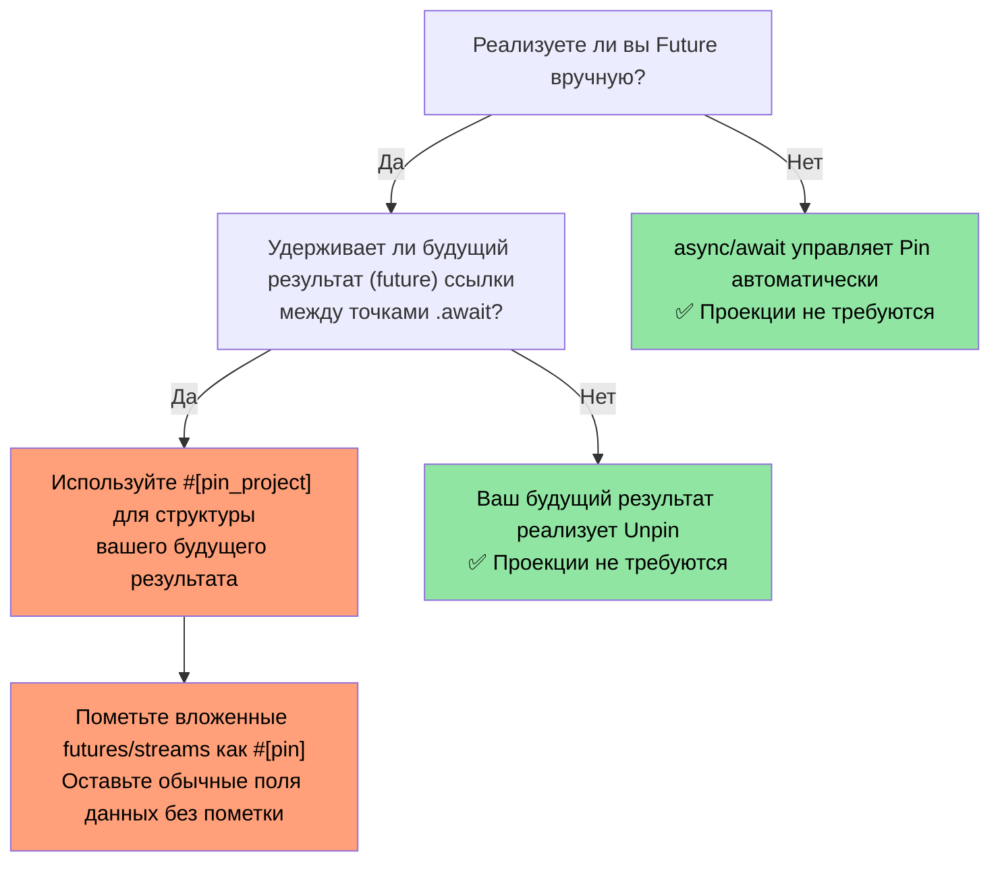
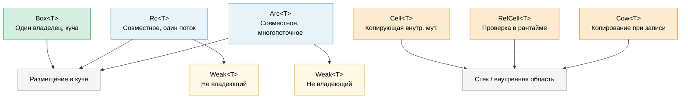

# 9. Умные указатели и внутренняя мутабельность 🟡

> **Что вы узнаете:**
> - Box, Rc, Arc для размещения данных в куче и совместного владения
> - Слабые ссылки (Weak references) для предотвращения циклов ссылок в Rc/Arc
> - Cell, RefCell и Cow для паттернов внутренней мутабельности (interior mutability)
> - Pin для самоссылающихся типов и ManuallyDrop для управления жизненным циклом

## Box, Rc, Arc — размещение в куче и совместное владение

```rust
// --- Box<T>: Один владелец, размещение в куче ---
// Используйте для: рекурсивных типов, больших значений, объектов типажей
let boxed: Box<i32> = Box::new(42);
println!("{}", *boxed); // Разыменование в i32

// Рекурсивный тип требует Box (иначе размер будет бесконечным):
enum List<T> {
    Cons(T, Box<List<T>>),
    Nil,
}

// Объект типажа (динамическая диспетчеризация):
let writer: Box<dyn std::io::Write> = Box::new(std::io::stdout());

// --- Rc<T>: Несколько владельцев, однопоточный ---
// Используйте для: совместного владения в рамках одного потока (не реализует Send/Sync)
use std::rc::Rc;

let a = Rc::new(vec![1, 2, 3]);
let b = Rc::clone(&a); // Увеличивает счетчик ссылок (НЕ глубокое копирование)
let c = Rc::clone(&a);
println!("Счетчик ссылок: {}", Rc::strong_count(&a)); // 3

// Все три указателя ссылаются на один и тот же Vec. Когда последний Rc выйдет из области видимости,
// Vec будет освобожден из памяти.

// --- Arc<T>: Несколько владельцев, потокобезопасный ---
// Используйте для: совместного владения между потоками
use std::sync::Arc;

let shared = Arc::new(String::from("shared data"));
let handles: Vec<_> = (0..5).map(|_| {
    let shared = Arc::clone(&shared);
    std::thread::spawn(move || println!("{shared}"))
}).collect();
for h in handles { h.join().unwrap(); }
```

### Слабые ссылки — предотвращение циклов ссылок

`Rc` и `Arc` используют подсчет ссылок, который не может автоматически освободить память при наличии циклов ссылок (A → B → A).
`Weak<T>` — это слабый дескриптор, который **не** увеличивает счетчик сильных (strong) ссылок:

```rust
use std::rc::{Rc, Weak};
use std::cell::RefCell;

struct Node {
    value: i32,
    parent: RefCell<Weak<Node>>,   // НЕ удерживает родителя в памяти
    children: RefCell<Vec<Rc<Node>>>,
}

let parent = Rc::new(Node {
    value: 0, parent: RefCell::new(Weak::new()), children: RefCell::new(vec![]),
});
let child = Rc::new(Node {
    value: 1, parent: RefCell::new(Rc::downgrade(&parent)), children: RefCell::new(vec![]),
});
parent.children.borrow_mut().push(Rc::clone(&child));

// Доступ к родителю из дочернего узла — возвращает Option<Rc<Node>>:
if let Some(p) = child.parent.borrow().upgrade() {
    println!("Значение родителя дочернего узла: {}", p.value); // 0
}
// Когда `parent` выходит из области видимости, strong_count → 0, память освобождается.
// После этого `child.parent.upgrade()` вернет `None`.
```

**Эмпирическое правило**: используйте `Rc`/`Arc` для связей владения, а `Weak` — для обратных ссылок и кэшей. Для многопоточного кода используйте `Arc<T>` вместе с `sync::Weak<T>`.

### Cell и RefCell — внутренняя мутабельность

Иногда требуется изменить данные, находящиеся за неизменяемой (`&`) ссылкой. Rust предоставляет *внутреннюю мутабельность* с проверкой правил заимствования во время выполнения:

```rust
use std::cell::{Cell, RefCell};

// --- Cell<T>: Внутренняя мутабельность на основе копирования ---
// Подходит только для типов, реализующих Copy (или типов, которые вы меняете местами через swap)
struct Counter {
    count: Cell<u32>,
}

impl Counter {
    fn new() -> Self { Counter { count: Cell::new(0) } }

    fn increment(&self) { // &self, а не &mut self!
        self.count.set(self.count.get() + 1);
    }

    fn value(&self) -> u32 { self.count.get() }
}

// --- RefCell<T>: Проверка заимствований во время выполнения ---
// Вызывает панику во время выполнения, если правила заимствования нарушены
struct Cache {
    data: RefCell<Vec<String>>,
}

impl Cache {
    fn new() -> Self { Cache { data: RefCell::new(Vec::new()) } }

    fn add(&self, item: String) { // &self — снаружи выглядит неизменяемым
        self.data.borrow_mut().push(item); // изменяемое заимствование &mut с проверкой в рантайме
    }

    fn get_all(&self) -> Vec<String> {
        self.data.borrow().clone() // неизменяемое заимствование & с проверкой в рантайме
    }

    fn bad_example(&self) {
        let _guard1 = self.data.borrow();
        // let _guard2 = self.data.borrow_mut();
        // ❌ ПАНИКА во время выполнения — нельзя получить &mut при наличии активной ссылки &
    }
}
```

> **Cell против RefCell**: `Cell` никогда не вызывает панику (он копирует или меняет местами значения), но работает только с типами `Copy` или через методы `swap()`/`replace()`. `RefCell` работает с любыми типами, но при повторном изменяемом заимствовании вызывает панику. Ни один из них не является потокобезопасным (`Sync`) — для многопоточного использования используйте `Mutex`/`RwLock`.

### Cow — копирование при записи

`Cow` (Clone on Write) хранит либо заимствованное, либо собственное значение. Он клонирует данные *только* тогда, когда требуется изменение (мутация):

```rust
use std::borrow::Cow;

// Избегает аллокации памяти, когда модификация не требуется:
fn normalize(input: &str) -> Cow<'_, str> {
    if input.contains('\t') {
        // Выделяем память только если нужно заменить табуляцию
        Cow::Owned(input.replace('\t', "    "))
    } else {
        // Нет аллокации — просто возвращаем ссылку
        Cow::Borrowed(input)
    }
}

fn main() {
    let clean = "no tabs here";
    let dirty = "tabs\there";

    let r1 = normalize(clean); // Cow::Borrowed — ноль аллокаций
    let r2 = normalize(dirty); // Cow::Owned — выделен новый String в куче

    println!("{r1}");
    println!("{r2}");
}

// Также полезно для параметров функций, которым МОЖЕТ понадобиться владение:
fn process(data: Cow<'_, [u8]>) {
    // Можно читать данные без копирования
    println!("Длина: {}", data.len());
    // Если нужно изменить данные, Cow автоматически клонирует их:
    let mut owned = data.into_owned(); // Клонирование только если хранится Borrowed
    owned.push(0xFF);
}
```

#### `Cow<'_, [u8]>` для бинарных данных

`Cow` особенно полезен в API для работы с байтами, где данным может требоваться или не требоваться преобразование (вставка контрольной суммы, выравнивание, экранирование). Это позволяет избежать выделения памяти под `Vec<u8>` на основном быстром пути (fast path):

```rust
use std::borrow::Cow;

/// Дополняет фрейм до минимальной длины, заимствуя исходные данные, если дополнение не требуется.
fn pad_frame(frame: &[u8], min_len: usize) -> Cow<'_, [u8]> {
    if frame.len() >= min_len {
        Cow::Borrowed(frame)  // Уже достаточно длинный — ноль аллокаций
    } else {
        let mut padded = frame.to_vec();
        padded.resize(min_len, 0x00);
        Cow::Owned(padded)    // Выделение памяти только когда дополнение действительно нужно
    }
}

let short = pad_frame(&[0xDE, 0xAD], 8);    // Owned — дополнен до 8 байт
let long  = pad_frame(&[0; 64], 8);          // Borrowed — уже ≥ 8
```

> **Совет**: комбинируйте `Cow<[u8]>` с `bytes::Bytes` (Глава 10), когда вам требуется совместное владение буферами с подсчетом ссылок после их возможного преобразования.

### Какой указатель использовать

| Указатель | Кол-во владельцев | Потокобезопасен | Мутабельность | Когда использовать |
|---------|:-----------:|:-----------:|:----------:|----------|
| `Box<T>` | 1 | ✅ (если T: Send) | Через `&mut` | Размещение в куче, объекты типажей, рекурсивные типы |
| `Rc<T>` | N | ❌ | Нет (оборачивать в Cell/RefCell) | Совместное владение в одном потоке, графы/деревья |
| `Arc<T>` | N | ✅ | Нет (оборачивать в Mutex/RwLock) | Совместное владение между потоками |
| `Cell<T>` | — | ❌ | `.get()` / `.set()` | Внутренняя мутабельность для Copy-типов |
| `RefCell<T>` | — | ❌ | `.borrow()` / `.borrow_mut()` | Внутренняя мутабельность для любых типов в одном потоке |
| `Cow<'_, T>` | 0 или 1 | ✅ (если T: Send) | Копирование при записи | Избежание аллокаций, когда данные редко меняются |

### Pin и самоссылающиеся типы

`Pin<P>` фиксирует положение значения в памяти, предотвращая его перемещение. Это критически важно для **самоссылающихся типов** (structs, содержащих указатели на собственные поля), а также для `Future`, которые могут сохранять ссылки между точками ожидания `.await`.

```rust
use std::pin::Pin;
use std::marker::PhantomPinned;

// Самоссылающаяся структура (упрощенная):
struct SelfRef {
    data: String,
    ptr: *const String, // Указывает на поле `data` выше
    _pin: PhantomPinned, // Отключает автотипаж Unpin — структуру нельзя перемещать
}

impl SelfRef {
    fn new(s: &str) -> Pin<Box<Self>> {
        let val = SelfRef {
            data: s.to_string(),
            ptr: std::ptr::null(),
            _pin: PhantomPinned,
        };
        let mut boxed = Box::pin(val);

        // БЕЗОПАСНОСТЬ: мы гарантируем, что данные не переместятся после установки указателя
        let self_ptr: *const String = &boxed.data;
        unsafe {
            let mut_ref = Pin::as_mut(&mut boxed);
            Pin::get_unchecked_mut(mut_ref).ptr = self_ptr;
        }
        boxed
    }

    fn data(&self) -> &str {
        &self.data
    }

    fn ptr_data(&self) -> &str {
        // БЕЗОПАСНОСТЬ: ptr указывает на self.data, пока структура зафиксирована (pinned)
        unsafe { &*self.ptr }
    }
}

fn main() {
    let pinned = SelfRef::new("hello");
    assert_eq!(pinned.data(), pinned.ptr_data()); // Оба возвращают "hello"
    // std::mem::swap нарушил бы корректность ptr — но Pin не позволяет это сделать
}
```

**Основные понятия**:

| Понятие | Значение |
|---------|--------|
| `Unpin` (автодеструктурирующий типаж / auto-trait) | "Перемещать этот тип безопасно". Большинство типов реализуют `Unpin` по умолчанию. |
| `!Unpin` / `PhantomPinned` | "У меня есть внутренние указатели — не перемещайте меня". |
| `Pin<&mut T>` | Изменяемая ссылка, гарантирующая, что `T` не переместится в памяти. |
| `Pin<Box<T>>` | Владеющее значение, зафиксированное в куче. |

**Почему это важно для async**: каждая `async fn` разворачивается компилятором в структуру, реализующую `Future`, которая может удерживать ссылки между точками ожидания `.await` — что делает её самоссылающейся. Среда выполнения (async runtime) использует `Pin<&mut Future>`, чтобы гарантировать, что футура не переместится в памяти после того, как для неё был вызван метод опроса.

```rust
// Когда вы пишете:
async fn fetch(url: &str) -> String {
    let response = http_get(url).await; // ссылка удерживается через await
    response.text().await
}

// Компилятор генерирует структуру конечного автомата, которая реализует !Unpin,
// и рантайм фиксирует её (pins) перед вызовом Future::poll().
```

> **Когда нужно помнить о Pin**: (1) При ручной реализации `Future`, (2) при написании асинхронных рантаймов или комбинаторов, (3) для любых структур с самоссылающимися указателями. В обычном прикладном асинхронном коде конструкция `async/await` управляет фиксированием прозрачно для разработчика. Подробный разбор этой темы см. в материалах *Async Rust Training*.
>
> **Альтернативные библиотеки**: Для создания самоссылающихся структур без ручной работы с `Pin` рассмотрите библиотеки [`ouroboros`](https://crates.io/crates/ouroboros) или [`self_cell`](https://crates.io/crates/self_cell) — они генерируют безопасные обертки с корректным фиксированием и семантикой удаления (drop).

### Проекции Pin — структурное фиксирование

Когда у вас есть `Pin<&mut MyStruct>`, часто требуется получить доступ к его отдельным полям. **Проекция Pin (pin projection)** — это паттерн для безопасного перехода от `Pin<&mut Struct>` к `Pin<&mut Field>` (для зафиксированных полей) или к `&mut Field` (для обычных полей).

#### Проблема: доступ к полям зафиксированных типов

```rust
use std::pin::Pin;
use std::marker::PhantomPinned;

struct MyFuture {
    data: String,              // Обычное поле — можно безопасно перемещать
    state: InternalState,      // Самоссылающееся поле — должно оставаться зафиксированным
    _pin: PhantomPinned,
}

enum InternalState {
    Waiting { ptr: *const String }, // Указывает на data — самоссылающийся элемент
    Done,
}

// Имея `Pin<&mut MyFuture>`, как получить доступ к `data` и `state`?
// Вы НЕ МОЖЕТЕ просто написать `pinned.data` — компилятор не позволит получить
// &mut к полю зафиксированного значения без использования unsafe-кода.
```

#### Ручная проекция Pin (unsafe)

```rust
impl MyFuture {
    // Проекция на `data` — это поле структурно не зафиксировано (его можно перемещать)
    fn data(self: Pin<&mut Self>) -> &mut String {
        // БЕЗОПАСНОСТЬ: `data` не фиксируется структурно. Перемещение только поля `data`
        // не перемещает всю структуру, поэтому гарантия Pin сохраняется.
        unsafe { &mut self.get_unchecked_mut().data }
    }

    // Проекция на `state` — это поле структурно зафиксировано
    fn state(self: Pin<&mut Self>) -> Pin<&mut InternalState> {
        // БЕЗОПАСНОСТЬ: `state` зафиксировано структурно — мы сохраняем инвариант
        // фиксирования, возвращая Pin<&mut InternalState>.
        unsafe { Pin::new_unchecked(&mut self.get_unchecked_mut().state) }
    }
}
```

**Правила структурного фиксирования** — поле считается «структурно зафиксированным», если:
1. Перемещение или замена только этого поля может нарушить самоссылку.
2. Реализация типажа `Drop` для структуры не должна перемещать это поле.
3. Сама структура должна быть `!Unpin` (это обеспечивается `PhantomPinned` или наличием других полей `!Unpin`).

#### `pin-project` — безопасные проекции Pin без unsafe-кода

Библиотека `pin-project` на этапе компиляции генерирует гарантированно корректные проекции, избавляя вас от необходимости писать `unsafe` вручную:

```rust
use pin_project::pin_project;
use std::pin::Pin;
use std::future::Future;
use std::task::{Context, Poll};

#[pin_project]                   // <-- Генерирует методы проекции
struct TimedFuture<F: Future> {
    #[pin]                       // <-- Структурно зафиксировано (так как это Future)
    inner: F,
    started_at: std::time::Instant, // НЕ зафиксировано — обычные данные
}

impl<F: Future> Future for TimedFuture<F> {
    type Output = (F::Output, std::time::Duration);

    fn poll(self: Pin<&mut Self>, cx: &mut Context<'_>) -> Poll<Self::Output> {
        let this = self.project();  // Безопасно! Метод сгенерирован макросом pin_project
        //   this.inner   : Pin<&mut F>              — зафиксированное поле
        //   this.started_at : &mut std::time::Instant — обычное поле

        match this.inner.poll(cx) {
            Poll::Ready(output) => {
                let elapsed = this.started_at.elapsed();
                Poll::Ready((output, elapsed))
            }
            Poll::Pending => Poll::Pending,
        }
    }
}
```

#### Сравнение `pin-project` и ручной проекции

| Аспект | Вручную (`unsafe`) | С помощью `pin-project` |
|--------|-------------------|---------------|
| Safety | Инварианты доказывает разработчик | Проверяется компилятором |
| Boilerplate | Мало (но легко ошибиться) | Отсутствует — через макрос derive |
| `Drop` interaction | Нельзя перемещать зафиксированные поля | Контролируется макросом `#[pinned_drop]` |
| Compile-time cost | Отсутствует | Накладные расходы на макросы (proc-macro) |
| Use case | Примитивы, режим `no_std` | Прикладной код и библиотеки |

#### `#[pinned_drop]` — метод Drop для зафиксированных типов

Когда у типа есть поля, помеченные `#[pin]`, библиотека `pin-project` требует использования атрибута `#[pinned_drop]` вместо обычной реализации `Drop`, чтобы предотвратить случайное перемещение зафиксированных полей:

```rust
use pin_project::{pin_project, pinned_drop};
use std::pin::Pin;

#[pin_project(PinnedDrop)]
struct Connection<F> {
    #[pin]
    future: F,
    buffer: Vec<u8>,  // Не зафиксировано — можно перемещать в drop
}

#[pinned_drop]
impl<F> PinnedDrop for Connection<F> {
    fn drop(self: Pin<&mut Self>) {
        let this = self.project();
        // `this.future` имеет тип Pin<&mut F> — нельзя перемещать, можно только удалить на месте
        // `this.buffer` имеет тип &mut Vec<u8> — можно очистить, слить данные и т. д.
        this.buffer.clear();
        println!("Connection dropped, buffer cleared");
    }
}
```

#### Когда проекции Pin важны на практике



> **Эмпирическое правило**: если вы оборачиваете другую структуру `Future` или `Stream`, используйте макрос `pin-project`. Если вы пишете обычный прикладной асинхронный код с использованием `async/await`, вам никогда не понадобятся проекции Pin напрямую. См. материалы *Async Rust Training* для изучения паттернов асинхронных комбинаторов, использующих проекции Pin.

### Порядок вызова деструкторов и ManuallyDrop

Порядок вызова деструкторов (выхода из области видимости) в Rust строго детерминирован, и его правила полезно знать:

#### Правила порядка вызова деструкторов

```rust
struct Label(&'static str);

impl Drop for Label {
    fn drop(&mut self) { println!("Dropping {}", self.0); }
}

fn main() {
    let a = Label("first");   // Объявлен первым
    let b = Label("second");  // Объявлен вторым
    let c = Label("third");   // Объявлен третьим
}
// Вывод:
//   Dropping third    ← локальные переменные удаляются в ОБРАТНОМ порядке объявления
//   Dropping second
//   Dropping first
```

**Три правила**:

| Что удаляется | Порядок вызова деструкторов | Обоснование |
|------|-----------|----------|
| **Локальные переменные** | Обратный порядок объявления | Переменные, объявленные позже, могут ссылаться на созданные ранее |
| **Поля структуры** | Порядок объявления (сверху вниз) | Соответствует порядку создания полей (стабильно с Rust 1.0, гарантировано [RFC 1857](https://rust-lang.github.io/rfcs/1857-stabilize-drop-order.html)) |
| **Элементы кортежа** | Порядок объявления (слева направо) | `(a, b, c)` → сначала удаляется `a`, затем `b`, затем `c` |

```rust
struct Server {
    listener: Label,  // Удаляется 1-м
    handler: Label,   // Удаляется 2-м
    logger: Label,    // Удаляется 3-м
}
// Поля удаляются сверху вниз (в порядке объявления).
// Это критично, когда поля ссылаются друг на друга или удерживают системные ресурсы.
```

> **Практическое значение**: если ваша структура содержит `JoinHandle` и `Sender`, порядок объявления полей определяет, какое из них будет уничтожено первым. Если запущенный поток читает из канала, вам нужно сначала удалить `Sender` (закрыть канал), чтобы поток завершил работу, а затем присоединить его через `JoinHandle`. Поместите поле `Sender` выше `JoinHandle` в определении структуры.

#### `ManuallyDrop<T>` — предотвращение автоматического вызова деструктора

Обертка `ManuallyDrop<T>` предотвращает автоматический вызов деструктора для значения. Ответственность за его уничтожение (или явное утекание в память) ложится на разработчика:

```rust
use std::mem::ManuallyDrop;

// Сценарий 1: Предотвращение двойного освобождения в unsafe-коде
struct TwoPhaseBuffer {
    // Мы должны сами удалить Vec, чтобы контролировать момент освобождения
    data: ManuallyDrop<Vec<u8>>,
    committed: bool,
}

impl TwoPhaseBuffer {
    fn new(capacity: usize) -> Self {
        TwoPhaseBuffer {
            data: ManuallyDrop::new(Vec::with_capacity(capacity)),
            committed: false,
        }
    }

    fn write(&mut self, bytes: &[u8]) {
        self.data.extend_from_slice(bytes);
    }

    fn commit(&mut self) {
        self.committed = true;
        println!("Зафиксировано {} байт", self.data.len());
    }
}

impl Drop for TwoPhaseBuffer {
    fn drop(&mut self) {
        if !self.committed {
            println!("Откат изменений — удаление незафиксированных данных");
        }
        // БЕЗОПАСНОСТЬ: буфер data всегда валиден в этой точке; мы удаляем его ровно один раз.
        unsafe { ManuallyDrop::drop(&mut self.data); }
    }
}
```

```rust
// Сценарий 2: Намеренная утечка памяти (например, для глобальных одиночек)
fn leaked_string() -> &'static str {
    // Идиоматичный способ создания &'static ссылки — Box::leak():
    let s = String::from("lives forever");
    Box::leak(s.into_boxed_str())
    // ⚠️ Это контролируемая утечка памяти. Память String в куче никогда не освобождается.
    // Используйте только для долгоживущих объектов-одиночек (singletons).
}

// Альтернатива с использованием ManuallyDrop (требует unsafe):
// ⚠️ Предпочтительнее использовать Box::leak() выше — этот пример показан
// исключительно для демонстрации семантики ManuallyDrop (предотвращение Drop, пока данные в куче живы).
fn leaked_string_manual() -> &'static str {
    use std::mem::ManuallyDrop;
    let md = ManuallyDrop::new(String::from("lives forever"));
    // БЕЗОПАСНОСТЬ: ManuallyDrop предотвращает деаллокацию; данные в куче будут жить
    // бесконечно долго, поэтому &'static ссылка валидна.
    unsafe { &*(md.as_str() as *const str) }
}
```

```rust
// Сценарий 3: Поля объединения union (в один момент времени валиден только один вариант)
use std::mem::ManuallyDrop;

union IntOrString {
    i: u64,
    s: ManuallyDrop<String>,
    // String реализует Drop, поэтому внутри union его ОБЯЗАТЕЛЬНО
    // нужно заворачивать в ManuallyDrop — компилятор не знает, какой вариант сейчас активен.
}

// Автоматического удаления нет — код, создающий IntOrString, должен также
// брать на себя очистку. Если активен вариант со String, вызовите:
//   unsafe { ManuallyDrop::drop(&mut value.s); }
// Без явного вызова Drop данные объединения просто утекут (это не UB, а просто утечка памяти).
```

**ManuallyDrop против `mem::forget`**:

| | `ManuallyDrop<T>` | `mem::forget(value)` |
|---|---|---|
| Когда применяется | Заворачивание при создании | Потребление значения позже |
| Доступ к значению | `&*md` / `&mut *md` | Значение больше недоступно |
| Удаление позже | `ManuallyDrop::drop(&mut md)` | Невозможно |
| Область применения | Тонкий контроль жизненного цикла | Утечка по принципу «запустил и забыл» |

> **Правило**: используйте `ManuallyDrop` в unsafe-абстракциях, где требуется *строго* контролировать момент выполнения деструктора. В безопасном прикладном коде это почти никогда не требуется — автоматический порядок удаления в Rust работает корректно.

> **Основные выводы — Умные указатели**
> - `Box` обеспечивает единоличное владение в куче; `Rc`/`Arc` — совместное владение (для одного/нескольких потоков)
> - `Cell`/`RefCell` реализуют внутреннюю мутабельность; `RefCell` проверяет правила заимствований во время выполнения и паникует при ошибках
> - `Cow` предотвращает лишнее выделение памяти на основном пути; `Pin` запрещает перемещение в памяти для самоссылающихся типов
> - Порядок удаления: поля структуры удаляются в порядке объявления (RFC 1857); локальные переменные — в обратном порядке

> **См. также:** [Главу 6 — Конкурентность](ch06-concurrency-vs-parallelism-vs-threads.md) для изучения паттернов совместного использования Arc и Mutex. [Главу 4 — PhantomData](ch04-phantomdata-types-that-carry-no-data.md) для работы с PhantomData в умных указателях.



---

### Упражнение: Граф на подсчете ссылок ★★ (~30 мин)

Постройте ориентированный граф с помощью `Rc<RefCell<Node>>`, где каждый узел имеет имя и список дочерних узлов. Создайте цикл (A → B → C → A), используя `Weak` для разрыва обратной связи. Убедитесь в отсутствии утечки памяти с помощью метода `Rc::strong_count`.

<details>
<summary>🔑 Решение</summary>

```rust
use std::cell::RefCell;
use std::rc::{Rc, Weak};

struct Node {
    name: String,
    children: Vec<Rc<RefCell<Node>>>,
    back_ref: Option<Weak<RefCell<Node>>>,
}

impl Node {
    fn new(name: &str) -> Rc<RefCell<Self>> {
        Rc::new(RefCell::new(Node {
            name: name.to_string(),
            children: Vec::new(),
            back_ref: None,
        }))
    }
}

impl Drop for Node {
    fn drop(&mut self) {
        println!("Удаление узла {}", self.name);
    }
}

fn main() {
    let a = Node::new("A");
    let b = Node::new("B");
    let c = Node::new("C");

    // A → B → C, где C ссылается обратно на A через Weak
    a.borrow_mut().children.push(Rc::clone(&b));
    b.borrow_mut().children.push(Rc::clone(&c));
    c.borrow_mut().back_ref = Some(Rc::downgrade(&a)); // Слабая ссылка!

    println!("A сильных ссылок: {}", Rc::strong_count(&a)); // 1 (только переменная a)
    println!("B сильных ссылок: {}", Rc::strong_count(&b)); // 2 (b + дочерний элемент в A)
    println!("C сильных ссылок: {}", Rc::strong_count(&c)); // 2 (c + дочерний элемент в B)

    // Проверяем работу слабой ссылки, восстановив её:
    let c_ref = c.borrow();
    if let Some(back) = &c_ref.back_ref {
        if let Some(a_ref) = back.upgrade() {
            println!("C ссылается обратно на: {}", a_ref.borrow().name);
        }
    }
    // Когда a, b, c выходят из области видимости, все узлы Node удаляются (утечки из-за цикла нет!)
}
```

</details>

***
