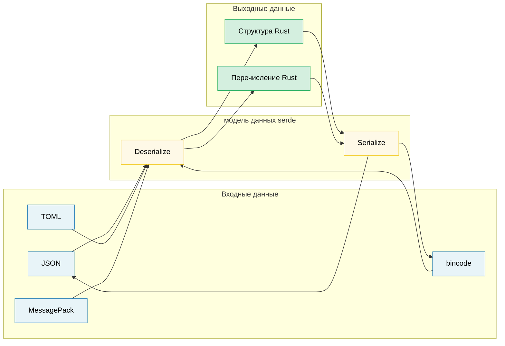

# 11. Сериализация, Zero-Copy и бинарные данные 🟡

> **Чему вы научитесь:**
> - Основы serde: макросы derive, атрибуты и способы представления перечислений
> - Десериализация без копирования (Zero-copy deserialization) для высокопроизводительных задач с преобладанием чтения
> - Экосистема форматов serde (JSON, TOML, bincode, MessagePack)
> - Работа с бинарными данными с помощью `repr(C)`, zerocopy и `bytes::Bytes`

## Основы serde

`serde` (SERialize/DEserialize) — это универсальный фреймворк сериализации для Rust.
Он разделяет **модель данных** (ваши структуры) и **формат** (JSON, TOML, бинарный формат):

```rust,ignore
use serde::{Serialize, Deserialize};

#[derive(Debug, Serialize, Deserialize)]
struct ServerConfig {
    name: String,
    port: u16,
    #[serde(default)]                    // Использовать Default::default(), если поле отсутствует
    max_connections: usize,
    #[serde(skip_serializing_if = "Option::is_none")]
    tls_cert_path: Option<String>,
}

fn main() -> Result<(), Box<dyn std::error::Error>> {
    // Десериализация из JSON:
    let json_input = r#"{
        "name": "hw-diag",
        "port": 8080
    }"#;
    let config: ServerConfig = serde_json::from_str(json_input)?;
    println!("{config:?}");
    // ServerConfig { name: "hw-diag", port: 8080, max_connections: 0, tls_cert_path: None }

    // Сериализация в JSON:
    let output = serde_json::to_string_pretty(&config)?;
    println!("{output}");

    // Та же структура, другой формат — без изменений кода:
    let toml_input = r#"
        name = "hw-diag"
        port = 8080
    "#;
    let config: ServerConfig = toml::from_str(toml_input)?;
    println!("{config:?}");

    Ok(())
}
```

> **Важное понимание**: Вы один раз реализуете (через derive) типажи `Serialize` и `Deserialize` для вашей структуры.
> После этого она работает со *всеми* совместимыми с serde форматами — JSON, TOML, YAML,
> bincode, MessagePack, CBOR, postcard и десятками других.

### Общие атрибуты serde

serde предоставляет тонкий контроль над сериализацией с помощью атрибутов полей и контейнеров:

```rust,ignore
use serde::{Serialize, Deserialize};

// --- Атрибуты контейнера (для структуры/перечисления) ---
#[derive(Serialize, Deserialize)]
#[serde(rename_all = "camelCase")]       // Соглашение JSON: field_name → fieldName
#[serde(deny_unknown_fields)]            // Отклонять лишние ключи — строгий парсинг
struct DiagResult {
    test_name: String,                   // Сериализуется как "testName"
    pass_count: u32,                     // Сериализуется как "passCount"
    fail_count: u32,                     // Сериализуется как "failCount"
}

// --- Атрибуты полей ---
#[derive(Serialize, Deserialize)]
struct Sensor {
    #[serde(rename = "sensor_id")]       // Переопределить имя поля при сериализации
    id: u64,

    #[serde(default)]                    // Использовать Default, если отсутствует на входе
    enabled: bool,

    #[serde(default = "default_threshold")]
    threshold: f64,

    #[serde(skip)]                       // Никогда не сериализовать и не десериализовать
    cached_value: Option<f64>,

    #[serde(skip_serializing_if = "Vec::is_empty")]
    tags: Vec<String>,

    #[serde(flatten)]                    // Встроить (inline) поля вложенной структуры
    metadata: Metadata,

    #[serde(with = "hex_bytes")]         // Пользовательский модуль сериализации/десериализации
    raw_data: Vec<u8>,
}

fn default_threshold() -> f64 { 1.0 }

#[derive(Serialize, Deserialize)]
struct Metadata {
    vendor: String,
    model: String,
}
// С использованием #[serde(flatten)] JSON выглядит так:
// { "sensor_id": 1, "vendor": "Intel", "model": "X200", ... }
// А НЕ ТАК: { "sensor_id": 1, "metadata": { "vendor": "Intel", ... } }
```

**Шпаргалка по наиболее часто используемым атрибутам**:

| Атрибут | Уровень | Эффект |
|-----------|-------|--------|
| `rename_all = "camelCase"` | Контейнер | Переименовать все поля в camelCase/snake_case/SCREAMING_SNAKE_CASE |
| `deny_unknown_fields` | Контейнер | Выдавать ошибку при наличии неизвестных ключей (строгий режим) |
| `default` | Поле | Использовать `Default::default()`, если поле отсутствует |
| `rename = "..."` | Поле | Пользовательское имя для сериализации |
| `skip` | Поле | Полностью исключить поле из сериализации и десериализации |
| `skip_serializing_if = "fn"` | Поле | Исключить при выполнении условия (например, `Option::is_none`) |
| `flatten` | Поле | Встроить (сделать плоскими) поля вложенной структуры |
| `with = "module"` | Поле | Использовать сторонние функции для сериализации/десериализации |
| `alias = "..."` | Поле | Принимать альтернативные имена при десериализации |
| `deserialize_with = "fn"` | Поле | Использовать специальную функцию только для десериализации |
| `untagged` | Перечисление | Пробовать каждый вариант по очереди (в выводе нет дискриминанта) |

### Способы представления перечислений (Enum Representations)

serde предоставляет четыре способа представления перечислений в таких форматах, как JSON:

```rust,ignore
use serde::{Serialize, Deserialize};

// 1. Внешняя метка (Externally tagged - ПО УМОЛЧАНИЮ):
#[derive(Serialize, Deserialize)]
enum Command {
    Reboot,
    RunDiag { test_name: String, timeout_secs: u64 },
    SetFanSpeed(u8),
}
// "Reboot"                                          → Command::Reboot
// {"RunDiag": {"test_name": "gpu", "timeout_secs": 60}}  → Command::RunDiag { ... }

// 2. Внутренняя метка (Internally tagged) — #[serde(tag = "type")]:
#[derive(Serialize, Deserialize)]
#[serde(tag = "type")]
enum Event {
    Start { timestamp: u64 },
    Error { code: i32, message: String },
    End   { timestamp: u64, success: bool },
}
// {"type": "Start", "timestamp": 1706000000}
// {"type": "Error", "code": 42, "message": "timeout"}

// 3. Смежная метка (Adjacently tagged) — #[serde(tag = "t", content = "c")]:
#[derive(Serialize, Deserialize)]
#[serde(tag = "t", content = "c")]
enum Payload {
    Text(String),
    Binary(Vec<u8>),
}
// {"t": "Text", "c": "hello"}
// {"t": "Binary", "c": [0, 1, 2]}

// 4. Без метки (Untagged) — #[serde(untagged)]:
#[derive(Serialize, Deserialize)]
#[serde(untagged)]
enum StringOrNumber {
    Str(String),
    Num(f64),
}
// "hello" → StringOrNumber::Str("hello")
// 42.0    → StringOrNumber::Num(42.0)
// ⚠️ Проверяются ПО ОЧЕРЕДИ — побеждает первый совпавший вариант
```

> **Какое представление выбрать**: Используйте внутреннюю метку (`tag = "type"`)
> для большинства JSON API — это наиболее читаемый вариант, соответствующий соглашениям в
> Go, Python и TypeScript. Используйте вариант без метки (`untagged`) только для типов-объединений (union),
> где сам формат данных однозначно определяет нужный вариант.

### Десериализация без копирования (Zero-Copy Deserialization)

serde умеет проводить десериализацию без выделения памяти под новые строки — заимствуя данные напрямую из
входного буфера. Это ключ к высокой производительности парсинга:

```rust,ignore
use serde::Deserialize;

// --- С владением (с выделением памяти) ---
// Каждое поле String копирует байты из входного буфера в новые области кучи.
#[derive(Deserialize)]
struct OwnedRecord {
    name: String,           // Выделяет память под новую String
    value: String,          // Выделяет память под ещё одну String
}

// --- Без копирования (с заимствованием) ---
// Поля &'de str заимствуют данные напрямую из входных данных — НУЛЕВОЕ выделение памяти.
#[derive(Deserialize)]
struct BorrowedRecord<'a> {
    name: &'a str,          // Указывает на область во входном буфере
    value: &'a str,         // Указывает на область во входном буфере
}

fn main() {
    let input = r#"{"name": "cpu_temp", "value": "72.5"}"#;

    // С владением: выделяет память под два объекта String
    let owned: OwnedRecord = serde_json::from_str(input).unwrap();

    // Без копирования: поля `name` и `value` указывают внутрь `input` — без выделения памяти
    let borrowed: BorrowedRecord = serde_json::from_str(input).unwrap();

    // Вывод привязан к времени жизни: borrowed не может пережить input
    println!("{}: {}", borrowed.name, borrowed.value);
}
```

**Понимание времен жизни (lifetimes)**:

```rust,ignore
// Deserialize<'de> — структура может заимствовать из данных со временем жизни 'de:
//   struct BorrowedRecord<'a> where 'a == 'de
//   Работает только тогда, когда входной буфер живет достаточно долго

// DeserializeOwned — структура владеет всеми своими данными, без заимствований:
//   trait DeserializeOwned: for<'de> Deserialize<'de> {}
//   Работает с любым временем жизни входных данных (структура независима)

use serde::de::DeserializeOwned;

// Эта функция требует типов с владением — входные данные могут быть временными
fn parse_owned<T: DeserializeOwned>(input: &str) -> T {
    serde_json::from_str(input).unwrap()
}

// Эта функция разрешает заимствование — более эффективно, но накладывает ограничения на времена жизни
fn parse_borrowed<'a, T: Deserialize<'a>>(input: &'a str) -> T {
    serde_json::from_str(input).unwrap()
}
```

**Когда использовать zero-copy**:
- Парсинг больших файлов, когда вам требуется всего несколько полей
- Высокопроизводительные конвейеры (сетевые пакеты, строки логов)
- Когда входной буфер уже живет достаточно долго (например, файл, отображенный в память - memory-mapped file)

**Когда НЕ использовать zero-copy**:
- Входной буфер является эфемерным (например, переиспользуемый буфер чтения из сети)
- Вам нужно хранить результат дольше времени жизни входного буфера
- Поля требуют трансформации (разрешение экранирования, нормализация)

> **Практический совет**: `Cow<'a, str>` дает лучшее из обоих миров — заимствование по
> возможности и выделение памяти при необходимости (например, когда управляющие последовательности JSON требуют
> разэкранирования). serde поддерживает Cow «из коробки».

### Экосистема форматов

| Формат | Библиотека (Crate) | Читаемость человеком | Размер | Скорость | Сценарий использования |
|--------|-------|:--------------:|:----:|:-----:|----------|
| JSON | `serde_json` | ✅ | Большой | Хорошая | Конфиги, REST API, логирование |
| TOML | `toml` | ✅ | Средний | Хорошая | Конфиги (в стиле Cargo.toml) |
| YAML | `serde_yaml` | ✅ | Средний | Хорошая | Конфиги (со сложной вложенностью) |
| bincode | `bincode` | ❌ | Малый | Быстрая | Межпроцессное взаимодействие (IPC), кэши, Rust-to-Rust |
| postcard | `postcard` | ❌ | Крошечный | Очень быстрая | Встраиваемые системы (embedded), `no_std` |
| MessagePack | `rmp-serde` | ❌ | Малый | Быстрая | Межъязыковой бинарный протокол |
| CBOR | `ciborium` | ❌ | Малый | Быстрая | IoT, среды с ограниченными ресурсами |

```rust
// Одна структура, много форматов — сила фреймворка serde:

#[derive(serde::Serialize, serde::Deserialize, Debug)]
struct DiagConfig {
    name: String,
    tests: Vec<String>,
    timeout_secs: u64,
}

let config = DiagConfig {
    name: "accel_diag".into(),
    tests: vec!["memory".into(), "compute".into()],
    timeout_secs: 300,
};

// JSON:   {"name":"accel_diag","tests":["memory","compute"],"timeout_secs":300}
let json = serde_json::to_string(&config).unwrap();       // 67 байт

// bincode: компактный бинарный формат — около 40 байт, без имён полей
let bin = bincode::serialize(&config).unwrap();            // Намного меньше

// postcard: ещё меньше, кодирование varint — отлично подходит для встраиваемых систем
// let post = postcard::to_allocvec(&config).unwrap();
```

> **Выбирайте правильный формат**:
> - Файлы конфигурации, редактируемые людьми → TOML или JSON
> - Межпроцессное взаимодействие (IPC) или кэширование Rust-to-Rust → bincode (быстрый, компактный, но не межъязыковой)
> - Межъязыковой бинарный формат → MessagePack или CBOR
> - Встраиваемые системы / `no_std` → postcard

### Бинарные данные и repr(C)

При диагностике аппаратного обеспечения часто приходится парсить бинарные данные протоколов. Rust предоставляет
инструменты для безопасной обработки бинарных данных без копирования (zero-copy):

```rust
// --- #[repr(C)]: Предсказуемое расположение в памяти ---
// Гарантирует, что поля располагаются в порядке объявления согласно правилам выравнивания C.
// Важно для соответствия структурам аппаратных регистров и заголовкам протоколов.

#[repr(C)]
#[derive(Debug, Clone, Copy)]
struct IpmiHeader {
    rs_addr: u8,
    net_fn_lun: u8,
    checksum: u8,
    rq_addr: u8,
    rq_seq_lun: u8,
    cmd: u8,
}

// --- Безопасный бинарный парсинг с ручной десериализацией ---
impl IpmiHeader {
    fn from_bytes(data: &[u8]) -> Option<Self> {
        if data.len() < size_of::<Self>() {
            return None;
        }
        Some(IpmiHeader {
            rs_addr:     data[0],
            net_fn_lun:  data[1],
            checksum:    data[2],
            rq_addr:     data[3],
            rq_seq_lun:  data[4],
            cmd:         data[5],
        })
    }

    fn net_fn(&self) -> u8 { self.net_fn_lun >> 2 }
    fn lun(&self)    -> u8 { self.net_fn_lun & 0x03 }
}

// --- Парсинг с учетом порядка байт (Endianness) ---
fn read_u16_le(data: &[u8], offset: usize) -> u16 {
    u16::from_le_bytes([data[offset], data[offset + 1]])
}

fn read_u32_be(data: &[u8], offset: usize) -> u32 {
    u32::from_be_bytes([
        data[offset], data[offset + 1],
        data[offset + 2], data[offset + 3],
    ])
}

// --- #[repr(C, packed)]: Удаление выравнивания (выравнивание = 1 байт) ---
#[repr(C, packed)]
#[derive(Debug, Clone, Copy)]
struct PcieCapabilityHeader {
    cap_id: u8,        // ID возможностей (Capability ID)
    next_cap: u8,      // Указатель на следующие возможности
    cap_reg: u16,      // Специализированный регистр возможностей
}
// ⚠️ Упакованные структуры: получение ссылки & на поле создает невыровненную ссылку — неопределенное поведение (UB).
// Всегда копируйте поля: let id = header.cap_id;  // OK (Copy)
// Никогда не пишите: let r = &header.cap_reg;               // UB, если ссылка не выровнена
```

### zerocopy и bytemuck — безопасное преобразование (Transmutation)

Вместо `unsafe` функции `transmute` используйте библиотеки, которые проверяют безопасность расположения данных в памяти на этапе компиляции:

```rust
// --- zerocopy: Проверяемые на этапе компиляции преобразования без копирования ---
// Cargo.toml: zerocopy = { version = "0.8", features = ["derive"] }

use zerocopy::{FromBytes, IntoBytes, KnownLayout, Immutable};

#[derive(FromBytes, IntoBytes, KnownLayout, Immutable, Debug)]
#[repr(C)]
struct SensorReading {
    sensor_id: u16,
    flags: u8,
    _reserved: u8,
    value: u32,     // Фиксированная запятая: фактическое значение = value / 1000.0
}

fn parse_sensor(raw: &[u8]) -> Option<&SensorReading> {
    // Безопасный zero-copy: проверяет выравнивание и размер НА ЭТАПЕ КОМПИЛЯЦИИ
    SensorReading::ref_from_bytes(raw).ok()
    // Возвращает &SensorReading, указывающую ВНУТРЬ raw — без копирования и выделения памяти
}

// --- bytemuck: Простой и проверенный временем ---
// Cargo.toml: bytemuck = { version = "1", features = ["derive"] }

use bytemuck::{Pod, Zeroable};

#[derive(Pod, Zeroable, Clone, Copy, Debug)]
#[repr(C)]
struct GpuRegister {
    address: u32,
    value: u32,
}

fn cast_registers(data: &[u8]) -> &[GpuRegister] {
    // Безопасное приведение: Pod гарантирует валидность любой битовой последовательности
    bytemuck::cast_slice(data)
}
```

**Когда что использовать**:

| Подход | Безопасность | Накладные расходы | Когда использовать |
|----------|:------:|:--------:|----------|
| Ручной посимвольный/побайтовый парсинг | ✅ Безопасно | Копирование полей | Небольшие структуры, сложные структуры данных |
| `zerocopy` | ✅ Безопасно | Без копирования | Большие буферы, частое чтение, проверки компилятора |
| `bytemuck` | ✅ Безопасно | Без копирования | Простые типы `Pod` (Plain Old Data), приведение срезов |
| `unsafe { transmute() }` | ❌ Небезопасно | Без копирования | Крайний случай — избегайте в прикладном коде |

### bytes::Bytes — буферы с подсчетом ссылок

Библиотека `bytes` (используется в tokio, hyper, tonic) предоставляет байтовые буферы без копирования
с подсчетом ссылок — `Bytes` относится к `Vec<u8>` так же, как `Arc<[u8]>` к массивам во владении:

```rust
use bytes::{Bytes, BytesMut, Buf, BufMut};

fn main() {
    // --- BytesMut: изменяемый буфер для создания данных ---
    let mut buf = BytesMut::with_capacity(1024);
    buf.put_u8(0x01);                    // Запись байта
    buf.put_u16(0x1234);                 // Запись u16 (big-endian)
    buf.put_slice(b"hello");             // Запись сырых байт
    buf.put(&b"world"[..]);              // Запись из среза

    // «Замораживание» в неизменяемый Bytes (нулевая стоимость):
    let data: Bytes = buf.freeze();

    // --- Bytes: неизменяемый буфер с подсчетом ссылок, поддерживающий клонирование ---
    let data2 = data.clone();            // Дешево: увеличивает счетчик ссылок, а НЕ делает глубокую копию
    let slice = data.slice(3..8);        // Срез без копирования (разделяет тот же буфер)

    // Чтение из Bytes с помощью типажа Buf:
    let mut reader = &data[..];
    let byte = reader.get_u8();          // 0x01
    let short = reader.get_u16();        // 0x1234

    // Разделение без копирования:
    let mut original = Bytes::from_static(b"HEADER\x00PAYLOAD");
    let header = original.split_to(6);   // header = "HEADER", original = "\x00PAYLOAD"

    println!("header: {:?}", &header[..]);
    println!("payload: {:?}", &original[1..]);
}
```

**`bytes` против `Vec<u8>`**:

| Особенность | `Vec<u8>` | `Bytes` |
|---------|-----------|---------|
| Стоимость клонирования | Глубокое копирование O(n) | Увеличение счетчика ссылок O(1) |
| Взятие среза | Заимствование с временем жизни | Собственный буфер, отслеживаемый по ссылке |
| Потокобезопасность | Не реализует `Sync` (требуется `Arc`) | `Send + Sync` «из коробки» |
| Изменяемость | Прямая `&mut` | Сначала нужно разделить на `BytesMut` |
| Экосистема | Стандартная библиотека | tokio, hyper, tonic, axum |

> **Когда использовать bytes**: Сетевые протоколы, парсинг пакетов, любой сценарий, в котором
> вы получаете буфер и должны разделить его на части, обрабатываемые различными
> компонентами или потоками. Разделение без копирования — главная killer-фича.

> **Основные выводы — Сериализация и бинарные данные**
> - Макросы derive от serde справляются с 90% задач; в остальных случаях используйте атрибуты (`rename`, `skip`, `default`).
> - Десериализация без копирования (`&'a str` в структурах) исключает выделение памяти для задач с интенсивным чтением.
> - Изучите `repr(C)` + `zerocopy`/`bytemuck` для представления регистров оборудования; `bytes::Bytes` для буферов с подсчетом ссылок.

> **См. также:** [Глава 9 — Обработка ошибок](ch10-error-handling-patterns.md) для интеграции ошибок serde с `thiserror`. [Глава 11 — Небезопасный Rust](ch12-unsafe-rust-controlled-danger.md) для `repr(C)` и размещения данных FFI.



---

### Упражнение: Пользовательская десериализация в serde ★★★ (~45 мин)

Разработайте обёртку `HumanDuration`, которая десериализует данные из понятных человеку строк (таких как `"30s"`, `"5m"`, `"2h"`) с помощью собственного десериализатора serde. Она также должна сериализовать данные обратно в этот же формат.

<details>
<summary>🔑 Решение</summary>

```rust,ignore
use serde::{Deserialize, Deserializer, Serialize, Serializer};
use std::fmt;

#[derive(Debug, Clone, PartialEq)]
struct HumanDuration(std::time::Duration);

impl HumanDuration {
    fn from_str(s: &str) -> Result<Self, String> {
        let s = s.trim();
        if s.is_empty() { return Err("пустая строка длительности".into()); }

        let (num_str, suffix) = s.split_at(
            s.find(|c: char| !c.is_ascii_digit()).unwrap_or(s.len())
        );
        let value: u64 = num_str.parse()
            .map_err(|_| format!("неверное число: {num_str}"))?;

        let duration = match suffix {
            "s" | "sec"  => std::time::Duration::from_secs(value),
            "m" | "min"  => std::time::Duration::from_secs(value * 60),
            "h" | "hr"   => std::time::Duration::from_secs(value * 3600),
            "ms"         => std::time::Duration::from_millis(value),
            other        => return Err(format!("неизвестный суффикс: {other}")),
        };
        Ok(HumanDuration(duration))
    }
}

impl fmt::Display for HumanDuration {
    fn fmt(&self, f: &mut fmt::Formatter<'_>) -> fmt::Result {
        let secs = self.0.as_secs();
        if secs == 0 {
            write!(f, "{}ms", self.0.as_millis())
        } else if secs % 3600 == 0 {
            write!(f, "{}h", secs / 3600)
        } else if secs % 60 == 0 {
            write!(f, "{}m", secs / 60)
        } else {
            write!(f, "{}s", secs)
        }
    }
}

impl Serialize for HumanDuration {
    fn serialize<S: Serializer>(&self, serializer: S) -> Result<S::Ok, S::Error> {
        serializer.serialize_str(&self.to_string())
    }
}

impl<'de> Deserialize<'de> for HumanDuration {
    fn deserialize<D: Deserializer<'de>>(deserializer: D) -> Result<Self, D::Error> {
        let s = String::deserialize(deserializer)?;
        HumanDuration::from_str(&s).map_err(serde::de::Error::custom)
    }
}

#[derive(Debug, Deserialize, Serialize)]
struct Config {
    timeout: HumanDuration,
    retry_interval: HumanDuration,
}

fn main() {
    let json = r#"{ "timeout": "30s", "retry_interval": "5m" }"#;
    let config: Config = serde_json::from_str(json).unwrap();

    assert_eq!(config.timeout.0, std::time::Duration::from_secs(30));
    assert_eq!(config.retry_interval.0, std::time::Duration::from_secs(300));

    let serialized = serde_json::to_string(&config).unwrap();
    assert!(serialized.contains("30s"));
    println!("Конфиг: {serialized}");
}
```

</details>

***
