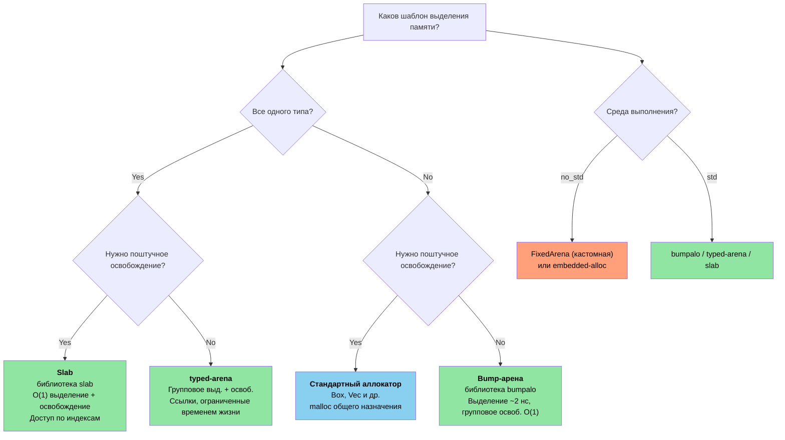

# 12. Небезопасный Rust — контролируемая опасность 🔴

> **Чему вы научитесь:**
> - Пять «суперсил» unsafe и когда каждая из них необходима
> - Написание надежных (sound) абстракций: безопасный API, небезопасная реализация
> - Шаблоны FFI для вызова C из Rust (и наоборот)
> - Распространенные ошибки, приводящие к неопределенному поведению (UB), и шаблоны аллокаторов arena/slab

## Пять суперсил unsafe

Ключевое слово `unsafe` открывает доступ к пяти операциям, безопасность которых компилятор не может гарантировать самостоятельно:

```rust
// БЕЗОПАСНОСТЬ: каждая операция поясняется ниже по тексту.
unsafe {
    // 1. Разыменование сырого указателя
    let ptr: *const i32 = &42;
    let value = *ptr; // Может быть висячим или нулевым указателем

    // 2. Вызов небезопасной функции
    let layout = std::alloc::Layout::new::<u64>();
    let mem = std::alloc::alloc(layout);

    // 3. Доступ к изменяемой статической переменной
    static mut COUNTER: u32 = 0;
    COUNTER += 1; // Состояние гонки (data race) при доступе из нескольких потоков

    // 4. Реализация небезопасного типажа
    // unsafe impl Send for MyType {}

    // 5. Доступ к полям объединения (union)
    // union IntOrFloat { i: i32, f: f32 }
    // let u = IntOrFloat { i: 42 };
    // let f = u.f; // Реинтерпретация битов — может быть мусором
}
```

> **Ключевой принцип**: `unsafe` не отключает проверку заимствований или систему типов.
> Он разблокирует только эти пять конкретных возможностей. Все остальные правила Rust продолжают действовать.

### Написание надежных абстракций

Цель `unsafe` заключается в построении **безопасных абстракций** вокруг небезопасных операций:

```rust
/// Буфер фиксированной емкости, расположенный на стеке.
/// Все публичные методы безопасны — unsafe-код инкапсулирован.
pub struct StackBuf<T, const N: usize> {
    data: [std::mem::MaybeUninit<T>; N],
    len: usize,
}

impl<T, const N: usize> StackBuf<T, N> {
    pub fn new() -> Self {
        StackBuf {
            // Каждый элемент по отдельности инициализируется как MaybeUninit — unsafe не требуется.
            // Блоки `const { ... }` (Rust 1.79+) позволяют повторить не реализующее Copy
            // константное выражение N раз.
            data: [const { std::mem::MaybeUninit::uninit() }; N],
            len: 0,
        }
    }

    pub fn push(&mut self, value: T) -> Result<(), T> {
        if self.len >= N {
            return Err(value); // Буфер заполнен — возвращаем значение вызывающему коду
        }
        // SAFETY: len < N, поэтому data[len] находится в пределах границ.
        // Мы записываем корректное значение типа T в ячейку MaybeUninit.
        self.data[self.len] = std::mem::MaybeUninit::new(value);
        self.len += 1;
        Ok(())
    }

    pub fn get(&self, index: usize) -> Option<&T> {
        if index < self.len {
            // SAFETY: index < len, и все элементы data[0..len] инициализированы.
            Some(unsafe { self.data[index].assume_init_ref() })
        } else {
            None
        }
    }
}

impl<T, const N: usize> Drop for StackBuf<T, N> {
    fn drop(&mut self) {
        // SAFETY: элементы data[0..len] инициализированы — корректно освобождаем их (drop).
        for i in 0..self.len {
            unsafe { self.data[i].assume_init_drop(); }
        }
    }
}
```

**Три правила надежного (sound) unsafe-кода**:
1. **Документируйте инварианты** — каждый комментарий `// SAFETY:` объясняет, почему операция безопасна и корректна
2. **Инкапсулируйте** — небезопасный код должен находиться внутри безопасного API, чтобы пользователи не могли вызвать UB
3. **Минимизируйте** — делайте блоки `unsafe` как можно меньше

### Шаблоны FFI: вызов C из Rust

```rust
// Объявляем сигнатуру C-функции:
extern "C" {
    fn strlen(s: *const std::ffi::c_char) -> usize;
    fn printf(format: *const std::ffi::c_char, ...) -> std::ffi::c_int;
}

// Safe wrapper:
fn safe_strlen(s: &str) -> usize {
    let c_string = std::ffi::CString::new(s).expect("строка содержит нуль-символ");
    // SAFETY: c_string является корректной строкой с завершающим нулем, существующей во время вызова.
    unsafe { strlen(c_string.as_ptr()) }
}

// Вызов Rust из C (экспорт функции):
#[no_mangle]
pub extern "C" fn rust_add(a: i32, b: i32) -> i32 {
    a + b
}
```

**Общие типы FFI**:

| Тип Rust | Тип C | Примечания |
|------|---|-------|
| `i32` / `u32` | `int32_t` / `uint32_t` | Фиксированная разрядность, безопасно |
| `*const T` / `*mut T` | `const T*` / `T*` | Сырые указатели |
| `std::ffi::CStr` | `const char*` (заимствованная) | Завершается нулем, заимствуется |
| `std::ffi::CString` | `char*` (владеющая) | Завершается нулем, владеет памятью |
| `std::ffi::c_void` | `void` | Целевой тип для непрозрачного (opaque) указателя |
| `Option<fn(...)>` | Указатель на функцию, который может быть NULL | `None` соответствует значению NULL |

### Распространенные ловушки неопределенного поведения (UB)

| Ловушка (Pitfall) | Пример | Почему это приводит к UB |
|---------|---------|------------|
| Разыменование нулевого указателя | `*std::ptr::null::<i32>()` | Разыменование NULL всегда является UB |
| Висячий указатель (Dangling pointer) | Разыменование после `drop()` | Память может быть переиспользована |
| Состояние гонки данных (Data race) | Два потока пишут в `static mut` | Несинхронизированная параллельная запись |
| Неверный `assume_init` | `MaybeUninit::<String>::uninit().assume_init()` | Чтение неинициализированной памяти. **Примечание**: `[const { MaybeUninit::uninit() }; N]` (Rust 1.79+) — это безопасный способ создать массив `MaybeUninit`, для которого не требуется `unsafe` или `assume_init` (см. `StackBuf::new()` выше). |
| Нарушение псевдонимов (Aliasing violation) | Создание двух ссылок `&mut` на одни и те же данные | Нарушает модель сдерживания псевдонимов Rust |
| Недопустимое значение перечисления | `std::mem::transmute::<u8, bool>(2)` | Значение `bool` может быть только 0 или 1 |

> **Когда использовать `unsafe` в production**:
> - Границы FFI (вызов кода на C/C++)
> - Критичные к производительности внутренние циклы (во избежание проверок границ)
> - Разработка базовых примитивов (`Vec`, `HashMap` используют unsafe внутри)
> - Избегайте использования в прикладной логике приложений

### Пользовательские аллокаторы — шаблоны Arena и Slab

В языке C для оптимизации выделения памяти часто пишут замены стандартной функции `malloc()` —
аллокаторы арены (arena allocators), освобождающие всю память за раз, slab-аллокаторы для объектов фиксированного размера
или пулы объектов для высоконагруженных систем. Rust предоставляет аналогичные возможности посредством
типажа `GlobalAlloc` и сторонних библиотек, добавляя к этому безопасность времен жизни (lifetimes),
что позволяет **предотвратить ошибки использования памяти после освобождения (use-after-free) еще на этапе компиляции**.

#### Аллокаторы арены (Arena Allocators) — групповое выделение и освобождение памяти

Арена выделяет память, просто сдвигая указатель вперед. Отдельные объекты внутри нее нельзя освободить —
вся арена освобождается за один раз. Это идеально подходит для распределения памяти под нужды конкретного HTTP-запроса или
отдельного кадра в графическом приложении:

```rust
use bumpalo::Bump;

fn process_sensor_frame(raw_data: &[u8]) {
    // Создаем арену для выделения памяти под этот кадр
    let arena = Bump::new();

    // Выделяем объекты на арене — около 2 нс на каждый (простой сдвиг указателя)
    let header = arena.alloc(parse_header(raw_data));
    let readings: &mut [f32] = arena.alloc_slice_fill_default(header.sensor_count);

    for (i, chunk) in raw_data[header.payload_offset..].chunks(4).enumerate() {
        if i < readings.len() {
            readings[i] = f32::from_le_bytes(chunk.try_into().unwrap());
        }
    }

    // Используем показатели...
    let avg = readings.iter().sum::<f32>() / readings.len() as f32;
    println!("Среднее по кадру: {avg:.2}");

    // `arena` выходит из области видимости — ВСЕ выделения освобождаются одновременно за O(1)
    // Без накладных расходов на вызов деструктора для каждого объекта и без фрагментации памяти
}
# fn parse_header(_: &[u8]) -> Header { Header { sensor_count: 4, payload_offset: 8 } }
# struct Header { sensor_count: usize, payload_offset: usize }
```

**Арена против стандартного аллокатора**:

| Аспект | `Vec::new()` / `Box::new()` | Арена `Bump` |
|--------|---------------------------|--------------|
| Скорость выделения | ~25 нс (malloc) | ~2 нс (сдвиг указателя) |
| Скорость освобождения | Деструктор для каждого объекта | Групповое освобождение за O(1) |
| Фрагментация | Да (в долгоживущих процессах) | Отсутствует внутри арены |
| Безопасность времен жизни | Куча — освобождается при `Drop` | Ссылка на арену — ограничена временем жизни компилятором |
| Сценарий использования | Общего назначения | Обработка запросов/кадров/пакетов |

#### `typed-arena` — типизированная арена

Когда все объекты арены имеют один и тот же тип, библиотека `typed-arena` предоставляет более простой API,
который возвращает ссылки, привязанные ко времени жизни арены:

```rust
use typed_arena::Arena;

struct AstNode<'a> {
    value: i32,
    children: Vec<&'a AstNode<'a>>,
}

fn build_tree() {
    let arena: Arena<AstNode<'_>> = Arena::new();

    // Выделяем память под узлы — возвращает &AstNode, связанный со временем жизни арены
    let root = arena.alloc(AstNode { value: 1, children: vec![] });
    let left = arena.alloc(AstNode { value: 2, children: vec![] });
    let right = arena.alloc(AstNode { value: 3, children: vec![] });

    // Строим дерево — все ссылки валидны, пока жива `arena`
    // (Для изменяемых деревьев требуется внутренняя изменяемость (interior mutability))

    println!("Root: {}, Left: {}, Right: {}", root.value, left.value, right.value);

    // `arena` выходит из области видимости — все узлы освобождаются одновременно
}
```

#### Slab-аллокаторы (Slab Allocators) — пулы объектов фиксированного размера

Slab-аллокатор предварительно выделяет пул ячеек фиксированного размера. Объекты распределяются
и освобождаются индивидуально, но все ячейки имеют один и тот же размер, что устраняет
фрагментацию и обеспечивает выделение и освобождение памяти за O(1):

```rust
use slab::Slab;

struct Connection {
    id: u64,
    buffer: [u8; 1024],
    active: bool,
}

fn connection_pool_example() {
    // Предварительно выделяем память под slab для подключений
    let mut connections: Slab<Connection> = Slab::with_capacity(256);

    // Вставка возвращает ключ (индекс типа usize) — O(1)
    let key1 = connections.insert(Connection {
        id: 1001,
        buffer: [0; 1024],
        active: true,
    });

    let key2 = connections.insert(Connection {
        id: 1002,
        buffer: [0; 1024],
        active: true,
    });

    // Доступ по ключу — O(1)
    if let Some(conn) = connections.get_mut(key1) {
        conn.buffer[0..5].copy_from_slice(b"hello");
    }

    // Удаление возвращает значение — O(1), ячейка переиспользуется для следующей вставки
    let removed = connections.remove(key2);
    assert_eq!(removed.id, 1002);

    // Следующая вставка переиспользует освобожденную ячейку — нет фрагментации
    let key3 = connections.insert(Connection {
        id: 1003,
        buffer: [0; 1024],
        active: true,
    });
    assert_eq!(key3, key2); // Переиспользуется та же ячейка!
}
```

#### Реализация минимальной арены (для `no_std`)

Для сред с низкоуровневым программированием (bare-metal), где нет возможности использовать `bumpalo`, ниже приведена
минимальная реализация арены на основе `unsafe`:

```rust
#![cfg_attr(not(test), no_std)]

use core::alloc::Layout;
use core::cell::{Cell, UnsafeCell};

/// Простой bump-аллокатор, использующий массив байт фиксированного размера.
/// Не потокобезопасен — используйте для каждого ядра отдельно или под блокировкой в многопоточных средах.
///
/// **Важно**: как и `bumpalo`, эта арена НЕ вызывает деструкторы для
/// выделенных объектов при удалении арены. Типы с реализацией `Drop` будут
/// приводить к утечке ресурсов (дескрипторов файлов, сокетов и т.д.). Выделяйте только типы
/// без значимой реализации `Drop` или вручную вызывайте drop до освобождения арены.
pub struct FixedArena<const N: usize> {
    // Здесь ОБЯЗАТЕЛЕН UnsafeCell: мы мутируем `buf` через `&self`.
    // Без UnsafeCell приведение &self.buf to *mut u8 вызвало бы UB
    // (нарушение модели сдерживания псевдонимов Rust — общая ссылка подразумевает неизменяемость).
    buf: UnsafeCell<[u8; N]>,
    offset: Cell<usize>, // Внутренняя изменяемость для выделения памяти через &self
}

impl<const N: usize> FixedArena<N> {
    pub const fn new() -> Self {
        FixedArena {
            buf: UnsafeCell::new([0; N]),
            offset: Cell::new(0),
        }
    }

    /// Выделяет `T` на арене. Возвращает `None`, если закончилось место.
    pub fn alloc<T>(&self, value: T) -> Option<&mut T> {
        let layout = Layout::new::<T>();
        let current = self.offset.get();

        // Выравнивание вверх
        let aligned = (current + layout.align() - 1) & !(layout.align() - 1);
        let new_offset = aligned + layout.size();

        if new_offset > N {
            return None; // Арена заполнена
        }

        self.offset.set(new_offset);

        // БЕЗОПАСНОСТЬ:
        // - `aligned` находится в пределах границ `buf` (проверено выше)
        // - Выравнивание верное (выровнено под требования T)
        // - Отсутствие псевдонимов: каждое выделение возвращает уникальную, неперекрывающуюся область
        // - UnsafeCell дает разрешение на изменение через &self
        // - Арена переживает возвращенную ссылку (вызывающий код должен это гарантировать)
        let ptr = unsafe {
            let base = (self.buf.get() as *mut u8).add(aligned);
            let typed = base as *mut T;
            typed.write(value);
            &mut *typed
        };

        Some(ptr)
    }

    /// Сбросить арену — делает все предыдущие выделения памяти недействительными.
    ///
    /// # Safety
    /// Вызывающий код должен гарантировать отсутствие существующих ссылок на выделенные на арене данные.
    pub unsafe fn reset(&self) {
        self.offset.set(0);
    }

    pub fn used(&self) -> usize {
        self.offset.get()
    }

    pub fn remaining(&self) -> usize {
        N - self.offset.get()
    }
}
```

#### Выбор стратегии выделения памяти

> **Примечание**: Диаграмма ниже использует синтаксис Mermaid. Она отрисовывается на GitHub и в
> инструментах с поддержкой Mermaid (например, mdBook с плагином `mermaid` или VS Code с
> расширением Mermaid). В обычных средствах просмотра Markdown будет отображаться ее исходный код.



| Шаблон в C | Эквивалент в Rust | Ключевое преимущество |
|-----------|----------------|---------------|
| Кастомный пул `malloc()` | Реализация `#[global_allocator]` | Типобезопасный, поддается отладке |
| `obstack` (GNU) | `bumpalo::Bump` | Ограничен временем жизни, нет use-after-free |
| Ядерный slab (`kmem_cache`) | `slab::Slab<T>` | Типобезопасный, с доступом по индексам |
| Временный буфер на стеке | `FixedArena<N>` (см. выше) | Без кучи, конструируется как `const` |
| `alloca()` | `[T; N]` или `SmallVec` | Размер определяется при компиляции, нет UB |

> **Перекрестная ссылка**: Инструкции по настройке аллокатора для систем без ОС (bare-metal) (`#[global_allocator]` с
> `embedded-alloc`) см. в *Обучении Rust для C-программистов*, Глава 15.1
> «Global Allocator Setup», где рассматривается специфический для встраиваемых систем процесс инициализации.

> **Основные выводы — Небезопасный Rust**
> - Документируйте инварианты (комментарии `SAFETY:`), инкапсулируйте небезопасный код за безопасными API, минимизируйте область действия unsafe.
> - `[const { MaybeUninit::uninit() }; N]` (Rust 1.79+) заменяет старый антипаттерн с использованием `assume_init`.
> - Для FFI требуются конструкции `extern "C"`, `#[repr(C)]` и тщательная обработка нулевых указателей и времен жизни.
> - Арены и slab-аллокаторы жертвуют гибкостью общего назначения ради скорости выделения памяти.

> **См. также:** [Глава 4 — PhantomData](ch04-phantomdata-types-that-carry-no-data.md) для изучения дисперсии (variance) и взаимодействия drop-check с небезопасным кодом. [Глава 8 — Умные указатели](ch09-smart-pointers-and-interior-mutability.md) для изучения Pin и самоссылающихся типов.

---

### Упражнение: Безопасная обёртка над unsafe-кодом ★★★ (~45 мин)

Напишите структуру `FixedVec<T, const N: usize>` — вектор фиксированной емкости, расположенный на стеке.
Требования:
- `push(&mut self, value: T) -> Result<(), T>` возвращает `Err(value)`, если вектор заполнен
- `pop(&mut self) -> Option<T>` извлекает и удаляет последний элемент
- `as_slice(&self) -> &[T]` возвращает заимствование для инициализированных элементов
- Все публичные методы должны быть безопасными; весь небезопасный код должен быть инкапсулирован с комментариями `SAFETY:`
- Реализация типажа `Drop` должна освобождать ресурсы инициализированных элементов

<details>
<summary>🔑 Решение</summary>

```rust
use std::mem::MaybeUninit;

pub struct FixedVec<T, const N: usize> {
    data: [MaybeUninit<T>; N],
    len: usize,
}

impl<T, const N: usize> FixedVec<T, N> {
    pub fn new() -> Self {
        FixedVec {
            data: [const { MaybeUninit::uninit() }; N],
            len: 0,
        }
    }

    pub fn push(&mut self, value: T) -> Result<(), T> {
        if self.len >= N { return Err(value); }
        // SAFETY: len < N, поэтому data[len] находится в пределах границ.
        self.data[self.len] = MaybeUninit::new(value);
        self.len += 1;
        Ok(())
    }

    pub fn pop(&mut self) -> Option<T> {
        if self.len == 0 { return None; }
        self.len -= 1;
        // SAFETY: элемент data[len] был инициализирован (len была > 0 перед уменьшением).
        Some(unsafe { self.data[self.len].assume_init_read() })
    }

    pub fn as_slice(&self) -> &[T] {
        // SAFETY: элементы data[0..len] инициализированы, а MaybeUninit<T>
        // имеет такое же расположение в памяти, как и T.
        unsafe { std::slice::from_raw_parts(self.data.as_ptr() as *const T, self.len) }
    }

    pub fn len(&self) -> usize { self.len }
    pub fn is_empty(&self) -> bool { self.len == 0 }
}

impl<T, const N: usize> Drop for FixedVec<T, N> {
    fn drop(&mut self) {
        // SAFETY: элементы data[0..len] инициализированы — освобождаем каждый из них.
        for i in 0..self.len {
            unsafe { self.data[i].assume_init_drop(); }
        }
    }
}

fn main() {
    let mut v = FixedVec::<String, 4>::new();
    v.push("hello".into()).unwrap();
    v.push("world".into()).unwrap();
    assert_eq!(v.as_slice(), &["hello", "world"]);
    assert_eq!(v.pop(), Some("world".into()));
    assert_eq!(v.len(), 1);
}
```

</details>

***
