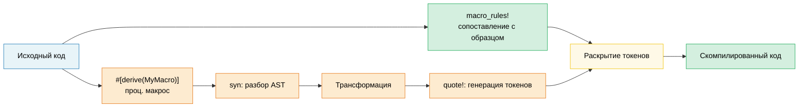

# 13. Макросы — код, который пишет код 🟡

> **Чему вы научитесь:**
> - Декларативные макросы (`macro_rules!`) с сопоставлением с образцом и повторениями
> - Когда макросы — подходящий инструмент, в отличие от обобщений (generics) и типажей (traits)
> - Процедурные макросы: derive, атрибуты и функциональные макросы
> - Написание собственного derive-макроса с помощью библиотек `syn` и `quote`

## Декларативные макросы (macro_rules!)

Макросы сопоставляют шаблоны синтаксиса и разворачиваются в код на этапе компиляции:

```rust
// Простой макрос для создания HashMap
macro_rules! hashmap {
    // Шаблон: пары ключ => значение, разделенные запятыми
    ( $( $key:expr => $value:expr ),* $(,)? ) => {
        {
            let mut map = std::collections::HashMap::new();
            $( map.insert($key, $value); )*
            map
        }
    };
}

let scores = hashmap! {
    "Alice" => 95,
    "Bob" => 87,
    "Carol" => 92,
};
// Разворачивается в:
// let mut map = HashMap::new();
// map.insert("Alice", 95);
// map.insert("Bob", 87);
// map.insert("Carol", 92);
// map
```

**Типы фрагментов макросов (спецификаторы)**:

| Фрагмент | Что сопоставляет | Пример |
|----------|---------|---------|
| `$x:expr` | Любое выражение | `42`, `a + b`, `foo()` |
| `$x:ty` | Тип | `i32`, `Vec<String>` |
| `$x:ident` | Идентификатор | `my_var`, `Config` |
| `$x:pat` | Шаблон | `Some(x)`, `_` |
| `$x:stmt` | Инструкция (statement) | `let x = 5;` |
| `$x:tt` | Одиночное дерево токенов (token tree) | Всё что угодно (самый гибкий вариант) |
| `$x:literal` | Литерал | `42`, `"hello"`, `true` |

**Повторение**: `$( ... ),*` означает «ноль или более элементов, разделенных запятой»

```rust
// Автоматическая генерация тестовых функций
macro_rules! test_cases {
    ( $( $name:ident: $input:expr => $expected:expr ),* $(,)? ) => {
        $(
            #[test]
            fn $name() {
                assert_eq!(process($input), $expected);
            }
        )*
    };
}

test_cases! {
    test_empty: "" => "",
    test_hello: "hello" => "HELLO",
    test_trim: "  spaces  " => "SPACES",
}
// Генерирует три отдельные функции #[test]
```

### Когда стоит (и не стоит) использовать макросы

**Используйте макросы, когда нужно**:
- Сократить шаблонный код (boilerplate), с которым не справляются типажи/обобщения (функции с переменным числом аргументов, неповторяющаяся (DRY) генерация тестов)
- Создать предметно-ориентированные языки, DSL (`html!`, `sql!`, `vec!`)
- Выполнить условную генерацию кода (`cfg!`, `compile_error!`)

**Не используйте макросы, когда**:
- Достаточно обычной функции или обобщенного кода (макросы сложнее отлаживать, автодополнение для них не работает)
- Требуется проверка типов внутри макроса (макросы работают на уровне токенов, а не типов)
- Шаблон используется всего один или два раза (это не окупает затрат на создание абстракции)

```rust
// ❌ Ненужный макрос — обычная функция отлично справится:
macro_rules! double {
    ($x:expr) => { $x * 2 };
}

// ✅ Просто используйте функцию:
fn double(x: i32) -> i32 { x * 2 }

// ✅ Хороший пример использования макроса — переменное число аргументов, функция так не умеет:
macro_rules! println {
    ($($arg:tt)*) => { /* строка форматирования + аргументы */ };
}
```

### Обзор процедурных макросов

Процедурные макросы представляют собой функции Rust, преобразующие потоки токенов (token streams). Для них требуется отдельный пакет (crate) с флагом `proc-macro = true` в настройках:

```rust
// Три типа процедурных макросов:

// 1. Derive-макросы — #[derive(MyTrait)]
// Генерируют реализации типажей на основе определений структур
#[derive(Debug, Clone, Serialize, Deserialize)]
struct Config {
    name: String,
    port: u16,
}

// 2. Атрибутные макросы (Attribute macros) — #[my_attribute]
// Преобразуют элемент, к которому они применены
#[route(GET, "/api/users")]
async fn list_users() -> Json<Vec<User>> { /* ... */ }

// 3. Функциональные макросы — my_macro!(...)
// Пользовательский синтаксис
let query = sql!(SELECT * FROM users WHERE id = ?);
```

### Практическое применение макросов Derive

Это самый распространенный тип процедурных макросов. Ниже показано, как концептуально работает `#[derive(Debug)]`:

```rust
// Входные данные (ваша структура):
#[derive(Debug)]
struct Point {
    x: f64,
    y: f64,
}

// Макрос derive генерирует следующее:
impl std::fmt::Debug for Point {
    fn fmt(&self, f: &mut std::fmt::Formatter<'_>) -> std::fmt::Result {
        f.debug_struct("Point")
            .field("x", &self.x)
            .field("y", &self.y)
            .finish()
    }
}
```

**Наиболее часто используемые макросы derive**:

| Макрос | Библиотека | Что он генерирует |
|--------|-------|-------------------|
| `Debug` | std | Реализацию `fmt::Debug` (вывод отладочной информации) |
| `Clone`, `Copy` | std | Дублирование значения |
| `PartialEq`, `Eq` | std | Сравнение на равенство |
| `Hash` | std | Хеширование ключей для HashMap |
| `Serialize`, `Deserialize` | serde | Кодирование данных в JSON/YAML/и т. д. |
| `Error` | thiserror | Реализацию `std::error::Error` + `Display` |
| `Parser` | `clap` | Разбор аргументов командной строки (CLI) |
| `Builder` | derive_builder | Шаблон «Строитель» (Builder pattern) |

> **Практический совет**: Свободно используйте макросы derive — они избавляют вас от написания шаблонного
> кода, в котором легко сделать ошибку. Написание собственных процедурных макросов — сложная тема; используйте
> готовые решения (`serde`, `thiserror`, `clap`), прежде чем пытаться создавать собственные.

### Гигиена макросов и `$crate`

**Гигиена** означает, что идентификаторы, созданные внутри макроса, не конфликтуют с
идентификаторами в области видимости вызывающего кода. Конструкция `macro_rules!` в Rust является *частично* гигиеничной:

```rust
macro_rules! make_var {
    () => {
        let x = 42; // Эта переменная 'x' находится в области видимости МАКРОСА
    };
}

fn main() {
    let x = 10;
    make_var!();   // Создает другую переменную 'x' (гигиенично)
    println!("{x}"); // Печатает 10, а не 42 — переменная x из макроса не утекает наружу
}
```

**`$crate`**: При написании макросов в библиотеке используйте `$crate` для ссылки на
собственный пакет (crate) — этот маркер разрешается корректно независимо от того, как именно пользователи импортируют вашу библиотеку:

```rust
// В пакете my_diagnostics:

pub fn log_result(msg: &str) {
    println!("[diag] {msg}");
}

#[macro_export]
macro_rules! diag_log {
    ($($arg:tt)*) => {
        // ✅ $crate всегда разрешается в my_diagnostics, даже если пользователь
        // переименовал пакет в своем файле Cargo.toml
        $crate::log_result(&format!($($arg)*))
    };
}

// ❌ Без использования $crate:
// my_diagnostics::log_result(...)  ← сломается, если пользователь напишет:
//   [dependencies]
//   diag = { package = "my_diagnostics", version = "1" }
```

> **Правило**: Всегда используйте префикс `$crate::` в макросах с атрибутом `#[macro_export]`. Никогда не используйте
> имя пакета напрямую.

### Рекурсивные макросы и `tt`-munching (поедание токенов)

Рекурсивные макросы обрабатывают входные данные по одному токену за раз — этот прием называется
**`tt` munching** (поедание дерева токенов):

```rust
// Подсчитываем количество выражений, переданных в макрос
macro_rules! count {
    // Базовый случай: токенов не осталось
    () => { 0usize };
    // Рекурсивный случай: поглощаем одно выражение, считаем остальные
    ($head:expr $(, $tail:expr)* $(,)?) => {
        1usize + count!($($tail),*)
    };
}

fn main() {
    let n = count!("a", "b", "c", "d");
    assert_eq!(n, 4);

    // Работает также и на этапе компиляции:
    const N: usize = count!(1, 2, 3);
    assert_eq!(N, 3);
}
```

```rust
// Сборка гетерогенного кортежа из списка выражений:
macro_rules! tuple_from {
    // Базовый случай: единственный элемент
    ($single:expr $(,)?) => { ($single,) };
    // Рекурсивный случай: первый элемент + остальные
    ($head:expr, $($tail:expr),+ $(,)?) => {
        ($head, tuple_from!($($tail),+))
    };
}

let t = tuple_from!(1, "hello", 3.14, true);
// Разворачивается в: (1, ("hello", (3.14, (true,))))
```

**Тонкости работы со спецификаторами фрагментов**:

| Спецификатор | Подводный камень (Gotcha) |
|----------|--------|
| `$x:expr` | Разбирает жадно — выражение `1 + 2` считается ОДНИМ выражением, а не тремя токенами |
| `$x:ty` | Разбирает жадно — `Vec<String>` считается одним типом; после него не могут следовать `+` или `<` |
| `$x:tt` | Сопоставляет ровно ОДНО дерево токенов — самый гибкий вариант, минимум проверок |
| `$x:ident` | Только простые идентификаторы — не пути вида `std::io` |
| `$x:pat` | В редакции Rust 2021 сопоставляет шаблоны вида `A \| B`; используйте `$x:pat_param` для одиночных шаблонов |

> **Когда использовать `tt`**: Когда нужно перенаправить токены в другой макрос без
> ограничений парсера. Шаблон `$($args:tt)*` означает «принимать всё»
> (используется в `println!`, `format!`, `vec!`).

### Написание макроса Derive с использованием библиотек `syn` и `quote`

Макросы derive располагаются в отдельном пакете (`proc-macro = true`) и преобразуют
поток токенов с помощью библиотек `syn` (для парсинга кода Rust) и `quote` (для генерации кода Rust):

```toml
# my_derive/Cargo.toml
[lib]
proc-macro = true

[dependencies]
syn = { version = "2", features = ["full"] }
quote = "1"
proc-macro2 = "1"
```

```rust
// my_derive/src/lib.rs
use proc_macro::TokenStream;
use quote::quote;
use syn::{parse_macro_input, DeriveInput};

/// Derive-макрос, генерирующий метод `describe()`,
/// возвращающий имя структуры и имена ее полей.
#[proc_macro_derive(Describe)]
pub fn derive_describe(input: TokenStream) -> TokenStream {
    let input = parse_macro_input!(input as DeriveInput);
    let name = &input.ident;
    let name_str = name.to_string();

    // Извлекаем имена полей (только для структур с именованными полями)
    let fields = match &input.data {
        syn::Data::Struct(data) => {
            data.fields.iter()
                .filter_map(|f| f.ident.as_ref())
                .map(|id| id.to_string())
                .collect::<Vec<_>>()
        }
        _ => vec![],
    };

    let field_list = fields.join(", ");

    let expanded = quote! {
        impl #name {
            pub fn describe() -> String {
                format!("{} {{ {} }}", #name_str, #field_list)
            }
        }
    };

    TokenStream::from(expanded)
}
```

```rust
// В пакете приложения:
use my_derive::Describe;

#[derive(Describe)]
struct SensorReading {
    sensor_id: u16,
    value: f64,
    timestamp: u64,
}

fn main() {
    println!("{}", SensorReading::describe());
    // "SensorReading { sensor_id, value, timestamp }"
}
```

**Рабочий процесс (Workflow)**: `TokenStream` (сырые токены) → `syn::parse` (абстрактное синтаксическое дерево, AST) →
анализ/трансформация → `quote!` (генерация токенов) → `TokenStream` (возврат компилятору).

| Библиотека | Роль | Ключевые типы |
|-------|------|-----------|
| `proc-macro` | Интерфейс компилятора | `TokenStream` |
| `syn` | Парсинг исходного кода Rust в AST | `DeriveInput`, `ItemFn`, `Type` |
| `quote` | Генерация токенов Rust из шаблонов | `quote!{}`, подстановка переменных `#variable` |
| `proc-macro2` | Мост между syn/quote and proc-macro | `TokenStream`, `Span` |

> **Практический совет**: Прежде чем приступать к написанию собственных макросов, изучите исходный код простого derive-макроса,
> например `thiserror` или `derive_more`. Команда
> `cargo expand` (с помощью утилиты `cargo-expand`) показывает результат работы любого макроса,
> что невероятно полезно при отладке.

> **Основные выводы — Макросы**
> - Используйте `macro_rules!` для простой генерации кода; процедурные макросы (`syn` + `quote`) — для сложной генерации (derives).
> - По возможности предпочитайте макросам типажи и обобщения (traits/generics) — макросы гораздо сложнее отлаживать и поддерживать.
> - Использование `$crate` обеспечивает гигиеничность макросов; прием `tt` munching позволяет делать рекурсивное сопоставление с образцом.

> **См. также:** [Глава 2 — Подробно о типажах](ch02-traits-in-depth.md) (когда типажи/обобщения предпочтительнее макросов). [Глава 13 — Тестирование](ch14-testing-and-benchmarking-patterns.md) для тестирования сгенерированного макросами кода.



---

### Упражнение: Декларативный макрос — `map!` ★ (~15 мин)

Напишите макрос `map!`, создающий `HashMap` из пар ключ-значение:

```rust,ignore
let m = map! {
    "host" => "localhost",
    "port" => "8080",
};
assert_eq!(m.get("host"), Some(&"localhost"));
```

Требования: поддержка завершающей запятой и пустого вызова `map!{}`.

<details>
<summary>🔑 Решение</summary>

```rust
macro_rules! map {
    () => { std::collections::HashMap::new() };
    ( $( $key:expr => $val:expr ),+ $(,)? ) => {{
        let mut m = std::collections::HashMap::new();
        $( m.insert($key, $val); )+
        m
    }};
}

fn main() {
    let config = map! {
        "host" => "localhost",
        "port" => "8080",
        "timeout" => "30",
    };
    assert_eq!(config.len(), 3);
    assert_eq!(config["host"], "localhost");

    let empty: std::collections::HashMap<String, String> = map!();
    assert!(empty.is_empty());

    let scores = map! { 1 => 100, 2 => 200 };
    assert_eq!(scores[&1], 100);
}
```

</details>

***
