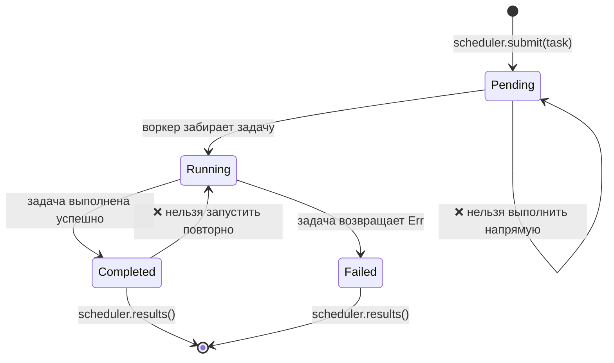

# Выпускной проект: типобезопасный планировщик задач

Этот проект объединяет паттерны со всей книги в единую систему промышленного уровня. Вы разработаете **типобезопасный конкурентный планировщик задач**, использующий обобщения, типажи, паттерн состояний типов (typestate), каналы, обработку ошибок и тестирование.

**Оценочное время**: 4–6 часов | **Сложность**: ★★★

> **Что вы закрепите на практике:**
> - Обобщения и ограничения типажей (гл. 1–2)
> - Паттерн состояний типов (typestate) для жизненного цикла задач (гл. 3)
> - Использование `PhantomData` в качестве маркеров состояния с нулевой стоимостью (гл. 4)
> - Каналы для взаимодействия между воркерами (гл. 5)
> - Конкурентность с использованием связанных потоков (scoped threads) (гл. 6)
> - Обработка ошибок с помощью `thiserror` (гл. 9)
> - Тестирование, включая тестирование на основе свойств (property-based testing) (гл. 13)
> - Проектирование API с помощью `TryFrom` и валидированных типов (гл. 14)

## Формулировка задачи

Создайте планировщик задач, в котором:

1. **Задачи** имеют типизированный жизненный цикл: `Pending → Running → Completed` (или `Failed`)
2. **Воркеры (Workers)** извлекают задачи из канала, выполняют их и сообщают о результатах
3. **Планировщик (Scheduler)** управляет отправкой задач, координацией воркеров и сбором результатов
4. Невалидные переходы между состояниями приводят к **ошибкам компиляции**



## Шаг 1: Определение типов задач

Начните с маркеров состояний типов (typestate) и обобщенной структуры `Task`:

```rust
use std::marker::PhantomData;

// --- Маркеры состояний (нулевого размера) ---
struct Pending;
struct Running;
struct Completed;
struct Failed;

// --- Идентификатор задачи Task ID (newtype для типобезопасности) ---
#[derive(Debug, Clone, Copy, PartialEq, Eq, Hash)]
struct TaskId(u64);

// --- Структура Task, параметризованная состоянием жизненного цикла ---
struct Task<State, R> {
    id: TaskId,
    name: String,
    _state: PhantomData<State>,
    _result: PhantomData<R>,
}
```

**Ваша задача**: Реализуйте переходы между состояниями так, чтобы:
- `Task<Pending, R>` могла переходить в состояние `Task<Running, R>` (с помощью метода `start()`)
- `Task<Running, R>` могла переходить в состояния `Task<Completed, R>` или `Task<Failed, R>`
- Любые другие переходы приводили к ошибке компиляции

<details>
<summary>💡 Подсказка</summary>

Каждый метод перехода должен потреблять `self` и возвращать новое состояние:

```rust
impl<R> Task<Pending, R> {
    fn start(self) -> Task<Running, R> {
        Task {
            id: self.id,
            name: self.name,
            _state: PhantomData,
            _result: PhantomData,
        }
    }
}
```

</details>

## Шаг 2: Определение рабочей функции

Задачи должны содержать выполняемую функцию. Используйте упакованное замыкание (boxed closure):

```rust
struct WorkItem<R: Send + 'static> {
    id: TaskId,
    name: String,
    work: Box<dyn FnOnce() -> Result<R, String> + Send>,
}
```

**Ваша задача**: Реализуйте функцию `WorkItem::new()`, которая принимает имя задачи и замыкание. Добавьте генератор `TaskId` (простой атомарный счетчик или счетчик, защищенный мьютексом).

## Шаг 3: Обработка ошибок

Определите типы ошибок планировщика с помощью `thiserror`:

```rust,ignore
use thiserror::Error;

#[derive(Error, Debug)]
pub enum SchedulerError {
    #[error("планировщик завершил работу")]
    ShutDown,

    #[error("задача {0:?} завершилась сбоем: {1}")]
    TaskFailed(TaskId, String),

    #[error("ошибка отправки в канал")]
    ChannelError(#[from] std::sync::mpsc::SendError<()>),

    #[error("воркер запаниковал")]
    WorkerPanic,
}
```

## Шаг 4: Планировщик

Постройте планировщик, используя каналы (глава 5 / Ch 5) и связанные потоки (глава 6 / Ch 6):

```rust
use std::sync::mpsc;

struct Scheduler<R: Send + 'static> {
    sender: Option<mpsc::Sender<WorkItem<R>>>,
    results: mpsc::Receiver<TaskResult<R>>,
    num_workers: usize,
}

struct TaskResult<R> {
    id: TaskId,
    name: String,
    outcome: Result<R, String>,
}
```

**Ваша задача**: Реализуйте:
- `Scheduler::new(num_workers: usize) -> Self` — создает каналы и запускает воркеры
- `Scheduler::submit(&self, item: WorkItem<R>) -> Result<TaskId, SchedulerError>`
- `Scheduler::shutdown(self) -> Vec<TaskResult<R>>` — уничтожает (drop) отправитель, ожидает завершения потоков воркеров (join) и собирает результаты

<details>
<summary>💡 Подсказка — Цикл воркера</summary>

```rust
fn worker_loop<R: Send + 'static>(
    rx: std::sync::Arc<std::sync::Mutex<mpsc::Receiver<WorkItem<R>>>>,
    result_tx: mpsc::Sender<TaskResult<R>>,
    worker_id: usize,
) {
    loop {
        let item = {
            let rx = rx.lock().unwrap();
            rx.recv()
        };
        match item {
            Ok(work_item) => {
                let outcome = (work_item.work)();
                let _ = result_tx.send(TaskResult {
                    id: work_item.id,
                    name: work_item.name,
                    outcome,
                });
            }
            Err(_) => break, // Канал закрыт
        }
    }
}
```

</details>

## Шаг 5: Интеграционный тест

Напишите тесты, проверяющие следующие сценарии:

1. **Основной успешный сценарий (Happy path)**: Отправьте 10 задач, завершите работу планировщика, убедитесь, что все 10 результатов вернули статус `Ok`
2. **Обработка ошибок**: Отправьте задачи, завершающиеся ошибкой, и убедитесь, что `TaskResult.outcome` содержит `Err`
3. **Пустой планировщик**: Создайте планировщик и сразу завершите его работу — программа не должна паниковать
4. **Тест на основе свойств (Property test)** (бонус): Используйте библиотеку `proptest`, чтобы убедиться, что для любого количества задач N (от 1 до 100) планировщик всегда возвращает ровно N результатов

```rust
#[cfg(test)]
mod tests {
    use super::*;

    #[test]
    fn happy_path() {
        let scheduler = Scheduler::<String>::new(4);

        for i in 0..10 {
            let item = WorkItem::new(
                format!("task-{i}"),
                move || Ok(format!("result-{i}")),
            );
            scheduler.submit(item).unwrap();
        }

        let results = scheduler.shutdown();
        assert_eq!(results.len(), 10);
        for r in &results {
            assert!(r.outcome.is_ok());
        }
    }

    #[test]
    fn handles_failures() {
        let scheduler = Scheduler::<String>::new(2);

        scheduler.submit(WorkItem::new("good", || Ok("ok".into()))).unwrap();
        scheduler.submit(WorkItem::new("bad", || Err("boom".into()))).unwrap();

        let results = scheduler.shutdown();
        assert_eq!(results.len(), 2);

        let failures: Vec<_> = results.iter()
            .filter(|r| r.outcome.is_err())
            .collect();
        assert_eq!(failures.len(), 1);
    }
}
```

## Шаг 6: Собираем все вместе

Ниже приведен код функции `main()`, демонстрирующий работу всей системы в сборе:

```rust,ignore
fn main() {
    let scheduler = Scheduler::<String>::new(4);

    // Отправляем задачи с различной нагрузкой
    for i in 0..20 {
        let item = WorkItem::new(
            format!("compute-{i}"),
            move || {
                // Имитируем работу
                std::thread::sleep(std::time::Duration::from_millis(10));
                if i % 7 == 0 {
                    Err(format!("task {i} hit a simulated error"))
                } else {
                    Ok(format!("task {i} completed with value {}", i * i))
                }
            },
        );
        // ПРИМЕЧАНИЕ: .unwrap() используется для краткости — в продакшене обрабатывайте SendError.
        scheduler.submit(item).unwrap();
    }

    println!("All tasks submitted. Shutting down...");
    let results = scheduler.shutdown();

    let (ok, err): (Vec<_>, Vec<_>) = results.iter()
        .partition(|r| r.outcome.is_ok());

    println!("\n✅ Succeeded: {}", ok.len());
    for r in &ok {
        println!("  {} → {}", r.name, r.outcome.as_ref().unwrap());
    }

    println!("\n❌ Failed: {}", err.len());
    for r in &err {
        println!("  {} → {}", r.name, r.outcome.as_ref().unwrap_err());
    }
}
```

## Критерии оценки

| Критерий | Ожидаемый результат |
|-----------|--------|
| Типобезопасность | Невалидные переходы состояний не компилируются |
| Конкурентность | Воркеры выполняются параллельно, нет гонок данных (data races) |
| Обработка ошибок | Все сбои сохраняются в `TaskResult`, отсутствие паник |
| Тестирование | Как минимум 3 теста; бонус за использование proptest |
| Организация кода | Чистая структура модулей, публичный API использует валидированные типы |
| Документация | Ключевые типы содержат комментарии документации, объясняющие инварианты |

## Идеи для расширения проекта

После того как базовый планировщик заработает, попробуйте реализовать следующие улучшения:

1. **Очередь с приоритетами**: Добавьте новый тип `Priority` (1–10) и обрабатывайте задачи с более высоким приоритетом в первую очередь
2. **Политика повторных попыток (Retry policy)**: Повторяйте запуск упавших задач до N раз, прежде чем пометить их окончательно сбойными
3. **Отмена задач**: Добавьте метод `cancel(TaskId)`, удаляющий ожидающие выполнения задачи
4. **Асинхронная версия**: Перепишите проект с использованием `tokio::spawn` и каналов `tokio::sync::mpsc` (глава 15 / Ch 15)
5. **Метрики**: Отслеживайте количество задач на каждого воркера, среднее время выполнения и частоту ошибок

***
